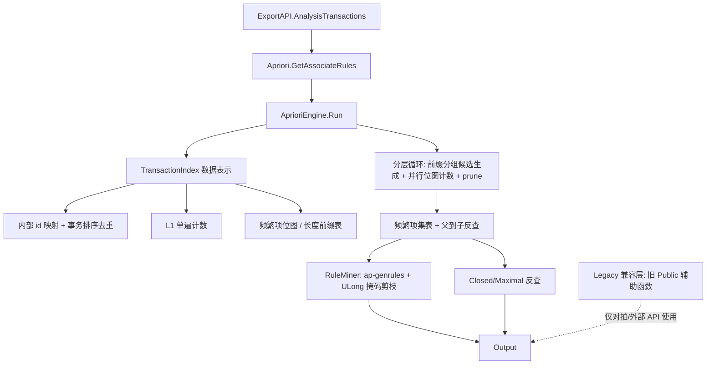

## 产品概述

对 `Data_science/DataMining/DataMining/AprioriRules` 中现有的 Apriori 关联规则挖掘实现做性能审查与优化：在**不改变对外 API 与结果集合**的前提下，重写热路径，使其能在大型事务数据集上实用；同时把 `DataMining/test` 工程升级为 net10.0 的 SDK 风格工程，用于承载等价性对拍与基准测试。

## 核心功能

1. **支持度计数重写**：把「逐候选 × 逐事务 × 逐元素线性 Contains」改为「事务按长度降序排列 + 分层位图（bitset）按字 AND + PopCount」，并按层截断字数、缓存组内前缀掩码、跳过空字。
2. **L1 与候选生成重写**：L1 由「每项扫全库」改为单遍横向计数；候选生成改为按前缀分组的组内两两拼接，去掉每个候选都要做一次的 `OrderBy` 排序与候选对象分配，并补上 Apriori 的 prune 步骤。
3. **闭项集/极大项集重写**：由「每项扫全部频繁项集 + 每次全量 ToArray」的 O(F²·k) 改为「由父项集反查子项集」的 O(F·k²)。
4. **规则生成重写**：采用 ap-genrules，子集用 ULong 位掩码表示，带置信度单调性剪枝，只为达标的规则分配对象，取消 `HashSet(Of Rule)` 全量去重。
5. **数据表示自适应**：位图内存超预算时自动降级为归并式横向计数，保证超大数据集仍可用。
6. **附带缺陷修复**：`ItemSet.Equals` 改为逐元素精确比较（消除哈希碰撞导致的项集合并/支持度算错/重复键异常）；`GetHashCode` 改用 `System.HashCode`（消除 `31 * hash` 的整数溢出崩溃）；`CompareTo` 改为按 `Item.Code` 的字典序（消除 `10 ^ i` 与 ULong 加法的溢出崩溃与错误排序）。
7. **验证**：旧实现保留为对拍基线，用固定种子的合成数据矩阵 + README 示例 + 现有 test2 示例做四组结果（频繁项集、闭项集、极大项集、强规则）的集合全等对拍，并做多档规模的计时基准。

## 技术栈

- 目标工程：`DataMining.NET5.vbproj`（Microsoft.NET.Sdk，仅 `net10.0`，`GenerateDocumentationFile=True`，`GeneratePackageOnBuild=True`）— 现有栈不变。
- 可直接使用 .NET 10 BCL 能力：`System.HashCode`（非检查算术的高质量哈希）、`System.Numerics.BitOperations.PopCount`（x64 上映射到 POPCNT）、`System.Threading.Tasks.Parallel.For/ForEach`、`System.Collections.Concurrent`。
- 测试工程迁移后与同目录既有范例 `test/NumericTableTests/NumericTableTests.vbproj` 保持一致：SDK 风格、net10.0、Exe、无第三方测试框架、失败汇总后 `Environment.Exit(1)`。
- 不引入任何新依赖包，不引入 GPU / SIMD intrinsics（位图按字 AND 已足够，SIMD 收益 < 1.6×，不划算）。

## 实现方案

整体策略：**在 `AprioriRules/Algorithm/Engine/` 下新增一套独立的高性能引擎，`Apriori.GetAssociateRules` 只做转发**，旧的 Public 辅助函数（`GetSupport`、`CheckIsSubset`、`GenerateCandidates`、`GetFrequentItems`、`GetClosedItemSets`、`GetStrongRules`、`GenerateRules` 等，其中 `GetSupport` 带 `<ExportAPI("Get.Support")>`）全部保留为兼容层且不再进入热路径。这样外部/R# 调用面零破坏，热路径完全换新。

### 关键设计决策与权衡

1. **垂直位图 vs 横向扫描**：位图把每个候选的支持度计数从 O(N·k·L) 降到 O(2·ceil(N_ge_k/64))，是本次收益的主体（10²~10³×），故作为主路径；位图内存 = m·N/8 字节（m = L1 频繁项数，只为频繁项建图），通常远小于按全部相异项建图。当位图内存超预算（默认 512MB，可配）时降级为横向归并式计数——该路径仍有 10~10²× 收益，因为事务已按长度降序排好、可提前退出，且子集判定是 O(L+k) 的归并而不是 O(k·L) 的线性 Contains。
2. **事务按相异项数降序重排**：使每个层 k 的候选只需遍历前 `ceil(count_ge_k/64)` 个字，天然实现长度剪枝（短事务不可能包含 k 项集），且掩码访问连续、缓存友好；事务顺序不影响任何支持度与结果。
3. **组内前缀掩码缓存**：候选 `{P,a,b}` 的计数 = `M_P & mask[a] & mask[b]`，组内只算一次 `M_P`，把每候选的 k 次字级 AND 降到 2 次，并让 `M_P` 成为最稀疏的 base，配合「空字跳过」进一步减少运算。
4. **先计数后物化**：候选只有跨过支持度阈值才物化成 `Integer()`，避免为海量不达标候选分配数组与字典条目。
5. **保留 prune 但仅在 k≥3 生效**：位图计数已很便宜，prune 本身要花 k−2 次哈希查找，k=2 时无子集可查故直接跳过；k≥3 时开启，避免为必然不频繁的候选做内存访问。
6. **闭/极大改用父→子反查**：遍历频繁项集 P，枚举其删一个元素得到的 |P|−1 子集 S，登记 `parentsOf(S)` 并在支持度相等时标记 S 非闭。结果与现状等价（现状依赖插入序只向后扫描 length+1 超集，反查得到同一集合），复杂度 O(F²·k) → O(F·k²)。
7. **规则用 ap-genrules + ULong 掩码**：子集用 k 位掩码表示（k ≤ 63），m 从 1 到 k−1 层推进，置信度不达标即剪掉该后件及其所有超集。剪枝正确性：h' ⊇ h ⇒ 前件 `XY\h'` ⊆ `XY\h` ⇒ 支持度更大 ⇒ 置信度更小 ⇒ 同样不达标。因每个有序规则 (前件→后件) 恰好生成一次，可彻底去掉 `HashSet(Of Rule)`；结果与现状等价（现状只枚举 |X| ≤ k/2 的拆分再由 `AddStrongRule` 双向产出，合并起来正是「所有满足 minConf 的有序规则」）。k > 63 的极端项集回退现有 `GenerateSubsets` 路径。
8. **并行粒度**：以 (组, 行) 为最小单位、按累计 pair 数切成与线程数相当的连续块，保证 L2（只有一个组）也能并行；每线程私有 `M_P` 缓冲与私有幸存者列表，结束合并，无锁；小工作量直接串行。
9. **结果等价性约束**：阈值判定沿用现状表达式 `support / transactionCount >= minSupport`（浮点逐位一致）；内部 id 按外部 `Code` 升序分配，使 L1 顺序与现状逐字一致。

### 复杂度与瓶颈

| 阶段 | 现状 | 优化后 |
| --- | --- | --- |
| L1 计数 | O(d·N·L) | O(N·L) |
| 候选支持度 | O(C·N·k·L) | O(C·2·ceil(N_ge_k/64))（位图）／O(C·N_ge_k·(k+L))（降级） |
| 候选生成 | O(C·k log k) 次排序 + O(C) 对象 | O(C) ULONG 拼接，零排序零分配 |
| 闭/极大 | O(F²·k) + O(F²) 分配 | O(F·k²) |
| 规则 | O(2^k) 对象分配 | O(2^k) 位运算 + 剪枝，只为达标规则分配 |


内存峰值：事务数组 N·L·4 字节 + 频繁项位图 m·N/8 字节 + 频繁项集 F·k·4 字节（可按需释放事务数组）。

## 实现注意事项

- **VB 整数溢出检查默认开启**：本 vbproj 只有 LipidSearch/mzkit/Rsharp_app_release 三个 x64 配置设了 `RemoveIntegerChecks=true`，Debug/Release|AnyCPU 都没有。禁止写 `31 * hash`、`h * 31 + x` 这类表达式，哈希一律用 `System.HashCode`；位运算用 `ULong` 的 `And`/`Or`/移位。
- `Parallel` 必须写 `System.Threading.Tasks.Parallel` 全限定（裸名会解析到 `Microsoft.VisualBasic.Parallel`）；`PopCount` 走 `System.Numerics.BitOperations`。
- VB 的 `^` 是幂运算、`Xor` 才是异或。
- 局部变量不得遮蔽类型名（`path`/`file`/`index`/`step`/`sub` 等）；`Next`、`Step`、`Call`、`Sub`、`Error` 是关键字；`[error]`、`[ReadOnly]` 需方括号。
- 事务内重复项要排序去重（现状 `CheckIsSubset` 对重复项也只算一次，去重不改变支持度语义）；`N`（支持度分母）仍取全部事务数（含空事务）。
- 保留的旧辅助函数仍使用 `ItemSet.Equals/GetHashCode/CompareTo`，修好后它们在碰撞场景下不再合并项集；对拍用小数据时不会出现该差异。
- 日志：沿用 `VBDebugger.EchoLine` 但只按层输出，移除热路径里的 `Tqdm.Wrap` 与逐元素 `AsParallel`。
- 兼容性：`GetAssociateRules` 前 4 个参数签名被 `AprioriPredictions` 委派固定，新增调节参数必须是 `Optional` 追加在末尾。

## 架构设计



- **表示层** `TransactionIndex`：负责编码、排序重排、L1 计数、位图构建与内存预算判断，并暴露「按字计数」与「归并式横向计数」两种支持度计数实现。
- **挖掘层** `AprioriEngine`：分层循环、候选生成、并行调度、频繁项集表、闭/极大反查、Output 组装。
- **规则层** `RuleMiner`：被 AprioriEngine 在每个频繁项集上驱动，只输出达标规则。
- **兼容层**：`Apriori` / `StrongRules` 中的旧 Public 函数保留，仅供外部 API 与对拍基线调用。

## 目录结构

```
Data_science/DataMining/DataMining/
├── AprioriRules/
│   ├── Algorithm/
│   │   ├── Engine/
│   │   │   ├── ItemSetKeys.vb          # [NEW] Integer() 的结构化 IEqualityComparer（GetHashCode 用 System.HashCode，Equals 逐元素精确比较）+ 数组比较/字典序工具。供频繁项集表、prune 查表、规则支持度查表共用。
│   │   │   ├── TransactionIndex.vb      # [NEW] 数据表示层：外部 Code→内部紧凑 id 映射；事务转 Integer()（排序+去重）；按相异项数降序重排；lenStart(k)/wordsK(k) 前缀表；L1 单遍横向计数；仅频繁项位图构建 + 内存预算判定（超预算走横向降级）；CountSupport 的位图实现与归并式横向实现。
│   │   │   ├── AprioriEngine.vb        # [NEW] 挖掘主控：Create(items, transactions).Run(minSupport, minConfidence)；分层循环、按 (k−2) 前缀分组的候选生成、组内前缀掩码缓存、k≥3 的 prune、Parallel.For 分块并行计数、先计数后物化、频繁项集表；父→子反查计算 ClosedItemSets/MaximalItemSets；Optional maxDegreeOfParallelism / bitIndexBudgetMB。
│   │   │   └── RuleMiner.vb            # [NEW] 规则挖掘：每个频繁项集的 k 位 ULong 子集掩码、ap-genrules 层推进、conf 单调性剪枝、仅达标规则物化 Rule 对象；k>63 回退 GenerateSubsets 路径。
│   │   ├── Implementation/
│   │   │   └── Apriori.vb              # [MODIFY] GetAssociateRules 改为转发 AprioriEngine（签名前 4 参不变，末尾追加 Optional 参数）；其余旧 Public 辅助函数（GetSupport/CheckIsSubset/GenerateCandidate(s)/GetCandidate/GetFrequentItems/GetL1FrequentItems/GetClosedItemSets/GetItemParents/CheckIsClosed）原样保留。
│   │   └── ItemSet.vb                  # [MODIFY] GetHashCode 改 System.HashCode；Equals 改长度+逐元素精确比较；CompareTo 改按 Code 的字典序（删除 GetCompareValue）；其余成员与运算符不变。
├── DataMining.NET5.vbproj              # 无需改动（SDK 默认 glob 会自动收录 Algorithm/Engine/*.vb）
└── test/
    ├── test.vbproj                     # [MODIFY] 旧式 net4.8 → Microsoft.NET.Sdk + net10.0：OutputType=Exe、RootNamespace/AssemblyName=Testing、StartupObject=Testing.AprioriTest、OptionStrict Off/Explicit On/Infer On、GenerateDocumentationFile=false；移除 My Project 全套（AssemblyInfo/Application.myapp/Resources/Settings）与旧式 Import；必须 <Compile Remove="NumericTableTests\**" />（其下是独立工程且另有 Main）并排除 bin/obj；保留三个 ProjectReference（DataMining、Core、Math）。
    ├── AprioriTest.vb                  # [MODIFY] 改为非交互 CLI 入口 Function Main(args As String()) As Integer：--selftest / --bench / --skip-legacy 分派；去掉 Pause() 与 SaveTo 副作用；失败汇总后 Environment.Exit(1)。
    ├── AprioriRules/
    │   ├── LegacyApriori.vb            # [NEW] 对拍基线：用保留的旧 Public 辅助函数复刻现状 GetAssociateRules 管线（L1 循环 + GenerateRules + GetStrongRules + GetClosedItemSets + GetMaximalItemSets），不重复库内代码。
    │   ├── AprioriSelfTest.vb          # [NEW] 等价性对拍：README 5 事务例、现有 test2 的 7 事务例、固定种子 Zipf 流行度合成数据矩阵（N×d×平均长×minSupport×minConf 多组）、可选 Adult.csv/Groceries.csv 抽样（文件存在才跑）；逐项比对 FrequentItems(键+支持度)、ClosedItemSets(键+父集)、MaximalItemSets、StrongRules(X,Y,置信度) 四组集合。
    │   └── AprioriBench.vb             # [NEW] 基准：多档规模（N=1000/d=500/长40、N=10000/d=2000/长25、N=50000/d=200/长10）分别计时新旧实现并打印加速比与各阶段耗时。
    ├── roc_test2.vb / SCStest.vb / DecisionTreeProgram.vb / KmedoidsTest.vb / DBSCAN/*   # 保留原 Main 不动（靠 StartupObject 选入口，其引用的 Evaluation / ShortestCommonSuperString / DbscanAlgorithm 在 net10 下均存在，编译无碍；仅运行时依赖不存在的本地路径）
    └── NumericTableTests/              # 独立工程，必须用 Compile Remove 排除
```

## 关键代码结构

```
' Engine/ItemSetKeys.vb：内部项集一律用 Integer()（内部 id 升序）表示，字典/哈希集合必须配该比较器
Friend Class IntSetComparer : Implements IEqualityComparer(Of Integer())
    Public Overloads Function GetHashCode(a As Integer()) As Integer   ' System.HashCode，无整数溢出
    Public Overloads Function Equals(a As Integer(), b As Integer()) As Boolean  ' 长度 + 逐元素精确比较
End Class

' Engine/TransactionIndex.vb：支持度计数的两种实现，由 UseBitIndex 决定
Friend Function CountBitset(prefix As ULong(), tailA As Integer, tailB As Integer, words As Integer) As Integer
Friend Function CountHorizontal(cand As Integer(), words As Integer) As Integer   ' 降级路径，事务按长度降序可提前退出
Friend ReadOnly Property WordsForLevel(level As Integer) As Integer   ' ceil(count_ge_level / 64)
```