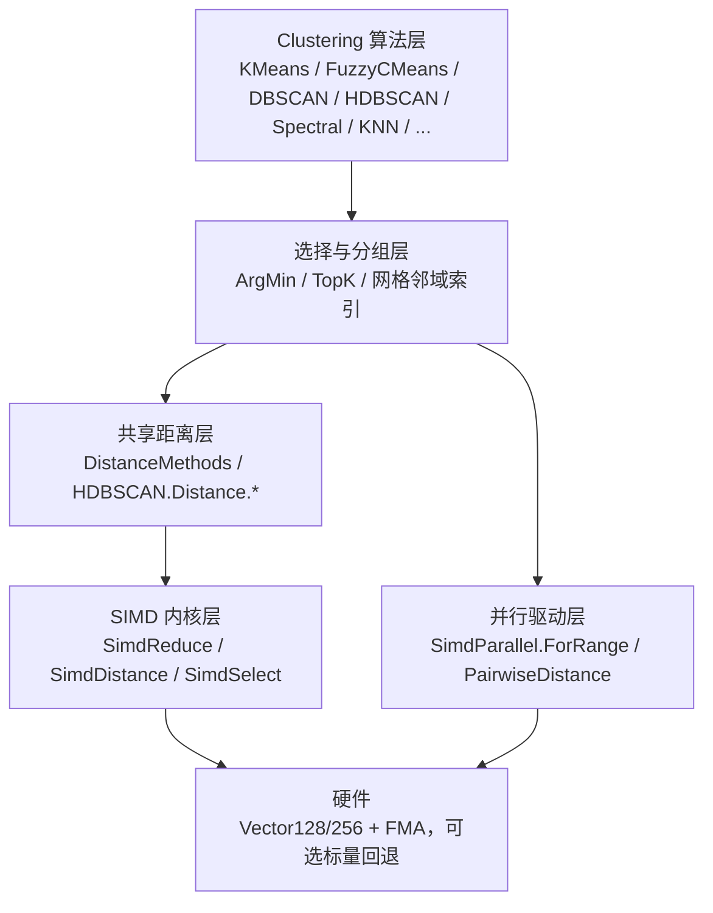

## 需求概述

审查 `Data_science\DataMining\DataMining\Clustering` 下的全部聚类算法及其依赖的底层数学函数，找出性能瓶颈，并制定开发计划；采用 `Microsoft.VisualBasic.Core\src\Math\SIMD` 的 SIMD + Parallel 内核进行优化，使算法能够胜任大型数据集矩阵（如 10000 行 × 100 列）的聚类计算。

## 审查结论（已定位的瓶颈）

- **距离层**：`DistanceMethods.SquareDistance` 用 `Subtract→Exponent→Sum` 三步，每次调用分配 2~3 个临时数组（FuzzyCMeans / Canopy / BisectingKMeans 全走这条路）；`EuclideanDistance(Double(),Double())` 已 SIMD，但比较时仍做 `Sqrt`。
- **HDBSCAN**：`HdbscanRunner` 默认物化 n×n 锯齿矩阵（n=20k 约 3.2 GB），`index Mod n` 整除 + 跨行写入；`Distance\*.vb` 五个度量全为朴素标量循环；`CalculateCoreDistances` 插入排序、`ConstructMst` 每轮全量重算。
- **FuzzyCMeans**：隶属度更新 O(n·c²·d)，内层聚合重复求值 `SquareDistance` c 次；`GetCenters` 每个（簇，维度）分配两个长度 n 的数组；`Pow` 每次重算。
- **KMeans / Kmedoids / Lloyds**：`ClusterDataSet` 内层每次读计算属性 `ClusterMean` 导致 n·k 次数组分配；`KMeans.vb` 并行分支是"每样本一个 PLINQ 查询 + OrderBy 全排序取最小"；Kmedoids 每步整表 `ConstrainedCopy`、`List.Contains` 线性查找。
- **n² 类算法**：Spectral 内核对每对样本取整行 Vector 并分配；Canopy 阈值估算 n²/2 对 + 每轮 `OrderByDescending`；KNNCluster 物化 N×N `DistanceMap` 且每次查询全排序；Density 每行全排序；KNN.Classify 每样本一个 `Double(1)` 小数组。
- **DBSCAN**：每点新建一个任务、`Dictionary(Of String, ...)` 字符串键缓存、`Union().ToArray()` 反复分配。
- **适配层**：`Metric.DistanceTo` 每次距离调用都从字典重建两个向量。

## 功能范围（已确认）

1. 全覆盖优化，含 HDBSCAN 的 O(n²) 距离矩阵结构性改造，以及 Spectral / Canopy / KNNCluster 去掉 n² 物化。
2. 允许在 `Microsoft.VisualBasic.Core\src\Math\SIMD` 新增内核（ArgMin、Span 零分配平方距离、范数展开距离、TopK、pairwise 矩阵、分块并行驱动）。
3. 允许新增 Optional 参数与新重载（并行度、距离平方开关、`DistanceCacheMode` 等），现有公开方法签名保持不变。
4. 新增 benchmark 工程，输出优化前后耗时与分配字节对比，并做数值对拍。

## 验收标准

- 现有调用点（Visualization、DataPlot、MachineLearning、UMAP/t-SNE/PaCMAP、stdlib、tutorials）保持可编译。
- 10000×100、k=10：KMeans 单轮耗时提升不低于 3 倍，单轮分配字节下降不低于 90%。
- HDBSCAN 5000 点默认路径不再物化 n² 矩阵，峰值内存低于 100 MB。
- 数值对拍：距离相对误差不超过 1e-9（SIMD 归约顺序带来的 ULP 差异允许）；确定性数据上聚类结果 ARI = 1。
- `Core.vbproj`、`Math.NET5.vbproj`、`DataMining.NET5.vbproj` 与 benchmark 工程 Debug/Release 均 0 警告 0 错误。

## 技术栈选择

- 语言 / 框架：VB.NET，`net10.0`；沿用现有 SDK 风格工程（`Core.vbproj` 已在 L25 全局启用 `RemoveIntegerChecks`，`DataMining.NET5.vbproj` 为默认 globbing，新增 .vb 文件无需改 vbproj 的 Compile 列表）。
- 向量化：`System.Numerics.Vector(Of T)` + `System.Runtime.Intrinsics.X86`（沿用 `SimdReduce` / `SIMDIntrinsics.DotFma` 既有 4 路累加器模式，不引入 `System.Numerics.Tensors` 等新包）。
- 并行：`System.Threading.Tasks.Parallel`（统一使用外层样本块分块并行；不新增 PLINQ 路径）。
- 选择算法：`System.Collections.Generic.PriorityQueue(Of TElement, TPriority)` + 手写 QuickSelect（`System.Memory` 的 Span）。
- 不新增任何 NuGet 依赖；`Math.NET5` 仍为仓库内工程。

## 实现方案

### 1. 总体策略

按"内核补齐 → 共享距离层 → 算法热路径 → n² 结构改造 → 基准验证"五层推进，所有改动保持公开签名不变（只新增重载 / Optional 参数）。核心判断：**已有 `SimdReduce.DistanceSquared` 已足够好（单趟零分配、4 路累加器），真正拖慢聚类的是"每次距离都重新分配数组""重复求值""用 OrderBy 求最小值"以及"把 n² 矩阵物理物化"**，因此优先消除分配与算法级复杂度，而非继续微调单条向量指令。

### 2. 关键决策与权衡

| 决策 | 理由 | 权衡 |
| --- | --- | --- |
| 在 `SimdReduce` 增加 `DistanceSquared(ReadOnlySpan(Of Double), ReadOnlySpan(Of Double))`，并让 `Double()` 重载转调 | Span 版本可让 `NumericMatrix` 行、`Vector.Array`、`Double(1)` 切片零拷贝 | Span 不能跨 `Async`；聚类路径全为同步计算，无影响 |
| 新增范数展开距离 `d² = ‖x‖² + ‖c‖² − 2·x·c`（配 FMA） | k-means 场景可把 O(n·k·d) 乘法减半，并把 `‖x‖²` 每轮只算一次 | 大数值下有抵消误差，需在结果 `< 0` 或量级异常时回退直接 DistanceSquared |
| 新增 `SimdSelect.ArgMin/ArgMax/TopK` | 替换 `OrderBy(...).First()`（O(k log k) + 比较器装箱）与 `OrderBy(...).Take(k)`（O(n log n)） | TopK 需确定性 tie-break（同值取小索引）以保持结果稳定 |
| 新增 `SimdParallel.ForRange(len, body, minLength)` 分块驱动 | 现有 `ShouldParallelize` 要求长度 ≥ 131072，行级（k≈10、d≈100 仅 1000 元素）永远串行；必须把并行放在样本块粒度 | 分块归约顺序变化带来 ULP 差异，对拍用相对误差 1e-9 |
| HDBSCAN 新增 `DistanceCacheMode`（None / UpperTriangle / Full），默认 None | n² 物化是内存杀手，Prim 生成树天然只需 O(n) 工作集 | 关闭缓存后距离会重算，靠 SIMD 单趟内核 + 候选缓存缓解；`CacheDistance` 字段保留为兼容别名 |
| 不改 `Release | AnyCPU` 的 `RemoveIntegerChecks` | 移除整数溢出检查会改变 Apriori 等既有代码的异常语义 | 放弃该"零成本收益"，换行为安全 |


### 3. 性能与复杂度预期

- 距离调用：O(d) 不变，常数从"2 次堆分配 + 2 趟内存往返 + LINQ"降到"单趟、寄存器累加"，预计单次 3~6 倍；GC 分配趋近 0。
- KMeans 单轮：O(n·k·d) 不变，去掉 n·k 次 `ClusterMean` 分配与 k 次 `OrderBy`，预计 3~8 倍。
- FuzzyCMeans：O(n·c²·d) → O(n·c·d)（c 通常 5~15，理论 5~15 倍）；`GetCenters` 从 O(c·d·n) 次分配降到 O(c·d) 个累加器。
- HDBSCAN：峰值内存 O(n²) → O(n)；`CalculateCoreDistances` 由 O(n²·k) 插入排序改 O(n²·log k)（有缓存时用 TopK 一次性取 k 个）；MST 保留 Prim 但加入候选距离数组剪枝，避免重复 `distances(i,j)`。
- Spectral：核矩阵与归一化降到 ~1/n 的分配；特征分解仍为 O(n³)（不重写 JAMA），仅对 n 过大时给出显式警告。
- KNNCluster / Density / KNN：查询从 O(n log n) 降到 O(n)（QuickSelect），全量 n² 改为增量/上三角缓存。

### 4. 架构设计



数据流：样本矩阵 `Double()()`（行主序）→ 距离内核（单趟 SIMD，零分配）→ 选择内核（单趟 ArgMin / QuickSelect）→ 簇分配 / 邻域扩展；并行始终在最外层"样本块"，块内单线程向量化，避免嵌套并行与任务风暴。

## 实现要点（执行细节）

### 内核层（Core）

1. `SimdReduce`：新增 `ArgMin/ArgMax(v, start, ends)`（单趟，标量比较已足够便宜，不要再走 `Max` + `Array.IndexOf` 两趟）；新增 `DistanceSquared(ReadOnlySpan, ReadOnlySpan)`，并让现有 `Double()` 重载转调它（DRY，行为不变）；新增 `Euclidean`、`Manhattan(L1)`、`Supremum(Max|d|)`、`CosineDistance`、`PearsonCorrelation` 的 Span 版本，供 HDBSCAN 五个 `IDistanceCalculator` 直接复用。
2. 新增 `Engine\SimdDistance.vb`：`DistanceSquaredFromNorms(normA, normB, dot)`；`BatchDistanceSquared(row, centers, norms, out dst)`（一行对 k 个中心一次算完，是 KMeans 内层的核心）。
3. 新增 `Engine\SimdSelect.vb`：`ArgMin`、`TopKIndices(values, k)`（k ≤ 32 用插入式有界数组，k 较大用 QuickSelect）、`SelectKSmallest`；全部返回索引数组，避免 `SeqValue` 装箱。
4. `Parallel\SimdParallel.vb`：新增 `ForRange(len, body As Action(Of Integer,Integer), Optional minLength=4096)` 与 `Chunk(len)` 公开化；把现有 `Min`/`Max` 的分块循环改成真正的 `Parallel.For`（当前是串行 for 却对外声称并行）；新增 `PairwiseDistance(rows, metric, upperTriangleOnly)`（平铺 1D + 行分块并行，供 HDBSCAN `DistanceCacheMode.UpperTriangle` 与 KNNCluster 使用）。
5. `SimdExtensions.vb`：按既有"Simd 前缀"约定新增 `SimdDistanceSquared`、`SimdArgMin`、`SimdTopK`，避免与 `System.Linq` 二义。
6. **Core 工程 `GenerateDocumentationFile=True`**，所有新增 Public 成员必须写 XML 注释，否则产生文档警告。

### 共享距离层

- `DistanceMethods.SquareDistance(Double(), Double())`、`(IVector, Double())`、`(Span, Span)` 三个重载全部改为 `SimdReduce.DistanceSquared` 调用（数值等价，`Span` 版本彻底零分配）；保留原有 `Sqrt` 与非 Sqrt 语义边界。
- `EuclideanDistance(IEnumerable, IEnumerable)` 的 `ToArray` 行为保留（对外契约），但内部若已是数组则直接转 `Double()` 重载，避免二次拷贝。
- `Metric.DistanceTo`：新增惰性投影缓存（按 `propertyNames` 缓存 `Double()`，仅当属性字典被改写时失效），并把 `propertyNames` 预编译成索引数组。

### 算法层

- **KMeans**：`KMeansEngine.ClusterDataSet` 每轮先物化 `centers As Double()()` 与 `centerNorms` 一次，内层用 `SimdDistance.BatchDistanceSquared` + `SimdSelect.ArgMin`，删除 `New Double(width-1)`（空簇中心预置零数组并复用）；`ClusterDataSetLoop` 收敛判定改为"平方距离和阈值"而非 `EuclideanDistance(...) = 0`；`KMeans.vb` 删除 `ParallelEuclideanDistance` 的每样本 PLINQ，改 `ForRange` 按样本块并行 + 块内 ArgMin；`CalculateKMeansCost` 的 `Pow(d,2)` 改 `d*d`（并直接用平方距离）。
- **Models**：`NumericKMeansCluster` / `KMeansCluster` 的 `ClusterMean` 增加 `_centerCache`（`Add` 时置脏），避免 getter 每次 `Divide` 分配；`Center` 属性保持公开语义。
- **FuzzyCMeans**：`CMeans.scanRow` / `updateMembership` / `CMeansEngine.scanRow` 先算 `d(0..c-1)` 数组（一次 c 次距离），再做 `c²` 次除法幂；`exponent = 2/(m-1)` 提到循环外；`GetCenters` 改为外层簇、内层样本单趟累加 `numerator(dim) += w * row(dim)`、`denominator += w`，`w = u(j)(i)^m` 每样本只算一次。
- **DBSCAN**：`DbscanSession` 内新增整数 `IndexOfId` 映射，`queryCache` 改 `Dictionary(Of Integer, Integer())`，`RegionQuery` 返回紧凑索引数组；删除 `QueryTask`（每点一任务），改 `ForRange` 分块 + 每块局部 `List`；新增 `DBSCAN\GridNeighborIndex.vb`（均匀网格，cell = eps，复用 `DensityQuery` 的 `KDQuery` 思路）作为可选加速路径；`ExpandCluster` 改显式队列遍历，去掉 `Union().ToArray()`；修正 `ExpandClusterParallel` 递归传参与 `Distinct` 冗余。
- **HDBSCAN**：`HdbscanParameters` 新增 `DistanceCacheMode`（默认 `None`）与 `MaxCachedPoints`（超限自动降级并告警），`CacheDistance` 保留为 `DistanceCacheMode <> None` 的兼容视图；`HdbscanRunner.PrecomputeNormalMatrixDistancesIfApplicable` 改平铺 `Double(n*n)` 或上三角 `n(n-1)/2`（`PairwiseDistance` 行分块并行填充），并把 `index Mod n` 的整除分派改成"按行块"；`HdbscanAlgorithm.CalculateCoreDistances` 有缓存时用 `SimdSelect.TopKIndices` 逐行取 k 近邻，无缓存时用有界最大堆；`ConstructMst` 保留 Prim，但把 `distances` 委托替换为"行缓存 + 候选数组"，去掉每轮对全部未附着点的重复距离计算；`Distance\EuclideanDistance.vb`、`ManhattanDistance.vb`、`SupremumDistance.vb`、`CosineSimilarity.vb`、`PearsonCorrelation.vb` 全部改调 `SimdReduce` 新内核（`ISparseMatrixSupport`、`IDistanceCalculator` 接口不变）；`CosineSimilarity` 的 `CalculateAndCacheMagnitude` 用 `SimdReduce.SumSquares` 并去掉 `Dictionary + Func` 缓存。
- **Spectral**：先把 `NumericMatrix` 行 `ArrayPack` 成 `Double()()` 局部数组；核矩阵按行块并行，核函数内联为 `Exp(-gamma * DistanceSquared)`（不再走 `Vector.operator-` / `.Mod`）；归一化改为逐行 `SimdParallel.Multiply`；新增 Optional `maxPoints`（超过时抛带说明的异常或告警降级），特征分解保持现状。
- **Canopy**：`SquareDist` 改 SIMD；阈值估算改为单趟上三角累加（或 `sampleSize` 采样）；`Solve` 去掉每轮 `OrderByDescending().ToArray()`，改用 `SimdSelect.TopK` 或最大堆；删除改为"尾部交换 + 计数收缩"替代 `List.RemoveAt`。
- **KNNCluster**：`DistanceMap` 全量物化改为按需行缓存（LRU，容量可配）或上三角平铺；`FindKNearestNeighbors` 改 `TopKIndices`；`AssignClusterId` 维护 `cluster → 索引 List` 增量结构。
- **Density / KNN / Kmedoids / Lloyds / Bisecting / 指标**：`Take(k)` 前的 `OrderBy` 全换 TopK；`KNN.Classify` 用两个平铺数组（`dist[]`、`label[]`）并复用 `ParallelOptions`；Kmedoids 用 `HashSet(Of Integer)` + 索引数组替代整表拷贝；Lloyds 重启次数改为 Optional（默认 100 保兼容），中心预物化；`BisectingKMeans` 的 SSE 与 `calcCluster` 改用 `Double()` 累加器 + `DistanceSquared`；`silhouette` 用"簇内和向量"把 O(m²) 降到 O(m·d)，`dunn` 用平方距离并提前剪枝。
- **Hamming**：`HammingClustering` 的 `Where` + `OrderBy` 重复距离合并为一次计算 + TopK；`Kmodes.Assign` 缓存 `centroidPatterns`。

### 健壮性与边界

- 所有新增内核保持"长度不一致抛 `ArgumentException`"（与 `SimdReduce` 现有约定一致，不静默截断）。
- 并行度统一走 `ParallelOptions.MaxDegreeOfParallelism`（0/8 次 CPU 的块大小），并保证 `Enable = False` 与 `SIMDEnvironment.config = disable` 时能纯标量回退（供 benchmark 对照）。
- 热点路径禁止字符串拼接（`Density.Description` 的 `ToString("F2")` 改惰性属性）。
- 数值稳定的下溢/抵消保护：范数展开距离结果 `< 0` 或 `|d²|` 与 `‖x‖²+‖c‖²` 量级比异常时回退直接 `DistanceSquared`。

### 影响面控制

- 已知外部调用方：`Visualization\Kmeans\Kmeans.vb:185-187`（`.ToKMeansModels.Kmeans(expected:=clusterN)`）、`DataPlot`、`UMAP/t-SNE/PaCMAP`、`MachineLearning\*`、`stdlib\cluster.vb`、`DataMining\test\*`。这些只依赖 `Kmeans`、`NumericTable` 扩展（`dbscan/hdbscan/spectralCluster/bisectingKMeans/lloydsCluster/canopyCluster/densityScore/knnClassify/knnCluster/kmedoids/silhouette/dunn/calinskiHarabasz`）与 `HdbscanParameters`，因此只做实现替换与 Optional 参数追加。
- 唯一行为变更：`HdbscanParameters.CacheDistance` 由 `True` 变 `False`（已获授权），需在 XML 注释与 benchmark 报告中显式说明。

## 目录结构

```
Microsoft.VisualBasic.Core/src/
├── Math/SIMD/Engine/SimdReduce.vb        # [MODIFY] 新增 ArgMin/ArgMax(start,ends) 单趟选择；新增 ReadOnlySpan 版 DistanceSquared 并让数组重载转调；新增 Euclidean/Manhattan/Supremum/Cosine/Pearson 的 Span 内核
├── Math/SIMD/Engine/SimdDistance.vb      # [NEW] 聚类专用度量：DistanceSquaredFromNorms（范数展开）、BatchDistanceSquared（一条样本对 k 个中心）、带抵消保护的混合分派
├── Math/SIMD/Engine/SimdSelect.vb        # [NEW] ArgMin/ArgMax（区间、确定性 tie-break）、TopKIndices（k 小走有界插入，k 大走 QuickSelect）、SelectKSmallest
├── Math/SIMD/Parallel/SimdParallel.vb    # [MODIFY] 新增公开 ForRange/Chunk 分块并行驱动、PairwiseDistance（平铺/上三角 + 行块并行）；把 Min/Max 的串行分块改为真 Parallel.For
├── Math/SIMD/SimdExtensions.vb           # [MODIFY] 新增 SimdDistanceSquared/SimdArgMin/SimdTopK 扩展方法（保持 Simd 前缀避免与 System.Linq 二义）
└── Math/Correlations/DistanceMethods.vb  # [MODIFY] SquareDistance 三个重载改为 SimdReduce.DistanceSquared（零分配）；IEnumerable 重载避免二次 ToArray；新增 Span 重载

Data_science/DataMining/DataMining/
├── Clustering/KMeans/KMeansEngine.vb             # [MODIFY] ClusterDataSet 每轮预取 centers/centerNorms、BatchDistanceSquared + ArgMin，空簇中心复用；收敛判定改平方距离阈值
├── Clustering/KMeans/KMeans.vb                   # [MODIFY] 删除每样本 PLINQ + OrderBy，改样本块并行 + 块内 ArgMin/平方距离；means() 中心预取
├── Clustering/KMeans/Kmedoids.vb                 # [MODIFY] HashSet 替代 List.Contains、平方距离、索引数组替代整表 ConstrainedCopy
├── Clustering/KMeans/Models/KMeansCluster.vb     # [MODIFY] ClusterMean 加中心缓存（Add 置脏）；CalculateKMeansCost 用平方距离，Pow→乘法
├── Clustering/KMeans/Models/NumericKMeansCluster.vb # [MODIFY] 同上；ClusterSum 累加改 SimdEngine.AddInPlace
├── Clustering/KMeans/Models/NumericCluster.vb    # [MODIFY] CalculateKMeansCost 的 Pow→乘法（非热点但同源）
├── Clustering/FuzzyCMeans/CMeans.vb              # [MODIFY] scanRow/updateMembership 距离 hoist（c²→c）、幂指数提到循环外；GetCenters 改外层簇内层样本单趟累加
├── Clustering/FuzzyCMeans/CMeansEngine.vb        # [MODIFY] scanRow 同步改造，去掉每 i 重复距离
├── Clustering/DBSCAN/DbscanSession.vb            # [MODIFY] 整数索引映射、Dictionary(Of Integer, Integer()) 缓存、删 QueryTask 改 ForRange 分块、队列式 ExpandCluster
├── Clustering/DBSCAN/DbscanAlgorithm.vb          # [MODIFY] IteratesAllPoints 不再为进度条物化数组，改计数循环
├── Clustering/DBSCAN/Extensions.vb               # [MODIFY] EntityClusterModel 一次性投影为 Double()()，避免 Metric 反复重建向量
├── Clustering/DBSCAN/GridNeighborIndex.vb        # [NEW] 均匀网格邻域索引（cell = eps），返回候选索引供 RegionQuery 复用，n 大时替代全扫描
├── Clustering/HDBSCAN/Runner/HdbscanParameters.vb    # [MODIFY] 新增 DistanceCacheMode/MaxCachedPoints；CacheDistance 保留为兼容视图，默认不再物化
├── Clustering/HDBSCAN/Runner/HdbscanRunner.vb        # [MODIFY] 预计算改平铺/上三角 + 行块并行；去掉 index Mod n 分派；缓存超限告警降级
├── Clustering/HDBSCAN/Hdbscanstar/HdbscanAlgorithm.vb # [MODIFY] 核心距离用 TopK/有界堆；ConstructMst 加候选数组剪枝，避免重复距离调用
├── Clustering/HDBSCAN/Distance/EuclideanDistance.vb    # [MODIFY] 改调 SimdReduce.DistanceSquared（Span）
├── Clustering/HDBSCAN/Distance/ManhattanDistance.vb    # [MODIFY] 改调 SimdReduce.Manhattan
├── Clustering/HDBSCAN/Distance/SupremumDistance.vb     # [MODIFY] 改调 SimdReduce.Supremum
├── Clustering/HDBSCAN/Distance/CosineSimilarity.vb     # [MODIFY] 单趟点积+范数，去掉 Dictionary/Func 缓存与 LINQ Sum(Pow)
├── Clustering/HDBSCAN/Distance/PearsonCorrelation.vb   # [MODIFY] 单趟 SIMD 求 sumX/sumY/sumXX/sumYY/sumXY
├── Clustering/Spectral.vb                        # [MODIFY] 行数组预打包、核矩阵行块并行（Exp(-gamma*d²)）、归一化逐行 SIMD、maxPoints 保护
├── Clustering/Canopy.vb                          # [MODIFY] SquareDist→SIMD、阈值估算单趟上三角/采样、TopK 替代 OrderByDescending、尾部交换删除
├── Clustering/KNNCluster.vb                      # [MODIFY] DistanceMap 改惰性行缓存/上三角、kNN 用 TopK、簇成员增量维护
├── Clustering/Density.vb                         # [MODIFY] 每行全排序改 TopK、Description 惰性化
├── Clustering/KNN.vb                             # [MODIFY] 平铺 dist/label 数组、Parallel.For 外提、TopK 替代 OrderBy.Take
├── Clustering/BisectingKMeans/Cluster.vb         # [MODIFY] SSE 用 DistanceSquared 累加，去掉每点两个 Vector 数组
├── Clustering/BisectingKMeans/BisectingKMeans.vb # [MODIFY] calcCluster 用可变 Double() 累加器；SSE 结果缓存
├── Clustering/Lloyds/LloydsMethodClustering.vb   # [MODIFY] 重启次数改 Optional 参数、中心预物化、平方距离
├── Clustering/Hamming/HammingClustering.vb       # [MODIFY] Where+OrderBy 重复距离合并为一次计算 + TopK
├── Clustering/Hamming/Kmodes.vb                  # [MODIFY] 缓存 centroidPatterns，避免每轮 FromIntegers
├── Clustering/ClusteringTableExtensions.vb       # [MODIFY] silhouette 用簇和向量降复杂度、dunn 用平方距离剪枝、ToIndexedEntities 复用投影
└── ComponentModel/EntityModels/Metric.vb         # [MODIFY] propertyNames 预编译为索引数组 + 距离投影缓存（写入时失效）

Data_science/DataMining/ClusteringBenchmark/          # [NEW] 独立基准工程（net10.0 Exe，引用 DataMining.NET5/Core/Math.NET5），登记到 DataMining.NET5.sln
├── ClusteringBenchmark.vbproj                        # [NEW] 工程文件：OutputType=Exe、MyType=Empty、StartupObject=BenchmarkRunner
├── Program.vb                                        # [NEW] CLI：--bench / --parity / --baseline / --scalar / --save <md>；Stopwatch 取中位数、GC.GetAllocatedBytesForCurrentThread 计分配
├── BenchCases.vb                                     # [NEW] 合成数据生成（固定 seed）：kmeans 10k×100×k=10、fuzzy 5k×50×c=8、dbscan 20k×20、hdbscan 5k×10、spectral 1k、knn/kmedoids
├── ParityChecks.vb                                   # [NEW] 与标量参考实现逐项对拍：距离（1e-9 相对）、簇标签 ARI、SSE、TopK 索引集合
└── Report.vb                                         # [NEW] 输出 Markdown 表格（用例 | 基线 ms | 优化后 ms | 加速比 | 分配 MB | 状态）
```

## 关键代码结构

```
''' <summary>HDBSCAN 距离矩阵缓存策略。</summary>
Public Enum DistanceCacheMode
    ''' <summary>不缓存，按需计算（默认，峰值内存 O(n)）。</summary>
    None
    ''' <summary>只缓存上三角，n(n-1)/2 个 Double。</summary>
    UpperTriangle
    ''' <summary>缓存完整 n×n（仅小数据集或显式指定）。</summary>
    Full
End Enum
```

```
' Core/Math/SIMD/Engine/SimdSelect.vb —— 单趟选择，替代 OrderBy().First()/Take(k)
Public Shared Function ArgMin(v As Double(), start As Integer, ends As Integer) As Integer
Public Shared Function ArgMin(v As ReadOnlySpan(Of Double)) As Integer
''' <summary>返回最小的 k 个值的索引（按值升序，同值按索引升序）。</summary>
Public Shared Function TopKIndices(v As ReadOnlySpan(Of Double), k As Integer) As Integer()
```

```
' Core/Math/SIMD/Parallel/SimdParallel.vb —— 聚类专用分块并行驱动
''' <summary>按块并行执行 body(start, ends)；长度小于 minLength 时退化为单块串行。</summary>
Public Shared Sub ForRange(len As Integer, body As Action(Of Integer, Integer), Optional minLength As Integer = 4096)
''' <summary>成对距离矩阵：upperTriangleOnly=True 时返回长度 n(n-1)/2 的平铺数组。</summary>
Public Shared Function PairwiseDistance(rows As Double()(), metric As Func(Of ReadOnlySpan(Of Double), ReadOnlySpan(Of Double), Double), Optional upperTriangleOnly As Boolean = True) As Double()
```

## Agent Extensions

### SubAgent

- **code-explorer**
- Purpose: 在收尾阶段审计 `Microsoft.VisualBasic.DataMining.Clustering` 与新增 SIMD 内核的全部调用点（Visualization / DataPlot / MachineLearning / UMAP / t-SNE / PaCMAP / stdlib / tutorials / DataMining\test），确认公开签名未被破坏、Optional 参数改动无编译回归。
- Expected outcome: 输出一份调用点清单与兼容性结论（哪些调用需要补参数、哪些会因默认值变化受影响），作为回归清单交付。