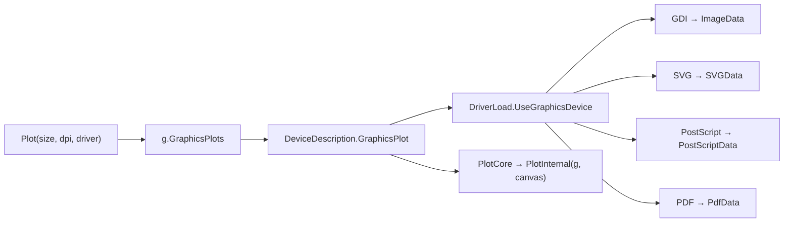

## 用户需求

### 产品概述

对 `DataPlot.vbproj`（VB.NET 图表引擎库）做架构级重构：把 `Engine\PlotEngine.vb` 从"构造时创建单一 GDI 画布、只能画不能导出"升级为与 `Canvas\PlotBase.vb` 一致的两段式渲染管线——对外用 `Plot(size, dpi, driver)` 通过 `g.GraphicsPlots(...)` 按驱动标志产出不同格式的绘图数据（PNG/SVG/PDF/PostScript），对内用抽象模板方法承载具体绘图代码。随后把 `Legacy\` 目录下全部旧绘图代码迁移/合并到新引擎上，删除与新引擎重复的实现，并同步修正所有下游调用点。

### 核心功能

- **多格式出图**：同一套图表代码可通过 `Drivers.GDI / SVG / PDF / PostScript` 输出，返回 `GraphicsData`（`ImageData` / `SVGData` / `PdfData` / `PostScriptData`），再 `.Save(path)` 落盘。
- **模板方法绘制**：绘图区从 `GraphicsRegion.PlotRegion(css)` 推算，具体图元绘制下沉到子类的 `PlotInternal`，基类统一负责画布创建、背景、坐标轴、图例之外的生命周期管理。
- **既保留实时绘制**：仍可直接画到宿主已有的 `IGraphics`（WinForms 控件、DirectX GPU 画布），外部画布不被释放。
- **Legacy 合并**：`Scatter2D / LinePlot2D / Bubble / Violin / HistogramPlot / SimpleBarPlot / StackedBarPlot / StackedPercentageBarPlot / LevelBarplot / BarPlotAlternativeDirection / StyledBarplot / BiDirectionBarPlot / PlotAlignmentGroup / AlignmentPlot / DensityPlot / Heatmap` 等旧绘图类被新引擎对应图型取代，仅保留真正的数据模型（`BarDataGroup`/`BarDataSample`/`HistogramGroup`/`ProfileGroup` 等）。
- **视觉一致性**：迁移后输出与旧实现保持同样的图形语义（离散 X 轴标签、凸包、误差棒、镜像直方图、堆叠/双向柱状、对齐轨道与高亮区），不追求像素级完全一致。
- **验证**：库编译 0 警告 0 错误；样例程序分别用四种驱动输出散点/折线/柱状/直方图/气泡/小提琴图，人工目检文件可用。

## 技术栈

| 项 | 选择 |
| --- | --- |
| 语言/运行时 | VB.NET，`net10.0`（`DataPlot.vbproj`、`test.vbproj` 为 `net10.0-windows`） |
| 绘图设备抽象 | `Microsoft.VisualBasic.Imaging`（`IGraphics`、`DeviceInterop`、`DriverLoad`、`ImageDriver`、`GraphicsRegion`） |
| 驱动分派 | `Microsoft.VisualBasic.Imaging.Drawing2D.g.GraphicsPlots(size, padding, bg, plotAPI, driver, dpi)` |
| PDF 写入 | `mime\application%pdf\Pdf.NET5.vbproj`（`PdfDocument.PageSetup/Image/Save`） |
| PS 写入 | `Microsoft.VisualBasic.Imaging.PostScript.PostScriptBuilder`（`ToString()` 产出 ASCII PostScript） |
| 主题 | `Engine\PlotTheme.vb`（强类型）+ 既有 `ThemeBridge.ToPlotTheme(Canvas.Theme)` |
| 不做改动 | `Canvas\PlotBase.vb`、`Canvas\`、`Plot3D\` 保持现状（本身已是两段式模式） |


## 总体实现方案

### 1. PlotEngine 两段式重构（核心）

`PlotEngine` 新增与 `PlotBase` 对等的入口，并把"绘图设备挂载/恢复"收敛到基类一个私有 `PlotCore`：

```
' 对外：一次性渲染并按 driver 产出 GraphicsData
Public Overloads Function Plot(Optional size$ = Resolution2K.Size,
                               Optional ppi% = 300,
                               Optional driver As Drivers = Drivers.Default) As GraphicsData
Public Overloads Function Plot(size As Size,
                               Optional dpi% = 300,
                               Optional driver As Drivers = Drivers.Default) As GraphicsData
    Return g.GraphicsPlots(size, Theme.Padding, Theme.BackgroundColor.ToHtmlColor,
                           AddressOf PlotCore, driver, dpi)

' 对外：直绘到宿主已有设备（控件刷新 / DirectX）
Public Overloads Sub Plot(ByRef g As IGraphics, canvas As GraphicsRegion)
Public Overloads Sub Plot(ByRef g As IGraphics, layout As Rectangle)

' 私有：挂载设备 → 调模板方法 → 恢复原设备（异常安全）
Private Sub PlotCore(ByRef g As IGraphics, canvas As GraphicsRegion)
    Dim saved = SaveDeviceState()
    AttachDevice(g, canvas)          ' _g/_width/_height/_plotArea = canvas.PlotRegion(css)
    Try
        PlotInternal(g, canvas)
    Finally
        RestoreDeviceState(saved)
    End Try
End Sub

' 子类实现的具体绘图（与 Canvas\PlotBase.vb:172 完全同形）
Protected MustOverride Sub PlotInternal(ByRef g As IGraphics, canvas As GraphicsRegion)
```

- `PlotTheme` 新增只读属性 `Padding`（`New Padding(CInt(MarginLeft), CInt(MarginTop), CInt(MarginRight), CInt(MarginBottom))`），使主题边距与 CSS padding 模型对齐；`ComputePlotArea()` 改为优先使用 `AttachDevice` 钉死的绘图区，否则回退到主题边距。
- `SeriesPlotEngine` 增加 `Protected Property SeriesList`，`Public Overloads Sub Plot(seriesList)` 与 `Public Overloads Function Plot(seriesList, size, dpi, driver)` 都只负责存数据后走基类管线；两个 `SeriePlotEngine` 子类的 `Plot(seriesList)` 正文搬进 `PlotInternal`。
- 46 个子类做**机械迁移**：`Public Sub Plot()` → `Protected Overrides Sub PlotInternal(ByRef g As IGraphics, canvas As GraphicsRegion)`；`Plot()` 由基类统一提供，调用点源码不变。
- 顺手修 `SetDataRange` 的自赋值 bug（`XMin/XMax/YMin/YMax` 从未被赋值）。
- `Extensions.AsGraphicsData / SavePng / Save / SaveChanges` 改为统一复用 `plot.Plot(New Size(CanvasWidth, CanvasHeight), dpi, driver)`，删掉 `DriverLoad.GetData(g, {})` 这条丢 padding 的旁路，保证只有一套导出逻辑。

### 2. Legacy 迁移与合并映射

| Legacy（删除） | 新引擎（承接） |
| --- | --- |
| `Legacy.Plots.Scatter2D` + `Module Scatter`（`Scatter.Plot(...)`） | `Basic.ScatterPlot` / `Basic.LinePlot` |
| `Legacy.Plots.LinePlot2D` / `LinePlot` | `Basic.LinePlot` |
| `Legacy.Plots.Bubble` | `Advanced.BubblePlot` |
| `Legacy.Plots.Violin` + `ViolinPlot` | `Advanced.ViolinPlot` |
| `Legacy.BarPlot.Histogram` + `HistogramPlot` | `Basic.HistogramPlot`（`BinEdges` 承接 `DataBinBox`，`Mirrored` 承接双向直方图） |
| `SimpleBarPlot` / `StackedBarPlot` / `StackedPercentageBarPlot` / `LevelBarplot` / `BarPlotAlternativeDirection` / `StyledBarplot` / `BiDirectionBarPlot` | `Basic.BarPlot`（`Stack` / `Diverging` / `Horizontal` / `Baseline` / `UseColorScale` 开关）+ `Basic.StackedBarPlot` |
| `PlotAlignmentGroup` + `AlignmentPlot` | `Advanced.AlignmentPlot`（`Tracks` + `Highlights`） |
| `Legacy.Plots.DensityPlot` | `Statistics.DensityPlot` |
| `Legacy.Plots.Heatmap` | `Advanced.HeatmapPlot` |
| `BarDataGroup`/`BarDataSample`/`BiDirectionData`/`HistogramGroup`/`ProfileGroup`/`Mapper`/`Scaling`/`PlotArguments`/`RectangleStyling` | 保留为纯数据模型，移除对 `Canvas.Plot` 的依赖并迁入 `Legacy\Data\` |


新增 `Plots\` 门面模块（`Scatter.Plot(...)`、`Bar.Plot(...)`、`Histogram.Plot(...)` 等）承接旧扩展方法的**调用语法**，但参数收敛为"数据 + size + dpi + driver + 主题"，替代原来的 40 个 optional 参数；语义差异在下游调用点显式赋值。

### 3. PDF / PostScript 驱动

- **PS（修既有缺陷）**：`PostScriptData` 当前把 `PostScriptBuilder` 丢掉且 `Save/GetDataURI` 全部 `Throw New NotImplementedException()`。改为持有 `PostScriptBuilder` 引用，`Save(stream)` 写 `ps.ToString()` 的 UTF-8 字节，`Save(path)` 走流式写盘。
- **PDF（新增，DataPlot 侧）**：`DeviceInterop` 是 `Public MustInherit`，下游程序集可实现，因此把 PDF 支持放在 `DataPlot` 而不是 `imaging`，避免 `imaging → pdf → docx` 的依赖扩散：
- `PdfInterop : Inherits DeviceInterop`：`CreateGraphic` 复用 GDI 设备（`DriverLoad.CreateGraphicsDevice(size, fill, dpi, Drivers.GDI)`），`GetData` 返回 `PdfData`。
- `PdfData : Inherits GraphicsData`：持有栅格图；`Save(path)` 先落临时 PNG，再用 `New PdfDocument().PageSetup(twipsW, twipsH, 0,0,0,0).Image(png, twipsW, twipsH).Save(path)` 生成 PDF；`Driver` 返回 `Drivers.PDF`。
- `PlotDrivers.Register()`：一次注册 `ImageDriver.Register()`（GDI+SVG）+ `ImageDriver.RegisterPostScript()` + `DriverLoad.Register(New PdfInterop, Drivers.PDF)`；幂等，重复调用安全。
- 明确记录取舍：PDF 是**高 DPI 栅格嵌入**（非矢量）；矢量输出请用 SVG。
- `DataPlot.vbproj` 增加 `<ProjectReference Include="..\..\..\mime\application%pdf\Pdf.NET5.vbproj" />`。



## 实现要点（执行细节）

- **VB 语言陷阱**：`Padding` 的构造参数顺序是 **left, top, right, bottom**（不是 GDI 的 left,top,right,bottom 直觉顺序也一致，但字段是 String 且带 `px`），必须用对象初始化器或命名实参，避免错位；`Sub(ByRef g As IGraphics, rect As GraphicsRegion)` 形式的 lambda 在 VB 里合法（仓库已有 `Legacy\Scatter.vb:408`、`NetworkPlot.vb:154` 先例）；全可选参数的 `Plot()` 会与无参重载二义，因此**只保留一个全可选的 String 尺寸重载 + 一个 Size 重载**，不要再加无参 `Plot()`；`Protected MustOverride` 方法名不能叫 `Plot`（会与对外重载打架），沿用 `PlotInternal`。
- **设备生命周期**：`PlotCore` 必须在 `Finally` 里恢复 `_g/_width/_height/_plotArea`——`GraphicsPlots` 创建的临时设备在返回后即被 `Using` 释放，若不恢复，引擎会在下一帧绘制时访问已释放对象。`_ownsGraphics` 语义保持：外部注入的画布永不 Dispose。
- **警告即错误**：`DataPlot.vbproj` 开了 `GenerateDocumentationFile=True`，所有新增 `Public`/`Protected` 成员（`Plot` 重载、`Theme.Padding`、`PlotDrivers`、`PdfData`）必须写 XML 注释；`imaging` 同样开启文档生成，`PSData` 的改动也不能漏注释。
- **性能**：`Plot(size, driver)` 是"按需创建画布"，不要在构造函数里预建；`ComputePlotArea` 已被钉死时不重算；SVG/PS 走虚拟设备逐图元记录，文件尺寸与图元数线性相关，数百系列以上的图建议 GDI；PDF 额外有一次 PNG 编码 + 解码，仅导出时发生。`AttachDevice` 每次只做 O(1) 状态保存，不分配大对象。
- **爆炸半径控制**：`Canvas\`（`PlotBase`、`PieChart`、`Axis`、`LayerRender`）与 `Plot3D\` 不动，只在 `Canvas\LayerRender.vb` 删掉不再需要的 `Imports ...Legacy.Plots`；`imaging` 只改 `PSData` 一个文件；PDF 不塞进 `imaging` 以免污染所有下游工程。

## 目录结构

```
Data_science/Visualization/DataPlot/
├── Engine/
│   ├── PlotEngine.vb                                # [MODIFY] 新增 Plot(size$/Size, dpi, driver) → g.GraphicsPlots；新增 Plot(ByRef g, canvas/layout)；
│   │                                                #          私有 PlotCore 负责 AttachDevice/Try-Finally/RestoreDevice + 调 PlotInternal；
│   │                                                #          Protected MustOverride PlotInternal(ByRef g, canvas)；SeriesPlotEngine 增加 SeriesList 与
│   │                                                #          Plot(seriesList, size, dpi, driver)；修复 SetDataRange 自赋值 bug；AttachDevice 用
│   │                                                #          canvas.PlotRegion(css) 钉死 _plotArea
│   ├── PlotTheme.vb                                  # [MODIFY] 新增只读属性 Padding（由 MarginLeft/Top/Right/Bottom 换算，注意 Padding
│   │                                                #          (left, top, right, bottom) 参数顺序）与 HTML 背景色辅助
│   ├── PlotDrivers.vb                                # [NEW]    幂等注册 GDI+SVG（ImageDriver.Register）、PostScript（RegisterPostScript）、
│   │                                                #          PDF（DriverLoad.Register(New PdfInterop, Drivers.PDF)），并提供 Current 默认驱动
│   └── Drivers/
│       ├── PdfInterop.vb                             # [NEW]    DeviceInterop 实现：CreateGraphic 复用 GDI 设备；GetData 返回 PdfData；
│       │                                             #          CreateCanvas2D 复用 GDI 画布（PDF 仅用于导出新图，不做二次绘制）
│       └── PdfData.vb                                # [NEW]    GraphicsData 实现：Driver=PDF、content_type、Save(path)/Save(stream)；
│                                                     #          临时 PNG + PdfDocument.PageSetup(twips).Image(...).Save(...)；文档注释说明是栅格嵌入
├── Basic/                                            # [MODIFY] ScatterPlot / LinePlot / AreaPlot / BarPlot / StackedBarPlot /
│   │                                                 #          HistogramPlot / StackedAreaPlot / ContourPlot：Plot()→PlotInternal(g, canvas)；
│   │                                                 #          删除返回 NotImplementedException 的 Shared Plot 占位
├── Advanced/                                         # [MODIFY] ViolinPlot / BubblePlot / BoxPlot / AlignmentPlot / HeatmapPlot / VennPlot /
│   │                                                 #          TreemapPlot / SankeyPlot / RosePlot / RadarPlot / PyramidPlot /
│   │                                                 #          PrincipalCurvePlot / PiePlot / JitterPlot / ImageMapPlot /
│   │                                                 #          FillPolygons / ChordPlot / DendrogramPlot：同上机械迁移；
│   │                                                 #          BubblePlot 的 BubbleSeries 入口统一为 Plot(seriesList)
├── Statistics/                                       # [MODIFY] 17 个统计图（ZScore/VariableWidthBar/TreeStackedBar/TimeTrends/Scree/
│   │                                                 #          SampleView/ROC/Regression/QQ/PCAScore/Manhattan/Forest/Density/
│   │                                                 #          CorrelationTriangle/CorrelationHeatmap/ClusterHeatmap/BubbleHeatmap）机械迁移
├── Plots/                                            # [NEW]    Legacy 语义的外层门面（保留旧调用点可读性，参数收敛）：
│   ├── Scatter.vb                                    #          Scatter.Plot(Series()/PointData(), size, dpi, driver, theme...) → ScatterPlot/LinePlot
│   ├── Line.vb                                       #          Line.Plot(...) → LinePlot
│   ├── Bar.vb                                        #          Bar.Plot(BarDataGroup, size, dpi, driver, stacked, ...) → BarPlot/StackedBarPlot
│   ├── Histogram.vb                                  #          Histogram.Plot(data/DataBinBox, size, dpi, driver) → HistogramPlot
│   ├── Bubble.vb                                     #          Bubble.Plot(...) → BubblePlot
│   ├── Violin.vb                                     #          Violin.Plot(...) → ViolinPlot
│   ├── Density.vb                                    #          Density.Plot(...) → Statistics.DensityPlot
│   ├── Heatmap.vb                                    #          Heatmap.Plot(fieldX, fieldY, valueField, colorSchema...) → HeatmapPlot
│   └── Alignment.vb                                  #          Alignment.Plot(query, subject, highlights) → AlignmentPlot
├── Legacy/
│   ├── Data/                                         # [NEW]    由 Legacy 迁入的纯数据模型（去掉 Canvas.Plot 依赖）：
│   │                                                 #          BarDataGroup.vb / BarDataSample.vb / BiDirectionData.vb /
│   │                                                 #          HistogramGroup.vb / ProfileGroup.vb / PlotArguments.vb /
│   │                                                 #          Mapper.vb / Scaling.vb / RectangleStyles.vb
│   └── (其余 24 个绘图/API 文件)                       # [DELETE] Scatter2D.vb / Scatter.vb / LinePlot2D.vb / LinePlot.vb / Bubble.vb /
│                                                     #          Violin.vb / ViolinPlot.vb / Histogram.vb / HistogramPlot.vb /
│                                                     #          SimpleBarPlot.vb / StackedBarPlot.vb / StackedPercentageBarPlot.vb /
│                                                     #          LevelBarplot.vb / BarPlot.vb / BarPlot2.vb / BarPlotDataExtensions.vb /
│                                                     #          StyledBarplot.vb / BiDirectionBarPlot.vb / PlotAlignmentGroup.vb /
│                                                     #          AlignmentPlot.vb / DensityPlot.vb / Heatmap.vb /
│                                                     #          Constructor.vb / Extensions.vb / Models.vb / DataModel.vb
├── Extensions.vb                                     # [MODIFY] AsGraphicsData / SavePng / Save / SaveChanges 统一走 Plot(size, dpi, driver)，
│                                                     #          删除 DriverLoad.GetData(g, {}) 旁路；DataSerials 保持不变
├── Canvas/LayerRender.vb                              # [MODIFY] 删除 `Imports Microsoft.VisualBasic.Data.Plots.Legacy.Plots`（唯一用途是注释里的类型引用）
├── DataPlot.vbproj                                    # [MODIFY] 增加 Pdf.NET5.vbproj 工程引用
└── test/
    ├── Program.vb                                    # [MODIFY] Main 改为调用 PlotDrivers.Register() + Examples.RunAll + DriverOutputs.RunAll
    ├── Examples.vb                                    # [MODIFY] 全部示例改为 `Dim data = plt.Plot(size, 300, driver)` + `data.Save(path)`，避免二次渲染
    ├── DriverOutputs.vb                               # [NEW]    四种驱动 × 六种图型（散点/折线/柱状/直方图/气泡/小提琴）落盘 png/svg/pdf/ps，
    │                                                  #          断言返回的 GraphicsData 派生类型与文件存在、非零字节
    └── test.vbproj                                    # [MODIFY] 引用 Pdf.NET5.vbproj（若 PdfData 在 DataPlot 内则无需，仅补必要引用）

gr/Microsoft.VisualBasic.Imaging/
└── Drivers/Models/PSData.vb                          # [MODIFY] 持有 PostScriptBuilder 引用；实现 Save(path)/Save(stream)/GetDataURI，
                                                      #          不再 Throw NotImplementedException

# 下游调用点（删除 Legacy 后必须同步修改）
src/GCModeller/visualize/DataVisualizationExtensions/CatalogProfiling/
    MultipleBubble.vb, AbstractPlot.vb, CatalogBubblePlot.vb, CatalogBubbleHeatmap.vb,
    Heatmap/CatalogHeatMap.vb, BubbleTerm.vb, LabelDisplayStrategy.vb        # [MODIFY]
src/GCModeller/CLI_tools/VirtualFootprint/CLI/Cluster.vb                    # [MODIFY]
src/GCModeller/CLI_tools/metaProfiler/CLI/Difference.vb                     # [MODIFY]
src/GCModeller/CLI_tools/eggHTS/CLI/Visualize/Clustering.vb                 # [MODIFY]
src/GCModeller/CLI_tools/eggHTS/CLI/Enrichment/KOBAS.vb                     # [MODIFY]
src/GCModeller/annotations/Proteomics/Plots.vb                              # [MODIFY] 去掉 Imports ...Legacy.BarPlot.Histogram
src/GCModeller/annotations/GSEA/PFSNet/PFSNet_visual/BubblePlot.vb           # [MODIFY]
src/GCModeller/annotations/GO/NamespaceCategoryPlots.vb                      # [MODIFY]
src/GCModeller/annotations/GO/EnrichBubbles.vb                               # [MODIFY]
src/GCModeller/analysis/Microarray/OmicsScatter2D.vb                         # [MODIFY] 去掉 Imports ...Legacy.Plots，改用 Basic/Advanced
src/workbench/R#/visualkit/visualPlot.vb                                     # [MODIFY] Imports ...Legacy.BarPlot(.Data) → Plots.Bar + Legacy.Data
Data_science/Visualization/test/ChartingBase.Test/Module1.vb                 # [MODIFY]（工程不在 DataPlot 内，但也需能编译）
Data_science/Visualization/test/ChartingBase.Test/Examples/ChartExamples.vb   # [MODIFY]
```

## 关键代码结构

```
' Engine\PlotEngine.vb —— 对外两段式入口（其余成员保持现状）
Public Overloads Function Plot(Optional size$ = Resolution2K.Size,
                               Optional ppi As Integer = 300,
                               Optional driver As Drivers = Drivers.Default) As GraphicsData
Public Overloads Function Plot(size As Size,
                               Optional dpi As Integer = 300,
                               Optional driver As Drivers = Drivers.Default) As GraphicsData
Public Overloads Sub Plot(ByRef g As IGraphics, canvas As GraphicsRegion)
Public Overloads Sub Plot(ByRef g As IGraphics, layout As Rectangle)

''' <summary>子类实现的具体绘图代码（与 Canvas\PlotBase.vb 的 PlotInternal 同形）</summary>
Protected MustOverride Sub PlotInternal(ByRef g As IGraphics, canvas As GraphicsRegion)

' Engine\PlotDrivers.vb
Public Module PlotDrivers
    ''' <summary>注册 GDI/SVG/PostScript/PDF 四种驱动；可重复调用</summary>
    Public Sub Register()
End Module

' Engine\Drivers\PdfData.vb
Public Class PdfData : Inherits GraphicsData
    Public Overrides ReadOnly Property Driver As Drivers           ' → Drivers.PDF
    Public Overrides Function Save(path As String) As Boolean
    Public Overrides Function Save(out As Stream) As Boolean
    Public Overrides Function GetDataURI() As DataURI
End Class
```

## Agent Extensions

### SubAgent

- **code-explorer**
- Purpose: 在破坏性删除 `Legacy\` 之后，对 `mime\application%pdf`、`Legacy` 下游调用点（`src/GCModeller/**`、`src/workbench/R#/visualkit`、`DataPlot\Canvas`、测试工程）做一次彻底的引用面扫描，逐一确认每个调用点用到的类名/扩展方法/属性，避免漏改导致编译失败。
- Expected outcome: 输出"文件 → 具体引用符号 → 应替换成的新 API"的完整清单，作为下游修复步骤的输入；并在修复完成后复查是否仍有 `Legacy.` 命名残留。