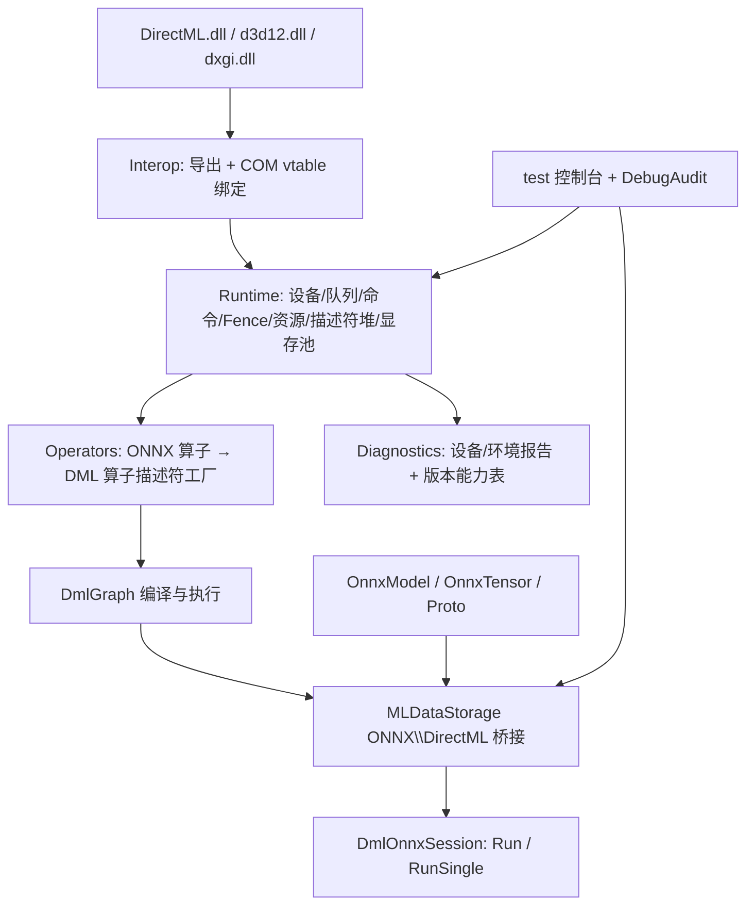

## 产品概述

在 `Data_science\DirectML\DirectML.vbproj` 中，从零构建一个**纯 VB.NET Interop 的 Windows DirectML 计算框架**，思路、分层与零依赖风格完全对齐现有的 `cuda\ILCuda\ILCuda.vbproj`：不引入任何第三方 NuGet，直接通过 `System.Runtime.InteropServices` 手工绑定 `dxgi.dll`、`d3d12.dll`、`DirectML.dll` 的原生 API 与 COM vtable。

在此之上，框架需要**原生支撑** `MachineLearning\MLDataStorage` 现有的 ONNX 能力：把 `.onnx` 模型（`OnnxModel` 的图/节点/属性/初始化器）直接编译成 DirectML 图并在 GPU 上执行，推理结果与现有 CPU 求值器（`OnnxGraphEvaluator`）在相同输入下可比对。

## 核心功能

- **原生库与设备层**：DXGI 适配器枚举（含独显/核显筛选）、D3D12 设备创建、DirectML 设备创建、版本与特性探测；库缺失时给出可操作诊断并安全失败。
- **执行层**：命令队列 / 命令分配器 / 命令列表 / Fence；显存资源（上传、回读、常量权重、临时资源）与描述符堆；一次提交完成整图执行，避免逐算子同步。
- **算子层**：把 ONNX 算子映射到 DML 算子（逐元素、激活、GEMM/MatMul、卷积与反卷积、池化、归一化与 LRN、归约、形状与布局变换、拼接切分填充、Gather/Scatter/TopK/Where、量化、比较与逻辑），附带形状推导与内存布局（strides）计算。
- **图执行**：编译一次、重复执行；中间张量显存池复用；支持多输入多输出，输出可回读为 `Double()`。
- **ONNX 桥接后端**（位于 `MLDataStorage\ONNX\DirectML\`）：`OnnxModel `→ DML 图编译器、Double ↔ Float32/Float16 精度适配、会话对象（API 形状对齐 `Run` / `RunSingle`），不支持的算子或不足的 DirectML 版本一律抛出带算子名/节点名的异常，绝不静默降级。
- **诊断**：设备报告、环境报告、修复建议、当前 DirectML 版本的能力矩阵，全部为纯数据结构，不依赖 Console。
- **演示与验证**：控制台测试程序可输出设备信息、算子自检、onnx 模型 GPU 推理并与 CPU 参考结果比较误差，生成测试报告。

框架本身无 UI；控制台程序的输出为结构化的设备/能力表与逐项测试结论（含最大绝对误差与耗时）。

## 技术栈

- 语言/运行时：VB.NET / .NET 10（`net10.0`），`PlatformTarget=x64`（D3D12/DirectML 指针与句柄均为 64 位）
- 原生依赖（运行时动态加载，零 NuGet）：`dxgi.dll`（适配器枚举）、`d3d12.dll`（设备与命令）、`DirectML.dll`（DML 设备与算子）
- Interop 方式：`NativeLibrary.Load` + `NativeLibrary.GetExport` + `Marshal.GetDelegateForFunctionPointer`（导出函数），COM 接口用**手写 vtable 槽位委托**（`Marshal.ReadIntPtr(Marshal.ReadIntPtr(p), slot*8)`）
- 打包：沿用 ILCuda 的工程元数据（`Configurations`、`OutputPath=../../.nuget/`、`PackageLicenseExpression=GPL-3.0-or-later`、README/logo 打包、`snupkg`）
- 测试：`test\test.vbproj`（Exe，x64）+ 仓库内 `Microsoft.VisualBasic.Core\src\ApplicationServices\Debugger\DebugAudit.vb` 记录断言并 `SaveReport` 生成报告

## 实现方案

### 分层策略

四层，依赖方向单向向下，与 ILCuda 的 `Interop` / `Runtime` / `Kernels+Math` 结构对位：

1. **Interop 层**：只做声明与绑定。`DxgiApi` / `D3D12Api` / `DmlApi` 负责导出签名与 vtable 委托；`ComApi` 提供 `IUnknown` 三槽（`QueryInterface` / `AddRef` / `Release`）、COM 包装基类与 `IID` 常量；`HResult` 提供 `HRESULT` 判定（`SUCCEEDED` / `FAILED`）与 `DmlException`；`Enums` / `Descriptors` 定义 `DML_TENSOR_DATA_TYPE`、`DML_OPERATOR_TYPE`、`DML_*_DESC` 结构体。
2. **Runtime 层**：把对象生命周期包装为 `IDisposable`，等价于 `CudaDevice` / `CudaStream` / `DeviceBuffer` 的角色：`DmlAdapter`、`DmlDevice`、`DmlCommandQueue`、`DmlCommandAllocator`、`DmlCommandList`、`DmlFence`、`DmlBuffer`、`DmlDescriptorHeap`、`DmlTensor`、`DmlBindingTable`、`DmlCompiledOperator`、`DmlCommandRecorder`、`DmlMemoryPool`、`DmlGraph`、`DmlExecutionContext`，以及引擎入口 `DmlEngine.TryCreate` + `EngineOptions`（对位 `CudaEngine`）。
3. **Operators 层**：把"算子语义"与"COM 调用"分离。`OperatorCatalog` 维护 ONNX 算子名 → 工厂 的注册表与能力表；`*Operators.vb` 各自产出 `DML_OPERATOR_DESC`（含形状/步长推导），由 Runtime 统一编译与绑定。等价于 ILCuda 的 `KernelCatalog` + `Math\GpuBasicMath` 关系。
4. **桥接层（在 MLDataStorage 内）**：`DmlOnnxGraphCompiler` 读 `ONNX.Proto` 节点与属性，调用 Operators 层构造图；`DmlOnnxSession` 对外提供与 `OnnxGraphEvaluator` 同形的 API，便于互换与结果比对。

### 关键决策与理由

- **手写 vtable 而非第三方 DirectX 绑定**：仓库既有 GPU 栈（ILCuda）是零依赖 P/Invoke，保持一致才能被同一套构建/打包流水线消化；代价是描述符结构体必须手工对齐、生命周期必须手工 `Release`，因此用"每个 COM 对象一个包装类 + 基类统一 Release"的强约束来抵消风险。
- **动态加载而非静态 `DllImport`**：`DirectML.dll` 可能来自系统目录、应用目录或 `Microsoft.AI.DirectML` 分发目录，且不同机器版本差异大；用 `NativeLibrary` 多路径探测（程序目录 → `System32` → `SysWOW64`/环境变量 → 已知 NuGet 目录）拿到模块句柄后再取导出，缺失时产出 `FixSuggestion` 而不是抛 `DllNotFoundException`。D3D12/DXGI 同理。
- **一次编译、多次执行**：`DmlOnnxSession` 缓存 `IDMLCompiledOperator`、绑定表、描述符堆与常量权重资源；执行时只做 `Reset/Close/ExecuteCommandLists/Signal/Wait`。这是与"每帧 `CreateOperator`"相比最关键的性能差异（编译开销远大于 dispatch）。
- **中间张量显存复用**：按节点区间（live interval）做线性扫描分配，单个 arena 缓冲切片复用，切片边界 256 字节对齐（满足 DML 绑定偏移要求）；复杂度 O(n log n)，显存占用接近峰值活跃集而非算子总量。
- **精度策略**：DML 不消费 `Double`，因此所有 GPU 张量统一为 `Float32`（可选 `Float16` 会话开关）；`Double ↔ Single` 转换只发生在**输入/输出边界**一次，中间结果全程驻留 GPU，避免宿主往返。误差在测试中以最大绝对误差显式记录。
- **不静默降级**：算子未映射、`CheckFeatureSupport` 判定当前 DML 版本不支持、或数据类型不支持时，抛 `OnnxDmlUnsupportedOperatorException`（带 `OpType` / `NodeName` / 需要的 DML 版本），与 `OnnxUnsupportedOperatorException` 的既有行为一致。

### 性能与可靠性要点

- **提交粒度**：整图 dispatch 记录进同一条 `ID3D12GraphicsCommandList`，一次 `ExecuteCommandLists` + 一次 Fence 等待，减少驱动往返与同步点。
- **资源状态**：DML 绑定缓冲必须为 `D3D12_RESOURCE_STATE_UNORDERED_ACCESS`；图中在执行前后插入必要的 `ResourceBarrier`（`COMMON → UAV`、`UAV → COPY_SOURCE`），避免隐式状态提升带来的性能惩罚。
- **临时/持久资源**：`IDMLCompiledOperator::GetBindingProperties` 给出 `TemporaryResourceSize` 与 `PersistentResourceSize`；临时资源从 `DmlMemoryPool` 租用，持久资源（DML 拥有的常量权重）在初始化时一次绑定。
- **描述符堆**：使用 `D3D12_DESCRIPTOR_HEAP_TYPE_CBV_SRV_UAV` 且 `ShaderVisible`，`DML_BINDING_TABLE_DESC` 同时需要 CPU 与 GPU 句柄；按 `RequiredDescriptorCount` 预留并在尺寸不变时复用。
- **诊断不写日志系统**：框架只产出 `DeviceReport` / `EnvironmentReport` / `FixSuggestion` 纯数据（对位 ILCuda 的 `Diagnostics\`），控制台排版留给 test 工程。
- **变更半径**：`DirectML` 工程为新建（无外部调用方）；`MLDataStorage` 只新增 `ONNX\DirectML\` 目录与一条 `ProjectReference`，不改动现有 `OnnxModel` / `OnnxTensor` / `OnnxGraphEvaluator` / `OnnxOperators` 的语义，现有 CPU 路径保持可用并可作参考基线。

## 架构设计



## 实现要点

- **结构体对齐**：`DML_*_DESC` 中的指针数组（`Sizes` / `Strides` / `InputTensorDescs`）必须用 `Marshal.AllocHGlobal` 分配并保持存活到调用返回；`DML_OPERATOR_DESC` 的 `Desc` 是 `void*`，用 `Marshal.StructureToPtr` 指向子描述符，嵌套描述符的生命周期必须包在同一个 `Using` 作用域内。
- **联合/可变结构**：`DML_CONVOLUTION_OPERATOR_DESC`、`DML_MEAN_VARIANCE_NORMALIZATION*_OPERATOR_DESC` 带可选 activation 指针，默认 `IntPtr.Zero`；`DML_ELEMENT_WISE_*_OPERATOR_DESC` 支持 `ScaleBias` 指针，需要与 `Clip` 区分使用。
- **所有权**：常量权重张量设置 `DML_TENSOR_FLAG_OWNED_BY_DML`，其数据在 operator 初始化时通过 `BindPersistentResource` 上传，之后**不得**再修改该缓冲；非 DML 拥有的张量在每次执行前 `BindInputs/BindOutputs`。
- **错误检查**：所有 `HRESULT` 统一走 `HResult.ThrowIfFailed(hr, <CallerMemberName>)`；DML 错误码（`DML_ELEMENT_WISE_*` 之外的 device-removed 类错误）需要单独文本映射，避免只给出数字。
- **回调/委托存活**：`GetDelegateForFunctionPointer` 得到的委托必须缓存（每接口类型静态只读），否则会被 GC 回收导致 AccessViolation；这是手写 vtable 最容易踩的坑。
- **测试可运行性**：无 GPU / 无 DirectML 时 test 程序必须优雅降级为"诊断输出 + 跳过 + 报告标记 skipped"，不能崩溃；这与 ILCuda demo 的 CPU 回退策略一致。
- **日志与隐私**：诊断只输出适配器名称、驱动版本、DirectML 版本与能力位，不打印模型权重内容。

## 目录结构

```
Data_science/DirectML/
├── DirectML.vbproj                  # [MODIFY] 改为 x64 可打包库工程：PlatformTarget/Platforms/Configurations/OutputPath/Package 元数据/README+logo 打包；移除 VisualStudio.NET5.vbproj 引用；Compile Remove="test\**"
├── Class1.vb                        # [DELETE] 空模板类
├── NamespaceDoc.vb                  # [NEW] 命名空间文档（对位 ILCuda/NamespaceDoc.vb）
├── README.md                        # [NEW] 框架说明：能力表、目录树、环境要求、DirectML 版本兼容表、用法示例
├── Interop/
│   ├── ComApi.vb                    # [NEW] IUnknown 三槽委托、COM 对象包装基类（Release/AddRef/QueryInterface）、IID 常量表、委托缓存
│   ├── HResult.vb                   # [NEW] HRESULT 常量与判定、DML 错误文本映射、DmlException
│   ├── DxgiApi.vb                   # [NEW] CreateDXGIFactory2 绑定；IDXGIFactory1/4/6、IDXGIAdapter1/4 的枚举与 GetDesc1 槽位
│   ├── D3D12Api.vb                  # [NEW] D3D12CreateDevice 绑定；ID3D12Device（CreateCommandQueue/Allocator/CommandList/Fence/CommittedResource/DescriptorHeap）、ID3D12GraphicsCommandList（ResourceBarrier/CopyBufferRegion/CopyResource/Close/Reset）、ID3D12Resource（Map/Unmap）、ID3D12Fence
│   ├── DmlApi.vb                    # [NEW] DMLCreateDevice 导出绑定；IDMLDevice（CreateOperator/CompileOperator/CreateOperatorInitializer/CreateCommandRecorder/CreateBindingTable/CheckFeatureSupport）、IDMLCompiledOperator（GetBindingProperties）、IDMLCommandRecorder（RecordDispatch）、IDMLBindingTable（BindInputs/BindOutputs/BindTemporaryResource/BindPersistentResource/Reset）
│   ├── DmlEnums.vb                  # [NEW] DML_TENSOR_DATA_TYPE / DML_TENSOR_FLAGS / DML_OPERATOR_TYPE / DML_EXECUTION_FLAGS / DML_CREATE_DEVICE_FLAGS / DML_FEATURE_* / DML_TENSOR_TYPE / DML_BINDING_TYPE
│   ├── DmlDescriptors.vb            # [NEW] DML_BUFFER_TENSOR_DESC / DML_TENSOR_DESC / DML_OPERATOR_DESC / DML_BUFFER_BINDING / DML_BUFFER_ARRAY_BINDING / DML_BINDING_TABLE_DESC / DML_BINDING_PROPERTIES、DML_TENSOR_DESC 与指针数组的辅助封送
│   └── Operators/
│       ├── DmlActivationDescs.vb    # [NEW] DML_ACTIVATION_* / DML_ELEMENT_WISE_*_OPERATOR_DESC（含 ScaleBias/Clip）
│       ├── DmlConvolutionDescs.vb   # [NEW] DML_CONVOLUTION_OPERATOR_DESC / DML_MAX_POOLING*_OPERATOR_DESC / DML_AVERAGE_POOLING_OPERATOR_DESC
│       ├── DmlMathDescs.vb          # [NEW] DML_GEMM_OPERATOR_DESC / DML_REDUCE_OPERATOR_DESC / DML_MEAN_VARIANCE_NORMALIZATION*_OPERATOR_DESC / DML_LP_NORMALIZATION_OPERATOR_DESC
│       └── DmlShapeDescs.vb         # [NEW] DML_JOIN/ELEMENT_WISE_IDENTITY/SPLICE/PADDING/TILE/EXPAND/GATHER/SCATTER/TOP_K/ARGMAX/QUANTIZE 等结构体
├── Runtime/
│   ├── NamespaceDoc.vb              # [NEW] Runtime 命名空间文档
│   ├── DmlAdapter.vb                # [NEW] DXGI 适配器包装：名称、显存、厂商/设备 ID、是否支持 D3D12（TryCreateDevice）
│   ├── DmlDevice.vb                 # [NEW] D3D12 + DML 设备与版本/特性探测（CheckFeatureSupport）、能力表
│   ├── DmlCommandQueue.vb           # [NEW] D3D12 命令队列（DIRECT/COMPUTE），Execute/Signal
│   ├── DmlCommandAllocator.vb       # [NEW] 命令分配器，Reset 复用
│   ├── DmlCommandList.vb            # [NEW] 命令列表记录、Reset/Close、屏障与 Copy 封装
│   ├── DmlFence.vb                  # [NEW] Fence 创建、Signal、WaitForValue（带超时）
│   ├── DmlBuffer.vb                 # [NEW] ID3D12Resource 包装：committed 资源创建、Write/ReadAsync（Map+Copy）、字节范围读写
│   ├── DmlTensor.vb                 # [NEW] 张量描述（dims/strides/data type/flags）+ 关联 DmlBuffer 与 TotalTensorSizeInBytes
│   ├── DmlDescriptorHeap.vb         # [NEW] shader visible CBV/SRV/UAV 堆：CPU/GPU 句柄、分配描述符
│   ├── DmlBindingTable.vb           # [NEW] DML 绑定表：BindInputs/BindOutputs/BindTemporaryResource/BindPersistentResource
│   ├── DmlCompiledOperator.vb       # [NEW] 编译算子与 BindingProperties（descriptor 数、临时/持久资源大小）
│   ├── DmlCommandRecorder.vb        # [NEW] RecordDispatch 封装
│   ├── DmlMemoryPool.vb             # [NEW] 显存池：256 字节对齐切片、按 live interval 复用、峰值统计
│   ├── DmlGraph.vb                  # [NEW] 编译后的算子图：节点顺序、绑定的张量、持久/临时资源、Execute(commandList)
│   ├── DmlExecutionContext.vb       # [NEW] 执行上下文：队列+分配器+命令列表+Fence 的提交/等待编排，支持一次提交多 dispatch
│   ├── Diagnostics/
│   │   ├── DeviceReport.vb          # [NEW] 设备报告（适配器、驱动、DML 版本、特性级别、显存）
│   │   ├── EnvironmentReport.vb     # [NEW] 环境报告（各原生库的探测路径与加载结果、可用设备列表）
│   │   └── FixSuggestion.vb         # [NEW] 可操作修复建议（缺少 DirectML 时如何安装/旁加载）
│   └── DmlEngine/
│       ├── DmlEngine.vb             # [NEW] 引擎入口：TryCreate（适配器→设备→队列→上下文），IDisposable，对位 CudaEngine
│       ├── EngineOptions.vb         # [NEW] 适配器序号、库路径覆盖、Float16 开关、Diagnostics 收集、ErrorMessage
│       └── DmlRuntime.vb            # [NEW] 库加载与导出缓存（NativeLibrary 多路径探测、SetDllDirectory 等价处理）
├── Operators/
│   ├── OperatorCatalog.vb           # [NEW] ONNX 算子名 → 工厂 注册表 + 能力表（按 DML 版本过滤），未知算子抛异常
│   ├── OperatorFactory.vb           # [NEW] 工厂基类：输入/输出张量描述、属性读取、形状推导、描述符构建与释放
│   ├── ElementWiseOperators.vb      # [NEW] Add/Sub/Mul/Div/Pow/Min/Max/Sum/Clip/Where/比较/逻辑/Identity/Copy
│   ├── ActivationOperators.vb       # [NEW] Relu/LeakyRelu/Elu/Selu/Sigmoid/HardSigmoid/HardSwish/Tanh/Softplus/Softsign/Exp/Log/Sqrt/Reciprocal/Neg/Abs/Floor/Ceil/Round/Sin/Cos/Tan/Erf/Celu/ThresholdedRelu/Shrink/PReLU/Softmax/LogSoftmax/Hardmax
│   ├── MatMulOperators.vb           # [NEW] Gemm/MatMul/MatMulInteger 的 GEMM 描述符（transA/transB/alpha/beta）
│   ├── ConvolutionOperators.vb      # [NEW] Conv/ConvTranspose/各类 Pool/GlobalPool/LpPool 描述符与输出形状推导
│   ├── NormalizationOperators.vb    # [NEW] BatchNormalization/InstanceNormalization/LayerNormalization/LRN/LpNormalization
│   ├── ReduceOperators.vb           # [NEW] Reduce{Sum,Mean,Max,Min,Prod,L1,L2,LogSum,LogSumExp}（axes/keepdims）
│   ├── ShapeOperators.vb            # [NEW] Reshape/Flatten/Squeeze/Unsqueeze/Transpose/Concat/Split/Slice/Pad/Expand/Tile/DepthToSpace/SpaceToDepth/Resize
│   ├── DataMovementOperators.vb     # [NEW] Gather/GatherElements/ScatterND/TopK/ArgMax/ArgMin/OneHot/NonZero（必要时用 CPU 侧辅助 + 回填）
│   ├── QuantizationOperators.vb     # [NEW] QuantizeLinear/DequantizeLinear/QLinearConv/QLinearMatMul
│   └── ConstantUploader.vb          # [NEW] 初始化器 → DML_TENSOR_FLAG_OWNED_BY_DML 常量权重上传与打包
└── test/
    ├── test.vbproj                  # [NEW] Exe + x64 + StartupObject，引用 Core / DirectML / MLDataStorage
    ├── Program.vb                   # [NEW] CLI：info / selftest / ops / onnx-run / onnx-compare；用 DebugAudit 记录每项断言
    └── Reporter.vb                  # [NEW] 控制台排版层：消费 DeviceReport/EnvironmentReport/能力表/测试结果

Data_science/MachineLearning/MLDataStorage/
├── MLDataStorage.vbproj             # [MODIFY] 增加 ProjectReference: ..\..\DirectML\DirectML.vbproj
├── README.md                        # [MODIFY] 增加 DirectML 后端章节（用法、精度、能力矩阵、回退说明）
└── ONNX/DirectML/
    ├── NamespaceDoc.vb              # [NEW] 桥接命名空间文档（Microsoft.VisualBasic.MachineLearning.DataStorage.ONNX.DirectML）
    ├── DmlTensorAdapter.vb          # [NEW] OnnxTensor(Double[]) ↔ DmlTensor(Float32/Float16) 的打包/解包、dims→DML sizes、行主序 strides
    ├── DmlOnnxGraphCompiler.vb      # [NEW] 节点遍历：属性解析、形状推导、算子构造、常量权重上传、中间缓冲分配计划、拓扑校验
    ├── DmlOnnxSession.vb            # [NEW] 会话：编译缓存、Run(IDictionary(Of String, OnnxTensor))、RunSingle(Double())，形状与 OnnxGraphEvaluator 对齐
    ├── DmlOnnxOptions.vb            # [NEW] 精度（Float32/Float16）、适配器序号、是否允许 CPU 回退、诊断输出
    └── DmlOnnxCapabilities.vb       # [NEW] DML 版本 → 支持算子矩阵；OnnxDmlUnsupportedOperatorException（OpType/NodeName/所需版本）
```

## 关键代码结构

（仅示意新增的公开契约，用于约束桥接层与执行器的 API 形状）

```
' Runtime\DmlEngine\DmlEngine.vb —— 引擎入口，对位 CudaEngine
Public NotInheritable Class DmlEngine
    Implements IDisposable

    Public Shared Function TryCreate(options As EngineOptions) As DmlEngine
    Public ReadOnly Property Device As DmlDevice
    Public ReadOnly Property Context As DmlExecutionContext
    Public Function GetMemoryInfo() As MemoryInfo
End Class

' ONNX\DirectML\DmlOnnxSession.vb —— 与 OnnxGraphEvaluator 同形的执行入口
Public NotInheritable Class DmlOnnxSession
    Implements IDisposable

    Public Sub New(model As OnnxModel, Optional engine As DmlEngine = Nothing,
                   Optional options As DmlOnnxOptions = Nothing)
    Public Function Run(inputs As IDictionary(Of String, OnnxTensor)) As Dictionary(Of String, OnnxTensor)
    Public Function RunSingle(input As Double()) As Double()
    Public ReadOnly Property Capabilities As DmlOnnxCapabilities
End Class
```

## Agent Extensions

### SubAgent

- **code-explorer**
- Purpose: 在实现 ONNX 桥接前，快速核对 MLDataStorage 的 `ONNX.Proto` 节点/属性/数据类型细节与 `OnnxOperators` 的 CPU 参考语义，确认算子名与属性名（strides/pads/dilations/group/alpha/beta/perm/axes/keepdims 等）的一致来源，避免凭记忆写错
- Expected outcome: 产出一份"ONNX 算子 → 属性 → 对应 DML 描述符字段"的核对清单，作为 `OperatorCatalog` 与 `DmlOnnxGraphCompiler` 的实现依据