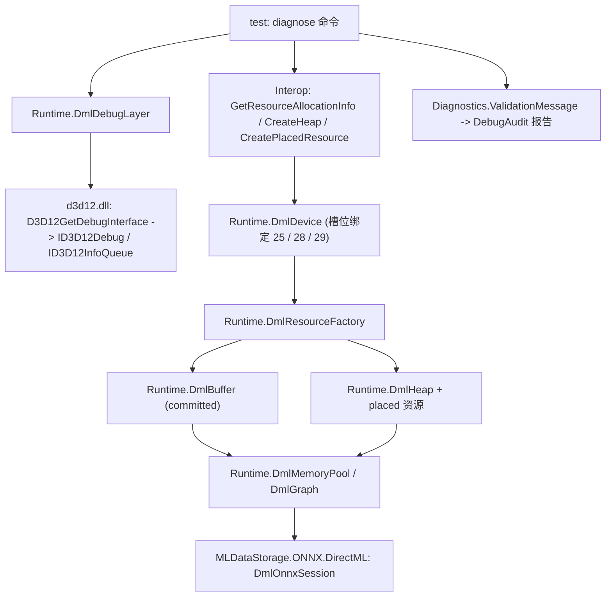

## 产品概述

`DirectML` 框架当前唯一的功能性阻塞点是：`ID3D12Device::CreateCommittedResource` 对 **BUFFER** 描述符一律返回 `E_INVALIDARG`（TEXTURE2D 走同一调用却成功），导致显存缓冲分配失败，进而使 `DmlGraph.Execute` 与 ONNX 推理链路全部无法执行。本计划的目标是：借助 D3D12 调试层与一组可复现的分治实验定位真实根因，修复显存分配路径（含备用的 placed 资源策略），并最终让"最小计算图 → 卷积图 → ONNX 小模型"三段 GPU 执行链路跑出与 CPU 参考一致的结果。

## 核心功能

- **根因定位能力**：打开 D3D12 调试层并通过 InfoQueue 读取运行时给出的拒绝原因原文，产出结构化校验消息（严重级别、类别、ID、描述），不依赖控制台，可被调用方自行排版。
- **分治实验矩阵**：针对缓冲区创建失败点做可复现实验——未托管内存手工构造描述符、`GetResourceAllocationInfo` 描述符校验、纹理对照组、`CreateHeap` + `CreatePlacedResource` 备用路径；每次实验记录 HRESULT 与校验消息，形成可比对结论。
- **显存分配修复**：缓冲区创建恢复可用，并同时支持 committed 与 placed 两种分配策略，策略可配置、可回退。
- **执行链路打通**：最小计算图（`input -> Relu -> output`）与卷积图都能完成上传、屏障、dispatch、回读并得到正确数值。
- **ONNX 端到端**：内置小模型（Conv/Relu/GlobalAveragePool/Flatten/Gemm）在 GPU 上推理，与 CPU 双精度参考逐节点对齐，误差在单精度量级内。
- **回归与文档**：`info / ops / selftest / device / graph / onnx` 六个命令全部通过并生成测试报告；README 状态表中的阻塞项改为已解决，并记录根因与修复方式。

预期效果：诊断输出从"只有 `0x80070057`"变为"运行时给出的具体约束 + 对应代码位置"，最终 `DirectML.Demo.exe graph relu` 打印 `0, 2, 0, 4`、`onnx` 命令打印 GPU 与 CPU 的最大绝对误差。

## 技术栈

- 语言与运行时：VB.NET / `net10.0` / `PlatformTarget=x64`（沿用 `DirectML.vbproj` 现有配置）
- 互操作：`System.Runtime.InteropServices` + 手写 vtable（`ComApi.GetDelegate(Of T)` / `ComObjectBase.GetSlotDelegate`），零 NuGet 依赖
- 原生依赖：`d3d12.dll`（新增 `D3D12GetDebugInterface` 导出）、`DirectML.dll`、`dxgi.dll`（均已通过 `NativeModule` 动态探测）
- 测试与报告：`test\test.vbproj`（Exe）+ 仓库内 `DebugAudit`（`Check/Test/Mark/SaveReport`），报告写到 `directml-report.json`

## 实现方案

### 总体策略

分四步、自证式推进，每一步都以"可复现的实验结果"作为下一步的输入，而不是靠猜测改动：

1. **把不可见变可见**：先补齐 D3D12 调试层（`ID3D12Debug::EnableDebugLayer`）与 `ID3D12InfoQueue` 的消息读取。D3D12 对 `CreateCommittedResource` 的失败几乎总会写一条校验消息，这条文本能直接指出是哪一个参数被拒。
2. **把可疑面切小**：在拿到文本之前，先用一组对照实验二分定位（描述符内容 / 描述符封送 / 堆与状态组合 / committed 与 placed 路径）。其中最关键的一项是把 `D3D12_RESOURCE_DESC` 手工写入未托管内存后以 `IntPtr` 传入，彻底排除 .NET 结构封送这一层。
3. **按结论修复**：三种可能结论各有明确落点（描述符字段约束 → 修正构造；封送差异 → 统一改走未托管描述符；committed 路径整体不可用 → 默认改用 `CreateHeap` + `CreatePlacedResource`）。为避免再被同一问题咬一次，分配策略抽成一层可切换的工厂。
4. **向上验证**：缓冲区可用之后，逐层验证执行链路与 ONNX 桥接，把每一层的数值误差显式记录到测试报告。

### 关键决策与理由

- **先上调试层，而不是继续枚举参数**：上一轮已把堆类型、初始状态、宽度、对齐、UAV 标志、NodeMask、三种适配器全部排除，继续盲试的边际收益极低；InfoQueue 的文本是唯一能直接终结猜测的信息源。代价是调试层会降低运行速度并增加内存，因此只在显式开关（`EngineOptions.EnableDebugLayer`）下启用，默认关闭。
- **未托管描述符实验优先于代码重构**：如果问题出在 .NET 对 `ByRef` 结构的封送（例如临时副本或字段填充差异），那么"用 `Marshal.AllocHGlobal` + 按偏移写入"必然复现问题或必然解决问题，两种结果都极具信息量，且改动只发生在实验命令里，不影响库。
- **placed 资源不是权宜之计而是架构补强**：`CreateHeap` + `CreatePlacedResource` 是 D3D12 的正式路径，显存池（`DmlMemoryPool` 已经是"单块 UAV 缓冲 + 切片"的设计）天然适配 placed 资源，还能减少驱动侧的大块分配压力。把它做成可切换策略（`AllocationMode`：`Auto`/`Committed`/`Placed`），既解决当前问题，也为后续大模型显存规划留出空间。
- **失败必须可诊断、不可静默**：延续既有"不静默降级"约定，分配失败时抛出带上 `HRESULT`、描述符关键字段、以及调试层消息的异常，而不是只给一个错误码。
- **变更半径受限**：只改 `Interop\`（新增调试层与 `CreateHeap`/`CreatePlacedResource`/`GetResourceAllocationInfo` 绑定）、`Runtime\`（设备槽位绑定、`DmlBuffer `分配路径、新增 `DmlHeap`/`DmlResourceFactory`）、`Diagnostics\`（校验消息类型）、`test\Program.vb`（新增 `diagnose` 命令）与 README；不动 `Operators\` 与 ONNX 桥接的算子语义，避免把问题面扩大。

### 性能与可靠性

- 调试层只在诊断/测试时开启；正常路径不承担其开销。
- 分配热路径无回归：`DmlResourceFactory` 只是把"构造描述符 + 调用一次原生方法"包起来，复杂度仍是 O(1)；placed 路径额外需要一个 `DmlHeap`（O(1) 创建，切片按 64KB 对齐），与现有 `DmlMemoryPool` 的 256 字节绑定对齐不冲突。
- 执行链路保持"整图一次提交、一次 Fence 等待"，不因为诊断改动引入逐算子同步。
- 所有 HRESULT 仍统一走 `HResult.ThrowIfFailed`；调试消息只在显式开关下缓存，且不打印模型权重内容，避免日志噪音与数据泄露。

### 实现要点

- **`_WIN32` 的返回值约定**：`GetResourceAllocationInfo` 在 Windows 上是 `(this, RetVal, visibleMask, numDescs, pDescs)`；`GetBindingProperties` 已按 `(this, RetVal)` 处理过，新增接口沿用同一模式，切勿写成 x64 sret。
- **槽位号必须实测**：SDK 头文件里 `#if !defined(_WIN32)` 会产生重复条目导致按文本解析偏移 2（`CreateFence` 实为 36、`CreateCommittedResource` 实为 27）；`CreateHeap`/`CreatePlacedResource` 的槽位（文本解析为 28/29）必须先通过"返回 HRESULT + `QueryInterface(IID_ID3D12Heap/IID_ID3D12Resource)`"确认再落地。
- **描述符字节为唯一真相**：实验命令需把每次尝试的 56 字节描述符以十六进制打进报告，便于把"失败"与"成功"两次的字节逐位对比。
- **缓冲区大小规则**：DML 绑定偏移要求 256 字节对齐，`Width` 需为 4 的倍数；placed 堆需 64KB 对齐，`DmlMemoryPool` 切片策略需与之一致。
- **`DmlGraph.Execute` 的既有隐患**：上传缓冲区的 Map/Unmap 与 `ResourceBarrier` 顺序、以及 readback 前的 `UAV -> COPY_SOURCE` 屏障，都应在 `graph relu` 首次成功后逐项核对，避免"数值对但靠运气"。
- **测试可运行性**：无 DirectML 或无可用适配器时，`diagnose` 与 `graph` 必须优雅降级为"诊断输出 + 标记 skipped"，不得崩溃；这与此前 `device`/`onnx` 命令的处理方式一致。

## 架构设计



## 目录结构

```
Data_science/DirectML/
├── Interop/
│   ├── D3D12Api.vb                          # [MODIFY] 新增 D3D12_HEAP_DESC 结构、D3D12CreateHeapFn、D3D12CreatePlacedResourceFn、D3D12GetResourceAllocationInfoFn（_WIN32 RetVal 约定）、D3D12GetDebugInterfaceFn 导出
│   ├── D3D12DebugApi.vb                     # [NEW] ID3D12Debug / ID3D12InfoQueue 槽位委托与 D3D12_MESSAGE 结构；EnableDebugLayer、GetNumStoredMessages、GetMessage、ClearStoredMessages
│   ├── ComIIDs.vb                           # [MODIFY] 补 IID_ID3D12Debug、IID_ID3D12InfoQueue、IID_ID3D12Heap、IID_ID3D12Device1（用于可选调试接口查询）
│   └── D3D12Marshal.vb                      # [NEW] 结构体写未托管内存（StructToNative/Free/FillBufferDesc），用于"排除封送差异"实验与后续统一传递方式
├── Runtime/
│   ├── DmlDebugLayer.vb                     # [NEW] 调试层生命周期与消息缓存：TryEnable、Attach(device)、Capture()/Clear()，产出 Diagnostics.ValidationMessage 列表
│   ├── DmlDevice.vb                         # [MODIFY] 绑定槽位 25/28/29；暴露 CreateHeap/CreatePlacedResource/GetResourceAllocationInfo；创建后按需 Attach 调试层
│   ├── DmlHeap.vb                           # [NEW] ID3D12Heap 包装（CreateHeap + QueryInterface 校验 + 64KB 对齐切片）
│   ├── DmlResourceFactory.vb                # [NEW] 分配策略：Auto/Committed/Placed；统一入口 CreateBuffer(device, size, heapType, uav, name)，失败时附带描述符字节与调试消息
│   ├── DmlBuffer.vb                         # [MODIFY] 描述符构造改为可注入（未托管描述符路径）、错误信息包含描述符关键字段；Map/Unmap 路径保持
│   ├── DmlMemoryPool.vb                     # [MODIFY] 通过 DmlResourceFactory 取显存，支持 placed 堆；切片对齐保持 256 字节
│   ├── DmlGraph.vb                          # [MODIFY] 核对上传/屏障/回读顺序，`Compile` 失败时把调试消息一并抛出
│   └── DmlEngine/EngineOptions.vb           # [MODIFY] 新增 EnableDebugLayer、AllocationMode、Trace 开关；EngineOptions 仍是诊断数据的唯一入口
├── Diagnostics/
│   └── ValidationMessage.vb                 # [NEW] 调试层消息的纯数据结构（Severity/Category/Id/Description/Operation），与既有 DeviceReport/EnvironmentReport 风格一致
├── test/
│   └── Program.vb                           # [MODIFY] 新增 diagnose 命令（描述符矩阵 + 校验消息输出）；graph/onnx 增加数值断言与 skipped 处理
└── README.md                                # [MODIFY] 状态表更新、根因记录、diagnose 用法

Data_science/MachineLearning/MLDataStorage/ONNX/DirectML/
└── DmlOnnxGraphCompiler.vb                  # [MODIFY] 仅在端到端暴露出编译器问题（张量步长、bias 绑定、Gemm 转置等）时按需修正
```

## 关键代码结构

```
' Diagnostics\ValidationMessage.vb —— 调试层消息的纯数据视图
Public NotInheritable Class DmlValidationMessage
    Public ReadOnly Property Severity As String
    Public ReadOnly Property Category As String
    Public ReadOnly Property Id As Integer
    Public ReadOnly Property Description As String
    Public ReadOnly Property Operation As String
End Class

' Runtime\DmlResourceFactory.vb —— 可切换的显存分配策略
Public Enum DmlAllocationMode
    Auto = 0
    Committed = 1
    Placed = 2
End Enum

Public NotInheritable Class DmlResourceFactory
    Public Shared Function CreateBuffer(device As DmlDevice,
                                        sizeInBytes As ULong,
                                        heapType As D3D12_HEAP_TYPE,
                                        unorderedAccess As Boolean,
                                        Optional mode As DmlAllocationMode = DmlAllocationMode.Auto,
                                        Optional name As String = Nothing) As DmlBuffer
End Class
```

## Agent Extensions

### SubAgent

- **code-explorer**
- Purpose: 在对原生接口做任何改动前，一次性核对 `Interop\` 与 `Runtime\` 中全部 vtable 槽位引用、`D3D12_*` / `DML_* `结构体定义（字段顺序、枚举底座类型、`StructLayout `与 `Marshal.SizeOf` 预期值），产出一份"代码 vs Windows SDK 头文件"的一致性清单，重点覆盖 `CreateHeap`/`CreatePlacedResource`/`GetResourceAllocationInfo`/`ID3D12InfoQueue` 这几个新增接口的槽位与签名
- Expected outcome: 一份可直接用于落地实现的核对清单（含每个槽位号、每个结构体的期望大小与字段偏移），避免再次出现 `CreateFence` 那类"按头文件文本解析导致偏移 2"的问题