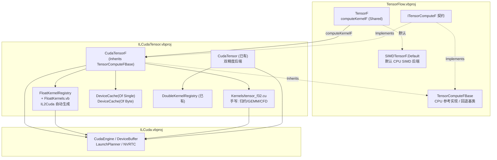

## 产品概述

为 `cuda\ILCudaTensor\ILCudaTensor.vbproj` 项目新增**单精度（float32）Tensor 的 CUDA GPU 计算后端** `CudaTensorF`，使其实现 `ITensorComputeF` 契约的全部算子，从而让 `TensorF.computeKernelF` 这条目前 100% 走 CPU SIMD 的计算栈也能切换到 GPU。

这是让 `gr\physics\physics-netcore5.vbproj` 后续能通过 tensor 算子间接获取 CUDA 加速的**前置基础设施**——因为 GPU 上 FP64 吞吐只有 FP32 的 1/64（GeForce）~1/32（RTX A4000），物理仿真必须走 float32 栈才有实际收益。

## 核心特性

1. **单精度逐元素/标量算子 GPU 化**：二元（Add/Subtract/Multiply/Divide/Maximum/Minimum）、一元（Exp/Log/Sqrt/Square/Abs/Negate/Reciprocal/Tanh/Sigmoid/Relu）、标量（AddScalar/MultiplyScalar/DivideScalar/Clip）。
2. **矩阵乘与归约 GPU 化**：`MatMul`（FP32 GEMM）、`SumAll`（返回 Double，设备侧双精度累加）、`MeanAll`、`MinAll`、`MaxAll`。
3. **CFD 四原语 GPU 化**：`Laplacian7`（七点拉普拉斯 stencil）、`JacobiStencil7`（带掩膜七点 Jacobi 迭代）、`AdvectTrilinear`（半拉格朗日平流 + 三线性插值）、`ApplyMask`（按掩膜置零固体单元）。
4. **`TensorF` 设备缓存失效机制**：补齐 `Version` / `MarkHostModified()` / `DeviceEpoch` / `InvalidateAllDeviceCaches()`，与双精度 `Tensor` 完全对齐，这是显存 LRU 缓存正确性的硬前提。
5. **统一注册与诊断**：`CudaTensor.Register()` 一次调用同时切换双精度与单精度两条栈；提供 `IsKernelAvailable` / `DescribeKernels` 风格的诊断，让调用方能确认"float 栈是否真的上了 GPU"。

## 已确认的范围边界

- CFD 四原语**纳入本次范围**（用户确认）。
- **允许**修改 TensorFlow 项目的 `TensorF.vb` 以补齐缓存失效机制（用户确认）。
- 不涉及 `ITensorComputeF` 契约本身的变更；不涉及设备常驻（`PinDevice`）能力——F 契约没有该组成员。

## 技术栈

- 语言/框架：VB.NET（`net10.0`，`Platforms=AnyCPU;x64`；ILCuda 仅支持 x64）
- 现有可插拔后端契约：`Microsoft.VisualBasic.MachineLearning.TensorFlow.Compute.ITensorComputeF`
- CPU 参考实现基类：`Compute.TensorComputeFBase`（回退目标，所有算子都有 `Overridable` 实现）
- GPU 内核两条供给路径：
- **自动生成**：`ILCuda.IL2Cuda` 的 `<CudaKernel(name)>` + IL 反编译（`CudaTypeMap` 已确证 `Single → float`，`PrefersSingle()` 自动加 `f` 后缀 → `sqrtf`/`expf`/`fabsf`/`powf`）
- **手写 .cu**：`Kernels\*.cu` 内嵌资源，经 `KernelSources.Register(Assembly)` 注入 NVRTC
- 显存缓存：`DeviceCache(Of T As Structure)`（LRU，键 = 主机数组引用身份 + 版本号），需新增 `(Of Single)` 与 `(Of Byte)` 两个实例
- 运行时：`ILCudaRuntime.CudaEngine.TryCreate` / `GetKernel` / `DeviceBuffer(Of T)` / `LaunchPlanner.For1D(n, 256)`

## 实现方案

### 高层策略

照 `CudaTensor`（双精度后端）的同构形态，在 `ILCudaTensor\GPUTensor\` 下新建一套 `CudaTensorF` 后端。**逐元素算子走 IL2Cuda 自动生成**（`CudaTypeMap` 已完整支持 Single，无需手写一行 .cu）；**只有 IL2Cuda 表达不了的部分手写 `tensor_f32.cu`**（两段式全局归约需要块内共享内存树形归约、GEMM 需要分块、CFD stencil 需要三维索引与 ping-pong 迭代——这与既有 `gemm.cu` / `train.cu` 必须手写的理由完全一致）。

### 关键技术决策与权衡

| 决策 | 理由 |
| --- | --- |
| 逐元素内核走 IL2Cuda 而非手写 .cu | `CudaTypeMap` 已确证支持 `Single→float` 且自动加 `f` 后缀；与 `DoubleKernels.vb` 同构，维护成本最低，且天然复用已有的"翻译失败 → 记入 `_failures` → 算子自动回退 CPU"机制 |
| `tensor_f32.cu` 只写 4 类内核 | 归约（共享内存树形，IL2Cuda 无法表达块内归约）、GEMM（分块）、CFD stencil（三维索引 + ping-pong）、ApplyMask。其余全部自动生成 |
| `SumAll` 设备侧用双精度累加 | `ITensorComputeF.SumAll` 契约注释明确要求"累加使用双精度，避免大数组单精度累加的舍入误差"，返回类型也是 `Double`。阶段一 partial 用 `double` 累加，与 CPU 参考实现对齐 |
| `mask`/`nFluid` 用 `DeviceCache(Of Byte)` | 这两个 `Byte()` 不是张量，但一次仿真中通常不变，适合长驻显存；复用既有泛型缓存即可，无新增机制 |
| float 栈单独设 `MinGpuElementsF` | float 只有 4 字节，PCIe 传输成本是 double 的一半，阈值可低于双精度栈。初值仍取 4096 与双精度栈一致，暴露为可写属性便于按设备调优 |
| `Register()` 同时切两栈 | 用户拿到的是"一个 GPU 后端"的心智模型；若只切双精度栈会造成"以为上了 GPU 实际没有"的误判。同时保留 `registerFloat` 可选参数以支持只切单精度的诊断场景 |


### 性能与复杂度

- **热路径**：每个算子 = 1 次显存上传（缓存命中则 0 次）+ 1 次内核启动 + 1 次结果回传。`DeviceCache` 的 LRU 命中是性能关键，故 `TensorF.Version` 必须准确：版本号不变 → 命中；原地写入 → `MarkHostModified()` 自增 → 失效重传。
- **瓶颈与缓解**：`TensorF.Wrap` 是零拷贝包装（注释明确"适用于把 CFD 场缓冲暴露成张量的场景"），主机侧就地改写 CFD 场时张量自身无从感知——这与 `Tensor.vb` 的注释完全同构，故必须提供 `InvalidateAllDeviceCaches()` 全局纪元。
- **CFD 原语的往返优化**：`JacobiStencil7(iterations:=N)` 必须在设备侧连续迭代 N 次（ping-pong 两个缓冲），**绝不能每次迭代回主机**，否则往返开销会把收益吃光。

### 避免技术债

全部沿用既有模式，不引入新抽象：`TensorComputeFBase` 作回退基类、`DeviceCache(Of T)` 作缓存、`FloatKernelRegistry` 照抄 `DoubleKernelRegistry` 的 `EnsureRegistered/Available/Failures` 三段式、算子覆写照抄 `RequireSameShape → EwXXX → If r IsNot Nothing Then Return r → Return MyBase.XXX` 范式。

## 架构设计



## 目录结构

```
G:\pixelArtist\src\framework\Data_science\MachineLearning\TensorFlow\
├── TensorF.vb                          # [MODIFY] 补齐设备缓存失效机制，与 Tensor.vb 对齐
│                                       #   - Private _version As Long 字段
│                                       #   - Private Shared _deviceEpoch As Long = 0
│                                       #   - Public Shared ReadOnly Property DeviceEpoch（Interlocked.Read）
│                                       #   - Public Shared Sub InvalidateAllDeviceCaches()（Interlocked.Increment）
│                                       #   - Public ReadOnly Property Version = _version + DeviceEpoch
│                                       #   - Public Sub MarkHostModified()（Interlocked.Increment）
│                                       #   模板：Tensor.vb L139-157 / L241-257

G:\pixelArtist\src\framework\cuda\ILCudaTensor\
├── ILCudaTensor.vbproj                 # [MODIFY] ItemGroup 增加 <EmbeddedResource Include="Kernels\tensor_f32.cu" />
├── GPUTensor\
│   ├── FloatKernels.vb                 # [NEW] IL2Cuda 内核源（只用于被反编译，不被托管调用）
│   │                                   #   Public Module FloatKernels：<CudaKernel(FloatKernelRegistry.Xxx)>
│   │                                   #   标注的 Single 标量函数，覆盖 21 个逐元素/标量算子
│   │                                   #   Friend Module FloatKernelRegistry：内核名常量 + Failures +
│   │                                   #   Available() + EnsureRegistered()（幂等/SyncLock/异常记入 _failures）
│   │                                   #   模板：DoubleKernels.vb L92-375（常量名前缀改 il_tensorf_ew_*）
│   ├── TensorKernels.vb                # [MODIFY] TensorKernelNames 增加 float 内核名常量分组：
│   │                                   #   归约（F32 版 Partial/Final Sum/Max/Min）、GEMM32、
│   │                                   #   Laplacian7 / Jacobi7 / Advect / ApplyMask
│   └── CudaTensorF.vb                  # [NEW] 单精度 CUDA 后端主体
│                                       #   Public Class CudaTensorF : Inherits TensorComputeFBase : Implements IDisposable
│                                       #   - 阈值常量：MinGpuElementsF / MinGemmElementsF / RowBlockSize / StageBlockSize
│                                       #   - 字段：_engine / _f32 As DeviceCache(Of Single) / _mask As DeviceCache(Of Byte)
│                                       #   - 工具：OnGpu / TryKernel / EwBinary / EwUnary / DeviceF32 / DeviceMask
│                                       #   - 全部算子覆写（逐元素/标量/MatMul/归约/CFD 四原语）
│                                       #   - Register(options, cacheBytes, registerDouble, registerFloat) / Unregister()
│                                       #   - 诊断：IsKernelAvailable / DescribeKernels / LastError / Current
│                                       #   模板：CudaTensor.vb L107-472（结构）+ L611+（算子覆写范式）
└── Kernels\
    └── tensor_f32.cu                   # [NEW] 手写单精度内核（extern "C" __global__）
                                        #   - 两段式全局归约：partial（double 累加）/ final
                                        #   - FP32 GEMM 分块矩阵乘
                                        #   - tensorLaplacian7Fp32Kernel
                                        #   - tensorJacobi7Fp32Kernel（设备侧 ping-pong 迭代 N 次）
                                        #   - tensorAdvectTrilinearFp32Kernel
                                        #   - tensorApplyMaskFp32Kernel
                                        #   网格索引必须与 TensorComputeFBase.vb L74-77 逐字一致：
                                        #     idx = (i*ny + j)*nz + k；±ny*nz / ±nz / ±1
                                        #   风格模板：Kernels\tensor.cu（#define 块 + 宏展开）

G:\pixelArtist\src\framework\cuda\ILCudaTensor\test\
└── Program.vb                          # [MODIFY] 新增 float 后端对拍测试
                                        #   每个算子：SIMDTensorF 结果 vs CudaTensorF 结果逐点比对
                                        #   回切 SIMD 的写法模板见 Program.vb L401-408
```

## 实现注意事项

1. **回退必须静默且语义等价**（既有后端的一致策略）：任何算子在「张量小于 `MinGpuElementsF` / 内核缺失 / NVRTC 编译失败」时必须回退 `MyBase.xxx`（`TensorComputeFBase` 的 CPU 实现），**绝不能抛异常或返回错误结果**。
2. **CFD 原语必须与 CPU 参考实现逐点比对**。`TensorComputeFBase.vb` 文件头注释原文："是 GPU 后端移植时的语义基准（GPU 结果必须与这里逐点比对）"。特别注意 `JacobiStencil7` 的 `denom` 二义性（`beta > 0` 时取 `beta`，否则取 `nFluid(idx)`）与固体单元恒为 0 的约束。
3. **`AdvectTrilinear` 的签名里没有网格尺寸与间距参数**（`src, u, v, w, dt, mask`）——实现前必须精读 `TensorComputeFBase.vb` L418 附近的 CPU 参考实现，确认它是如何从 `src.Shape` 推导 `nx/ny/nz` 与网格间距的，GPU 内核必须使用**完全相同**的推导，否则会出现静默的空间错位。
4. **VB 陷阱**（务必遵守）：标识符大小写不敏感，循环变量不能叫 `name`（撞 `Name` 属性）；裸 `Math.xxx` 会被自定义 Math 模块遮蔽，写 `System.Math.xxx` 或 `Imports std = System.Math`；`Module` 成员不能声明为 `Shared`；参数名不能用 `set`（保留字）。
5. **诊断先行**：内核不可用时全部算子会静默回退 CPU。必须提供 `IsKernelAvailable` / `DescribeKernels`，否则性能不符预期时无法区分"算得慢"和"根本没上 GPU"（这是 `CudaTensor.vb` L2125-2158 的既有教训）。
6. **构建**：`dotnet build ILCudaTensor\ILCudaTensor.vbproj -c Debug -p:Platform=x64 -p:GeneratePackageOnBuild=false`。`ILCudaTensor` 输出到 `../../.nuget`，注意不要误用过期残留产物。
7. **兼容性**：`TensorF.vb` 的改动是纯新增（新字段 + 新属性/方法），不改变任何既有成员签名，`TensorFlow.vbproj` 的 9 个下游项目不受影响。

## 关键代码结构

```
' GPUTensor\CudaTensorF.vb —— 单精度后端的公开表面（签名草案）
Public Class CudaTensorF
    Inherits tfCompute.TensorComputeFBase
    Implements IDisposable

    ''' <summary>低于该元素数时走 CPU 兜底（float 传输成本是 double 的一半，可低于双精度栈）</summary>
    Public Shared Property MinGpuElementsF As Integer = 4096
    ''' <summary>矩阵乘走上 GPU 的最小规模（m * k * n）</summary>
    Public Shared Property MinGemmElementsF As Integer = 65536

    Public Shared Property LastError As String
    Public Shared ReadOnly Property Current As CudaTensorF

    Public Sub New(engine As ILCudaRuntime.CudaEngine, Optional cacheBytes As Long = 0)

    ''' <summary>初始化 CUDA 并把 TensorF.computeKernelF 切换为本后端；失败返回 False 且不改变当前后端</summary>
    Public Shared Function Register(Optional options As ILCudaRuntime.EngineOptions = Nothing,
                                    Optional cacheBytes As Long = 0) As Boolean
    Public Shared Sub Unregister()

    ''' <summary>指定名称的内核当前是否可用（诊断"到底有没有上 GPU"）</summary>
    Public Function IsKernelAvailable(kernelName As String) As Boolean
    Public Function DescribeKernels() As String
End Class
```

```
' GPUTensor\FloatKernels.vb —— IL2Cuda 内核源（只被反编译，不被托管调用）
Public Module FloatKernels
    <CudaKernel(FloatKernelRegistry.EwAdd)>
    Public Function FAdd(a As Single, b As Single) As Single
        Return a + b
    End Function
    ' ... 其余 20 个算子同构（CudaTypeMap 自动 Single→float、数学函数加 f 后缀）
End Module

Friend Module FloatKernelRegistry
    Public Const EwAdd As String = "il_tensorf_ew_add"
    ' ... 常量表 / Failures / Available(name) / EnsureRegistered()
End Module
```

## Agent Extensions

### SubAgent

- **code-explorer**
- Purpose：在实现 CFD 四原语前，精读 `TensorComputeFBase.vb` 中 `Laplacian7`(L328) / `JacobiStencil7`(L367) / `AdvectTrilinear`(L418) / `ApplyMask`(L483) 的 CPU 参考实现全文，逐字提取网格索引推导方式、`AdvectTrilinear` 缺失网格尺寸参数时如何从 `src.Shape` 推导 `nx/ny/nz` 与间距、`JacobiStencil7` 的 `denom` 分支条件、`TrilinearAt` 的边界钳制规则，以及 `DeviceCache.GetBuffer` 的确切重载签名。
- Expected outcome：产出一份可直接照抄的语义清单（索引公式、边界处理、分支条件），确保 `tensor_f32.cu` 与 CPU 参考实现逐点一致，避免静默的空间错位或 stencil 语义偏差。