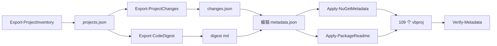

## 产品概述

对 `scibasic.net.slnx` 解决方案中根目录下的 109 个库 NuGet 程序包，刷新其描述性元数据（title、description、packageTags、releaseNotes、assemblyTitle 等），并把结果写回各项目的 `*.vbproj` 中对应的 NuGet 元数据 XML 节点。

## 核心特性

- 项目范围：现有 99 个库项目 + 10 个新增 `Microsoft.VisualBasic.*` 库项目，共 109 个；排除 4 个根目录外的 Drawing 项目和 12 个 Exe/工具类项目。
- 数据来源：先更新 `vs_solutions/dev/NuGetMetadata` 下的 JSON 与摘要文件，再应用已有 PowerShell 脚本写回 vbproj。
- 发布说明：以 2026-10-22 上次刷新时间到当前 HEAD 的 git 变更为依据，重写全部 109 个项目的 releaseNotes。
- 描述性字段：新增 10 个项目需基于代码摘要生成完整元数据；现有 99 条保留已有描述，按新窗口重写 releaseNotes。
- 完整性：补齐 4 个缺少 README 的新项目，确保元数据脚本与验证脚本全部通过。

## 技术栈

- 脚本：PowerShell，复用 `vs_solutions/dev/NuGetMetadata` 下已有的 7 个 `.ps1` 脚本，不改造脚本本体
- 数据格式：JSON（projects.json / metadata.json / changes.json）、XML（*.vbproj）
- 变更分析：`git log --numstat --since` 生成时间窗口内的提交与文件归因
- 环境：Windows / PowerShell；读取文件统一使用 `Get-Content -Encoding UTF8`

## 实现思路

采用「生成数据 → 编辑 JSON → 应用脚本 → 验证」的管线，全部基于现有工作流完成。

关键决策：

1. 不修改脚本逻辑，范围扩展完全通过重新生成 `projects.json` 实现。`Export-ProjectInventory.ps1` 已内置 RootNamespace 前缀过滤及 test/demo、Exe/WinExe、IsPackable=false 排除规则，可自动得到 109 个库项目并天然排除 12 个工具项目；根目录扫描不会包含 4 个外部 Drawing 项目。
2. releaseNotes 以新 git 窗口为准：重新生成清单后，脚本会把旧 generatedAt（2026-10-22T18:30:27）保留为 `previousGeneratedAt`，`Export-ProjectChanges.ps1` 的默认 `-Since` 即取此值，得到正确的 2026-10-22 → HEAD 窗口；也可显式传入该时间以确保稳定。
3. metadata.json 现有 99 条的 title/description/tags/assemblyTitle 已是按代码内容提炼的高质量文本，予以保留；10 个新项目依据代码摘要新建完整条目；全部 109 条的 releaseNotes 按 changes.json 重写。
4. 4 个无 README 的新项目补最小 README.md，使 `Apply-PackageReadme.ps1` 能写入 PackageReadmeFile、`Verify-Metadata.ps1` 能通过。

性能与可靠性：脚本为单次线性扫描，`Export-CodeDigest.ps1` 扫描约 5000 个 .vb 文件，分钟级完成，无重复遍历或 N+1 问题；所有 Apply 脚本幂等，仅写入真实变更。

## 实现要点

- 编码：Apply 脚本已保留 UTF-8 BOM 与原始换行（CRLF/LF）；所有读取显式指定 `-Encoding UTF8`，避免编码守卫拦截与乱码。
- 幂等与安全：应用前先用 `-WhatIf` 预演，确认变更集后再正式写入；脚本对缺字段条目会跳过，须保证 109 条字段齐全（title/description/assemblyTitle，非 legacy 还需 packageTags）。
- 唯一性：Verify 校验 title、description、assemblyTitle 在 109 条中互不相同，新写条目须逐一确保不重复；releaseNotes 不要求唯一但应语义明确。
- 图标：新项目由 `Apply-NuGetMetadata.ps1` 的 Ensure-IconItem 自动补 logo-knot.png 打包项，无需额外处理。
- 日志：复用脚本自带 Write-Host 统计输出，不新增日志逻辑，不打印大负载。

## 架构设计



## 目录结构

```
vs_solutions/dev/NuGetMetadata/
├── Export-ProjectInventory.ps1   # [复用] 重新扫描生成 projects.json，确认 libraryCount=109
├── Export-ProjectChanges.ps1     # [复用] 按新窗口重写 changes.json
├── Export-CodeDigest.ps1         # [复用] 重新生成 109 个 digest/*.md 与 _index.md
├── projects.json                 # [重新生成] 清单扩展至 109 个库项目，继承 previousGeneratedAt=2026-10-22
├── changes.json                  # [重新生成] 窗口 2026-10-22 → HEAD，含全部项目的提交与文件归因
├── digest/*.md, _index.md        # [重新生成] 10 个新项目的代码摘要及更新后的索引
├── metadata.json                 # [修改] 扩展至 109 条：新增 10 条完整元数据，重写全部 releaseNotes
├── Apply-NuGetMetadata.ps1       # [复用] 先 -WhatIf 预演再正式写回 vbproj 元数据节点
├── Apply-PackageReadme.ps1       # [复用] 为 109 个项目写入 PackageReadmeFile 及打包项
└── Verify-Metadata.ps1           # [复用] 校验全部元数据一致性并输出问题清单
Data/BinaryData/Parquet/README.md          # [新增] Parquet 包最小功能简介
Data/BinaryData/Protobuf/README.md         # [新增] Protobuf 包最小功能简介
Data_science/MachineVision/Cloudy/README.md # [新增] Cloudy 包最小功能简介
Data_science/MachineVision/UNet/README.md   # [新增] U-Net 包最小功能简介
根目录下 109 个 *.vbproj                    # [修改] 由脚本写入/更新 NuGet 元数据 XML 节点
```

## 关键代码结构

metadata.json 条目契约（脚本按字段名读取，缺字段将跳过对应项目）：

```
{
  "path": "库项目相对路径，需与 projects.json 完全一致",
  "title": "包标题",
  "description": "包功能描述",
  "packageTags": "分号分隔的标签",
  "assemblyTitle": "程序集标题",
  "releaseNotes": "按 git 窗口生成的发布说明"
}
```