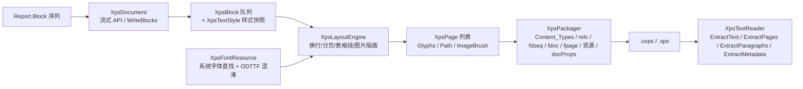

## 产品概述

为 sciBASIC# 的文档输出体系补齐 XPS / OXPS 格式能力：既能生成 XPS/OXPS 固定版式文档，也能从已有的 XPS/OXPS 文档中提取纯文本；同时以统一报告渲染接口把 markdown 内容块（报告块模型）直接渲染成 XPS/OXPS 报告文件。

## 核心功能

### 一、文档生成

- 输出扩展名为 `.oxps` 或 `.xps` 的单个文档包，两者共用同一套版式与内容能力，仅包内声明（命名空间、内容类型、关系类型）随格式切换。
- 固定页面版式：默认 A4 纵向，可自定义纸张尺寸与四边页边距；内容按行高顺序排布，超出页面自动分页，页数随内容增长。
- 支持的块级内容：
- 标题（1-6 级，字号逐级递减、可选加粗、段前段后间距）
- 正文段落（自动换行、首行/整段缩进、行距）
- 文档大标题（封面标题，居中大字）
- 无序/有序列表（项目符号或编号，带缩进）
- 任务列表（`[x]` / `[ ]` 前缀标记）
- 定义列表（术语行 + 缩进定义行）
- 代码块（等宽字体、灰底、保留原始换行）
- 引用块（缩进、灰色文字）
- 表格（表头 + 数据行、逐列对齐、细边框线，跨页时续排并重复表头）
- 水平分割线
- 图片（PNG/JPEG，按原始像素尺寸换算为页面尺寸，过宽时等比缩放到版心宽度，图下可带图注）
- 脚注、链接、原始 HTML 片段、公式：降级为文本行输出（脚注为 `[id] 内容`，链接为 `[文本](url)`，公式为 LaTeX 代码块）
- 目录：可选在正文前插入静态目录，按标题层级缩进列出各级标题。
- 字体：默认自动查找系统字体并嵌入文档包，使阅读器能按设计字体渲染；找不到可用字体或显式关闭嵌入时自动回退为「不嵌字体的轻量文档」——包结构依然合法、文本依然可被提取，不抛异常。文档元数据（作者、标题、主题、描述、关键词）写入包内属性。

### 二、文本提取

- 提取整篇纯文本：按文档页序还原每页文字，页内按视觉行（基线位置）合并为段落，中文、全角标点、制表符、换行均正确还原。
- 按页提取：返回每页文本数组，便于分页处理或预览。
- 按段落提取：把整篇文本切分为段落行数组。
- 提取元数据：返回标题、作者、主题、关键词、描述、生成程序等文档属性。
- 对第三方生成的 XPS/OXPS 具备容错：页面定位不完全依赖固定路径、非法或缺失部件不崩溃、畸形 XML 安全返回已解析内容。

### 三、统一报告接口

- 提供报告渲染器对象，接受统一的报告块序列（标题/段落/列表/任务列表/定义列表/代码/表格/引用/分割线/图片/脚注/链接/公式等），一次调用即可生成完整 XPS/OXPS 报告。
- 渲染器可配置：文档大标题、是否生成目录、目录最大层级、输出格式（XPS 或 OXPS）、字体文件与是否嵌入、文档元数据。
- 支持「多次追加渲染 + 一次保存」以及「一步生成报告文件」两种使用方式。
- 与既有 Word / RTF / PDF 渲染器保持完全一致的调用形态与命名，切换输出格式时只需换渲染器类型。

## 技术选型

- 语言/框架：VB.NET，`net10.0`，沿用目标工程既有设置（`RootNamespace = Microsoft.VisualBasic.MIME.OpenXPS`，`AssemblyName = Microsoft.VisualBasic.MIME.OpenXPS`，`AssemblyTitle = application/oxps`）。
- 依赖：仅保留现有 `Microsoft.VisualBasic.Core` 工程引用（提供 `ApplicationServices.Report.Block` / `ReportRender`）。打包与解析全部使用 BCL：`System.IO.Compression.ZipArchive`、`System.Xml.Linq.XDocument`、`System.Text.StringBuilder`。不新增对 docx / rtf / pdf 工程的引用。
- 与仓库既有实践保持一致：写入侧沿用 `DocxPackager` 的「`ZipArchive` + `StringBuilder` 拼 XML」模式；读取侧沿用 `DocxTextReader` 的 `XDocument` 提取模式与 `ExtractText / ExtractParagraphs / ExtractMetadata` API 命名；渲染器沿用 `WordRender` / `RtfRender` / `PdfRender` 的 `Document / DocumentTitle / TableOfContents / Render / Save / Generate` 形态与 `EnsureDocument()` 懒初始化 + prelude 只写一次的实现套路。

## 实现方案

### 总体策略

OXPS 与 XPS 是同一 OPC(zip) 包结构的两种方言（命名空间、内容类型、关系类型不同），因此用**一个 `XpsFlavor` 枚举驱动同一套生成/解析代码**，避免两份实现分叉。生成链路为「块模型 → 布局引擎（固定页 + 自动分页）→ 包序列化」三段式，解析链路为「zip → 定位页面部件（经 fdseq/fdoc 关系或路径回退）→ 逐页收集 `Glyphs` → 按基线位置重组段落」。



### 关键技术决策

1. **文本一律用 `<Glyphs>`**：XPS 没有纯文本元素，`Glyphs` 的 `FontUri / FontRenderingEmSize / OriginX / OriginY / UnicodeString` 即可表达一行文字；**不使用 `Indices`**（可选属性），让每个 `Glyphs` 表示一整行/一整段同一样式的文本，既简化布局也便于文本提取。
2. **字体：可选嵌入 + 自动回退**（用户已确认）。

- `XpsFontResource` 按优先级查找单一字体文件（`.ttf`）：显式 `FontFile` → Windows 字体目录（`simhei.ttf` / `segoeui.ttf` / `arial.ttf` / `consola.ttf`）→ Linux/macOS 常见路径（`DejaVuSans.ttf` / `NotoSans*.ttf`）。
- 嵌入时按 ODTTF 规范混淆：以字体部件名中的 GUID 反序字节作为 16 字节密钥，对字体文件**前 32 字节**做循环 XOR，写入 `Resources/Fonts/{guid}.odttf`；`Glyphs/@FontUri` 指向该部件。
- `.ttc` 字体集合直接跳过（不会伪造 `FontFaceIndex`），进入回退分支。
- 回退分支：不写字体部件，`Glyphs` 省略 `FontUri`（不制造悬空引用），包结构与文本提取仍然有效，仅在文档注释与 README 中说明「渲染依赖阅读器字体替换」。

3. **分页与换行**：文字宽度用**近似度量**（CJK 与全角标点按 1.0 em，ASCII 按 0.5 em，制表符按 4 个空格）驱动断行；`OriginY` 为基线，按 `字号 × 行距` 推进光标，越过下边距即翻页。表格逐行渲染，翻页时在新页重画表头与顶线。
4. **图片资源**：以 `<Path>` 的 `Path.Fill` 内联 `<ImageBrush ImageSource="/Resources/Images/{n}.png" Viewbox/Viewport Units="Absolute">` 表达，不使用 `x:Key` + `{StaticResource}`，避免 XAML 资源解析依赖；图片尺寸通过自带 PNG（IHDR）/JPEG（SOFn）头解析获得，不引入新工程引用。图片文件缺失时降级为文本占位段落（与 docx/rtf/pdf 一致）。
5. **目录**：布局引擎先做一遍标题收集，遇到 `Toc` 块时按已收集标题展开为缩进文本行（不输出页码，XPS 无域更新机制，避免两遍布局的复杂度与不确定性）。
6. **文本提取定位策略**：优先解析 `FixedDocumentSequence.fdseq` → `DocumentReference` → `FixedDocument.fdoc` → `PageContent` 顺序；解析失败时回退到「按 `Documents/*/Pages/*.fpage` 路径自然排序」，保证第三方文档可用。段落重组按 `OriginY` 聚类（容差 < 0.5 em），同一行内按 `OriginX` 排序后顺序拼接；`_xHHHH_` 转义与 XML 实体统一解码。
7. **与统一接口的对接**：`XpsRender : ReportRender`（二进制包格式，直接继承 `ReportRender`，不继承 `TextReportRender`）；`Render` 把块转写为 `XpsDocument.WriteBlocks`，`Save` 触发打包落盘；`Flavor / FontFile / EmbedFont` 等配置在自动创建文档时透传。

### 性能与可靠性

- 打包为**单遍流式写入**：每个 `fpage` 在布局阶段即已确定，写包时逐条目 `CreateEntry` 输出，内存占用与页面数线性相关，不做全量字符串拼接后再压缩。
- 文本度量使用查表 + 缓存（字符→宽度），表格列宽一次计算后复用，避免 O(行×列) 重复度量。
- 所有资源（`FileStream` / `ZipArchive` / 条目 `Stream`）用 `Using` 成对释放；图片与字体字节读取失败降级为占位，不中断整篇文档生成。
- 自校验以「生成 → 解包结构校验 → 自解析回读」闭环覆盖，杜绝只验证「文件非空」。

## 架构设计

采用与 docx/rtf/pdf 子工程一致的分层结构（同一 `mime/OXPS` 工程内按职责分文件）：

- **规格常量层**：`XpsFlavor` + `XpsSpec`（命名空间、内容类型、关系类型、页面/字号常量），XPS 与 OXPS 差异集中于此。
- **内容模型层**：`XpsBlock` / `XpsBlockType` / `XpsTextStyle`，写入期内容与样式快照。
- **资源层**：`XpsFontResource`（查找 / 混淆 / 回退）、`XpsImageResource`（尺寸探测 + 资源名分配）。
- **布局层**：`XpsLayoutEngine` → `XpsPage` / `XpsTextRun` / `XpsImagePlacement` / `XpsLineSegment`。
- **门面层**：`XpsDocument`（流式 API + `WriteBlocks` + `Save`）。
- **打包层**：`XpsPackager`（OPC 部件序列化，按 `Flavor` 切换声明）。
- **解析层**：`XpsTextReader` + `XpsDocumentInfo`。
- **统一接口层**：`XpsRender : ReportRender`。

## 目录结构

```
mime/OXPS/
├── OXPS.vbproj                       # [MODIFY] 保持 Core 引用；补 GeneratePackageOnBuild/GenerateDocumentationFile 等与同族工程一致的打包属性（可选）
├── NamespaceDoc.vb                   # [MODIFY] 补充命名空间说明（XPS/OXPS 读写能力概览）
├── XpsFlavor.vb                      # [NEW] XpsFlavor 枚举（Xps/Oxps）+ XpsSpec 常量模块：两种方言的命名空间（page/document/resource）、内容类型（fdseq/fdoc/fpage/rels/odttf/png/jpg/core-props）、关系类型（fixedrepresentation/fixeddocument/fixedpage/font/image）、默认 A4 尺寸与页边距（twips）、XAML 转义与值格式化辅助
├── XpsBlock.vb                       # [NEW] XpsBlockType 枚举（Title/Heading/Paragraph/Code/Quote/List/TaskList/DefList/Hr/PageBreak/Toc/Table/Image）+ XpsBlock 类（Text/Level/Ordered/Checked/Term/TableHeaders/TableRows/TableAlignments/ImagePath/ImageWidth/ImageHeight/ImageCaption/Style 快照）+ XpsTextStyle（FontFamily/Size/Bold/Italic/ForeColor/BackColor/LineSpacing/SpaceBefore/SpaceAfter/Indent/Alignment）+ 文本度量（MeasureText / WrapLine）
├── XpsImageResource.vb               # [NEW] PNG（IHDR）/JPEG（SOF0/2）尺寸探测、扩展名与内容类型判定、资源条目名分配；文件缺失时返回 Nothing 供上层降级为文本占位
├── XpsFontResource.vb                # [NEW] 系统字体查找（Windows/Linux/macOS 候选列表，跳过 .ttc）、ODTTF 混淆（GUID 反序密钥 XOR 前 32 字节）、部件名生成、`IsEmbedded` 状态；查找失败时安全回退
├── XpsLayoutEngine.vb                # [NEW] 固定页布局核心：光标推进、自动换行与分页、标题/正文/代码/引用/列表/任务列表/定义列表/分割线/脚注/链接/公式（降级）排版、表格列宽计算与跨页续排、图片版面（按版心缩放 + 图注）、目录展开（两阶段收集标题）、输出 XpsPage 列表（Glyphs / Path 线框 / ImageBrush 占位）
├── XpsDocument.vb                    # [NEW] 流式写入门面（同族风格）：元数据 Author/Title/Subject/Description/Tags/ApplicationName、Flavor、FontFile/EmbedFont、PageSetup/PageSetupA4/PageSetupLetter、HeadingStyle/ParagraphStyle/CodeStyle/BlockquoteStyle/TitleStyle、DocTitle/H1..H6/Heading/Paragraph/CodeBlock/Blockquote/List/TaskList/DefinitionList/Hr/PageBreak/Toc/Table/Image、WriteBlocks(IEnumerable(Of Block))（含全部别名与降级规则）、Save(filePath)、ToBytes()
├── XpsPackager.vb                    # [NEW] OPC 打包：`[Content_Types].xml`、`_rels/.rels`、`FixedDocumentSequence.fdseq`、`Documents/1/FixedDocument.fdoc`(+rels)、`Documents/1/Pages/N.fpage`(+rels，含字体/图片关系)、`Resources/Fonts/*.odttf`、`Resources/Images/*`、`docProps/core.xml`；按 XpsFlavor 切换命名空间与内容类型；目录自动创建、资源用 Using 释放
├── XpsTextReader.vb                  # [NEW] 文本提取：ExtractText(filePath|Stream)、ExtractPages(...)、ExtractParagraphs(...)、ExtractMetadata(...) → XpsDocumentInfo；页面顺序经 fdseq/fdoc 解析，失败回退路径扫描；Glyphs 按 OriginY 聚类成段、按 OriginX 排序拼接；`_xHHHH_` 与实体解码；畸形输入容错
├── XpsDocumentInfo.vb                # [NEW] 元数据模型：Title/Author/Subject/Keywords/Description/Creator（与 RtfDocumentInfo 风格一致），由 docProps/core.xml 填充
├── XpsRender.vb                      # [NEW] `Public Class XpsRender : Inherits ReportRender`：Document（可注入/懒创建）、DocumentTitle、TableOfContents、TocMaxLevel、Author/Title/Subject/Description/Tags、Flavor、FontFile、EmbedFont、Overrides Render(report)、Save(filePath)、Shared Generate(report, filePath, Optional documentTitle)；沿用 EnsureDocument + prelude 只写一次
└── test/
    ├── test.vbproj                   # [NEW] 控制台工程（Exe，net10.0），引用 Core + OXPS.vbproj，镜像 rtf/docx test 工程写法
    └── Program.vb                    # [NEW] 自校验：双 flavor 结构与命名空间/内容类型校验、字体部件存在且前 32 字节已混淆、回退模式不抛异常、图片资源与 ImageBrush 校验、ExtractText/ExtractPages/ExtractParagraphs/ExtractMetadata 回读校验（标题/正文/列表/表格/脚注/链接）、多页分页校验、XpsRender 端到端（Render+Save / Generate）；失败计数 + 退出码 0/1
```

## 关键技术结构

```
''' <summary>输出的 XPS 包方言：OpenXPS（ECMA-388 2nd）或 Microsoft XPS（2005/06）。</summary>
Public Enum XpsFlavor
    Oxps
    Xps
End Enum

''' <summary>XPS/OXPS 文档生成器（流式 API，与 WordDocument / RtfDocument / PdfDocument 同族）。</summary>
Public Class XpsDocument
    Public Property Flavor As XpsFlavor
    Public Property Author As String
    Public Property Title As String
    Public Property Subject As String
    Public Property Description As String
    Public Property Tags As String()
    Public Property FontFile As String
    Public Property EmbedFont As Boolean

    Public Function PageSetup(pageWidth As Integer, pageHeight As Integer,
                              marginTop As Integer, marginRight As Integer,
                              marginBottom As Integer, marginLeft As Integer) As XpsDocument
    Public Function WriteBlocks(blocks As IEnumerable(Of Report.Block)) As XpsDocument
    Public Function ToBytes() As Byte()
    Public Sub Save(filePath As String)
End Class

''' <summary>XPS/OXPS 报告渲染器：ReportRender 在 OPC 包格式上的实现。</summary>
Public Class XpsRender : Inherits ReportRender
    Public Property Document As XpsDocument
    Public Property DocumentTitle As String
    Public Property TableOfContents As Boolean
    Public Property TocMaxLevel As Integer
    Public Property Flavor As XpsFlavor

    Public Overrides Sub Render(report As IEnumerable(Of Report.Block))
    Public Sub Save(filePath As String)
    Public Shared Function Generate(report As IEnumerable(Of Report.Block),
                                   filePath As String,
                                   Optional documentTitle As String = "") As XpsDocument
End Class
```

## 验证要点

- `OXPS.vbproj` 与 `test/test.vbproj` 在 Debug / Release 下均 0 警告 0 错误。
- 生成 `.oxps` 与 `.xps` 后解包断言：部件齐全、命名空间与内容类型随 flavor 正确切换、`fdseq → fdoc → fpage` 引用链闭合、rels 目标存在。
- 文本回读断言：标题、正文、列表项、表格单元格、脚注、链接文本逐项命中；`ExtractPages` 页数与 `Documents/1/Pages/*.fpage` 数量一致；`ExtractMetadata` 与设置一致。
- 字体断言：嵌入模式下 `Resources/Fonts/*.odttf` 存在、`FontUri` 指向该部件、前 32 字节与原始 TTF 不同；`EmbedFont=False` 或不提供字体时不抛异常且文本仍可提取。
- 图片断言：PNG 被写入 `Resources/Images/*`，`fpage` 中出现 `ImageBrush/@ImageSource`，图片块图注文本进入回读结果。
- `XpsRender` 端到端：Block 数组 → `Render`+`Save`（及 `Generate`）→ 回读全部关键文本；分页用例断言生成多个 fpage 且文本顺序正确。