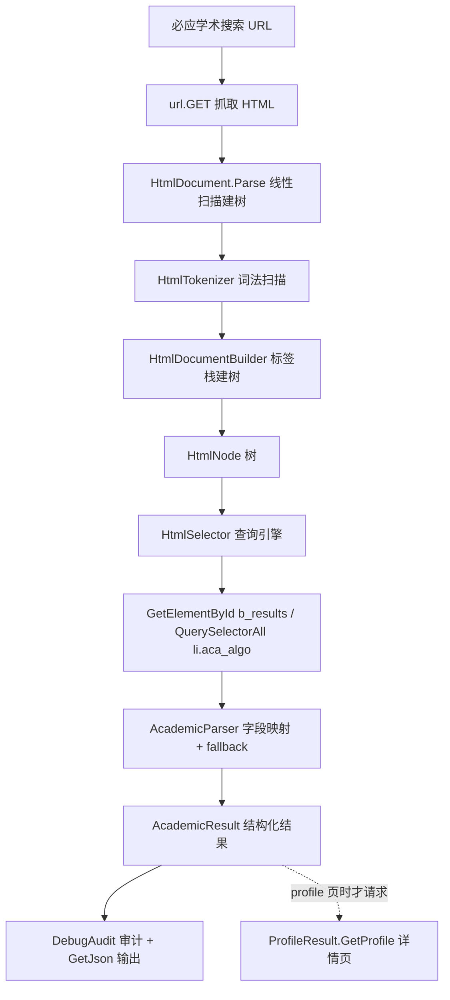

## 产品概述

在 sciBASIC# 框架的 Trinity（文本挖掘）程序集中新增一套**通用 HTML 文档解析方法库**，并用它重构必应（Bing）学术搜索模块的页面解析逻辑，使学术检索结果可以被稳定、结构化地抽取出来，作为后续知识库构建的数据来源。

## 核心功能

1. **通用 HTML 解析库（Trinity）**

- 提供基于词法扫描 + 标签栈的 HTML 文档解析器，把任意（包括畸形/未闭合标签的）HTML 文本构建成节点树。
- 提供节点查询能力：按标签名、id、class、属性精确/包含匹配，以及类 CSS 选择器（`tag`、`.class`、`#id`、`[attr]`、`[attr=val]`、`[attr*=val]`、后代/子代/`>`、逗号并集）。
- 提供 HTML 实体解码（命名实体、`&#nnn;`、`&#xHH;`）、纯文本抽取与空白归一化、相对链接绝对化。
- 与已有的 `Html2Article` 文本密度正文抽取共存并复用，不破坏现有 API。

2. **必应学术搜索模块重构（Bing）**

- 用 DOM 解析替换原先脆弱的正则切片（原先 `.+?</li>` 在嵌套/畸形标签下会截断，`RemovesJavaScript` 等正则在 200KB+ 页面上易超时）。
- 结构化输出学术结果：标题、链接、展示链接、摘要、作者列表、期刊、年份、被引次数、关键词标签、PDF/全文链接、结果总数、页码。
- 兼容两类真实页面形态：学术文献型（含 `caption_author`/`caption_venue`/`caption_field_badge`/被引数）与网页型（含 `caption_display_url`/`cite`）。
- 链接统一实体解码 + 绝对化；过滤 `javascript:void(0)`；按 URL 去重；字段缺失时返回空值而不抛异常。
- 保留分页 `Query` 与详情页 `GetDetails` 能力，但仅在结果确实指向必应学术 profile 页时才拉取详情。

3. **Demo 测试（test 项目）**

- 以 `scibasic` 为关键词调用重构后的学术搜索模块。
- 使用 `DebugAudit` 记录审计事件与断言（结果数量、字段完整性、耗时），生成测试报告。
- 控制台以带缩进的结构化 JSON 字符串打印检索结果。

## 技术栈

- 语言/框架：Visual Basic .NET（VB.NET），SDK 风格 `.vbproj`，`net10.0`
- 程序集：
- `Microsoft.VisualBasic.Data.TrinityNLP`（RootNamespace `Microsoft.VisualBasic.Data.NLP`）
- `Microsoft.VisualBasic.Web.KnowledgeBase`（RootNamespace `Microsoft.VisualBasic.Data.KnowledgeBase.Web`）
- 依赖 `Microsoft.VisualBasic.Core`（`Core.vbproj`）：`HtmlStrips`、`TagAttributeParser`、HTTP `GET` 扩展、JSON 序列化、`DebugAudit`
- 复用而非替换：保留 `Html2Article`/`Article`（文本密度正文抽取）、`UrlUtility`（链接补全）与 Core 中 `HtmlStrips` 的既有能力

## 实现方案

### 总体策略

用「**词法扫描器 + 标签栈建树 + 选择器引擎**」三层结构替代现有正则切片：

1. **Scanner（词法层）**：单次线性扫描（O(n)）产生 token 序列 —— 开始标签、结束标签、自闭合标签、文本、注释、DOCTYPE、CDATA、`script/style/textarea` 原始文本块。属性解析支持双引号/单引号/无引号/布尔属性。
2. **Builder（树构建层）**：用栈构建 `HtmlNode` 树；处理空元素（`br/img/input/meta/link/hr/source/col/area/base/embed/param/track/wbr`）、隐式闭合（`li/p/td/tr/th/option/dt/dd` 等）、孤儿结束标签容错（栈内回溯查找同名祖先，找不到则丢弃）。
3. **Selector（查询层）**：解析 CSS-lite 选择器 → 匹配器链，支持后代/子代/并集；`HtmlDocument`/`HtmlNode` 暴露 `QuerySelector`/`QuerySelectorAll`/`GetElementById`/`GetElementsByTagName`/`GetElementsByClassName`/`Descendants`。

### 关键技术决策与权衡

- **自建轻量 DOM 而非引入 HtmlAgilityPack**：仓库为自包含框架、离线可构建，不新增 NuGet 依赖；且必应对 `script` 中的畸形标签必须容忍，自建扫描器可精确控制（script/style 走 raw-text 模式，跳过一切内部尖括号）。
- **线性扫描 + 状态机**（非正则）：现有 `HtmlStrips.RemoveTags` 用正则在 236KB 页面上存在 `RegexTimeout=5s` 风险（源码里已对 `TimeoutException` 做吞异常处理，说明该问题真实存在）；线性扫描一次性完成，无回溯爆炸，无超时。
- **宽容（lenient）建树**：真实页面存在 `</li><li><li class="aca_algo_count">…</li></li></ol>` 这类多余未闭合 `li`，必须容错而非抛错。
- **通用性**：DOM 层不出现任何 Bing 相关概念；必应侧只做「选择器 + 字段映射」，保证库可被其他页面（知识库其他数据源）复用。
- **多形态兼容**：学术型/网页型结果走同一套「按 class 优先、结构特征兜底」的抽取链，字段缺失置空。

### 性能与可靠性

- 解析：O(n) 时间 / O(d) 栈空间（d 为嵌套深度）；236KB 页面单次扫描约毫秒级。
- 查询：选择器匹配 O(m)（m 为节点数）；建议先用 `GetElementById("b_results")` 定位容器再在子树内查询，把匹配范围从全树降到 10 个 `li`。
- 文本抽取：`InnerText` 懒计算 + 缓存，避免 `QuerySelectorAll` 循环中重复遍历。
- 属性字典用 `Dictionary(Of String, String)(StringComparer.OrdinalIgnoreCase)`，HTML 属性名大小写不敏感。
- 网络侧保留原有 `url.GET(headers:=..., refer:=...)`，并保留 `Try/Catch + App.LogException` 的分页容错；详情页请求按 `sleepInterval` 节流，避免对必应高频请求。

## 实现要点（执行细节）

- 命名空间：`Microsoft.VisualBasic.Data.NLP.Html`，文件置于 `Data\Trinity\Html\DOM\`（Trinity 项目默认 `**/*.vb` 全编译，无需改 `.vbproj`；`Test\**` 已被排除）。
- Trinity 项目 `GenerateDocumentationFile=True` 且 `TreatWarningsAsErrors=false`；仍建议为 `Public` 成员写 XML 注释，避免大量 1591 警告。
- Bing.NET5.vbproj **已**引用 `..\..\Data\Trinity\Trinity.NET5.vbproj`，无需新增 ProjectReference，只需 `Imports Microsoft.VisualBasic.Data.NLP.Html`。
- URL 处理：`href` 先做实体解码（`&amp;` → `&`），再 `New Uri(New Uri("https://cn.bing.com/"), href).AbsoluteUri`；若已是绝对 URL 则原样保留（这是现有代码 `"https://cn.bing.com/" & url` 硬拼接的 bug 修复点）。
- 被引数抽取：`div.caption_venue` 的 `InnerText` 形如 `2006 · Journal of Morphology |被引数：95`，按 `·` 与 `|` 分割并解析 `被引数：` 后的数字。
- 年份解析：`\d{4}` 优先，失败时置 0，不抛异常（现有 `Date.Parse(time)` 在异常输入下会崩）。
- 向后兼容：`AcademicSearch.Search` 返回类型由 `NamedValue(Of String)()` 改为 `AcademicResult()`，需同步修改 `Extensions.Build_KB`、`Query`；`ProfileResult.GetProfile`/`ArticleProfile` 保持不变，仅新增 profile 判定。
- 日志：`App.LogException` 沿用现有模式；不要在日志中打印整页 HTML（体积大），只打印 URL 与选择器名。
- Demo：`DebugAudit.Watch(...)` 用 `Using` 包裹整个检索过程计时；`DebugAudit.Mark` 记录关键词/结果数；`DebugAudit.Test` 断言结果非空与字段完整；`DebugAudit.Dump()` 打印文本报告，`DebugAudit.SaveReport(path)` 落盘 JSON 报告；结果用 `GetJson(indent:=True)` 打印。

## 架构设计



模块职责划分：

- **Scanner/Builder（Trinity）**：通用、无业务语义，负责把任意 HTML 变成可查询树。
- **Node/Selector（Trinity）**：通用查询与文本抽取 API。
- **AcademicParser（Bing）**：唯一耦合必应页面结构的地方，纯「选择器 + 字段映射」。
- **AcademicResult（Bing）**：面向知识库的结构化数据模型。

## 目录结构

```
G:\pixelArtist\src\framework\Data\Trinity\Html\
├── Article.vb                    # [保持] 文章正文数据模型
├── Html2Article.vb               # [保持] 文本密度正文抽取
├── UrlUtility.vb                 # [保持] 相对链接补全（可复用为绝对化实现参考）
└── DOM/                          # [NEW] 通用 HTML 解析方法库
    ├── NamespaceDoc.vb           # [NEW] 命名空间文档（Friend Class NamespaceDoc），说明库用途与入口
    ├── HtmlNodeType.vb           # [NEW] 枚举：Document/Element/Text/Comment/CData/Doctype/Script/Style
    ├── HtmlToken.vb              # [NEW] 词法 token 结构 + TokenType 枚举（OpenTag/CloseTag/SelfClosing/Text/Comment/Doctype/RawText）
    ├── HtmlTokenizer.vb          # [NEW] 单次线性扫描器：尖括号状态机、属性引号解析、布尔属性、
    │                             #        script/style/textarea 原始文本、注释与条件注释、CDATA、DOCTYPE；
    │                             #        Friend 可见性，供 Builder 消费
    ├── HtmlDocumentBuilder.vb    # [NEW] 标签栈建树：空元素集合、隐式闭合集合（li/p/td/tr/option 等）、
    │                             #        孤儿结束标签回溯容错；Friend 可见性
    ├── HtmlNode.vb               # [NEW] 节点类：Name/Id/Classes/Attributes/Nodes/Parent/NodeType、
    │                             #        InnerHtml/OuterHtml/InnerText（解码实体+空白归一化）/Text、
    │                             #        Attribute(name)/HasClass/Ancestors/Descendants/Elements/
    │                             #        QuerySelector/QuerySelectorAll/NextSibling/PrevSibling
    ├── HtmlDocument.vb           # [NEW] 文档入口：Parse(html)/LoadFile(path)/Root/Html/
    │                             #        GetElementById/GetElementsByTagName/GetElementsByClassName/
    │                             #        QuerySelector/QuerySelectorAll/Title/TotalNodes
    ├── HtmlSelector.vb           # [NEW] CSS-lite 选择器：解析 tag/.class/#id/[attr]/[attr=val]/[attr*=val]/
    │                             #        [attr~=val]，支持空格后代、> 子代、, 并集；Matches(node) 匹配引擎
    ├── HtmlEntity.vb             # [NEW] 实体解码/编码模块：&amp; &lt; &gt; &quot; &#39; &nbsp; 等命名实体表 +
    │                             #        &#nnn; / &#xHH; 数值实体；Decode(text)/Encode(text)
    └── HtmlText.vb               # [NEW] 文本处理扩展模块：ToPlainText/InnerText 归一化/CollapseWhiteSpace/
                                  #        FixRelativeUrls(baseUrl)/IsSafeUrl（过滤 javascript: 与空链接）/
                                  #        SplitBySep（按 ·、| 等分隔符切分复合文本）

G:\pixelArtist\src\framework\www\Microsoft.VisualBasic.Webservices.Bing\Academic\
├── Academic.vb                   # [MODIFY] 用 HtmlDocument 重写：getInternal 改为 DOM 解析；
│                                 #          Search 返回 AcademicResult()；Query 分页签名同步；
│                                 #          GetDetails 增加 profile 判定（仅 profile 页才请求详情）
├── AcademicResult.vb             # [NEW] 结构化结果模型：title/url/displayUrl/abstract/authors/journal/
│                                 #        year/cites/keywords/pdfUrl/profileUrl/profileID/isAcademic/
│                                 #        query/rank/term
├── AcademicParser.vb             # [NEW] 页面→AcademicResult 的字段映射与多级 fallback 抽取
│                                 #        （h2>a 标题、caption_author 作者、caption_venue 年份/期刊/被引数、
│                                 #          caption_abstract 摘要、caption_field_badge 关键词、
│                                 #          caption_display_url 展示链接、aca_algo_count 结果总数）
├── Extensions.vb                 # [MODIFY] Build_KB 适配新返回类型，跳过非 profile 结果，
│                                 #          增加 AcademicResult → Summary 转换
└── ProfileResult.vb              # [MODIFY] 仅在 url 含 /academic/profile?id= 时执行；
                                  #          年份/日期解析改为容错解析（不再直接 Date.Parse）

G:\pixelArtist\src\framework\www\Microsoft.VisualBasic.Webservices.Bing\test\
└── Module1.vb                    # [MODIFY] demo 入口：关键词 "scibasic" → AcademicSearch.Search →
                                  #          DebugAudit 审计 + 控制台打印缩进 JSON + SaveReport
```

## 关键代码结构

```
' Microsoft.VisualBasic.Data.NLP.Html
Public Class HtmlDocument
    Public Shared Function Parse(html As String) As HtmlDocument
    Public Shared Function LoadFile(path As String) As HtmlDocument
    Public ReadOnly Property Root As HtmlNode
    Public ReadOnly Property Html As String
    Public Function GetElementById(id As String) As HtmlNode
    Public Function GetElementsByTagName(tag As String) As HtmlNode()
    Public Function GetElementsByClassName(className As String) As HtmlNode()
    Public Function QuerySelector(selector As String) As HtmlNode
    Public Function QuerySelectorAll(selector As String) As HtmlNode()
    Public Function Title() As String
End Class

Public Class HtmlNode
    Public ReadOnly Property Name As String              ' 小写标签名；文本节点为 "#text"
    Public ReadOnly Property NodeType As HtmlNodeType
    Public ReadOnly Property Attributes As IReadOnlyDictionary(Of String, String)
    Public ReadOnly Property Nodes As IReadOnlyList(Of HtmlNode)
    Public ReadOnly Property Parent As HtmlNode
    Public ReadOnly Property InnerHtml As String
    Public ReadOnly Property OuterHtml As String
    Public ReadOnly Property InnerText As String         ' 实体解码 + 空白归一化后的纯文本
    Public Function Attribute(name As String, Optional [default] As String = "") As String
    Public Function HasClass(className As String) As Boolean
    Public Function Elements() As IEnumerable(Of HtmlNode)
    Public Function Descendants() As IEnumerable(Of HtmlNode)
    Public Function QuerySelector(selector As String) As HtmlNode
    Public Function QuerySelectorAll(selector As String) As HtmlNode()
End Class
```

```
' Microsoft.VisualBasic.Data.KnowledgeBase.Web.Bing.Academic
Public Class AcademicResult
    Public Property title As String
    Public Property url As String
    Public Property displayUrl As String
    Public Property abstract As String
    Public Property authors As String()
    Public Property journal As String
    Public Property year As Integer
    Public Property cites As Integer
    Public Property keywords As String()
    Public Property pdfUrl As String
    ''' <summary>必应学术详情页地址；网页型结果为空</summary>
    Public Property profileUrl As String
    Public Property profileID As String
    Public Property isAcademic As Boolean
    Public Property term As String
    Public Property rank As Integer
End Class
```

## Agent Extensions

### SubAgent

- **code-explorer**
- Purpose：在动手前精确核对 `HtmlStrips`/`TagAttributeParser`/`DebugAudit`/`HttpGet` 的公开签名与调用约定，以及在 Trinity/Bing 两个项目内查找 `AcademicSearch`、`ProfileResult`、`UrlUtility`、`Html2Article` 的全部调用点，确认重构的改动半径。
- Expected outcome：给出准确的 API 签名清单与受影响文件列表，避免误用方法名或漏改调用点。

### Skill

- **lsp-code-analysis**
- Purpose：对新增的 `HtmlDocument`/`HtmlNode`/`AcademicResult` 做定义与引用导航，验证 Bing 项目对 Trinity 新库的引用解析正确、无符号冲突。
- Expected outcome：确认跨项目引用可解析、编译无未定义符号。