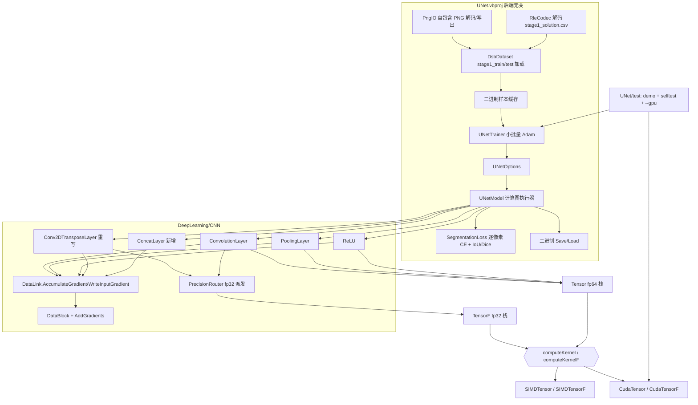

## 产品概述

在 sciBASIC# 框架的 `MachineVision\UNet` 工程中，基于 `DeepLearning\CNN` 现有卷积层代码，从零实现经典 U-Net（Ronneberger 2015）语义分割模型的**完整训练与推理 demo 流程**：编码器逐层下采样、瓶颈层、解码器转置卷积上采样、通道维跳跃连接拼接、逐像素 softmax 交叉熵损失、小批量 Adam 训练、IoU/Dice 评估、模型落盘与加载，并在**真实数据**（Kaggle DSB2018 细胞核分割数据集）上端到端跑通。

## 核心功能

- **U-Net 模型**：对称编码器—解码器结构（可配置输入尺寸、层数、基础通道数、类别数），3×3 same 卷积 + ReLU + 2×2 最大池化下采样，2×2 转置卷积上采样，跳跃连接按通道拼接（带中心裁剪兜底），末端 1×1 卷积输出每像素类别 logits。
- **混合精度计算**：主权重、偏置、优化器状态、激活、拼接、损失与评估指标全部保持 fp64（Double/Tensor）；卷积与转置卷积的前向及三个反向作为计算热点，按规模判据临时降为 fp32（TensorF）计算后升回 fp64，并给出"加速/回退"计数以便验证真的走了低精度路径。
- **真实数据集接入（DSB2018）**：
- 训练集 `stage1_train/<id>/images/<id>.png` + `stage1_train/<id>/masks/*.png`（多实例掩膜合并为"细胞核/背景"二值前景掩膜）；
- 验证/测试集 `stage1_test/<id>/images/<id>.png`（65 张，**无 masks 目录**），真值由根目录 `stage1_solution.csv` 的 RLE（`ImageId,EncodedPixels,Height,Width,Usage`）解码得到；
- 自包含 PNG 解码/编码（不引入 Imaging 或 NuGet 依赖）、任意尺寸缩放归一化到模型固定输入、掩膜最近邻缩放+阈值化、解码结果二进制缓存避免重复解析。
- **完整训练流程**：小批量 Adam（可选 SGD+momentum）、学习率衰减、梯度裁剪、前景类别权重（细胞核像素占比低）、轻量增广（水平/垂直翻转、90° 旋转、亮度抖动）、每轮输出 loss 与 IoU/Dice/像素精度、验证集评估、二进制模型保存与加载。
- **demo 测试流程**：训练后在 `stage1_test` 上预测，输出每张图的预测掩膜（PNG/PGM 落盘）+ ASCII 预览 + 聚合指标，肉眼可判分割效果。
- **测试工程**：`UNet/test` 提供 `demo`、`selftest`、`--gpu` 三条 CLI 路径；`selftest` 含转置卷积尺寸公式、数值梯度校验、真实小样本过拟合、PNG 解码往返、**RLE 方向用 stage1_train 的 masks PNG 交叉验证**、混合精度开/关一致性与命中计数、保存加载往返、GPU/CPU 对拍等断言；`--gpu` 通过 ILCudaTensor 注册 fp64 与 fp32 两条 CUDA 栈后再跑同一流程并对比耗时与数值。
- **CNN 侧补齐**：在 `DeepLearning\CNN` 中新增缺失的跳跃连接拼接层与转置卷积层（重写现有不可用实现），并让层在图上支持"累加式"输入梯度，不改动既有串行 CNN 的默认行为。

## 技术栈

- 语言/框架：VB.NET（net10.0，x64），SDK 风格工程，自动 glob `*.vb`
- 复用的既有设施：`Microsoft.VisualBasic.MachineLearning.CNN`（ConvolutionLayer / PoolingLayer / RectifiedLinearUnitsLayer / DataBlock / BackPropResult）、`Microsoft.VisualBasic.MachineLearning.TensorFlow`（Tensor fp64 + TensorF fp32 + `Compute.MixedPrecisionOps/Policy/Diagnostics` + 可插拔后端 `Tensor.computeKernel` / `TensorF.computeKernelF`）
- PNG 编解码：**自行实现**于 UNet 工程内（`System.IO.Compression.DeflateStream` 解 IDAT + 反过滤 None/Sub/Up/Average/Paeth，支持位深 8/16、颜色类型 0/2/3/4/6、非隔行；写出用 stored deflate 块 + CRC32）。不引入 `gr\Microsoft.VisualBasic.Imaging`（庞大的 net10.0-windows 图形库）也不引入 NuGet 包。
- GPU：`cuda\ILCudaTensor`（`GPUTensor.CudaTensor.Register(options)` 默认一并 `CudaTensorF.Adopt`，fp64 与 fp32 两条栈同时切到 CUDA），仅在 `UNet/test` 工程引用与注册，UNet 库保持后端无关

## 实现方案

在 UNet 工程内实现一个**显式计算图执行器**（节点 = 一个 CNN 层 + 输入节点索引，拓扑序 forward、逆序 backward），复用 CNN 的层对象与参数块；CNN 侧只补齐三类缺失能力：转置卷积层、跳跃连接拼接层、支持累加的输入梯度写入。混合精度按"算子级临时降精度"实现（与 `MixedPrecisionOps` 同风格：不适用即返回 Nothing 回退 fp64），不改动层的 fp64 存储主体。数据侧自写 PNG 解码 + RLE 解码 + 缩放归一化，把真实 DSB2018 数据喂进同一套训练/评估流程。

### 关键设计决策与理由

1. **转置卷积 = 膨胀 + 翻转 + stride-1 卷积**（已手算逐项验证）：
`X'=dilate(X,s-1)`（尺寸 `(H-1)s+1`）、`X''=pad(X',K-1-p)`、`Wf=flip(W)`（仅翻 kh/kw 轴），则

- forward：`Y = Conv2D(X'', Wf, bias, 1, 0)`，输出 `H2 = s(H-1)+K-2p`，偏置由算子直接加；
- `dX''=Conv2DBackwardInput(dY, Wf, shape(X''), 1, 0)`，`dX[i,j]=dX''[i·s+(K-1-p), j·s+(K-1-p)]`；
- `dWf=Conv2DBackwardFilter(dY, X'', {K,K,Cin,Cout}, 1, 0)`，`dW=flip(dWf)`；`dbias=Conv2DBackwardBias(dY)`。
理由：直接把 `Conv2DBackwardInput` 当转置卷积用会撞"filters.Shape(2)=Cin 必须等于目标通道数 Cout"的约束（Cin≠Cout 时 GPU 回退、CPU 按错通道数索引），膨胀方案三个反向全部落在现成算子且形状全部合法，fp32/fp64/CUDA 三条路径都能复用。

2. **跳跃连接必须"累加式"写梯度**：同一个 DataBlock 同时被 pool（下游）与 concat（跳跃）消费，逆拓扑序下 pool.backward 晚于 concat.backward，而现有三层 backward 都是 `clearGradient()+SetGradients`（覆盖）会抹掉拼接分支的梯度。故在 `DataLink` 增加 `AccumulateGradient`（默认 False，MNIST 等既有串行路径行为完全不变）与 `WriteInputGradient`，由 U-Net 图执行器在每次 backward 前统一清零**激活块**梯度（参数块 dw 不清，需跨 mini-batch 样本累加，由 trainer 更新后清零）。
3. **混合精度切分**：热点 = Conv2D 前向/反向、转置卷积前向/反向，判据复用 `MixedPrecisionPolicy.Decide(ComputeBound, ConvOps(...))` 与 `IsSafeForSingle`（非有限值一律回退 fp64，避免 Inf 粘住优化器）；池化/ReLU/拼接/损失/优化器/指标保持 fp64（属 `MustDouble`/带宽受限，降精度无收益且有风险）。
4. **不自造优化器/损失框架**：`TrainerAlgorithm` 强耦合 `ConvolutionalNN`（串行链），U-Net 用不了；改为在 UNet 工程写约百行的 `UNetTrainer`，但**复用 `BackPropResult`**（其 `NotifyModified()` 是把就地权重改写通知 GPU 显存缓存失效的必需步骤）。
5. **真实数据零新增依赖**：工程无 Imaging 依赖，自行实现 PNG 解码（DeflateStream + 反过滤）与写出（stored deflate + CRC32），并对"解码+缩放"结果做二进制缓存，避免每次运行重复解析 3 万张 PNG。
6. **RLE 方向必须被验证而不是猜**：DSB 的 RLE 有行主序/列主序两种流传版本。本项目用 `stage1_train_labels.csv`（与 solution 同格式）对**有 masks PNG 的训练图**做交叉验证：两种方向各解一遍，与 `masks/*.png` 并集比对，IoU 接近 1 的那个即正确方向；该校验作为 selftest 的一条断言固化下来，避免测试集指标因方向搞反而归零。

### 复杂度与性能

- 单样本前向+反向浮点量约 `Σ 2·OH·OW·Cout·K²·Cin`。CPU 侧 `SIMDTensor.Conv2D` 在 `totalOps >= ConvParallelThreshold(200000)` 时才并行 + axpy 向量化，否则落到 `TensorComputeBase` 的七重朴素循环；实测规模估算：64×64 输入 / 基础通道 8 / 3 层 的单样本前向约 3e7、反向约 6e7 次乘加，量级 1~3 秒/样本（随机器浮动）。
- 因此 demo 默认取 **64×64 输入、3 层、基础通道 8、`--limit 40`、`--epochs 6`**（约 240 样本·次，数分钟量级），全部参数 CLI 可调；`--gpu` 可进一步加速（64×64×8=32768 ≥ `MinConvElementsF=16384`，卷积可上 GPU；单层 ConvOps 可达 1e6~1e7，能触发混合精度阈值 1048576）。
- 数据侧：670 张训练图 + 65 张测试图，首次解码+缩放约数十秒，之后走缓存文件；训练子集大小由 `--limit` 控制，`--limit 0` 表示全量。
- 显存/缓存一致性红线：任何绕过 Tensor 索引器的就地写入（trainer 改权重、图执行器灌输入、清零梯度）都必须 `MarkValueModified/MarkGradientModified/NotifyModified`，否则 GPU 侧静默读到旧值。

## 实现要点（防回归）

- `DeepLearning.NET6.vbproj` 开了 `GenerateDocumentationFile=True`：新增/修改的 Public 成员必须带 XML 注释，目标 Debug/Release 均 0 警告 0 错误；XML 注释内不得出现 `--`。
- 既有串行 CNN 路径（MNIST 系列）必须保持数值行为不变：`AccumulateGradient` 默认 False、`AddGradients` 是纯新增、`Conv2DTransposeLayer` 的重构需同步更新其全仓唯一调用者 `LayerBuilder.buildConv2DTransposeLayer` 与 `CNNLayers.conv_transpose_layer`。
- 图执行器在 forward 前不需要清零激活（每层 forward 都新建/覆盖 DataBlock），只在 backward 前清零激活块梯度；ReLU 的 `clone()` 语义不变。
- 真实数据管线必须"防假通过"：PNG 解码后校验尺寸/位深并断言解码出的像素不全 0；RLE 方向用训练图 masks 交叉验证；stage1_test 指标若因 CSV 缺失而算不出真值，应明确报告"跳过"而非静默给 0。
- 自检除数值一致外还要断言强制低阈值时 fp32 命中计数大于 0，GPU 模式要打印 `Tensor.computeKernel.Name` / `TensorF.computeKernelF.Name` 与 `DescribeKernels()`，内核缺失或规模不足时明确标注"回退 CPU"而非默认成功。
- 类别不平衡：细胞核像素占比低，损失需支持前景权重（默认按训练集前景比例自动取 `1/前景占比` 的开方或 CLI 指定），并在指标里同时报告前景 IoU 与背景 IoU，避免"全预测背景"拿到虚高精度。
- VB 已知坑：局部变量/属性不得与所在函数或类型同名（大小写不敏感）；`Step/Next/Call/Index/error/sub/set` 不得作标识符；Module 成员不能声明 Shared；`If(cond, arr, Nothing)` 需 `DirectCast(Nothing, Double())`；跨命名空间用 `System.Math` 需全限定（TensorFlow 内有同名 `Math`）。

## 架构设计



数据流：`stage1_train` 图像 PNG → 解码/转灰度/缩放到固定尺寸 → `DataBlock.addImageData` 灌入 → 图执行器按拓扑序 forward（卷积/转置卷积热点走 fp32 算子，其余 fp64）→ 逐像素交叉熵（fp64，含前景权重）写回 logits 梯度 → 逆序 backward（各层把输入梯度**累加**回上游）→ 参数梯度跨样本累加 → 每 batch 更新（fp64 主权重）+ `NotifyModified()` → 在 `stage1_test`（真值来自 `stage1_solution.csv` RLE）上评估 IoU/Dice → 掩膜与可视化落盘。

## 目录结构

```
Data_science/MachineLearning/DeepLearning/CNN/
├── DataLink.vb                        # [MODIFY] 新增 Public Property AccumulateGradient（默认 False）+ Protected WriteInputGradient(target, values)：False 走 SetGradients（原语义），True 走新增的累加写入；供 U-Net 图使用，串行 CNN 不受影响
├── PrecisionRouter.vb                 # [NEW] 命名空间 CNN 的 Public Module：Conv2DOr / Conv2DBackwardInputOr / Conv2DBackwardFilterOr / Conv2DBackwardBiasOr，与 MixedPrecisionOps 同风格（不适用返回 Nothing），复用 MixedPrecisionPolicy.Decide/ConvOps/IsSafeForSingle，并记 MixedPrecisionDiagnostics；带 Enabled 总开关
├── LayerTypes.vb                      # [MODIFY] 追加 <Description("concat")> Concat
├── LayerBuilder.vb                    # [MODIFY] buildConv2DTransposeLayer 适配新转置卷积构造器；新增 buildConcatLayer
├── CNNLayers.vb                       # [MODIFY] conv_transpose_layer 工厂适配新签名（全仓唯一调用者）
├── Layers/
│   ├── ConcatLayer.vb                 # [NEW] 跳跃连接：持有 skip 块引用（SetSkip），按通道维拼接（skip 更大时中心裁剪），backward 按通道切回两段并累加回两侧输入；无参数
│   └── Conv2DTransposeLayer.vb        # [REWRITE] 膨胀+翻转实现：New(def, kernel, outChannels, stride, padding, useBias)；filters()/biases 与 ConvolutionLayer 同构以便 BackPropagationResult 直喂 trainer；修掉 out_act 跨样本不清零、索引自相矛盾等缺陷
├── Layers/ConvolutionLayer.vb         # [MODIFY] backward 的输入梯度改为 WriteInputGradient（默认语义不变）
├── Layers/PoolingLayer.vb             # [MODIFY] 同上
├── Layers/RectifiedLinearUnitsLayer.vb# [MODIFY] 同上
└── data/DataBlock.vb                  # [MODIFY] 新增 Public Sub AddGradients(values)：逐元素累加到 dw 并 MarkGradientModified

Data_science/MachineVision/UNet/
├── Model.vb                           # [DELETE] 空占位 Public Class Model
├── NamespaceDoc.vb                    # [NEW]
├── UNetOptions.vb                     # [NEW] 输入尺寸/输入通道/类别数/层数(下采样次数)/基础通道数/卷积核/padding；校验宽高能被 2^levels 整除
├── UNetModel.vb                       # [NEW] 计算图执行器：建图（编码器/瓶颈/解码器/跳跃）＋拓扑序 Forward、ZeroActivationGradients＋逆序 Backward、Parameters As BackPropResult()、Predict/SegmentMask、Describe()、二进制 Save/Load
├── SegmentationLoss.vb                # [NEW] fp64 逐像素 softmax 交叉熵（减最大值稳定、可选类别权重）+ 梯度写回 logits；IoU/Dice/像素精度（分前景/背景）
├── UNetTrainer.vb                     # [NEW] 小批量 Adam（可选 SGD+momentum）、学习率衰减、梯度裁剪、每轮 loss/IoU 报告、更新后 NotifyModified()
├── PngIO.vb                           # [NEW] 自包含 PNG 解码（IHDR/PLTE/IDAT + DeflateStream + 反过滤，位深 8/16、颜色类型 0/2/3/4/6、非隔行）与灰度 PNG 写出（stored deflate + CRC32）；含 PGM 写出兜底
├── RleCodec.vb                        # [NEW] DSB RLE 编解码：decode(encodedPixels, H, W, columnMajor) → Boolean 前景掩膜；方向由 selftest 用 stage1_train 的 masks PNG 交叉验证后锁定
├── DsbDataset.vb                      # [NEW] 真实数据加载：枚举 stage1_train/<id>/{images,masks}、合并多实例掩膜为二值前景、stage1_test 真值来自 stage1_solution.csv、转灰度 + 缩放（图像双线性/掩膜最近邻+阈值）、轻量增广、train/val 划分、二进制缓存(.unet-cache)与失效判定
└── SyntheticSamples.vb                # [NEW] 仅供自检/数值校验用的确定性合成小块（几何体+噪声），保证 selftest 不依赖外部数据也能跑数学断言

Data_science/MachineVision/UNet/test/
├── Program.vb                         # [MODIFY] CLI：demo（默认）/selftest/--gpu；--data <unet-dataset根>（默认 C:\Users\Administrator\Downloads\unet-dataset）、--size/--levels/--filters/--epochs/--limit/--lr/--batch/--out 等参数解析与退出码
├── UNetDemo.vb                        # [NEW] 真实数据完整流程：加载 → 训练 → 在 stage1_test 上评估 → 预测掩膜 PNG/PGM + ASCII 预览落盘 → 打印聚合指标与耗时
└── UNetSelfTest.vb                    # [NEW] 断言集：转置卷积形状公式、数值梯度校验、PNG 解码往返、RLE 方向交叉验证、真实小样本过拟合、混合精度开/关一致与命中计数、Save/Load 往返、GPU/CPU 对拍（不可用时优雅跳过）
```

## 关键代码结构

```
' CNN：层基类新增的梯度写入开关（默认保持既有串行 CNN 语义）
Public MustInherit Class DataLink
    Public Property AccumulateGradient As Boolean = False
    Protected Sub WriteInputGradient(target As DataBlock, values As Double())
End Class

' UNet：计算图节点与执行器契约
Public Class UNetModel
    Public Sub New(options As UNetOptions)
    Public Function Forward(x As DataBlock, training As Boolean) As DataBlock   ' 返回 (W,H,K) logits
    Public Sub Backward()                                                       ' 先清零激活梯度，再逆序各层 backward
    Public ReadOnly Property Parameters As BackPropResult()                     ' 供 UNetTrainer 更新
    Public Function Segment(x As DataBlock) As Integer()                        ' 每像素 argmax 掩码
End Class

' UNet：真实数据加载契约
Public Class DsbDataset
    Public Shared Function LoadTrain(root As String, imageSize As Integer, limit As Integer) As SegmentationSample()
    Public Shared Function LoadTest(root As String, imageSize As Integer, limit As Integer) As SegmentationSample()  ' 真值来自 stage1_solution.csv
End Class

Public Module RleCodec
    Public Function Decode(encoded As String, height As Integer, width As Integer,
                           Optional columnMajor As Boolean = True) As Boolean()
End Module
```

## 数据集实测事实（已勘察 `C:\Users\Administrator\Downloads\unet-dataset`）

- 根目录：`stage1_train/`（约 670 个 `<id>/` 目录，共 30131 个 png）、`stage1_test/`（65 个 `<id>/` 目录，共 65 个 png，仅有 `images/`）、`stage2_test_final/`、`metadata.xlsx`、`stage1_train_labels.csv`、`stage1_solution.csv`、`stage2_solution_final.csv`、以及同名 zip。
- `stage1_train/<id>/images/<id>.png` 一张图；`stage1_train/<id>/masks/*.png` 若干张实例掩膜（本例 27 张），需合并成二值前景掩膜。
- `stage1_test/<id>/images/<id>.png`（无 masks），真值在 `stage1_solution.csv`：`ImageId,EncodedPixels,Height,Width,Usage`，前几行 Height/Width 均为 256,256，Usage=Public；`EncodedPixels` 为 "起点 长度 起点 长度 ..." 的 1-based RLE。
- `stage1_train_labels.csv` 是同格式的训练集 RLE（`ImageId,EncodedPixels`），可与其 `masks/*.png` 对照以锁定 RLE 的展开方向。
- 训练图尺寸并不统一（DSB2018 原数据含 256/320/360/512/1024 等多种），故必须缩放归一化到模型固定输入；图像用双线性、掩膜用最近邻 + 0.5 阈值。