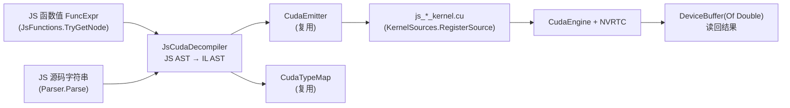

## 产品概述

对 sciBASIC# 的脚本生态做三项能力补齐，目标是让 JavaScript 侧脚本在"脚本自省/程序集引用/GPU 计算"三个方面与 VBS 侧对齐，并把标准库中为 demo 专门写的代码清理干净：

1. **LiteJs 内建脚本魔法函数**：把 `here(relpath)` 与脚本自省函数做进解释器，脚本不再自己实现 `here`。
2. **LiteJs 程序集搜索路径**：引用 CLR 程序集时除相对路径外，还会在解释器目录、其 `libs` 目录、上级 `libs` 目录中查找，与 VBS 的 `#include` 搜索规则同级。
3. **JsCuda 新工程**：把"JavaScript 函数源码 → AST → CUDA 内核源码 → GPU 执行"打通，使 JS 脚本可以直接把 JS 函数编译成 CUDA 算子；同时把 stdlib 里专为 cuda demo 写的 Pearson 内核代码删除，cuda demo 改用与业务无关的通用 API，内核归还给脚本自身。

## 核心特性

- **`here` 及其配套自省函数**：`here(path)`、`scriptDir()`、`scriptFile()`、`scriptName(withExtension?)`、`scriptText()`、`scriptLines()`，语义与 VBS `Magics.Build` 一致（相对路径锚定脚本所在目录、绝对路径原样返回、空参数返回脚本目录）；解释执行与代码生成（翻译执行）两条执行路径行为一致。
- **程序集解析增强**：`import ns from 'x.dll'` 保持相对脚本目录解析能力不变，新增解释器目录 / 解释器目录\libs / 上级目录\libs 三个搜索根，并允许省略 `.dll` 扩展名；被导入 dll 的托管与原生依赖继续沿其所在目录探测。
- **JavaScript → CUDA 翻译**：JS 函数（带名字约定的 `i`/`j` 线程索引参数、数组参数映射为只读指针、`return` 写回输出数组）或源码字符串，两种入口都能翻译；同时支持 `ctx.i` / `ctx.arr[...]` 的上下文语法糖；生成的 `.cu` 可打印查看，失败时给出带位置的明确异常。
- **可组合的 GPU 运行层**：设备探测、引擎创建、显存缓冲、1D/2D 启动、结果读回、CPU 与 GPU 对拍，均由通用 API 提供，不含任何业务算法。
- **demo 回归"脚本自己写内核"**：VBS 版在脚本内用 VB.NET 类写数学内核（走 IL 反编译），JS 版在脚本内用 JS 函数写内核（走 JS AST 翻译），两者都用同一套通用运行 API，产出可对照的设备名、耗时、误差与矩阵预览结果。
- **可验证**：LiteJs 既有 167 个测试保持通过，新增魔法函数与搜索路径测试；JsCuda 新增纯翻译测试（不依赖 GPU）；本机 GPU 上实跑两个 demo 并刷新样例输出。

## 技术栈

- 语言/运行时：VB.NET，.NET 10（SDK 风格工程），`dotnet build` / `dotnet test`。
- 相关工程：`vs_solutions\JavaScript\LiteJs.vbproj`（解释器 + 代码生成器，OutputPath → `.nuget\net10.0`）、`vs_solutions\NJS\NJS.vbproj`（宿主，OutputPath → `vs_solutions\tools`）、`cuda\ILCuda\ILCuda.vbproj`、`cuda\JsCuda\JsCuda.vbproj`（骨架待实现）、`vs_solutions\libs\stdlib`、`vs_solutions\libs\stdio`。
- 关键依赖：`Microsoft.VisualBasic.ApplicationServices.Development.VisualStudio.IL`（可复用的 IL 风格 AST：`MethodSyntax`/`Statement`/`Expression` + `SyntaxWriter` + `AstInterpreter`）、`ILCuda.IL2Cuda`（`CudaEmitter`、`CudaTypeMap`、`IlCudaKernel`、`CudaEngine`、`DeviceBuffer(Of T)`、`LaunchPlanner`、`KernelSources`）。

## 实施方案

### 一、LiteJs 魔法函数（解释执行 + 翻译执行双路径）

- 新增 `Runtime\API\ScriptMagic.vb`（`Public Module ScriptMagic`），作为脚本上下文的唯一真相来源：
- 目录锚点用 `JsRuntime.ScriptBaseDirectory`（`Interpreter.Run` 已按脚本目录设置并在结束时恢复，缺省回落到 `ProcessModule.ScriptDir` → `AppContext.BaseDirectory`）；
- 文件锚点用 `Interpreter.SourceFile`（默认 `ProcessModule.ScriptFile`）；
- `Here` 语义照抄 VBS `__magicResolve`：空串 → 脚本目录；`Path.IsPathRooted` → `Path.GetFullPath`；否则 `Path.GetFullPath(Path.Combine(脚本目录, relpath))`；
- 无脚本文件时安全降级：`ScriptFile()` 返回空串、`ScriptName()` 返回空串、`ScriptText()`/`ScriptLines()` 抛 `JsRuntimeException`（带明确消息），绝不 NullReference。
- `Runtime\Runtime.vb`：
- `GlobalIdentifiers()` 把 6 个名字并入 `New BuiltinMethod(GlobalObj, name)` 集合；
- `BuiltinGlobalFn(name, args)` 增 `Case`（`here`/`scriptDir`/`scriptFile`/`scriptText`/`scriptLines` 无参或单参，`scriptName` 支持可选布尔参）；
- 派发路径不变（`JsInvokeCore` → `NativeObject("global")` → `BuiltinGlobalFn`），因此**解释执行零额外分支**。
- `CodeGenerator.vb::ResolveIdent`：把这 6 个名字加进 `JsRuntime.JsGet(JsRuntime.GlobalObj, name)` 分支，保证生成代码（`njs` 的翻译执行/`--dts` 等路径）与解释执行等价。
- 同步移除 12 个 demo 里的本地 `here` 定义，改为直接调用内置函数。

### 二、CLR 程序集搜索路径

在 `Runtime\Interop\AssemblyResolver.vb` 内集中构造搜索根（对齐 `VBScript.vb:91-98` 的 `{baseDir, App.HOME, App.HOME/libs, App.HOME.ParentPath/libs}`）：

```
SearchRoots(baseDirectory) =
    [ baseDirectory(脚本目录),
      AppContext.BaseDirectory(解释器/njs 所在目录),
      AppContext.BaseDirectory\libs,
      AppContext.BaseDirectory\..\libs ]
    + ClrInterop.AssemblySearchPaths   ' 宿主显式注册的路径，保持最高优先级的追加语义
```

- `ResolveExistingPath`：`Path.IsPathRooted` 直接判定；相对 specifier 依次在各搜索根上尝试命中，允许省略 `.dll`（先试原名，再试 `name.dll`）；全部失败才继续后续步骤。
- 简单名解析：`Assembly.Load(AssemblyName(bare))` 失败后，按搜索根逐个尝试 `bare.dll`（原逻辑只遍历 `ClrInterop.AssemblySearchPaths`，统一改为遍历 `SearchRoots`）。
- 命中后仍调用 `AddProbeDirectory(path)`，使该 dll 的托管依赖（简单名）与原生依赖（`runtimes/*/native`）可解析——保持上一轮已实现的依赖探测能力。
- 提供 `Friend Function SearchRoots(baseDirectory As String) As String()` 只读视图，供单元测试断言顺序与去重。

### 三、JsCuda（JS AST → CUDA）

流水线复用现有组件，只在"前端"新增 JS→IL-STYLE-AST 的翻译：



关键设计决策：

1. **复用 IL 侧 AST 而不是另造一套**：`MethodSyntax`/`Statement`/`Expression` 全是公开 POCO，可直接构造；这样 `CudaEmitter` 与 `CudaTypeMap`（含 `System.Math` → `sqrt/pow/fabs` 映射表）零改动复用，JS 与 VB.NET 两侧生成的代码风格完全一致，审查成本最低。
2. **前端只做"类型化"**：JS 是动态类型，JsCuda 在翻译期把一切数值定为 `Double`（`CudaTypeMap` 天然支持 `double`），索引参数定为 `Integer`，数组参数定为 `Double()`（生成 `const double* __restrict__`）。这让"JS 直接写 GPU 内核"有确定的数值语义（GPU 侧与 JS 侧同为 IEEE-754 双精度，对拍误差可控）。
3. **内核包裹自己生成**：`IlCudaTranslator.BuildSource` 是 Private，JsCuda 内实现等价包裹（`__device__` 标量函数 + `extern "C" __global__`，1D/2D 索引、越界保护、`js_out[索引]` 写回），符号统一 `js_` 前缀，避免与 `il_*`、`metrics.cu` 等框架内置内核撞名。产物装进 `IlCudaKernel`（`Name/Source/IndexMode/Syntax/DeviceFunctionName`），便于统一调试与打印。
4. **运行层与 stdlib 解耦**：JsCuda 自带 engine/buffer/launch/read 门面，**不要求把 `IlCudaKernel` 对象跨程序集传给 stdlib**（避免 dll 副本导致的类型身份不一致）；stdlib.cuda 的同名能力服务 VBS 侧。代价是约 60 行薄封装重复，换来运行期稳定。
5. **失败即明确失败**：`ArrayExpr`/`ObjectExpr`/非白名单调用/闭包捕获外层变量/`console.log` 等一律抛 `JsCudaException`（消息含函数名、节点种类、源位置），绝不生成可疑代码。

### 四、stdlib cuda 泛化

- 删除 `vs_solutions\libs\stdlib\cuda-kernels.vb`（demo 专用 Pearson 内核）。
- 重写 `stdlib\cuda.vb` 为通用层：设备探测（`available/diagnostics/deviceName`）、翻译（`compile(method As MethodInfo)` + `kernelSource/kernelPseudoCode/kernelIndexMode(kernel)` 按对象取）、运行（`createEngine/buffer/bufferSize/read/launch1D/launch2D`）、自检（`selfCheck(kernel, args, expected)` 基于 `AstInterpreter`）、纯工具（`makeMatrix/toMatrix/preview/maxError`）；移除 `metrics/pearson/distance/pearsonCpu/distanceCpu/CudaMetrics/EnsureKernels/FindKernel`。
- 所有签名继续遵守脚本友好约定（数组/具体类，不用 `IEnumerable(Of T)`、泛型、`ByRef`、委托）。

### 五、demo 重构

- VBS：`cuda.vb` 内在脚本里定义 `Public Class PearsonMetrics`（`Shared`、`Single` 入参的普通数学）+ `Public Class CudaReference`（CPU 双精度参考实现），流程为"反射取 MethodInfo → `cuda.compile` → 打印 `.cu`/伪代码 → `selfCheck` → GPU 五步计算 → 与 CPU 参考对拍 → 导出 CSV"。
- JS：`cuda.js` 内用 **JS 函数**写同一组内核（至少一份名字约定、一份 `ctx` 语法糖），`jscuda.JsCudaHost.translate(fn)` → `launch1D/launch2D` → `read` → 与 JS 参考实现对拍 → 复用 `stdlib.table.fromMatrix` + `stdio.write.csv` 导出；打印项与 vb 版一一对应。
- 其余 11 个 js demo 删除本地 `here`，保留 `path` 导入（其他位置仍在用）。

## 实现要点（防止回归）

- **不要把魔法函数实现成 `JsModule`**：`here/scriptDir` 必须走 `NativeObject("global")` + `BuiltinGlobalFn`，因为 `CodeGenerator` 对已知全局走 `JsGet(GlobalObj, name)`，走别的容器会导致翻译执行路径 404。
- **`ScriptBaseDirectory` 是 ThreadStatic 且在 `Run` 结束时恢复**：新增魔法函数不要在解释器之外缓存目录，每次调用实时读取，避免测试并发场景串味。
- **搜索路径顺序稳定且去重**：`AppContext.BaseDirectory` 与其 `..\libs` 可能相同（部署在根目录时），需 `StringComparer.OrdinalIgnoreCase` 去重，否则日志与测试断言会漂移。
- **性能**：`here` 每次调用一次 `Path.GetFullPath`（O(路径段数)，可忽略）；程序集解析结果仍按 specifier 缓存（`_assemblies`），搜索根只在首次解析时计算并缓存，避免每次 import 重复探测磁盘。
- **错误可诊断**：解析失败消息保留"tried: ..."清单，新增搜索根也要出现在清单里，便于用户自助定位。
- **影响面控制**：NJS 不做行为变更（只是多几个可命中的目录）；LiteJs 既有公开 API 不改签名；ILCuda 不改动（只被 JsCuda 引用）；stdlib 的移除项在 readme 中有说明，且这些 API 仅被 cuda demo 使用（已确认）。
- **GPU 不可用降级**：翻译/伪代码/自检全部纯 CPU 可跑；`launch/read` 前先 `available()` 判定，demo 打印 `fallback` 分支而非抛异常。

## 目录结构

```
sciBASIC#/
├── vs_solutions/
│   ├── JavaScript/
│   │   ├── Runtime/
│   │   │   ├── API/
│   │   │   │   └── ScriptMagic.vb                 # [NEW] here/scriptDir/scriptFile/scriptName/scriptText/scriptLines
│   │   │   ├── Runtime.vb                          # [MODIFY] GlobalIdentifiers + BuiltinGlobalFn 派发 6 个魔法函数
│   │   │   └── Interop/
│   │   │       └── AssemblyResolver.vb             # [MODIFY] SearchRoots（脚本目录/appbase/appbase\libs/parent\libs）、可省略 .dll、简单名按根探测
│   │   ├── CodeGenerator.vb                        # [MODIFY] ResolveIdent 登记 6 个魔法函数
│   │   ├── README.md                               # [MODIFY] 内建全局与搜索路径说明
│   │   └── test/
│   │       ├── LiteJsMagicTests.vb                 # [NEW] here/自省的语义与生成代码结构断言
│   │       └── LiteJsImportTests.vb                # [MODIFY] 搜索根断言 + 无扩展名 specifier 解析
│   └── libs/
│       ├── readme.md                               # [MODIFY] 4.8 小节改为泛化后的 cuda api
│       └── stdlib/
│           ├── cuda-kernels.vb                     # [DELETE] demo 专用 PearsonMetrics
│           └── cuda.vb                             # [MODIFY] 泛化为 compile/buffer/launch/selfCheck + 工具函数
├── cuda/
│   ├── JsCuda/
│   │   ├── JsCuda.vbproj                           # [MODIFY] 补 LiteJs ProjectReference
│   │   ├── Class1.vb                               # [DELETE]
│   │   ├── JsKernelOptions.vb                      # [NEW] 名称/索引模式/参数顺序/元素类型/容差
│   │   ├── JsCudaException.vb                      # [NEW] 带函数名与源位置的明确失败异常
│   │   ├── JsCudaDecompiler.vb                     # [NEW] JS AST → IL 风格 AST（含 ctx 语法糖改写、类型推断）
│   │   ├── JsCudaTranslator.vb                     # [NEW] Translate(fn)/TranslateSource(src) + .cu 包裹生成
│   │   ├── JsCudaHost.vb                           # [NEW] 脚本门面：translate/available/engine/buffer/launch/read/selfCheck
│   │   ├── README.md                               # [NEW] 用法与支持的 JS 子集
│   │   └── test/
│   │       ├── JsCuda.Tests.vbproj                 # [NEW] xunit（参考 ILCuda/test、JavaScript/test 写法）
│   │       └── JsCudaTranslationTests.vb           # [NEW] 纯翻译断言（无 GPU 依赖）
│   └── ILCuda.slnx                                 # [MODIFY] 加入 JsCuda 工程与测试工程
└── tutorials/VBS/
    ├── readme.md                                   # [MODIFY] cuda demo 的 kernel 归属与 JS 两种写法说明
    └── scripts/
        ├── cuda/
        │   ├── cuda.vb                             # [MODIFY] 脚本内 PearsonMetrics + CudaReference + 通用 cuda api
        │   ├── cuda.js                             # [MODIFY] JS 函数内核（名字约定 + ctx）+ jscuda + 通用运行 api
        │   └── stdout.txt                          # [MODIFY] 重新采集
        └── {linear_regression,kmeans,hierarchical_clustering,tf-idf,word2vec,
             hola_layout,spiking_nn,mnist_umap,mnist_cnn,tuple,dynamic_type}/*.js
                                                    # [MODIFY] 删除本地 here 定义
```

## 关键接口约定

```
' Runtime\API\ScriptMagic.vb —— 脚本自省（与 VBS Magics.Build 表面一致）
Public Module ScriptMagic
    Public Function Here(relpath As String) As String
    Public Function ScriptDir() As String
    Public Function ScriptFile() As String
    Public Function ScriptName(Optional withExtension As Boolean = True) As String
    Public Function ScriptText() As String
    Public Function ScriptLines() As String()
End Module
```

```
' cuda\JsCuda\JsCudaHost.vb —— 脚本门面（JS 侧：jscuda.JsCudaHost.*）
Public Class JsCudaHost
    Public Shared Function Translate(kernel As Object, Optional options As JsKernelOptions = Nothing) As IlCudaKernel
    Public Shared Function TranslateSource(source As String, Optional options As JsKernelOptions = Nothing) As IlCudaKernel
    Public Shared Function PseudoCode(kernel As IlCudaKernel) As String
    Public Shared Function Available() As Boolean
    Public Shared Function DeviceName() As String
    Public Shared Function CreateEngine() As Object          ' CudaEngine（不透明句柄，由 Launch/Dispose 使用）
    Public Shared Function Buffer(values As Double()) As Object
    Public Shared Function Launch1D(kernel As IlCudaKernel, engine As Object, n As Integer, blockSize As Integer, ParamArray args As Object()) As String
    Public Shared Function Launch2D(kernel As IlCudaKernel, engine As Object, rows As Integer, cols As Integer, tileX As Integer, tileY As Integer, ParamArray args As Object()) As String
End Class
```

## 验证方案

1. `dotnet build` LiteJs / JsCuda / stdlib / stdio / NJS（Debug 与 Release）0 error；标准库与 JsCuda 自身源码 0 warning。
2. `dotnet test` LiteJs.Tests（既有 167 例 + 新增魔法函数/搜索路径用例）与 JsCuda.Tests（纯翻译用例）全绿。
3. `vbs.exe tutorials\VBS\scripts\cuda\cuda.vb` 与 `njs.exe ...\cuda.js` 均实跑成功（本机 NVIDIA RTX A4000），刷新 `stdout.txt`，两版打印的节点（内核翻译、伪代码、自检、设备/耗时、GPU vs CPU 最大误差、矩阵预览）一一对应。
4. 其余 11 个 js demo 全量重跑（`here` 改为内置后产物路径不变），确认无回归。
5. 文档齐备：`JavaScript/README.md`（魔法函数 + 搜索根）、`libs/readme.md`（4.8 节泛化 API）、`cuda/JsCuda/README.md`（支持的 JS 子集与两种写法）、`tutorials/VBS/readme.md`（cuda demo 说明）。

## Agent Extensions

### SubAgent

- **code-explorer**
- Purpose: 在实现 JsCuda 前端前，精确核对 JS AST → IL AST 映射所需的下游成员签名（`MethodSyntax`/`ParameterDeclaration`/`VariableDeclarationStatement`/`ForStatement` 的构造与可写属性、`JsValue` 的数值读取方法、`CudaEmitter.EmitFor` 对 `VariableName` 的假设、`KernelSources.RegisterSource` 与 `CudaEngine.GetKernel` 的调用契约）。
- Expected outcome: 一份可直接落笔的成员清单（文件路径 + 成员签名），使 `JsCudaDecompiler` 与 `.cu` 包裹生成一次写对，避免编译期反复试错。