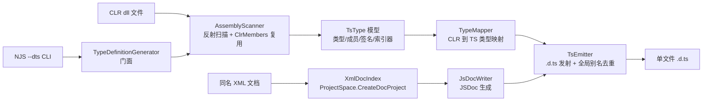

## User Requirements

用户希望在 vs_solutions\JavaScript\LiteJs.vbproj（VB.NET 编写的 JavaScript 解释器，已提供 CLR 反射互操作接口）中新增一个 TypeScript `.d.ts` 定义文件生成工具：通过反射加载某一个编译好的 CLR dll 程序集，获取其中所有可公开访问的类型及成员（属性、字段、方法函数、构造函数），按成员签名生成对应的 TypeScript 类型定义文件；生成的 `.d.ts` 供用户在其它 IDE 中编写 JavaScript 时引用，以获得 .NET CLR 库的类型智能提示。若目标 assembly 附带 XML 注释文档，还需使用 `G:\pixelArtist\src\framework\Microsoft.VisualBasic.Core\src\ApplicationServices\VBDev\XmlDoc` 中提供的方法解析注释，生成对应 TypeScript 对象的 JSDoc 注释。

## Product Overview

一个可命令行调用、也可作为库 API 使用的定义文件生成器：输入 CLR dll（可带同名 XML 文档），输出单文件 `.d.ts`。生成结果与 LiteJs 互操作桥接的运行时语义严格一致（成员可见性、重载解析、类型转换），保证 IDE 提示与脚本实际行为不矛盾。输出形态为「命名空间 + 全局别名」：类型按 CLR 命名空间聚合声明，同时为每个公开类型生成全局别名（`type X = Ns.X;` + `declare const X: typeof Ns.X;`），使 JS 脚本中可直接 `new T()` / `T.StaticMember` 获得提示；跨命名空间重名自动去重，可用开关关闭。通过 NJS CLI 的 `--dts` 子命令调用，支持 `-o/--output`、`--xmldoc`、`--no-globals`、`--explicit-only` 选项；未指定 XML 路径时自动探测 dll 同目录同名 `.xml`，不存在则无注释生成（不报错）。

## Core Features

- 反射扫描：加载 dll，枚举全部 public（含嵌套 public）类型与公共成员；跳过编译器生成类型；可见性规则与桥接完全一致（JsName 重命名 / JsIgnore 隐藏 / JsExpose 白名单 / ExplicitOnly 全局白名单）
- 成员签名生成：属性（只读/只写、单参数索引器转索引签名）、字段（const/readonly）、方法（重载多签名、params 转剩余参数、可选参数、泛型方法、静态）、公共构造函数；事件不生成（桥接不暴露事件）
- 类型映射与 ClrConvert 转换语义对齐：数值→number、String/Char/Guid→string、Boolean→boolean、Date/DateTimeOffset→Date、Task(Of T)→Promise`<T>`、枚举→枚举声明、Nullable→`T | null`、数组/List→`T[]`、IEnumerable→`Iterable<T>`、委托→函数类型、未知类型→any
- XML 注释解析：用 XmlDoc 的 ProjectSpace.CreateDocProject 载入文档，按编译器成员命名约定匹配反射成员，生成 JSDoc（summary/@param/@returns/@template/@example/@deprecated）
- 全局别名与去重：class/struct/enum 生成 type+const，interface/delegate 仅 type；简单名冲突首个保留、其余注释说明
- CLI 与库双入口：TypeDefinitionGenerator 库 API + `njs --dts <dll>`，输出统计信息，失败退出码 1

## Tech Stack Selection

- 语言/框架：VB.NET，net10.0，Option Strict/Explicit/Infer On —— 与 LiteJs.vbproj 现有工程设置逐字一致；无新增项目引用、无新增 NuGet 依赖
- 反射：System.Reflection（Assembly.LoadFrom、GetExportedTypes、GetProperties/GetFields/GetMethods/GetConstructors + BindingFlags）
- XML 注释解析：复用 Microsoft.VisualBasic.Core 程序集中 `ApplicationServices.Development.XmlDoc.Assembly`（`ProjectSpace.CreateDocProject` → Project/ProjectNamespace/ProjectType/ProjectMember）；LiteJs.vbproj 已 ProjectReference Core.vbproj，开箱可用
- CLI：vs_solutions/NJS（已引用 LiteJs.vbproj），新增 `--dts` 分支，沿用现有 Main 手工参数循环风格
- 测试：xunit 2.9.3（test 工程已配置）
- 输出：UTF-8 无 BOM 文本 `.d.ts`（与 HtmlIO.SaveHtml 的编码做法一致）

## Implementation Approach

### 策略

生成器组织为单向流水线：**反射扫描 → TsType 模型 → 类型映射 + XML 文档查找 → 文本发射**，全部代码位于 LiteJs.vbproj 新目录 `TypeDefinitions/`（SDK 默认通配自动包含，vbproj 无需改动）。

**核心决策：直接复用同程序集内的 `Friend` 模块 `ClrMembers`/`ClrConvert`，而不是重新实现可见性与类型映射规则。** 已读源码确认：`ClrMemberCache.vb:122 Friend Module ClrMembers` 提供 `Friend Function InstanceSet/StaticSet/Constructors`，`Friend NotInheritable Class ClrMemberSet`（Friend 字段 Properties/Fields/Methods/Indexers/Names/IsEnumerable）；新代码与 Interop 编译进同一程序集，可直接调用。这些视图已按桥接语义缓存好成员（JsName 重命名、JsIgnore 隐藏、JsExpose 类型级白名单、IsSpecialName 跳过、索引器分离、含继承成员）；`ClrConvert.IsNumericType/IsGenericList` 与 `ClrMembers.IsEnumerableType` 可直接作为类型映射判据。这样 `.d.ts` 与运行时共用单一事实源，永不脱同步（若重抄规则必然漂移）。生成器只自建类型级枚举（GetExportedTypes 等，ClrMembers 无此能力）。

**关键取舍：**

1. 复用 Friend 内部实现 vs 重写规则：选复用。代价是生成器与 Interop 内部耦合，但同程序集同作者，收益（永不脱同步）远大
2. 单文件输出 vs 每命名空间一文件：选单文件——自包含、无交叉引用、IDE 引用路径简单；大程序集文件体积大可接受，README 说明
3. 全局别名用 `type X = Ns.X; declare const X: typeof Ns.X;`（TS 声明合并）而非重复整体声明：避免两份定义漂移；interface/delegate 仅 type（无可构造值）；泛型用 `type X<T> = Ns.X<T>;`
4. XML 文档用 Project 结构化模型（用户指定）而非 Doc 原始模型：提供 Params/TypeParams/GetParameterDocument 等直接可用的 JSDoc 素材
5. 未知 BCL 类型 → any（YAGNI）：v1 覆盖 sciBASIC 常见面，后续可在 TypeMapper 挂点增强

**性能与可靠性：**

- 复杂度 O(总成员数)：每类型一次成员扫描（ClrMembers 内部 Dictionary 缓存，key = AssemblyQualifiedName + ExplicitOnly 策略）；XML 文档一次性 XPath `members/member` 载入 O(D)；StringBuilder 顺序发射 O(输出长度)。Core 规模（数千类型/数万成员 + 数 MB XML）预计数秒内，无 N+1 反射
- 健壮性：`GetExportedTypes` 对依赖缺失的程序集会抛 ReflectionTypeLoadException，必须捕获并降级为 `ex.Types.Where(Function(t) t IsNot Nothing)`，保证“能生成多少生成多少”；XML 载入失败降级为无注释模式，不阻断生成
- 开关污染防护：扫描前保存并临时设置 `ClrInterop.ExplicitOnly = options.ExplicitOnly`（CacheKey 含该开关，不会污染缓存），Finally 恢复

## Implementation Notes

- **成员名 TS 关键字冲突**：CLR 成员名可能是 TS 结构关键字（constructor/static/get/set/readonly/declare/namespace/interface/type/enum/implements/private/public/protected/abstract/async/await/function/let/const/class/extends/super/import/export/from/of/as/new/delete/typeof/instanceof/void/never/unknown/any/object/string/number/boolean/symbol/bigint/is/keyof/infer/unique），类成员名需加引号（`"constructor"(x): void;` 在 TS 合法）
- **VB Module 检测**：`t.IsAbstract AndAlso t.IsSealed` 且带 `CompilerServices.StandardModuleAttribute` → 全 static + 发 `private constructor();`
- **从 System.Object 继承的公共成员**（ToString/Equals/GetHashCode/GetType）会按桥接实情出现在每个类型中，忠实反映，README 说明
- **XML 文档成员键**：按编译器约定从反射计算（`M:Ns.Type.Name(System.Int32,...)`，泛型实例花括号 `{}`、开放泛型反引号 `` `N ``、数组 `[]`、ByRef `&`、ctor 为 `#ctor`），与 `ProjectMember.[Declare]` 归一化后精确匹配；失败回退「名称+参数个数」再回退「仅名称」，全部失败静默无注释
- 自建 XML 文档全名索引（遍历 Project.Namespaces→Types），**不要用 `Project.GetType(fullName)`**——其按 "." 拆分对嵌套类型 `Ns.Outer+Inner` 会拆错（Project.vb:115 已读源码确认）
- JSDoc 文本转义 `*/` → `*\/`；多行 summary 逐行 ` * ` 前缀；无任何注释素材时不输出注释块
- 输出确定性：命名空间 Ordinal 排序、成员（属性/字段合并按 script name、方法按 name+参数数、ctor 按参数数）、枚举保留元数据顺序、无时间戳 → 可 diff、可入版本库
- 事件跳过（ClrMembers 本就不扫描事件，与桥接一致）；多维数组 → any（桥接拒绝转换）；委托参数按函数类型发出（桥接会抛可读错误，README 注明）
- CLI 反馈：统计（类型数/成员数/输出路径/XML 是否使用）到 stdout，错误到 stderr 且 exit 1；加载目标 dll 到默认 ALC 在一次性 CLI 进程无卸载问题，库 API 场景在 XML 注释说明
- 爆炸半径控制：全部新代码在新目录 + NJS 新分支 + test 新文件 + README；不改动任何现有运行时行为（ClrInterop.ExplicitOnly 仅临时借设且 Finally 恢复）

## Architecture Design

数据流（单向流水线，无环）：



模块职责：

- **AssemblyScanner**：类型级过滤（public/嵌套 public 且父 public/跳过 CompilerGenerated 与名称含 `<` 的生成类/IncludeNonPublic 选项），对每个导出类型调用 `ClrMembers.InstanceSet/StaticSet/Constructors` 构建 TsType 模型（合并实例+静态视图，分别打 static 标记）
- **TypeMapper**：`TsTypeName(t As Type) As String`，对齐 ClrConvert 语义；本程序集类型输出限定声明名（泛型实参递归），外部类型查映射表
- **XmlDocIndex**：载入 + 全名/短名索引 + 成员文档键计算与三级回退匹配，暴露 `DocFor(typeFullName)` 与成员级查询
- **JsDocWriter**：ProjectType/ProjectMember + ObsoleteAttribute → JSDoc 文本（转义、多行、`[name=default]`、@template、@example、@deprecated）
- **TsEmitter**：头注释 → 命名空间块（全局命名空间类型顶层）→ 类型声明（class/interface/enum/struct/delegate/Module，extends/implements、泛型、索引签名、成员排序）→ 全局别名段（去重）
- **TypeDefinitionGenerator**：门面 `Generate(assemblyPath, options) As String` / `Write(assemblyPath, outputPath, options) As Integer`（返回导出类型数），串联全流程并做参数校验

## Directory结构

```
g:/pixelArtist/src/framework/
├── vs_solutions/
│   ├── JavaScript/
│   │   ├── LiteJs.vbproj                  # 无需改动（SDK 默认 **/*.vb 通配自动包含 TypeDefinitions/）
│   │   ├── TypeDefinitions/               # [NEW] 生成器根目录，命名空间 TypeDefinitions
│   │   │   ├── NamespaceDoc.vb            # [NEW] 命名空间文档模块（沿用仓库每目录惯例）
│   │   │   ├── TsOptions.vb               # [NEW] TypeDefinitionOptions：XmlDocPath/Globals(默认True)/ExplicitOnly(默认False)/IncludeNonPublic(默认False)
│   │   │   ├── TsModel.vb                 # [NEW] TsTypeKind 枚举 + TsType/TsProperty/TsField/TsMethod/TsConstructor/TsIndexer 模型（纯数据，无行为）
│   │   │   ├── AssemblyScanner.vb         # [NEW] 类型级过滤 + 复用 ClrMembers.InstanceSet/StaticSet/Constructors 构建模型；ReflectionTypeLoadException 降级；ExplicitOnly 借设与恢复
│   │   │   ├── TypeMapper.vb              # [NEW] CLR 到 TS 类型映射（复用 ClrConvert.IsNumericType/IsGenericList、ClrMembers.IsEnumerableType；Nullable/Task/枚举/数组/委托/泛型规则）
│   │   │   ├── XmlDocIndex.vb             # [NEW] ProjectSpace.CreateDocProject 载入（excludeVBSpecific:=True）、全名索引、成员文档键计算与三级回退匹配
│   │   │   ├── JsDocWriter.vb             # [NEW] ProjectType/ProjectMember + Obsolete 到 JSDoc（转义/多行/@param/@returns/@template/@example/@deprecated）
│   │   │   ├── TsEmitter.vb               # [NEW] .d.ts 发射：文件头/命名空间/类型声明/成员/索引签名/全局别名去重/确定性排序/UTF-8 无 BOM
│   │   │   └── TypeDefinitionGenerator.vb # [NEW] 门面：Generate/Write + 参数校验 + 统计返回
│   │   ├── test/
│   │   │   ├── TsFixture.vb               # [NEW] 夹具类型全集：枚举/struct/委托/泛型类+泛型方法/继承+接口/嵌套/索引器/params/可选参数/静态/JsName/JsIgnore/JsExpose/Obsolete/多命名空间重名/Task/Nullable/VB Module
│   │   │   ├── TypeDefinitionTests.vb     # [NEW] xunit：文件头/命名空间/类型映射逐项/可见性/重载/泛型/JSDoc/全局别名与去重/--no-globals/端到端真实程序集
│   │   │   └── test.vbproj                # [MODIFY] 增 GenerateDocumentationFile=true + NoWarn BC42356（验证 dll 旁 XML 自动探测路径）
│   │   └── README.md                      # [MODIFY] 增补「TypeScript 定义文件生成」小节：用法/输出形态/类型映射表/与互操作语义对应/已知限制
│   └── NJS/
│       └── Program.vb                     # [MODIFY] Main 参数循环新增 --dts 分支（-o/--output、--xmldoc、--no-globals、--explicit-only、--include-nonpublic）+ 生成执行与错误处理 + Usage 增行
```

## Key Code Structures

```
''' <summary>Options of the .d.ts generation pipeline.</summary>
Public Class TypeDefinitionOptions

    ''' <summary>XML documentation file; Nothing = auto-detect next to the dll.</summary>
    Public Property XmlDocPath As String

    ''' <summary>Emit global aliases (type + declare const) per public type. Default True.</summary>
    Public Property Globals As Boolean = True

    ''' <summary>Whitelist mode for every type (mirrors ClrInterop.ExplicitOnly). Default False.</summary>
    Public Property ExplicitOnly As Boolean = False

    ''' <summary>Also emit non-public (Friend/internal) types. Default False.</summary>
    Public Property IncludeNonPublic As Boolean = False

End Class
```

```
''' <summary>
''' Facade of the TypeScript definition generator: reflects one CLR assembly
''' and emits a single .d.ts whose member visibility and type mapping are
''' taken from the same ClrMembers/ClrConvert rules the script bridge uses.
''' </summary>
Public Module TypeDefinitionGenerator

    ''' <summary>Generate the .d.ts text for one assembly.</summary>
    Public Function Generate(assemblyPath As String, options As TypeDefinitionOptions) As String

    ''' <summary>Generate and save to file (UTF-8, no BOM); returns the exported type count.</summary>
    Public Function Write(assemblyPath As String, outputPath As String, options As TypeDefinitionOptions) As Integer

End Module
```