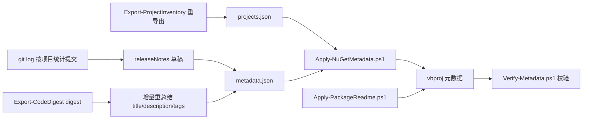

## Product Overview

对 sciBASIC# 代码库的 NuGet 包元数据流程进行一次增量刷新：以 `vs_solutions\dev\NuGetMetadata` 文件夹中已有的 PowerShell 脚本流水线为基础，先更新 json 数据文件（projects.json 清单 + metadata.json 逐包描述），再应用脚本将 Title、Description、PackageTags、AssemblyTitle、releaseNotes（PackageReleaseNotes）等元数据写入各库项目的 vbproj，最后用验证脚本确认结果正确且幂等。

## Core Features

- **清单同步**：重新导出 projects.json，移除 2 个已从仓库删除的项目（Data_science/Visualization/Plots、Plots-statistics），并与 nuget.slnx 核对项目列表一致性；同步清理 metadata.json 中的失效条目。
- **releaseNotes 生成与应用**：按 git log 按项目统计近期提交，为每个包总结一条简短 release note，作为 metadata.json 新增的 releaseNotes 字段，由 Apply 脚本写入 vbproj 的 PackageReleaseNotes 属性（89/91 个 vbproj 已有该属性，现游离于流程之外，需纳入统一管理）。
- **元数据增量刷新**：仅对近期代码有改动的项目，基于 Export-CodeDigest 生成的代码摘要重新总结 title/description/packageTags；其余项目沿用现有条目。
- **脚本 bug 修复与扩展**：审查并修复 NuGetMetadata 文件夹中 5 个 PowerShell 脚本的不确定 bug；扩展 Apply-NuGetMetadata.ps1 支持 PackageReleaseNotes（含幂等写入、legacy 项目跳过逻辑），同步扩展 Verify-Metadata.ps1 的校验集合。
- **应用与验证**：以 WhatIf 预览变更后应用脚本更新 vbproj（保持 UTF-8 BOM/换行/缩进不变），运行 Verify-Metadata.ps1 校验 XML 有效性、统一值、逐项内容与幂等性（重复运行应零变更）。

## 边界与约束

- 不修改任何 .vb 源代码与项目功能逻辑；只触碰 vbproj 元数据与 NuGetMetadata 文件夹内的数据/脚本。
- readme 覆盖已完整（0 个缺失），Apply-PackageReadme.ps1 仅做修复性重跑确认。
- 保持现有 xml 写入的幂等与格式保留语义，避免无关 vbproj diff。

## Tech Stack

- **脚本语言**：Windows PowerShell 5.1（与现有脚本一致），XML 处理用 System.Xml.XmlDocument + PreserveWhitespace，JSON 用 ConvertFrom-Json/ConvertTo-Json。
- **数据源**：git log（按项目目录过滤提交）、Export-CodeDigest.ps1 生成的 digest markdown（项目公共类型/成员/summary 摘要）。
- **目标文件**：91→89 个 SDK 风格 vbproj 的首个含 RootNamespace 的无条件 PropertyGroup。

## Implementation Approach

1. **脚本审查与修复先行**：先以 `-WhatIf`/只读方式跑一遍现有脚本发现 bug（已知疑点：Export-ProjectInventory 的 TestPathSegments 只排除路径含测试段的目录但不影响本次；Verify-Metadata 与 Apply 的预期值重复定义易漂移；ConvertTo-Json 深度默认 2 可能截断 projects.json snapshot 嵌套——需检查 Export 脚本写回时的 -Depth 参数；Find-ItemGroup 取“第一个无条件 ItemGroup”可能把图标/编译项追加进语义错误的组等），确认后修复。
2. **releaseNotes 管道**：新增/扩展流程——用 `git log --since` 按项目目录统计提交主题，结合 digest 生成每包一条简短中文或英文 release note，写入 metadata.json 的 releaseNotes 字段；Apply-NuGetMetadata.ps1 对非 legacy 项目 Set-Property 'PackageReleaseNotes'，值相同时幂等跳过。
3. **增量刷新策略**：以 git diff/log（上次清单导出日 2026-09-11 之后）判定“近期有改动”的项目集合，仅对这些项目读取 digest 重新总结 title/description/tags；metadata.json 保留原条目结构（path/title/description/packageTags/assemblyTitle/releaseNotes）。
4. **应用顺序**：更新 projects.json → 更新 metadata.json → `Apply-NuGetMetadata.ps1 -WhatIf` 预览 → 实际应用 → `Apply-PackageReadme.ps1` 确认 → `Verify-Metadata.ps1` 校验。

## 性能与可靠性

- git log 按目录 `-- <dir>` 过滤，O(项目数×log N)，无性能瓶颈；digest 每项目仅数 KB。
- XML 写入严格复用现有 Save-XmlPreserving（保留 BOM/声明/换行/缩进，无变化不落盘），防止大范围无关 diff。
- WhatIf 预览 + Verify 校验双重防线；脚本修复均为向后兼容的小改动，不改变统一值常量（Authors/License/Icon 等）。

## 架构



## Key Code Structures

metadata.json 条目扩展（向后兼容，仅新增字段）：

```
{
  "path": "mime/application%json/JSON-netcore5.vbproj",
  "title": "...",
  "description": "...",
  "packageTags": "scibasic;json;...",
  "assemblyTitle": "Microsoft.VisualBasic.MIME.application.json",
  "releaseNotes": "近期变更一句话总结"
}
```

Apply-NuGetMetadata.ps1 新增写入（非 legacy 分支内，紧随 PackageTags 之后）：

```
if ($meta.releaseNotes) {
    $ops += (Set-Property $doc $group 'PackageReleaseNotes' $meta.releaseNotes $indents)
}
```

## Agent Extensions

### SubAgent

- **code-explorer**
- Purpose：对“近期有改动”的项目集合，结合 digest 与源码快速确认项目当前功能职责，辅助生成准确的 title/description/packageTags 增量文案；并在脚本审查阶段交叉核对 5 个 PowerShell 脚本中可疑逻辑。
- Expected outcome：产出每个待刷新项目的功能要点小结，供元数据文案总结直接引用；报告脚本疑点清单。