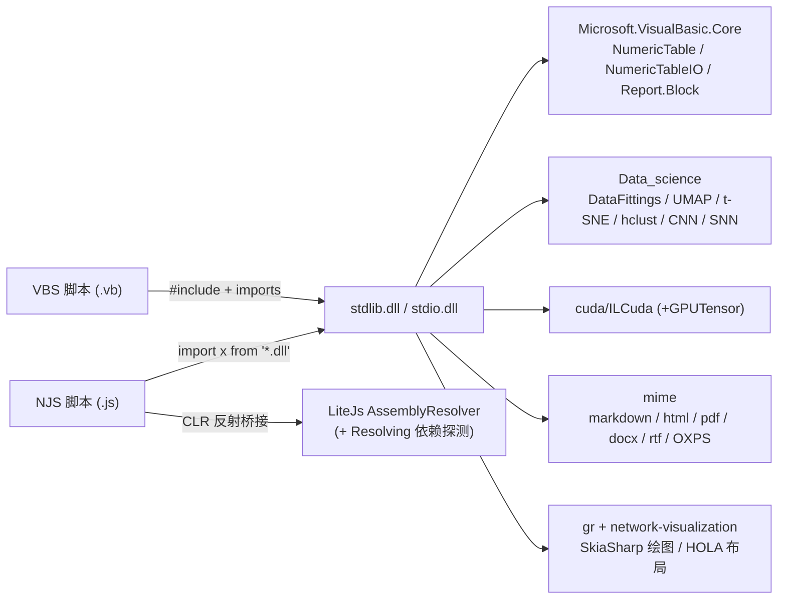

## 用户需求

为 **VBS（`vs_solutions\VBS\VBS.vbproj`）** 与 **NJS（`vs_solutions\NJS\NJS.vbproj`）** 两个脚本引擎提供一套**共享的标准库**，让两种语言写出的脚本调用同一套 API。

- `vs_solutions\libs\stdio\stdio.vbproj`：数据文件读写标准库，基于 `sciBASIC#\Data` 下的文件 I/O 代码，覆盖多种格式。
- `vs_solutions\libs\stdlib\stdlib.vbproj`：数据科学分析、数据可视化、数据报告标准库，基于 `sciBASIC#\Data_science` 下的分析代码。
- 编写风格沿用两个工程现有模式：扁平 `Public Module` + 扁平函数（`read.csv` / `write.csv` / `fit.linear` / `plot.scatter`）。

## 产品概述

最终交付"两个类库 + 24 个示例脚本"：VBS 脚本用 `#include "stdlib.dll"` / `imports stdlib` 调用；JavaScript 脚本用相对路径 dll 导入（`import stdlib from '../../../../.nuget/net10.0/stdlib.dll';`），调用语义相同的 API，产出同样的结果表、结果图与报告文件。不修改 NJS 工程。

## 核心特性

- **stdio 多格式 I/O**：以 `NumericTable` 为统一表格载体，读写 csv/tsv/分隔符表/arff/xlsx/json/纯文本行/MNIST，并为网络、HDF5、SQLite、msgpack、feather 等格式提供读写入口。
- **stdlib 表格与建模**：表格构造/取值/加标签/列名生成/子集；线性、多项式、岭回归、弹性网、非线性拟合与预测。
- **stdlib 统计与无监督**：描述统计、相关/协方差、假设检验；kmeans、层次聚类（树与剪枝）、PCA/UMAP/t-SNE 降维。
- **stdlib 可视化**：散点/折线/直方/箱线/柱状/热图，按类别自动分组配色，一次调用落盘 PNG；网络图构建 + HOLA 布局 + 出图。
- **stdlib 报告**：基于 Core 的 `Block` 内容模型，把标题/段落/代码/列表/表格/图片组装成文档，按扩展名统一导出 **markdown / html / docx / pdf / rtf / xps**。
- **stdlib 领域封装**：TF-IDF、word2vec；MNIST 读取、CNN 训练评估与 CPU/GPU 后端对比、脉冲神经网络训练与文本可视化；IL→CUDA 内核门面（GPU 不可用时自动降级 CPU）。
- **24 个等价 demo**：12 个 VBS 脚本全部重构为只依赖 stdlib/stdio；每个脚本旁新增一份等价 JavaScript demo，产物文件名一一对应，可在缺数据/无 GPU 时优雅降级并给出可运行回退。

## 技术栈

- **语言/运行时**：VB.NET，.NET 10（SDK 风格工程，`net10.0`），`dotnet build`。
- **脚本引擎**：VBS（Roslyn 内存编译 + `ScriptLoadContext`）、NJS（LiteJs 树遍历解释器 + CLR 反射桥接）。
- **依赖**：`Microsoft.VisualBasic.Core`（`NumericTable`、`NumericTableIO`、`Report.Block`）、`Data_science`（DataFittings/UMAP/t-SNE/hierarchical-clustering/DataMining、MachineLearning 的 DeepLearning/SNN、Mathematica/Math、Visualization/DataPlot）、`cuda/ILCuda`（+ ILCudaTensor）、`mime`（markdown/html/pdf/docx/rtf/OXPS）、`gr/*`（SkiaSharp 绘图、network-visualization）。
- **产物目录**：stdlib/stdio/VBS → `sciBASIC#\.nuget\net10.0\`；NJS → `sciBASIC#\vs_solutions\tools\`。

## 实施方案

### 1. 脚本 API 契约（先定规则，再写代码）

LiteJs 桥接的 `ClrConvert.ToClr` 只支持：基元/字符串/枚举/日期、`T()`（rank=1，逐元素递归）、`List(Of T)`、`IsAssignableFrom`、`Nothing`。**不支持 `IEnumerable(Of T)`**。因此所有面向脚本的 public 成员必须满足：

- 参数与返回值只用 `Double()`、`Double()()`、`String()`、`Integer()`、`Boolean`、`String`、具体类（`NumericTable`/`DataFrame`/`Block`/`Cluster`/`GraphicsData`/自定义结果类）。
- 禁止：`IEnumerable(Of T)`、泛型方法/泛型参数、`ByRef`、委托/`Func` 参数、多维数组 `Double(,)`（用交错数组）。
- 不把 `IDisposable` 交给脚本：绘图返回 `GraphicsData`，另给 `plot.save(g, file, dpi)` 负责落盘与释放。
- 模块必须**直接**位于命名空间 `stdlib` / `stdio` 下（LiteJs 命名空间导入是扁平的，不递归子命名空间）。
- 库内保持静默（不主动 `Console.WriteLine`），由 demo 控制输出；需要开关时给 `Optional silent As Boolean = True`。

### 2. stdio：`read` / `write` 双模块

- 统一以 `NumericTable` 为表格出口：`read.csv/tsv/table/xlsx` 内部走 `NumericTableIO.ReadCsv/ReadDelimited` 与 `DataFrame.AsNumericTable`，保留 `columns As String()` 列白名单参数（对应 `labels`）。
- `read.xlsx` 保留 `sheet As String` 与 `index As Integer` 两个重载（JS 按实参类型择优）。
- 新增 `read.mnist(images, labels, limit)`（内部 `MNIST` + `ExtractDataSet(Of ClusterEntity)`）、`read.lines/text`、`read.json`、`read.sif/edgeList`，以及 `write.csv/tsv/xlsx(多 sheet)/json/lines/sif`。
- 二进制/专用格式（hdf5、sqlite、msgpack、feather、HDSPack、wav）在**验证底层入口签名可行**后按同一模式补齐，不可行则在 readme 中标注为未支持，不阻塞主线。

### 3. stdlib：按职责分模块

| 模块 | 关键函数 |
| --- | --- |
| `table` | `fromRows/fromColumns/fromMatrix`、`feature/label/classLabels`、`setLabel`、`select`、`names`（替代 `fieldname`）、`asDataFrame/fromDataFrame`、`matrix` |
| `fit` | `linear/poly/ridge/elasticNet/lma`、`predict/residuals/r2` |
| `stats` | `mean/sd/median/quantile/var/cor/cov`、`t_test/anova/chisq`、`summary` |
| `cluster` | `kmeans`、`hclust`（`hca`）、`distanceMatrix`、`cutree(k)`/`cutree(threshold)`、`leafCount/leafs/orderLeafs/clusterSizes` |
| `dimreduce` | `pca`（返回分析结果）、`pcaScore`（直接返回得分表）、`umap`、`tsne` |
| `plot` | `scatter/line/hist/box/bar/heatmap`、`save`；内部完成 `SkiaDriver.Register()` 与按 `class_id` 分组 |
| `net` | `newgraph/addNode/addEdge/hola/nodes/edges/bendCount/draw` |
| `report` | Block 工厂（`heading/paragraph/code/list/table/tableOf/image/blockquote/hr/raw/link/math/deflist/tasklist/footnote`）、`markdown/html/text`、`render(blocks, file, title, author, toc)`、`ReportBuilder` |
| `nlp` | `tokenize/tfidfTable/tfidfMatrix/word2vec` |
| `ml` | `cnnTrain/cnnBackendBenchmark/useCuda/backend/kernelFailures`、`snnTrain`（含 `sparkline/raster/trace` 文本可视化）、`gaussianClusters`、`accuracy/confusion/split` |
| `cuda` | 把 `cuda.vb` 的 `PearsonMetrics` 内核搬入 stdlib 程序集（保证 `MethodInfo` 可反射），门面 `available/deviceInfo/pearson/distance/pearsonCpu/distanceCpu/makeMatrix/maxError/kernelInfo` |


`report.render` 按扩展名分派：`.md/.markdown` → `ToMarkdown`，`.txt` → `ToPlainText`，`.html` → `ToHtml`（补 HTML5 骨架与 charset），`.docx` → `WordRender`，`.pdf` → `PdfRender`，`.rtf` → `RtfRender`，`.xps/.oxps` → `XpsRender`；`title/author/toc` 映射为各渲染器的 `DocumentTitle/Author/TableOfContents`。

### 4. 让"相对路径 dll 导入"真正可用（LiteJs 增强）

`AssemblyResolver` 目前用 `Assembly.LoadFrom(path)` 载入显式 dll，但 .NET 的默认 `AssemblyLoadContext` **不会**探测该 dll 所在目录，`stdlib.dll` 的 70 个依赖（`.nuget\net10.0`）在 `tools\` 下运行的 njs 中无法解析。方案：在 `AssemblyResolver` 记录每个 `LoadFrom` 过的 dll 目录与 `ClrInterop.AssemblySearchPaths`，一次性挂接 `AssemblyLoadContext.Default.Resolving` 事件按这些目录探测同名 dll；探测失败仍走原有错误路径。纯增量改动，不影响既有导入行为（VBS 走 `ScriptLoadContext` 的 probe dirs，无需改动）。

### 5. 教程重构与跨语言一致性

- 12 个 VBS 脚本改为仅 `#include "stdlib.dll"` / `#include "stdio.dll"` + `imports stdlib/stdio`，不再 `#include` 各子模块 dll。
- 每个目录新增同名 `.js`：`import stdlib from '../../../../.nuget/net10.0/stdlib.dll';`、`import stdio from '../../../../.nuget/net10.0/stdio.dll';`，路径用 `path.join(__dirname, ...)`，参数用 `process.argv`。
- 为保证两语言结果可比：**所有随机数、矩阵生成、MNIST 读取、CNN/SNN 训练都放进 stdlib**（VB 侧 RNG），脚本只做流程编排；JS 端不自行生成随机数据。
- 缺数据/无 GPU 时打印 `skip` / `fallback` 而非异常：`cuda` 降级到 CPU 参考实现；`mnist_umap`/`mnist_cnn` 支持 `--mnist-data`，缺失时用 `ml.gaussianClusters` 生成的确定性合成表替代（形状一致）。

### 6. 性能与可靠性

- `NumericTable.Feature(name)` 每次拷贝整列（O(n)）：包装层避免在循环里反复调用；`table.matrix(t)` 一次取出全矩阵。
- 距离矩阵 O(n²)、UMAP 近似 O(n·k)：demo 默认限制样本量（MNIST 默认 5000 可调），避免教程不可运行。
- CNN/SNN 训练：默认 passes/epochs 取小值并可通过参数放大；训练过程只在 demo 打印，库内静默。
- `SkiaDriver.Register()` 只注册一次（模块内幂等标志），避免重复初始化。
- 文件 I/O 失败统一包成带文件路径的 `IOException`/`InvalidDataException` 消息；CUDA 初始化失败不抛到脚本。
- 影响面控制：仅新增成员；唯一破坏性变更是 `stdio.read.csv/tsv` 的返回类型由 `DataFrame` 改为 `NumericTable`（该库此前无脚本使用），`read.arff` 仍返回 `DataFrame`。

## 架构



## 目录结构

```
sciBASIC#/
├── vs_solutions/
│   ├── libs/
│   │   ├── readme.md                                  # [MODIFY] API 索引 + 两种语言调用示例
│   │   ├── stdio/
│   │   │   ├── stdio.vbproj                            # [MODIFY] 按需补引用（无需大改）
│   │   │   ├── read.vb                                 # [MODIFY] read 模块：csv/tsv/table/xlsx/arff/json/lines/text/mnist/sif/edgeList + 可选 hdf5/sqlite/msgpack/feather
│   │   │   ├── write.vb                                # [MODIFY] write 模块：csv/tsv/xlsx(多sheet)/arff/json/lines/sif + 可选二进制格式
│   │   │   └── formats.vb                              # [NEW] 扩展名→格式分派、编码/路径/形状校验、异常包装
│   │   └── stdlib/
│   │       ├── stdlib.vbproj                           # [MODIFY] 补 pdf/docx/rtf/OXPS/markdown 与 Data/DataFrame 引用
│   │       ├── table.vb                                # [NEW] 表格构造/取值/标签/列名/子集/DataFrame 互转
│   │       ├── fit.vb                                  # [MODIFY] linear/poly/ridge/elasticNet/lma/predict（改数组签名）
│   │       ├── stats.vb                                # [NEW] 描述统计/相关/假设检验
│   │       ├── lapack.vb                               # [MODIFY] 改为 Module+Shared，补 svd/solve/inv 等
│   │       ├── cluster.vb                              # [NEW] kmeans/hclust/distanceMatrix/cutree/leaf 信息
│   │       ├── dimreduce.vb                            # [NEW] pca/pcaScore/umap/tsne
│   │       ├── plot.vb                                 # [MODIFY] scatter/line/hist/box/bar/heatmap/save
│   │       ├── net.vb                                  # [NEW] 网络图构建/HOLA 布局/出图
│   │       ├── report.vb                               # [NEW] Block 工厂 + 六格式 render + ReportBuilder
│   │       ├── nlp.vb                                  # [NEW] tokenize/tfidf/word2vec
│   │       ├── ml.vb                                   # [NEW] mnist 表转换/cnn/snn/指标/合成数据
│   │       ├── cuda.vb                                 # [NEW] IL→CUDA 门面 + 设备探测 + CPU 回退
│   │       └── cuda-kernels.vb                         # [NEW] PearsonMetrics 内核（Shared，供 IlCudaTranslator 反射）
│   └── JavaScript/
│       ├── Runtime/Interop/AssemblyResolver.vb          # [MODIFY] Resolving 依赖探测（相对路径 dll 导入可用）
│       └── test/LiteJsImportTests.vb                   # [MODIFY] 新增"dll 依赖可解析"用例
└── tutorials/VBS/
    ├── readme.md                                       # [MODIFY] 示例导览改为 stdlib/stdio 版本
    └── scripts/
        ├── linear_regression/{linear_regression.vb [MODIFY], linear_regression.js [NEW], report.{md,html,docx,pdf,rtf,oxps} [NEW], stdout.txt [MODIFY]}
        ├── kmeans/{kmeans.vb [MODIFY], kmeans.js [NEW], stdout.txt [MODIFY]}
        ├── hierarchical_clustering/{hierarchical_clustering.vb [MODIFY], hierarchical_clustering.js [NEW], stdout.txt [MODIFY]}
        ├── tf-idf/{tfidf.vb [MODIFY], tfidf.js [NEW], stdout.txt [MODIFY]}
        ├── mnist_umap/{mnist_umap.vb [MODIFY], mnist_umap.js [NEW], stdout.txt [MODIFY]}
        ├── word2vec/{word2vector.vb [MODIFY], word2vector.js [NEW], stdout.txt [MODIFY]}
        ├── hola_layout/{hola_layout.vb [MODIFY], hola_layout.js [NEW], stdout.txt [MODIFY]}
        ├── cuda/{cuda.vb [MODIFY], cuda.js [NEW], stdout.txt [MODIFY]}
        ├── mnist_cnn/{mnist_cnn.vb [MODIFY], mnist_cnn.js [NEW], stdout.txt [MODIFY]}
        ├── spiking_nn/{spiking_nn.vb [MODIFY], spiking_nn.js [NEW], stdout.txt [MODIFY]}
        ├── tuple/{tuple.vb [MODIFY], tuple.js [NEW], stdout.txt [MODIFY]}
        └── dynamic_type/{dynamic_type.vb [MODIFY], dynamic_type.js [NEW], stdout.txt [MODIFY]}
```

## 关键接口约定

```
' libs/stdlib/report.vb —— 只收数组，不收 IEnumerable，保证 JS 桥接可转换
Public Module report
    Public Function heading(text As String, Optional level As Integer = 1) As Block
    Public Function tableOf(t As NumericTable, Optional headers As String() = Nothing) As Block
    Public Function render(blocks As Block(), file As String,
                           Optional title As String = Nothing,
                           Optional author As String = Nothing,
                           Optional toc As Boolean = False) As String
End Module

' libs/stdlib/plot.vb —— 绘图对象由 save() 收尾，脚本不需要 Using/Dispose
Public Module plot
    Public Function scatter(x As Double(), y As Double(),
                            Optional classId As String() = Nothing,
                            Optional title As String = "scatter",
                            Optional xLabel As String = "x", Optional yLabel As String = "y",
                            Optional subtitle As String = Nothing,
                            Optional theme As String = "nature",
                            Optional size As String = "800,600") As GraphicsData
    Public Function save(g As GraphicsData, file As String, Optional dpi As Integer = 300) As String
End Module
```

### SubAgent

- **code-explorer**
- Purpose: 在编写包装层前，精确汇总 `NumericTable`/`NumericTableIO`、UMAP/t-SNE、hierarchical-clustering、DataFittings/ElasticNet、TFIDF/word2vec、MNIST/ConvolutionalNN/SpikingNetwork、ILCuda（DeviceBuffer/LaunchPlanner/IlCudaTranslator）以及 `Block`+六个渲染器的真实方法签名与命名空间。
- Expected outcome: 一份可直接落笔的签名清单（含工程路径与命名空间），使 stdlib/stdio 的每个包装函数都有确定的下层调用目标，避免编译期反复试错。