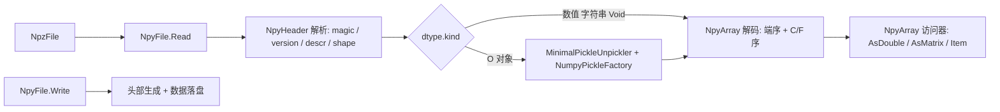

## 产品概述

在 sciBASIC# 的二进制数据存储库中补齐对 NumPy 数据文件的读写能力：既能读取/写入单数组的 `.npy`，也能读写多数组的 `.npz`（zip 容器），并把读取结果以 .NET 原生数组、矩阵视图和对象视图的形态暴露出来。最后在测试工程中用真实的 TCGA 数据文件做一次端到端演示。

## 核心功能

- **读取 .npy**：解析魔数、版本（1.0/2.0/3.0）与头部字典（`descr`、`fortran_order`、`shape`），支持小端/大端/端序无关三种数据，支持 C 序与 Fortran 序，按形状还原为多维数据。
- **数值/字符串数据类型**：布尔、有符号/无符号整数、单双精度浮点、复数、定长字节串（S）、Unicode 字符串（U）、Void 原始字节；结构化 dtype 只保证可识别与长度正确，可按原始字节读取。
- **对象数组（dtype 为 O）**：能解码 NumPy 对象数组内部内嵌的 Python 对象（内嵌 ndarray、字符串、数字、列表、元组等），使形如 `r160_subtype.npy` 这类"数组里套矩阵"的文件可以直接读出。
- **访问接口**：提供元素级（按下标取任意维度的一个值）与数组级（一维展平、二维矩阵、字符串数组、对象数组）访问；二维数据可直接转成矩阵对象用于后续计算；同时给出形状/类型/端序/元素数等描述信息。
- **写入 .npy**：把 Double、Single、Int32、Int64、Boolean、String、Byte 的一维数据按指定形状写成标准 .npy（默认小端 64 字节对齐头部），可指定 Fortran 序；写入对象数组时给出明确的不支持提示而不是产生坏文件。
- **读取/写入 .npz**：以 zip 容器方式一次存取多个命名数组，写入时按 `名称.npy` 生成条目，读取时按名称取回且保持插入顺序。
- **演示程序**：在测试工程中读入 `r160_subtype.npy`，打印头部信息、顶层形状、内嵌各子矩阵的形状/类型/数值统计，并把其中最大的矩阵写出为 .npy 与 .npz，再读回做逐元素一致性校验，输出可读的通过/失败结论。
- **可视化效果**：无图形界面，演示效果为控制台结构化输出（分段标题 + 字段对齐 + 校验结果汇总），便于人工核对。

## 技术栈选型

- 语言/框架：VB.NET + `.NET 10.0`（`net10.0`），沿用 `Microsoft.NET.Sdk`，不新增 NuGet 依赖
- 目标程序集：`Microsoft.VisualBasic.Data.Storage`（`RootNamespace = Microsoft.VisualBasic.Data.IO`）；新代码置于新目录 `DataStorage\Numpy\`，命名空间 `Microsoft.VisualBasic.Data.IO.Numpy`
- 刻意不使用裸 `Numpy`/`NumPy`：`Data_science\MachineLearning\TensorFlow\NumPy.vb` 已占用 `Namespace NumPy`，避免后续同名冲突
- 二进制 I/O：`System.IO` + `System.Buffers.Binary.BinaryPrimitives` + `System.Runtime.InteropServices.MemoryMarshal`；不使用工程内 `BinaryDataReader`，因为 npy 的数据区语义完全由 dtype 决定（含 2/4/8 字节、Unicode 4 字节码元、结构化记录）
- zip（npz）：BCL 内置 `System.IO.Compression.ZipArchive`
- pickle（对象数组）：复用 BinaryData 工程既有 `Pickle.MinimalPickleUnpickler`（已支持协议 0~5 且覆盖本测试文件用到的全部操作码），通过新增扩展点 `Pickle.IPickleObjectFactory` 接入 numpy 的 `_reconstruct` / `dtype` / `scalar`
- 矩阵互转：`Microsoft.VisualBasic.Math.LinearAlgebra.Matrix.NumericMatrix`（`New(Double(,))` 与 `New(Double()(), Optional t)` 可用；注意此类型的 `*` 是逐元素乘法，本任务只做构造不做乘法）

## 实现方案

1. **格式层**（`NpyHeader` / `NpyDType`）：手写 Python 字面量 dict 解析器替代正则，支持带转义的普通字符串、`True`/`False`、十进制整数、元组，以及结构化 dtype 的嵌套 list；头部长度字段 v1 为 2 字节、v2/v3 为 4 字节；写入时按 numpy 规则用空格补齐使"魔数+版本+长度+头部"整体 64 字节对齐并以 `\n` 收尾。
2. **数据层**（`NpyArray`）：一次性读入原始字节后单遍转换。端序与本机一致且为 C 序时走 `MemoryMarshal.Cast` 零拷贝快路径；端序相反时按 2/4/8 字节分组反转。`fortran_order=True` 时访问器按 numpy `ravel(order='C')` 语义做下标重排（O(N) 单次映射，缓存结果），避免每次访问都换序。
3. **对象数组**：`NpyFile` 检出 `dtype.kind = O` 时不自行解码，而是把"头部之后的字节切片"交给 `MinimalPickleUnpickler.UnpickleFromBytes(bytes, factory)`；工厂在 `BUILD` 阶段拿到 `ndarray.__setstate__` 的元组 `(version, shape, dtype, is_fortran, rawdata)`，其中 rawdata 是 `Byte()`（数值数组）或 `IList`（对象数组的元素列表），据此构造出真正的 `NpyArray`。
4. **写入层**：统一写小端 + v1 头部（头部超 65535 字节自动降级 v2）；`Double/Single/Int32/Int64/Boolean/String/Byte` 重载 + 通用 `Write(Of T)`；`fortranOrder:=True` 时先做 C 序到 F 序重排再落盘；`dtype='O'` 写盘抛 `NotSupportedException`（消息注明原因与替代做法）。
5. **npz 层**：写入用 `ZipArchiveMode.Create` 逐条目写 `名称.npy`；读取遍历条目，`Entry.Open` 后复用流的 `NpyFile.Read`，key 去掉 `.npy` 后缀并按 zip 顺序保存。

**性能与复杂度**：npy 解码 O(N) 单遍，峰值内存为原始字节 + 目标数组（转换后可选释放 raw 缓存）；端序反转按块处理、字符串 dtype 按 span 解码，避免逐元素 `BitConverter.GetBytes` 分配。本测试文件 18.5 MB / 2.3M 个 double，预期读入远低于 1 s；对象数组为递归构造，代价与内嵌矩阵总规模线性相关。

**避免技术债**：不改动 `FrameReader`/`FrameWriter`/`XPT`/`Feather`；对 BinaryData 只做"新增 1 个接口文件 + 入口参数可选追加"的最小侵入改动，不传 factory 时行为与现状完全一致。

## 实现要点

- `MinimalPickleUnpickler` 的 `Case BUILD` 目前是 `Dim obj = stack.Pop()` → `BuildObject(obj, state)` → `stack.Push(obj)`；必须把 `BuildObject` 的参数改成 `ByRef obj`，否则工厂构造出的 `NpyArray` 无法替换掉占位对象（占位对象本身没有数据）。
- 现有 `UnpickleFromStream` 以 `While stream.Position < stream.Length` 判结束，因此只能把 header 之后的字节切片（本文件为偏移 128..EOF）交给它，绝不能把整个文件传进去。
- `PythonGlobalRef` 是 `Friend Class`，扩展接口签名只能用 `moduleName As String, className As String`，不要暴露该类型。
- 端序规则：`|` 与端序无关（bool/object/S）、`=` 为本机端序、`<`/`>` 明确大小端；`U` 的 itemsize = 4 × 字符数（UTF-32 码元），`S` 按 Latin-1 解码，两者都去掉尾部 NUL。
- 异常语义：魔数不符/长度不足 → `InvalidDataException`；dtype 不认识 → `NotSupportedException`（消息带原始 descr 文本）；对象数组写入 → `NotSupportedException`。
- VB 陷阱：`Module` 成员不能 `Shared`；局部变量不要与属性/类型仅大小写不同（`Dim array` 会遮蔽 `Array`）；`Path`/`File` 被同名局部变量遮蔽时写 `System.IO.Path`；XML 注释中不能出现 `--`。
- 库内不打印日志（本工程无日志框架）：异常消息自带上下文；诊断输出只在 demo 中用 `Console.WriteLine`。

## 系统架构



## 目录结构

总体结构：DataStorage 内新增独立的 `Numpy/` 子命名空间（格式层 → 数据层 → 文件层 → pickle 适配层），BinaryData 只增加 1 个接口文件并对 unpickler 加可选参数；测试工程新增 1 个 demo 模块并切换启动对象。

```
Data/BinaryData/
├── BinaryData/
│   └── PickleSerializer/
│       ├── IPickleObjectFactory.vb        # [NEW] pickle 扩展点接口。定义 Construct(moduleName, className, args()) As Object 与 ApplyState(ByRef obj, state) As Boolean；签名不暴露 Friend 的 PythonGlobalRef，供外部程序集插入自定义类型重建逻辑（如 numpy）。
│       └── MinimalPickleUnpickler.vb      # [MODIFY] Unpickle/UnpickleFromBytes/UnpickleFromStream 追加 Optional factory 参数，透传到 ReduceCallable/NewObjf/ConstructPythonObject；BuildObject 改为 ByRef obj，并优先询问 factory.ApplyState（返回 True 即短路）；BUILD 分支推回可能被替换后的对象。不传 factory 时与现状行为一致。
└── DataStorage/
    ├── Numpy/
    │   ├── NamespaceDoc.vb                # [NEW] 命名空间说明（沿用 XPT/ 目录的 Friend Class NamespaceDoc 风格），描述 npy/npz 读写能力。
    │   ├── NpyHeader.vb                   # [NEW] 魔数/版本/头部长度读写 + dict 字面量解析（NpyHeader 类：Version、Descr、FortranOrder、Shape、HeaderSize、DataOffset）。核心是手写 tokenizer：字符串（含转义）、布尔、整数、元组、嵌套 list；再加头部生成与 64 字节对齐补齐。
    │   ├── NpyDType.vb                    # [NEW] dtype 模型：NpyEndian 枚举（Little/Big/NotApplicable/Native）、NpyTypeKind 枚举（Bool/Int/UInt/Float/Complex/Bytes/Unicode/Object/Void/Datetime/Timedelta）、NpyDType（Endian、Kind、ItemSize、Fields、IsStructured、名称字符串）；解析 'f8'、'<f8'、'|O'、'<U5'、'|S10'、'<c16'、'V16'、'<M8[ns]' 与结构化 list 形式（结构化只算 ItemSize）。
    │   ├── NpyArray.vb                    # [NEW] 核心数据模型：Shape、DType、FortranOrder、RawData、对象元素；Shape 校验、Length、Rank、ItemSize；AsDouble/AsSingle/AsInt32/AsInt64/AsBoolean/AsString/AsObjectArray/Item(下标)/GetValue(线性下标)；AsMatrix（二维转 NumericMatrix）；ToString 摘要。端序解码与 C/F 序重排的内核都放在此文件（或同目录 NpyConverter 内嵌），带结果缓存。
    │   ├── NpyFile.vb                     # [NEW] 对外门面（Public Module NpyFile）：Read(path)/Read(stream)（自动在 O 类型时走 pickle 分支）、Write 系列重载 + Save(array)、ReadHeader(path) 只读头部（供快速探测大文件）；参数校验与异常语义集中在此。
    │   ├── NumpyPickleFactory.vb          # [NEW] 实现 Pickle.IPickleObjectFactory：识别 numpy.core.multiarray._reconstruct / numpy.ndarray / numpy.dtype / numpy.core.multiarray.scalar；Construct 返回占位构造器或 NpyDType，ApplyState 用 setstate 元组 (version, shape, dtype, is_fortran, rawdata) 生成 NpyArray（含 object 数组的 Object() 元素），并把占位对象替换为最终实例。
    │   └── NpzFile.vb                     # [NEW] npz 容器：Keys(Names)、Item(name)、Count、Read(path)/Read(stream)、Save(path, 数组集合)（ZipArchiveMode.Create + 名称.npy 条目）、按名称大小写不敏感查找 + 缺失时给出可用名称列表的异常消息。
    └── test/
        ├── NumpyTest.vb                   # [NEW] demo（Module NumpyTest，Sub Main(args)）：默认读 G:\GCModeller\src\GCModeller\annotations\GSEA\data\TCGA_COAD\r160_subtype.npy（可用 args(0) 覆盖，路径不存在时打印提示并返回非 0）；输出头部（版本/descr/shape/fortran_order/数据偏移）、对象数组三个内嵌矩阵的 shape/dtype/前若干数值/min-max-mean、把 14464x160 矩阵写出为 .npy 与 .npz 再读回逐元素比对，最后打印 PASS/FAIL 汇总与耗时。
        └── test.vbproj                    # [MODIFY] StartupObject 由 test.Module1 改为 test.NumpyTest；Module1.vb 保持不动。
└── DataStorage/README.md                  # [MODIFY] 增补 numpy npy/npz 章节：能力范围、关键类型 API、快速上手示例、对象数组限制说明。
```

## 关键代码结构

```
' BinaryData/PickleSerializer/IPickleObjectFactory.vb
Namespace Pickle
    Public Interface IPickleObjectFactory
        ' 返回 Nothing 表示"交回默认实现处理"
        Function Construct(moduleName As String, className As String, args As Object()) As Object
        ' 返回 True 表示已处理；允许用新实例替换占位对象
        Function ApplyState(ByRef obj As Object, state As Object) As Boolean
    End Interface
End Namespace
```

```
' DataStorage/Numpy/NpyArray.vb（公开面）
Public Class NpyArray
    Public Property Shape As Integer()
    Public Property DType As NpyDType
    Public Property FortranOrder As Boolean
    Public Property RawData As Byte()
    Public ReadOnly Property Rank As Integer
    Public ReadOnly Property Length As Integer
    Public Function AsDouble() As Double()
    Public Function AsInt32() As Integer()
    Public Function AsString() As String()
    Public Function AsObjectArray() As Object()
    Public Function Item(ParamArray indices As Integer()) As Object
    Public Function AsMatrix() As NumericMatrix
End Class
```

## Agent 扩展

### Skill

- **lsp-code-analysis**
- Purpose: 在改动 `MinimalPickleUnpickler` 的公开方法签名前后，用语义能力查找 `Unpickle`/`UnpickleFromBytes`/`UnpickleFromStream` 与 `BuildObject`/`ConstructPythonObject` 的全部调用点与实现引用，确认"追加可选参数"不会破坏仓库内其它调用者
- Expected outcome: 得到一份完整的调用点清单（文件+行号），并在修改后复核无遗漏、无编译期断裂

### SubAgent

- **code-explorer**
- Purpose: 以 medium 力度核对待建文件所在目录的既有约定（命名空间、NamespaceDoc 写法、异常/参数校验风格），以及确认 `.npy/.npz` 相关符号在解决方案内无重名冲突
- Expected outcome: 一份约定清单与冲突检查结论，用于统一新文件的代码风格