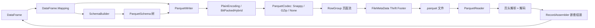

## 产品概述

在现有的 `Parquet` 库项目中，用 VB.NET 从零实现 Apache Parquet 列式存储格式的读写能力，并以基础代码库中的 `DataFrame` 作为唯一内存数据模型，对外只暴露 `pq.write_table(df, path)` 与 `pq.read_table(path)` 两个核心 API，同时配套一套命令行 demo 测试，输出可审计的测试报告。

## 核心功能

- **写入**：`pq.write_table(df, "data.parquet")` 将 DataFrame 写成合法的 Parquet 文件；**读取**：`pq.read_table("data.parquet")` 还原为 DataFrame，另提供 Stream 重载与 `read_schema(path)` 元数据查询。
- **列类型映射**：Double/Single/Integer/Long/Boolean/String/DateTime 等列按各自类型写入并原样读回；支持空值（null）与空字符串的区别。
- **行名持久化**：DataFrame 的 `rownames` 以 `__index__` 列写入，读回时自动识别为行名且不作为普通列暴露；无该列时按 0..n-1 顺序生成行名。
- **压缩**：支持 UNCOMPRESSED、GZIP、SNAPPY 三种编码，可指定；默认 SNAPPY。
- **分块存储**：写入时按行数阈值（默认 1,000,000 行）自动切分多个 row group；读取时透明合并全部 row group。
- **嵌套结构**：支持 LIST / STRUCT / MAP / LIST<STRUCT> 的读取；读取时 struct 成员自动展开为 `a.b` 形式的点号列，list/map 列转为 JSON 文本列；写回时若列带有相应结构描述，则将 JSON 反序列化还原为原始嵌套结构，保证 DataFrame 层面的读写往返一致。
- **外部文件兼容**：读取端兼容词典编码、DELTA 系列编码、BEAT_STREAM_SPLIT、DataPageV1/V2、旧式 BIT_PACKED 级别、INT96 时间戳等外部实现（如 pandas/pyarrow）生成的常见文件，遇到不支持的组合给出明确报错。
- **测试与报告**：控制台 demo 覆盖扁平表、各压缩算法、多 row group、嵌套结构与外部编码解码等场景，逐条断言并生成 JSON 测试报告，失败时以非零退出码结束。

## 技术栈

- 语言/运行时：VB.NET，`net10.0`（当前环境 SDK 10.0.403，可直接构建）
- 目标项目：`g:/pixelArtist/src/framework/Data/BinaryData/Parquet/Parquet.vbproj`（`RootNamespace=Microsoft.VisualBasic.DataStorage.Parquet`，已引用 `Core.vbproj`、`dataframework-netcore5.vbproj`、`binarydata-netcore5.vbproj`、`Math.NET5.vbproj`）
- 内存模型：`Microsoft.VisualBasic.Data.Framework.DataFrame` / `FeatureVector`（`g:/pixelArtist/src/framework/Data/DataFrame/DataFrame/*.vb`）
- 压缩：Snappy 直接复用 `g:/pixelArtist/src/framework/Data/BinaryData/BinaryData/Snappy/Snappy.vb`（`Microsoft.VisualBasic.Data.IO.Snappy.Snappy.Compress/Uncompress`，raw block，正是 Parquet 内嵌格式）；GZIP 用 `System.IO.Compression.GZipStream`
- 序列化辅助：`System.Buffers.Binary.BinaryPrimitives`（小端读写、零分配）、`System.Text.Json`（JSON 列解析/输出，随 net10.0 共享框架提供，无需新增包）
- 测试：`DebugAudit`（`Microsoft.VisualBasic.ApplicationServices.Debugging`），模板参考 `Protobuf/test/Program.vb` 与 `Protobuf/test/TestSupport.vb`

## 实现方案

### 总体策略

纯自研实现完整 Parquet 栈，分层推进：Thrift Compact 协议层 → Parquet 元数据结构层 → 编码/压缩层 → Schema 与记录展开层 → 文件读写层 → DataFrame 映射层 → `pq` API。写入统一使用规范编码（PLAIN + RLE/bit-packed 级别 + 可选统计信息），保证被 PyArrow/pandas 正常打开；读取端兼容多种外部编码。

### 关键设计决策

1. **Thrift Compact 协议自实现**：`ThriftCompactWriter` 基于 `MemoryStream`（字段 id delta、zigzag varint、list header `(size<<4)|type`、bool 的 field-header 内联编码）；`ThriftCompactReader` 支持逐字段读取与 `Skip(type)`，保证遇到未知/新字段可安全跳过（前向兼容）。所有结构体实现统一 `Read/Write`，不引入反射与代码生成，避免运行时代码生成开销。
2. **写入编码选择**：数据页统一 PLAIN，级别（definition/repetition）统一 RLE/bit-packed hybrid（DataPageV1，级别前带 4 字节长度）；不写词典页（降低出错面），但保留 `ParquetOptions.UseDictionary` 开关以便后续扩展。统计信息（min/max/null_count）对数值与字符串列按可选开关写入。
3. **读取编码广度**：`PlainEncoding`（全部物理类型）、`BitPackedHybrid`（RLE/bit-packed hybrid + 旧式 BIT_PACKED）、`DictionaryEncoding`（PLAIN_DICTIONARY / RLE_DICTIONARY，含每页首字节 bit-width）、`DeltaEncoding`（DELTA_BINARY_PACKED 含 miniblock 位宽、DELTA_LENGTH_BYTE_ARRAY、DELTA_BYTE_ARRAY）、`ByteStreamSplit`（FLOAT/DOUBLE 读取）。DataPageV2 的级别区不带长度前缀，需单独分支。
4. **性能：避开装箱**。`DataFrame.features(name).vector` 是强类型数组，写入按 `DirectCast(vec.vector, Double())` 等分支取强类型数组直接批量写；**禁止**在热路径使用 `FeatureVector.GetValue/Getter`（返回 `Object`，逐值装箱）。读取端按 `ColumnMetaData.num_values` 预分配数组，一次遍历解码级别与值。
5. **内存与 I/O**：写入按列、按 row group 流式产出页面（每页目标 64KB~1MB），单 row group 只驻留当前批次；读取用 `FileStream.Seek` 精确定位每个 column chunk，不做整文件缓冲。复杂度：每列 O(n) 单遍，内存 O(当前列 + 当前 row group)。
6. **嵌套处理的性能捷径**：struct 成员若无重复祖先（rep level 恒为 0），其级别与普通可选扁平列一致，读取时只需“改列名 + 去级别”，零成本展平；只有 LIST/MAP/LIST<STRUCT> 叶子需要真正按 rep/def 级别组装成 JSON 文本。写入端分两条路径：无嵌套列走强类型数组快路径；存在嵌套列时按行构建记录树，用通用 Dremel shredder 生成各级别（覆盖 struct/list/map/list<struct>）。
7. **往返一致性的载体**：`FeatureVector` 已有 `attributes As Dictionary(Of String,String)`（`FeatureVector.vb` 第 92 行）。读取嵌套列时在返回列的 `attributes` 中写入 `parquet.logical_type`（嵌套结构 JSON 描述）与 `parquet.nested=true`；写入时检测该属性即按 JSON 反序列化还原嵌套；点号列名（`a.b`）按前缀归并成 struct 分组。该机制不修改 DataFrame 项目任何代码，且有显式 `ParquetOptions.NestedColumns` 作为覆盖手段。
8. **类型映射**：Double→DOUBLE、Single→FLOAT、Integer→INT32、Long→INT64、Boolean→BOOLEAN、String→BYTE_ARRAY(UTF8)、DateTime→INT64 + LogicalType TIMESTAMP(MILLIS, isAdjustedToUTC=true)；读取时按 physical + logical/converted type 反推。注意 `FeatureVector.FromGeneral` **只覆盖** Integer/Short/Long/Single/Double/Boolean/String（`FeatureVector.vb` 第 288-298 行），Date/TimeSpan 必须走 `New FeatureVector(name, IEnumerable(Of DateTime))` 构造器，映射层需显式分支，否则抛 `NotImplementedException`。INT96 读取时按 Julian day + nanoseconds of day 转换为 DateTime（精度截断到 100ns tick），失败则降级为字符串列。
9. **行数语义修正**：`DataFrame.dims.nsamples` 取 `rownames.Length`，`rownames` 为 Nothing 时会抛空引用。因此读取端必须始终设置 `rownames`（无 `__index__` 列时生成 `0..n-1` 字符串），写入端在 `rownames` 为空时以各列 `size` 推导行数。

## 架构设计



分层职责：`Thrift` 只负责协议字节；`Format` 只负责结构体与枚举；`Encodings` 只做纯字节编解码（无 schema 依赖，可单测）；`Compression` 只做编解码分发；`Schema` 负责扁平 `schema` 列表与树的互转；`Nested` 负责 Dremel 记录展开；`ParquetWriter/Reader` 组装文件；`DataFrame.Mapping` 隔离数据模型耦合；`pq` 是对外门面。下层永不反向依赖上层，便于后续支持其他 DataFrame 类型或写入更多编码。

## 目录结构

```
g:/pixelArtist/src/framework/Data/BinaryData/Parquet/
├── Parquet.vbproj                  # [MODIFY] 增加 <Compile Remove="test\**" />、<EmbeddedResource Remove="test\**" />、<None Remove="test\**" />（当前会把 test/Program.vb 编进库项目，参考 Feather/FeatherFormat.vbproj 第 47-50 行）；开启 GenerateDocumentationFile、OptionStrict 默认值
├── Class1.vb                       # [DELETE] 空占位类
├── NamespaceDoc.vb                 # [NEW] 命名空间文档（跟进 CSV 风格的中文说明）
├── pq.vb                           # [NEW] 对外门面模块：write_table(df, path/stream, options)、read_table(path/stream)、read_schema(path)
├── ParquetOptions.vb               # [NEW] CompressionCodec 枚举、行组阈值、是否写 __index__、是否写统计信息、UseDictionary、NestedColumns 覆盖表
├── Thrift/
│   ├── ThriftCompactWriter.vb      # [NEW] zigzag varint、field id delta、list/map header、bool special、struct 栈
│   └── ThriftCompactReader.vb      # [NEW] 逐字段读取、Skip(type)、varint 溢出防护、流位置管理
├── Format/
│   ├── ParquetEnums.vb             # [NEW] Type/ConvertedType/FieldRepetitionType/Encoding/CompressionCodec/PageType
│   ├── SchemaElement.vb            # [NEW] SchemaElement + LogicalType（String/Date/Timestamp/Decimal/List/Map/Integer/Bson/Json/UUID/Enum）
│   ├── FileMetaData.vb             # [NEW] FileMetaData（version/schema/row_groups/key_value_metadata/created_by）
│   ├── RowGroup.vb                 # [NEW] RowGroup/ColumnChunk/ColumnMetaData/Statistics/KeyValue/PageEncodingStats
│   └── PageHeader.vb               # [NEW] PageHeader/DataPageHeader/DataPageHeaderV2/DictionaryPageHeader/IndexPageHeader
├── Encodings/
│   ├── BitPackedHybrid.vb          # [NEW] RLE/bit-packed hybrid 读写（bit width 1..32），旧式 BIT_PACKED 只读
│   ├── PlainEncoding.vb            # [NEW] PLAIN 全部物理类型读写（bool 位序 LSB first、INT96）
│   ├── DictionaryEncoding.vb       # [NEW] 词典页 + PLAIN_DICTIONARY/RLE_DICTIONARY 索引解码
│   ├── DeltaEncoding.vb            # [NEW] DELTA_BINARY_PACKED（含 miniblock 位宽/尾块）、DELTA_LENGTH_BYTE_ARRAY、DELTA_BYTE_ARRAY
│   └── ByteStreamSplit.vb          # [NEW] BYTE_STREAM_SPLIT 解码（FLOAT/DOUBLE，按 k 路还原）
├── Compression/
│   └── ParquetCodec.vb             # [NEW] 按 codec 分发：直接调用 Microsoft.VisualBasic.Data.IO.Snappy.Snappy.Compress/Uncompress；GZip 用 GZipStream；Uncompressed 直通；解压时按 PageHeader.uncompressed_page_size 校验长度
├── Schema/
│   ├── ParquetSchema.vb            # [NEW] 由扁平 schema 列表按 num_children 还原树；路径拼接、max_def/max_rep 计算、leaf 枚举、平铺回写
│   └── SchemaBuilder.vb            # [NEW] 由 DataFrame 列名（含点号）与 FeatureVector 类型/attributes 生成 schema 树与列计划
├── Nested/
│   ├── RecordShredder.vb           # [NEW] 记录树 + schema → (rep_level, def_level, value) 三元流，支持 list/map/list<struct>
│   └── RecordAssembler.vb          # [NEW] 级别流 → 每行记录/JSON 文本，处理空列表、null 元素、深层嵌套
├── ParquetWriter.vb                # [NEW] 组织多 row group、列 chunk、页面、统计信息、footer 与尾部 magic，单遍流式写
├── ParquetReader.vb                # [NEW] 尾部 footer 定位与解析、row group 合并、页头解析（V1/V2）、编码分派、类型反推
├── DataFrame.Mapping.vb            # [NEW] DataFrame ↔ 列数据双向映射：类型映射表、__index__ 行名、Date/TimeSpan 构造分支、嵌套列 attributes 读写、列顺序保持
└── test/
    ├── test.vbproj                 # [MODIFY] 保持 Exe/net10.0；补充 OptionStrict/LangVersion 与对 DebugAudit 所在 Core 项目的隐式引用说明（如需要显式 ProjectReference）
    ├── Program.vb                  # [MODIFY] demo 入口：DebugAudit.Reset + 分组 Watch + SaveReport + 失败退出码（照搬 Protobuf/test/Program.vb 结构）
    ├── TestSupport.vb              # [NEW] 断言计数与 AssertEqual/AssertTrue/AssertBytesEqual/AssertThrows/TempDir（Parquet 版）
    ├── FlatTableTests.vb           # [NEW] 扁平表 roundtrip：类型矩阵、空值、__index__ 行名、Schema 校验、多 row group（小阈值强制切分）
    ├── CompressionTests.vb         # [NEW] UNCOMPRESSED / GZIP / SNAPPY 三组写入后读回一致性与文件头尾 magic 校验
    ├── EncodingTests.vb            # [NEW] 用规范字节序列（手写十六进制）验证 hybrid、DELTA_*、BYTE_STREAM_SPLIT、词典索引解码
    ├── NestedTests.vb              # [NEW] struct 点号展开、list/map JSON 往返、list<struct> 与空列表/null 元素
    └── InteropTests.vb             # [NEW] 若命令行传入外部 .parquet 路径则读取并断言；未提供时以本库写出的文件做规范自检（magic/footer/统计）
```

## 关键代码结构

```
' pq.vb —— 对外门面（VB 大小写不敏感，write_table 即 WriteTable）
Public Module pq
    Public Sub write_table(df As DataFrame, path$, Optional options As ParquetOptions = Nothing)
    Public Sub write_table(df As DataFrame, output As Stream, Optional options As ParquetOptions = Nothing)
    Public Function read_table(path$) As DataFrame
    Public Function read_table(input As Stream) As DataFrame
    Public Function read_schema(path$) As ParquetSchema
End Module

' ParquetOptions.vb
Public Enum CompressionCodec : Uncompressed = 0 : Snappy = 1 : GZip = 2 : End Enum

Public Class ParquetOptions
    Public Property Compression As CompressionCodec = CompressionCodec.Snappy
    Public Property RowGroupSize As Integer = 1000000
    Public Property WriteIndexColumn As Boolean = True
    Public Property WriteStatistics As Boolean = True
    Public Property NestedColumns As Dictionary(Of String, String)   ' 列名 -> 嵌套结构 JSON 描述（覆盖 FeatureVector.attributes）
End Class
```

## 实现注意事项

- **项目隔离**：先修 `Parquet.vbproj` 的 `test\**` 排除项，否则 `test/Program.vb` 会被编入库程序集并与测试项目重复；删除 `Class1.vb`；不修改 `DataFrame`、`BinaryData` 项目源码，Snappy 仅调用其公开 API。
- **小端与位序**：所有数值小端；BOOLEAN 的 PLAIN 采用 bit-packed、LSB first；RLE/bit-packed hybrid 的 bit-packed run 亦为 LSB first。位写入/读取必须统一一个 bit-packer 工具，避免两套实现不一致。
- **级别长度前缀**：DataPageV1 中 rep/def 级别块前有 4 字节（小端）长度；DataPageV2 用 `repetition_levels_byte_length` / `definition_levels_byte_length` 字段，无长度前缀且级别不压缩（只有 data 区压缩）。这是外部文件读取最常见的坑。
- **元数据一致性**：`ColumnMetaData` 的 `num_values`（含 null 的槽位数）、`total_compressed_size`、`total_uncompressed_size`、`data_page_offset`、可选 `dictionary_page_offset` 必须与实际写入字节严格一致；`ColumnChunk.file_offset` 需指向 chunk 起点，否则 PyArrow 报错。
- **容错与安全**：footer 长度校验（`len <= fileLength - 8`，非负）；magic `PAR1` 双向校验；varint 最多 10 字节、bit width 限制 0..32；嵌套深度上限（如 100）防止恶意文件递归爆栈；未知编码/物理类型抛 `NotSupportedException` 并附带列路径与 row group 索引；所有失败抛出统一 `ParquetFileFormatException`（继承 `InvalidDataException`）。
- **资源管理**：`read_table(Stream)` 不关闭调用方流，内部 `FileStream` 用 `Using` 确保释放；写入路径先写临时文件再原子替换不存在时不必，但需在异常时删除半成品文件（调用方传入 path 时）。
- **日志**：库内不打日志，仅抛异常；测试侧统一用 `DebugAudit.Test/AreEqual/Mark/Watch/SaveReport`，报告中不得输出敏感信息，仅记录断言与度量。
- **性能校验**：以 10 万行 × 6 列数据做写入/读取计时并在报告中 `DebugAudit.Mark` 记录耗时，作为回归基线；页面组装复用缓冲，避免每值分配。

## Agent Extensions

### SubAgent

- **code-explorer**
- Purpose: 在实现阶段快速定位基础库中可复用的既有实现与调用样例（Snappy raw block 用法、FeatureVector 强类型数组访问、DebugAudit 断言签名、Feather 自研格式的代码组织方式）
- Expected outcome: 产出精确的文件路径与符号清单，避免凭空假设 API，减少实现返工

### Skill

- **lsp-code-analysis**
- Purpose: 在新增/重构 Parquet 源码时做语义级校验（查找 `DataFrame`、`FeatureVector.attributes`、`Snappy` 的引用与定义，确认命名空间与重载解析正确，检查改动影响面）
- Expected outcome: 每个新增 API 的引用点与命名空间导入都被确认，编译期符号错误在编码阶段即被发现