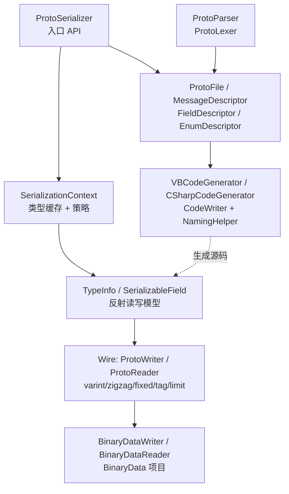

## 用户需求

在 `G:\pixelArtist\src\framework\Data\BinaryData\Protobuf\Protobuf.vbproj`（纯 VB.NET / net10.0，当前无任何源码）中从零实现一套完整的 protobuf 体系，并在 `Protobuf\test\test.vbproj` 中编写 demo 测试程序。

## 产品概述

一个零第三方依赖的 protobuf 工具链，共四层能力：底层 Wire 格式字节编解码、基于 Attribute 标注的 .NET CLR 对象序列化/反序列化、`.proto` IDL 文本解析（运行时描述符模型）、以及根据 `.proto` 生成 VB / C# 实体类源码的代码生成器。四层可独立使用，也可串成 "写 .proto → 生成类 → 序列化对象 → 二进制往返" 的完整闭环。

## 核心功能

- **Wire 层字节读写**：varint（含负 int32 的 10 字节符号扩展）、zigzag、fixed32/fixed64、float/double、tag 编解码、长度前缀（string/bytes/嵌套消息/packed）、字段跳过、子消息边界限制、截断流检测。
- **CLR 对象序列化**：用 `ProtoContract` / `ProtoMember(fieldNumber)` 标注普通类/结构体，即可序列化为 `Byte()`、写入 `Stream` 或文件；反序列化支持泛型与非泛型入口，并可直接填充已存在实例。
- **字段能力**：repeated（`List(Of T)`、`T()`，packed 与 unpacked 混合读取）、`Dictionary(Of K,V)` 映射为 map entry、嵌套消息、`Nullable` / `Nothing` 表示字段缺失、枚举按 varint、缺失字段回落默认值、未知字段可跳过或原样保留后再次写出、递归深度保护。
- **`.proto` 解析**：支持 `syntax = "proto3"`、`package`、`import`、`option`、嵌套 message/enum、`repeated`/`optional`/`required`、`map<K,V>`、`oneof`、`reserved`、字段选项 `[packed=true, default=...]` 及 `//`、`/* */` 注释，产出可遍历描述符树并完成类型名解析。
- **代码生成**：从描述符生成带 `ProtoContract` / `ProtoMember(n)` 标注的 POCO 源码，支持 VB 与 C# 两种目标语言、命名空间映射、snake_case 转 PascalCase、语言关键字转义、嵌套类型扁平化命名，可返回源码字符串、文件字典或直接落盘到目录。
- **Demo 测试**：控制台程序分主题覆盖 Wire 黄金字节向量、对象往返、`.proto` 解析、代码生成产物校验，并输出测试报告文件。

## 视觉与使用效果

无界面。表现为开发者可用的 API 与测试控制台的纯文本输出：分层目录、直观的入口 API、清晰的异常信息（含出错偏移量），测试运行结束后打印对齐的断点摘要表格，并在输出目录生成 JSON 测试报告。

## 技术栈选择

- 语言/运行时：VB.NET，`TargetFramework=net10.0`（沿用 `Protobuf.vbproj` 现有配置，不改 RootNamespace `Microsoft.VisualBasic.Data.IO.Protobuf` 与 AssemblyName）
- 底层字节 IO：复用 `Microsoft.VisualBasic.Data.IO.BinaryDataReader` / `BinaryDataWriter`（`BinaryData\binarydata-netcore5.vbproj`，已由项目引用），在其上补齐 protobuf varint 层
- 反射：`System.Reflection`（`PropertyInfo` / `FieldInfo`），**不使用** DynamicMethod / 表达式树，与 `msgpack` 项目保持一致
- 无第三方依赖，不引入 Roslyn；代码生成器只输出源码文本
- 测试：Console Exe + `Microsoft.VisualBasic.ApplicationServices.Debugging.DebugAudit`（用户强制要求）

## 实现方案

### 总体策略

仿照同目录 `msgpack` 项目的成熟范式分三层组织："每类型一个缓存模型 + 全局 Context 持有类型缓存 + 静态入口 API"。新增一层 `Schema`/`CodeGen` 处理 IDL。

### 关键决策与理由

1. **varint 自行实现，不去改 BinaryData**：`BinaryDataReader` / `BinaryDataWriter` 完全没有 varint API；`ReserveOffset()` 返回的 `Offset` 只能回填固定 4 字节 `UInt32`（见 `BinaryData\Stream\Offset.vb` 的 `Me.Writer.Position += 4` 与 `Satisfy()` 中 `Writer.Write(oldPosition)`），无法表达 protobuf 变长长度前缀。因此在新项目内新增 `ProtoWireFormat` 模块与 varint 读写方法，避免污染既有项目、控制影响面。
2. **长度前缀采用"子缓冲"策略**：写嵌套消息 / string / bytes / packed 时，先写成 `Byte()`（临时 `ProtoWriter` 包一层 `MemoryStream`），再写 `tag + varint(length) + payload`。复杂度 O(n)，比两次遍历方案简单且无需回填。
3. **读取侧使用 limit 栈而非切片拷贝**：`ProtoReader` 维护 `_limit`，`PushLimit(byteCount)` / `PopLimit()`，`ReadTag` 在越过 limit 或流尾时返回 False。避免为每个嵌套消息分配新 `MemoryStream` 与字节数组。
4. **字段读写用一次性反射模型缓存**：`TypeInfo` 在首次访问时构建（`SyncLock` 双检缓存于 `SerializationContext`），之后每次序列化只做 `GetValue` / `SetValue`，与 `msgpack\Serialization\Reflection\SerializableProperty.vb` 完全一致，避免每次调用走 `GetProperties` + 特性查询。
5. **proto3 语义为默认**：值为默认值时省略字段（`SerializationContext.SkipDefaults = True` 可关）；`repeated` 数值类型默认 packed，同时读取端兼容 unpacked 形态（同一字段号可能以 Varint 0 或 LengthDelimited 2 两种 wire type 出现，需按字段声明的 wire type 分派）。
6. **Decimal / DateTime / Guid 作为扩展类型**（protobuf 原生无对应）：Decimal 用 16 字节 .NET decimal bits 的 length-delimited，Guid 用 16 字节 length-delimited，DateTime 用 Unix 毫秒 varint。均在 XML 注释与 README 中标注为非标准扩展，避免使用者误判与官方实现互通。
7. **未知字段保留用显式契约**：定义 `IProtoMessage`（含 `UnknownFields As UnknownFieldSet`）。实现该接口的类型在反序列化时收集未知字段，序列化时原样重放；未实现则按 `SerializationContext.UnknownFieldBehavior` 跳过。比隐式约定更可预期。
8. **代码生成器用抽象基类而非接口**：`IProtoCodeGenerator` 定义 `Generate(ProtoFile)` / `GenerateFiles(ProtoFile)`，`VBCodeGenerator` / `CSharpCodeGenerator` 共用 `CodeWriter`（缩进栈）与 `NamingHelper`（大小写转换、关键字转义、CLR 类型名映射），DRY 且易于扩展第三种语言。

### 性能与可靠性

- varint 编解码单次 O(1)（最多 10 字节），tag 读写 O(1)；消息序列化 O(字段数)，repeated/map 为 O(n)。
- 字符串/字节写入使用 `System.Buffers.ArrayPool(Of Byte).Shared` 租借缓冲，`Try/Finally` 归还，减少大消息的 GC 压力；小载荷（不超过 256 字节）直接用 `stackalloc` 等价的固定短数组路径或 `Encoding.UTF8.GetBytes` 直写，避免租借开销。
- 热路径方法（`ReadTag` / `ReadVarint` / `WriteVarint` / 固定宽度读写）标注 `MethodImpl(MethodImplOptions.AggressiveInlining)`，与仓库既有做法一致。
- 安全与健壮：长度前缀必须校验不超过剩余可读字节数（`BinaryReader.ReadBytes` 在流尾会静默返回短数组，必须显式校验）；`MaxDepth`（默认 64）防递归炸弹；`_limit` 防越界读；所有格式错误统一抛 `WireFormatException`（携带绝对偏移量与字段号）。

### 与既有约定的对齐

- 根目录文件（`ProtoSerializer.vb`、`ObjectExtensions.vb`、`NamespaceDoc.vb`）不写 `Namespace` 块，落入 RootNamespace；子目录用单行点号声明 `Namespace Wire` / `Namespace Serialization` / `Namespace Serialization.Reflection` / `Namespace Schema` / `Namespace CodeGen`。
- 保留仓库文件头 `#Region` banner 风格；新代码 XML 注释与异常提示使用简体中文，标识符英文；`Call` 前缀调用 Sub；4 空格缩进；私有方法集中在 `#Region "METHODS (PRIVATE)"`。
- 库文件顶部写 `Option Strict On` + `Option Explicit On`（沿袭 `BinaryData\LZ77Stream\*` 的先例），保证新代码类型安全。

## 架构设计



数据流：`.proto` 文本 → Lexer → Parser → Descriptor 树 → (a) CodeGen 生成 POCO 源码，或 (b) 运行时按描述符读写；POCO 对象 → TypeInfo 反射模型 → ProtoWriter → 字节流；反向由 ProtoReader 驱动同一模型回填。

## 目录结构

```
G:\pixelArtist\src\framework\Data\BinaryData\Protobuf\
├── Protobuf.vbproj                              # [UNCHANGED] RootNamespace/AssemblyName/TargetFramework 均保持原样，SDK 默认通配已包含新增子目录
├── NamespaceDoc.vb                              # [NEW] 根命名空间文档（Friend Module NamespaceDoc + summary），与 msgpack\NamespaceDoc.vb 同款
├── ProtoSerializer.vb                           # [NEW] 对外入口。静态类：Serialize(Of T)(obj) As Byte()、Serialize(Of T)(obj, Stream, Optional leaveOpen)、SerializeToFile(obj, path)、Deserialize(Of T)(Byte())、Deserialize(Of T)(Stream)、Deserialize(t As Type, Byte())、DeserializeFromFile(Of T)(path)；持有 Shared Context 属性（默认指向 SerializationContext.DefaultContext）
├── ObjectExtensions.vb                          # [NEW] Public Module + Imports System.Runtime.CompilerServices；扩展方法 ToProtobuf(Of T)(obj) As Byte()、AsProtobufFile(path)、FromProtobuf(Of T)(Byte()|Stream)，与 msgpack\ObjectExtensions.vb 形状对齐
├── Wire\
│   ├── WireType.vb                              # [NEW] Public Enum WireType As Byte：Varint=0 / Fixed64=1 / LengthDelimited=2 / StartGroup=3 / EndGroup=4 / Fixed32=5；Group 明确标注暂不支持
│   ├── ProtoWireFormat.vb                       # [NEW] Friend Module（或 Public Module 供外部做尺寸预估）：常量 MaxVarintBytes=10、MaxDepth=64；GetVarintSize(ULong)、GetTagSize(fieldNumber)、MakeTag(fieldNumber, wireType)、ReadTag 解析辅助、ZigZagEncode32/Decode32/Encode64/Decode64、GetWireType(FieldTypeKind) 映射（供 Schema 层复用）
│   ├── WireFormatException.vb                   # [NEW] Public Class WireFormatException : Inherits FormatException；属性 Position As Long、FieldNumber As Integer、WireType；构造函数带上下文消息，供反序列化定位损坏字节
│   ├── ProtoWriter.vb                           # [NEW] Public Class : Implements IDisposable。内部持 BinaryDataWriter（构造后立即设 ByteOrder = LittleEndian），提供 New(output As Stream, Optional leaveOpen) 与 New(writer As BinaryDataWriter, Optional ownsWriter)。成员：Position、Depth、WriteTag(fieldNumber, wireType)、WriteVarint(ULong)、WriteInt32/Int64/UInt32/UInt64/SInt32/SInt64/Bool/EnumValue（负 int32 必须符号扩展为 10 字节，不得截断为 5 字节）、WriteFixed32/Fixed64/Single/Double、WriteString（UTF8 + varint 长度，ArrayPool 租借）、WriteBytes、WriteRawBytes、WriteLengthDelimited(Action(Of ProtoWriter)) 便利重载、CreateBuffer() As MemoryStream（供子消息临时缓冲）、Flush()、Dispose()
│   ├── ProtoReader.vb                           # [NEW] Public Class : Implements IDisposable。内部持 BinaryDataReader（ByteOrder = LittleEndian），提供 New(input As Stream, Optional leaveOpen)、New(reader As BinaryDataReader, Optional ownsReader)。成员：Position、Depth、EndOfStream（考虑 limit）、ReadTag(ByRef fieldNumber As Integer, ByRef wireType As WireType) As Boolean、ReadVarint() As ULong、ReadInt32/Int64/UInt32/UInt64/SInt32/SInt64/Bool、ReadEnumValue(Of TEnum)、ReadFixed32/Fixed64/Single/Double、ReadLengthPrefix() As Integer（负值或超长即抛 WireFormatException）、ReadBytes()、ReadString()、ReadRawBytes(count)、PushLimit(byteCount) / PopLimit()、SkipField(wireType)、ReadUnknownField(wireType) As UnknownFieldPayload（捕获原始字节以供保留）
│   └── NamespaceDoc.vb                          # [NEW] Wire 子命名空间文档
├── Serialization\
│   ├── ProtoContractAttribute.vb                # [NEW] AttributeUsage(Class Or Structure Or Interface, AllowMultiple:=False, Inherited:=True)；属性 Name As String（默认 Nothing 表示用 CLR 类型名）、SkipConstructor As Boolean
│   ├── ProtoMemberAttribute.vb                  # [NEW] AttributeUsage(Property Or Field)；构造 New(fieldNumber As Integer)（校验 1..536870911 且不在 19000..19999 保留段）；只读 FieldNumber；属性 Name、IsRequired、IsPacked As Boolean?（Nothing = 按类型自动判定）、DataFormat As ProtoDataFormat、DefaultValue As Object、IsMap As Boolean
│   ├── ProtoDataFormat.vb                       # [NEW] Public Enum：Default / ZigZag / Fixed32 / Fixed64 / Decimal128 / DateTimeTicks / Guid128（后三者为 .NET 扩展类型编码方式）
│   ├── IProtoMessage.vb                         # [NEW] Public Interface IProtoMessage：ReadOnly Property UnknownFields As UnknownFieldSet；同文件内含 Public Class UnknownFieldSet（Entry 列表 + Add(fieldNumber, wireType, payload) + WriteTo(ProtoWriter) + Count + Clear），实现未知字段保留与重放
│   ├── SerializationContext.vb                  # [NEW] Public Class SerializationContext。Friend _typeInfos As Dictionary(Of Type, TypeInfo) + SyncLock 双检缓存；Shared ReadOnly DefaultContext As New SerializationContext()；属性 MaxDepth=64、SkipDefaults=True、UnknownFieldBehavior As UnknownFieldBehavior（Skip/Preserve，默认 Preserve）、Encoding As Encoding=UTF8；方法 GetTypeInfo(t As Type) As TypeInfo、Reset()、GetMessageModel(Of T)()；未知字段策略与深度校验集中在此
│   ├── Reflection\
│   │   ├── TypeInfo.vb                          # [NEW] Friend Class TypeInfo。属性 Schema As Type、Contract As ProtoContractAttribute、Fields() As SerializableField（按 FieldNumber 升序）、Lookup(number) As SerializableField、IsMessage As Boolean、CreateInstance() As Object（Activator.CreateInstance，支持 List(Of T)/Dictionary(Of K,V)/数组/无参构造缺失时的未初始化对象降级）；构建期只反射一次
│   │   └── SerializableField.vb                 # [NEW] Friend Class SerializableField。字段模型：MemberInfo、Name、FieldNumber、WireType、DataType As Type、ValueType As Type（Nullable 解包）、FieldTypeKind（映射到 Schema.FieldTypeKind 以便与 IDL 共用 wire 映射）、IsRepeated、IsPacked、IsMap、MapKeyType/MapValueType、NestedTypeInfo。方法：WriteField(writer, owner, context)（默认值/空集合/空字典省略；repeated 按 packed=数值类型则写 LengthDelimited 子缓冲，否则逐条写 tag；map 写 entry 结构 key=1、value=2）、ReadField(reader, owner, wireType, context)（兼容 packed 与 unpacked；对 List 追加、对 map 覆盖）、MergeRepeated、IsDefaultValue()、GetDefaultValue()
│   └── NamespaceDoc.vb                          # [NEW] Serialization 子命名空间文档
├── Schema\
│   ├── FieldDescriptor.vb                       # [NEW] Public Class FieldDescriptor；同文件含 Public Enum FieldLabel（Optional/Required/Repeated）与 Public Enum FieldTypeKind（Double=1..SInt64=18，编号与 protobuf FieldDescriptorProto.Type 对齐）。属性：Name、Number、Label、FieldType As FieldTypeKind、TypeName As String（原始名）、ResolvedTypeFullName、Packed As Boolean、DefaultValue As String、OneofIndex As Integer、IsMap、MapKeyType、MapValueType、MapValueTypeName、JsonName
│   ├── MessageDescriptor.vb                     # [NEW] Public Class MessageDescriptor：Name、FullName（含 package 与父级前缀）、Package、Parent As MessageDescriptor、Fields As List(Of FieldDescriptor)、NestedMessages、NestedEnums、Oneofs As List(Of String)、MapEntry As Boolean、IsWellKnown；FindField(name/number)、AllMessages() 递归扁平化
│   ├── EnumDescriptor.vb                        # [NEW] Public Class EnumDescriptor（Name/FullName/Package/Values）+ 同文件 Public Class EnumValueDescriptor（Name/Number）；FindValue(name/number)
│   ├── ServiceDescriptor.vb                     # [NEW] Public Class ServiceDescriptor（Name/FullName/Methods）+ 同文件 Public Class MethodDescriptor（Name/InputType/OutputType/ClientStreaming/ServerStreaming）
│   ├── ProtoFile.vb                             # [NEW] Public Class ProtoFile（Syntax As ProtoSyntax / Package / Imports As List(Of String) / Options As Dictionary(Of String,String) / Messages As List(Of MessageDescriptor) / Enums / Services / SourceFile）+ 同文件 Public Enum ProtoSyntax（Proto2/Proto3）；方法 Load(path)、LoadText(text)、AllMessages()、FindMessageByFullName()
│   ├── ProtoToken.vb                            # [NEW] Friend Class ProtoToken（TokenType 枚举：Identifier/Number/String/Symbol/EndOfFile；Text、Line、Column）+ Public Class ProtoParseException : Inherits FormatException（File/Line/Column/Message）
│   ├── ProtoLexer.vb                            # [NEW] Friend Class ProtoLexer。Tokenize() As List(Of ProtoToken)：跳过空白、`//` 行注释、`/* */` 块注释；解析标识符（允许点号与下划线）、整数（十进制/0x/八进制）、浮点、带转义的双引号字符串、单字符符号 `{ } [ ] ( ) = ; , . : 小于 大于`；未知字符抛 ProtoParseException 并带行列号
│   ├── ProtoParser.vb                           # [NEW] Public Class ProtoParser。Parse(text, Optional fileName) / ParseFile(path)：递归下降；处理 syntax、package、import（仅记录，不解析文件）、option（忽略值）、message（含嵌套）、enum、service/rpc（含 stream 关键字）、map 字段（转成合成的 MapEntry 描述符）、oneof、reserved、extensions（忽略）；随后执行 Resolve(ProtoFile) 解析 TypeName 到 FullName，未解析类型记入 ProtoFile.UnresolvedTypes 而不抛异常（保证容错）
│   └── NamespaceDoc.vb                          # [NEW] Schema 子命名空间文档
├── CodeGen\
│   ├── CodeLanguage.vb                          # [NEW] Public Enum CodeLanguage：VB / CSharp
│   ├── IProtoCodeGenerator.vb                   # [NEW] Public Interface IProtoCodeGenerator：ReadOnly Property Language As CodeLanguage；Generate(file As ProtoFile) As String；GenerateFiles(file As ProtoFile) As Dictionary(Of String, String)；GenerateToDirectory(file As ProtoFile, outputDir As String) As IReadOnlyList(Of String)
│   ├── CodeWriter.vb                            # [NEW] Public/Friend Class CodeWriter：缩进栈（Indent/Dedent，默认 4 空格）、WriteLine、Write、BlankLine、Block(header, content) 便捷写法、ToString()；统一换行为 Environment.NewLine
│   ├── NamingHelper.vb                          # [NEW] Friend Module：ToPascalCase(snake_case / camelCase)、ToCamelCase、EscapeIdentifier(name, language)（VB 用方括号包裹关键字，C# 用 @ 前缀）、GetClrTypeName(field, language)（标量映射 Int32/String/Byte()/Single/Double/Boolean/UInt32/...，repeated 映射 List(Of T)，map 映射 Dictionary(Of K,V)，message/enum 用解析后的 FullName 去包前缀）、GetDefaultLiteral(field, language)；含 VB 与 C# 关键字集合
│   ├── VBCodeGenerator.vb                       # [NEW] Public Class VBCodeGenerator : Implements IProtoCodeGenerator。输出 auto-generated 头注释 + Imports System / System.Collections.Generic / Microsoft.VisualBasic.Data.IO.Protobuf.Serialization + Namespace（package 各段转 PascalCase）+ 每个消息一个 Public Class（含 ProtoContract 标注、无参构造、按字段生成属性、`<ProtoMember(1)>`、repeated 用 New List(Of T)() 初始化、packed 用 IsPacked:=True、map 用 IsMap:=True）+ 枚举生成 Public Enum
│   ├── CSharpCodeGenerator.vb                   # [NEW] Public Class CSharpCodeGenerator : Implements IProtoCodeGenerator。对应输出 `using` + `namespace` + `[ProtoContract]` / `[ProtoMember(1)]` + 自动属性初始化器；文件扩展名 .cs
│   └── ProtoCodeGenerator.vb                    # [NEW] Public Module 门面：Generate(file, language)、GenerateFiles(file, language)、GenerateToDirectory(file, outputDir, language)（自动创建目录、文件名取顶层消息/枚举名 + 扩展名）、Create(language) As IProtoCodeGenerator；并提供 GenerateFromProtoText(text, language) 一步到位便利方法
└── test\
    ├── test.vbproj                              # [UNCHANGED] 已引用 Core + BinaryData + Protobuf
    ├── Program.vb                               # [MODIFY] 替换 Hello World：DebugAudit.Reset() → Using Watch 依次运行 WireTests/SerializationTests/SchemaTests/CodeGenTests → Console 打印 DebugAudit.Dump() → SaveReport(Path.Combine(AppContext.BaseDirectory, "protobuf-test-report.json")) → 按 FailureCount 设置 Environment.ExitCode；全程异常捕获写出堆栈并 Mark 失败
    ├── TestSupport.vb                           # [NEW] Friend Module：ToHex(bytes) 生成 "08 96 01" 形式十六进制视图、AssertBytesEqual(expected, actual, msg)、Fail(msg)、TempDir() 创建唯一临时目录、NewReportPath()；统一封装 DebugAudit.Test / AreEqual 调用，避免各处重复
    ├── Models.vb                                # [NEW] 测试 POCO：Person（Name、Id、Email、Tags As List(Of String)、Scores As List(Of Integer)、Phones As List(Of PhoneNumber)）、PhoneNumber（Number、Type 枚举）、OrderProfile（Attributes As Dictionary(Of String,String)、Status As OrderStatus 枚举、Score As Double?、Discount As Decimal?、CreatedAt As DateTime、Payload As Byte()、Meta As Person 嵌套消息）、UnknownTolerantMessage（Implements IProtoMessage，用于未知字段保留），以及 SampleProto As String 常量（proto3 示例源码，含 nested、map、oneof、enum、reserved、option、注释）
    ├── WireTests.vb                             # [NEW] Wire 层黄金向量：varint 0/1/127/128/300/-1(int32 十字节)；zigzag -1→1、1→2、-2→3、Int32.MinValue；tag field1-varint→08、field16-lengthdelimited→82 01；fixed32 1.0f→00 00 80 3F；fixed64 1.0→00 00 00 00 00 00 F0 3F；string "testing"→12 07 74 65 73 74 69 6E 67；packed [3,270,86942]→22 06 03 8E 02 9E A7 05；截断流与超长长度前缀抛 WireFormatException（CheckThrows）；PushLimit/PopLimit 边界；SkipField 各 wire type
    ├── SerializationTests.vb                    # [NEW] 对象往返：Person/OrderProfile 深度逐字段比对（手写比较，不依赖默认 Equals）；Nothing 与默认值字段不进字节流；packed 与 unpacked 混合读（手工构造 unpacked 字节后读入声明为 packed 的字段）；map 往返与空字典省略；枚举未知值按 varint 读取；未知字段 Preserve 后重放出字节一致、Skip 模式丢弃；MaxDepth 超限抛异常；空消息序列化为 0 字节；Deserialize 到已存在实例的合并语义；大字符串（1MB）走 ArrayPool 路径正确性
    ├── SchemaTests.vb                           # [NEW] 解析 SampleProto：断言 syntax/package/导入数、消息数、嵌套消息 FullName、字段号与 FieldTypeKind 映射、repeated 与 packed 标记、map 的 key/value 类型、oneof 归属、enum 值与 reserved 记录；错误输入（缺少分号/未闭合花括号/非法字段号）抛 ProtoParseException（CheckThrows）；注释与 option 被正确跳过
    └── CodeGenTests.vb                          # [NEW] 从解析出的 ProtoFile 生成 VB 与 C#：断言包含 auto-generated 头、Imports/using、ProtoContract 标注、每个字段的 ProtoMember(n)、List/Dictionary 属性声明、关键字字段名被转义；GenerateFiles 顶层文件数正确；GenerateToDirectory 到临时目录后文件存在且非空；GenerateFromProtoText 便利方法可用
```

## 关键代码结构

```
' Serialization\ProtoMemberAttribute.vb
<AttributeUsage(AttributeTargets.Property Or AttributeTargets.Field, AllowMultiple:=False, Inherited:=True)>
Public Class ProtoMemberAttribute : Inherits Attribute
    Public Sub New(fieldNumber As Integer)     ' 1..536870911，且不得落在 19000..19999
    Public ReadOnly Property FieldNumber As Integer
    Public Property Name As String
    Public Property IsRequired As Boolean
    Public Property IsPacked As Boolean?       ' Nothing = 自动判定（repeated 数值类型默认 packed）
    Public Property DataFormat As ProtoDataFormat
    Public Property DefaultValue As Object
    Public Property IsMap As Boolean
End Class
```

```
' Wire\ProtoReader.vb / ProtoWriter.vb 的关键契约（仅签名）
Public Function ReadTag(ByRef fieldNumber As Integer, ByRef wireType As WireType) As Boolean
Public Function ReadVarint() As ULong
Public Function ReadLengthPrefix() As Integer        ' 负数/超限/超出 limit 抛 WireFormatException
Public Sub PushLimit(byteCount As Integer)
Public Sub PopLimit()
Public Sub SkipField(wireType As WireType)

Public Sub WriteTag(fieldNumber As Integer, wireType As WireType)
Public Sub WriteVarint(value As ULong)
Public Sub WriteLengthDelimited(payload As Byte())
Public Shared Function GetVarintSize(value As ULong) As Integer
```

## 实现要点（执行细则）

- **必须显式设置 `ByteOrder.LittleEndian`**：`BinaryDataReader` / `BinaryDataWriter` 构造后 `ByteOrder` 默认取 `ByteOrderHelper.SystemByteOrder`，在 big-endian 机器上会静默产生错误字节。两个包装类构造完成后立即设置，并在 XML 注释中说明原因。
- **负 `int32` 必须写满 10 字节**：protobuf 规定 `int32` 负数按 64 位符号扩展编码；若用 `CUInt` 强转只写 5 字节，将无法与官方实现互通。`int64` 负数同理走 10 字节；`sint32/sint64` 必须先 zigzag。
- **`ReadBytes(count)` 是静默截断的**：`BinaryReader` 在流尾返回短数组。所有长度前缀读取路径必须校验 `bytes.Length = count`，否则抛 `WireFormatException` 并附偏移量。
- **禁止使用 `ReserveOffset()` 写 protobuf 长度前缀**：`Offset.Satisfy()` 回填的是定长 `UInt32`。统一走 "临时 `MemoryStream` → 取 `Byte()` → 写 `varint(length)` → 写 payload" 的子缓冲路径。
- **packed 兼容读取**：读取端判断字段声明的元素类型是否为数值，再按实际出现的 wire type 分派（LengthDelimited 视为 packed 块，否则单条读取），避免只支持一种编码的互操作缺陷。
- **未知字段保留**：`SkipField` 与 `ReadUnknownField` 分离实现，`Preserve` 模式下必须捕获原始字节（含 varint 原样字节），否则重放出字节无法一致。
- **反射缓存并发安全**：`SerializationContext.GetTypeInfo` 用 `SyncLock` + 双检，缓存命中后不再持锁；`TypeInfo` 构建期一次性完成特性解析、`Nullable` 解包、集合/字典类型识别、字段号重复校验（重复即抛 `InvalidOperationException`）。
- **日志与错误**：本库不打印日志；错误统一抛类型化异常（`WireFormatException` / `ProtoParseException` / `NotSupportedException` / `InvalidOperationException`），消息中文且包含字段号与偏移量，不输出大块 payload。
- **影响面控制**：只在 `Protobuf\` 目录内新增文件；不改动 `BinaryData`、`Core`、`msgpack`、`Feather` 任何源码，不改 `Protobuf.vbproj` 与 `test.vbproj`（SDK 默认通配已收录新目录与测试文件，且主项目已 `Remove test\**`）。
- **代码生成产出**：使用 `Environment.NewLine`；VB 关键字用 `[ ]` 包裹、C# 用 `@` 前缀；生成文件顶部注释声明 "auto-generated, do not edit"，并注明生成器版本与源 `.proto` 文件名。
- **测试断言选型**：`DebugAudit.Check` 带 `Conditional("DEBUG")`，Release 下会被编译剔除；demo 中断言统一用 `DebugAudit.Test` / `AreEqual` / `CheckThrows` / `Mark`，计时用 `Using DebugAudit.Watch("suite:xxx")`，收尾 `DebugAudit.SaveReport` 生成 JSON 报告。

## 复杂度说明

- 单次序列化/反序列化：O(字段数 + 集合元素数)，无隐藏的 O(n²) 路径。
- 反射开销集中在首次构建 `TypeInfo`（O(属性数 × 特性查询)），后续调用为字段级 `GetValue`/`SetValue`。
- `.proto` 解析：词法 O(n)，递归下降 O(token 数)，类型解析 O(类型引用数 × 作用域深度)，无回填循环。
- 代码生成：O(AST 节点数)，字符串拼接统一走 `StringBuilder`（`CodeWriter` 内部）。

## Agent Extensions

### SubAgent

- **code-explorer**
- Purpose: 在实现 Wire 层前，对 `BinaryData\Stream\BinaryDataReader.vb` / `BinaryDataWriter.vb` / `ByteOrder\ByteOrderHelper.vb` 的最终 Public 签名与端序实现做一次定向复核，确认 `New(input, leaveOpen)`、`Position` 可写性、`Write(Byte())`、`ReadBytes` 截断行为等细节与本文档一致，避免基于过时记忆编码。
- Expected outcome: 输出一份与实现直接对应的 API 事实清单（含文件绝对路径与行号）；若与计划假设不符，则在编码前修正 `ProtoReader` / `ProtoWriter` 的包装方式。