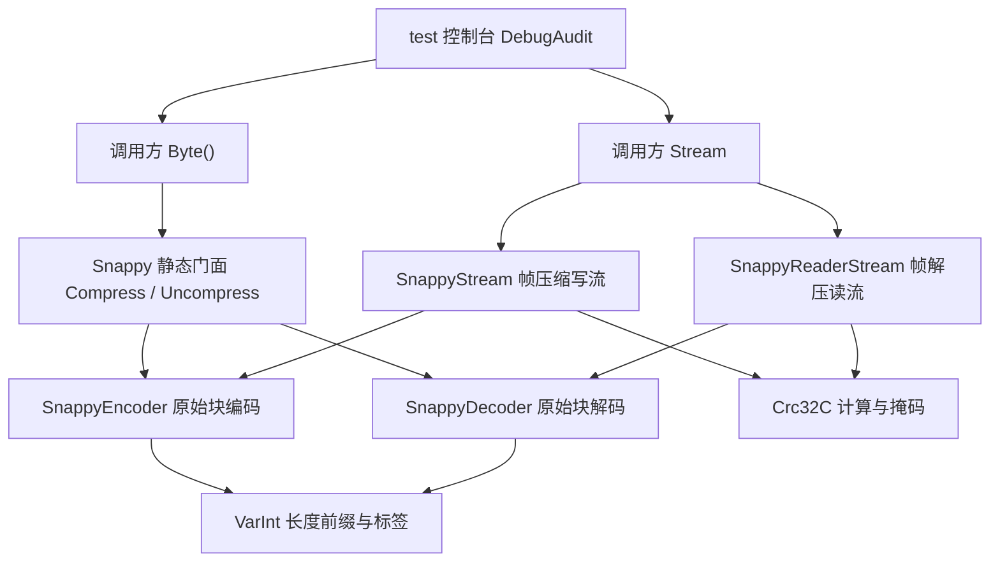

## 产品概述

在当前二进制数据工具库项目中新增 Snappy 数据压缩能力，覆盖原始块格式与帧格式两套数据表示，并提供字节数组入口与流式入口，使内嵌压缩块解析与大文件分块处理均可完成往返编解码。

## 核心特性

- **原始块压缩与解压**：字节数组往返，输出遵循标准格式，可与第三方工具生成的数据互通。
- **帧格式流式读写**：支持流标识块、压缩块、未压缩块、可跳过块，以及数据完整性校验。
- **大文件流式接口**：压缩写入流与解压读取流按块惰性处理，可配置是否连带关闭底层流。
- **输入健壮性**：长度前缀、回退距离、校验值、截断数据与保留类型均作校验，损坏数据被明确拒绝。
- **控制台测试与报告**：覆盖已知向量、往返一致性、边界与异常用例，输出可查阅的测试结果报告。
- **文档与包信息同步**：项目说明与包元数据补充新能力条目与用法示例。

## 技术栈选型

- **语言与运行时**：沿用 `binarydata-netcore5.vbproj` 的 VB.NET、`TargetFrameworks = net10.0`、SDK 风格项目、`RootNamespace = Microsoft.VisualBasic.Data.IO`，保持纯托管、零原生依赖（延续 README 设计目标）。
- **依赖范围**：仅 BCL（`System.IO`、`System` 等）；主项目已引用 `Microsoft.VisualBasic.Core\src\Core.vbproj`，其中 `Microsoft.VisualBasic.ApplicationServices.Debugging.DebugAudit` 供测试项目使用。不引入任何第三方 NuGet 包，避免破坏 `GeneratePackageOnBuild` 与离线构建。
- **测试载体**：现有 `test/test.vbproj` 控制台 `Exe` + `DebugAudit`（`Reset` / `Test` / `Watch` / `Mark` / `Dump` / `SaveReport` / `FailureCount`），输出 JSON 报告并按失败数设置 `Environment.ExitCode`。
- **风格基线**：`Option Strict On` / `Option Explicit On`、XML 文档注释、`Imports std = System.Math`、参数校验抛 `Argument*Exception`、格式错误抛 `InvalidDataException`、`Buffer.BlockCopy` / `Array.Copy` 拷贝、重叠复制逐字节。

## 实现方案

**总体策略**：按「原始块核心 → 校验辅助 → 帧格式流封装 → 静态门面」四层组织，静态 API 与 Stream API 共用同一原始块核心，避免编解码逻辑重复（DRY）；不引入新架构，直接复用 `Lz4.vb`（静态类 + 私有构造 + `Shared` 方法）与 `Lz4Stream.vb` / `LzmaStream.vb`（forward-only `Stream`、`leaveOpen`、`ThrowIfDisposed`、逐块惰性服务）的模板。

**原始块编码**：varint 写入未压缩长度；4 字节滚动哈希 + 按输入规模自适应大小的哈希表做贪心最长匹配，窗口上限 64 KiB、单次匹配长度上限 64、尾部不足 4 字节强制 literal；按 literal 长度与 copy 长度/偏移自动选择 1/2/4 字节偏移标签。均摊时间复杂度 O(n)，空间 O(n + 哈希表)。

**原始块解码**：单次线性扫描；先读 varint 得到声明长度并一次性预分配输出；literal 批量拷贝，copy 先校验 offset 不小于 1 且不超过已输出长度，重叠时逐字节复制；结束时校验实际输出长度等于声明长度。时间 O(n)、空间 O(n)。

**帧格式**：`SnappyStream` 构造即写 stream identifier chunk，按默认 64 KiB 分块，压缩结果不小于原文时改写 uncompressed chunk；`SnappyReaderStream` 解析「1 字节类型 + 3 字节小端长度 + 数据」，跳过 skippable、校验 masked CRC32C、拒绝保留类型与截断流；任意时刻仅缓冲一个 chunk，内存 O(chunkSize)。

**关键决策与权衡**：

- CRC32C 自带 256 项查表实现，不复用 `Bzip2.Math.CRC32`（其为 IEEE 多项式 0x04C11DB7，而帧格式要求 Castagnoli 0x82F63B78，且跨子命名空间引用会破坏模块边界）。
- 静态 `Byte()` API 直接服务 Parquet / Hadoop 内嵌块；Stream API 服务大文件；两者共用核心，兼顾易用与内存可控。
- 不实现并行块、字典复用等超出 Snappy「速度优先」定位的能力（YAGNI），避免过度设计。
- 主项目 SDK 默认 glob 会自动编译 `Snappy\` 下新增 `.vb`，无需新增 `Compile Include`，把改动面压到最小。

**可靠性与安全**：所有来自输入的 length / offset / 声明大小视为不可信，先校验再分配；声明长度须落在 `Integer` 范围且帧流中不得超过 chunk 上限，防止恶意长度导致 OOM 与越界读写；所有格式错误统一抛带上下文的 `InvalidDataException`。

## 执行要点

- **性能热路径**：哈希查找、literal 拷贝、重叠匹配复制、CRC 更新是热点；使用定长数组哈希表与局部变量、`Array.Copy` / `Buffer.BlockCopy` 批量拷贝、CRC 查表一次更新；帧流每次 `Read` 只服务已解码 chunk，不重复解析整块。
- **数值回绕**：项目全局 `RemoveIntegerChecks=true`，但 CRC32C 查表、掩码（循环右移 15 位等价左移 17 位按位或再加常数 0xA282EAD8，32 位回绕）、varint 与位移运算须显式使用 `UInteger` / `ULong` 并按位掩码，避免溢出与符号扩展错误。
- **命名解析**：静态门面类 `Snappy` 位于 `Namespace Snappy`（全名 `Microsoft.VisualBasic.Data.IO.Snappy.Snappy`）；测试代码用 `Imports Microsoft.VisualBasic.Data.IO.Snappy`，若编译器把 `Snappy` 解析为命名空间，则用完全限定名，确保符号绑定明确。
- **日志约定**：库代码沿用现有编解码器静默策略，不打印日志、不外泄数据；测试统一走 `DebugAudit.Test` / `Mark` / `Watch` / `Dump` / `SaveReport`，失败信息只含长度与期望摘要，不转储大 payload。
- **影响面控制**：仅新增 API，不改动 `Lz4.vb`、`Lz4Stream.vb`、`BZip2*` 等既有逻辑；`test.vbproj` 追加 `Compile Remove` 仅影响测试项目编译，保留 `test/Lz4LzmaTests/` 下 Xunit 源码文件不删除；`.sln` 无新项目，无需改动；README 与 vbproj 元数据只做追加性文本更新。

## 架构设计



数据流向：压缩 `Byte()` → varint 头 → 哈希匹配扫描 → literal/copy 标签流；解压缩为其逆过程并校验输出长度。帧写入：底层流缓冲满 chunk → 调用原始块压缩 → 计算 masked CRC32C → 写 chunk 头与数据；帧读取：读 chunk 头 → 跳过可跳过块 / 校验 CRC → 调用原始块解压 → 按块缓冲服务 `Read`。

## 目录结构

本次新增一个 `Snappy/` 子模块与测试目录，修改主项目元数据、README 与测试项目接线；以下为全部新建、修改及受影响文件。

```
g:/pixelArtist/src/framework/Data/BinaryData/BinaryData/
├── Snappy/
│   ├── Snappy.vb               # [NEW] 公开静态门面与格式常量。提供 Compress / Uncompress 的字节数组重载、带 offset/count 的重载、GetUncompressedLength 与 MaxCompressedLength；内含 varint 读写辅助与 tag 常量；私有构造、Shared 方法，对齐 Lz4.vb 风格。
│   ├── SnappyEncoder.vb        # [NEW] 原始块编码器（Friend）。实现 4 字节哈希 + 自适应哈希表的最长匹配、64 KiB 窗口、长度上限 64、尾部 literal 收尾，以及 literal 与 copy 1/2/4 标签的发出；写入 varint 长度前缀。
│   ├── SnappyDecoder.vb        # [NEW] 原始块解码器（Friend）。解析 varint、四类 tag、长度扩展字节；校验 offset、输出上限与声明长度；重叠复制逐字节、非重叠用 Array.Copy；错误抛 InvalidDataException。
│   ├── Crc32C.vb               # [NEW] CRC32C 辅助（Friend Module）。基于反射多项式 0x82F63B78 的 256 项查表，提供 ComputeHash(buffer, offset, count) 及帧格式所需的 Mask / Unmask 掩码运算。
│   ├── SnappyStream.vb         # [NEW] 帧格式压缩写入流（Public NotInheritable，继承 Stream）。构造写 stream identifier；按 chunkSize 分块缓冲，压缩不划算时写 uncompressed chunk；重写 Write / Flush / CanWrite 等全套成员，Dispose 尊重 leaveOpen。
│   ├── SnappyReaderStream.vb   # [NEW] 帧格式解压读取流（Public NotInheritable，继承 Stream）。惰性解析 chunk 头、跳过 skippable、拒绝保留类型与截断、校验 masked CRC32C，按块服务 Read；leaveOpen 与 ThrowIfDisposed 对齐 Lz4Stream.vb。
│   └── NamespaceDoc.vb         # [NEW] Namespace Snappy 的 XML 命名空间文档，中文说明原始块标签、varint、帧 chunk 布局与 CRC32C 掩码规则，风格对齐 LZ77Stream/NamespaceDoc.vb。
├── binarydata-netcore5.vbproj  # [MODIFY] 仅追加性修改 Description / PackageReleaseNotes / PackageTags，补充 Snappy 与 Framed 支持；不新增 Compile 项（SDK glob 自动包含 Snappy 目录），不动既有 PropertyGroup 与 ProjectReference。
├── README.md                   # [MODIFY] 在核心特性、关键类型与 API、快速上手等段落补充 Snappy 静态 API 与两个流类的条目及简短 vbnet 示例；保持现有中文文档风格。
├── binarydata-netcore5.sln     # [AFFECTED] 无需改动，仅确认三个项目未新增/删除。
└── test/
    ├── test.vbproj             # [MODIFY] 新增对 binarydata-netcore5.vbproj 与 Microsoft.VisualBasic.Core/src/Core.vbproj 的 ProjectReference；追加 Compile Remove 排除 Lz4LzmaTests 目录（含相应 None/EmbeddedResource 视情况），使项目可编译。
    ├── Program.vb              # [MODIFY] 替换 Hello World：DebugAudit.Reset、RunSuite 中 Using Watch、Mark 断言数、Dump、SaveReport 输出 JSON、按 FailureCount 设置退出码；结构对齐 Protobuf/test/Program.vb。
    ├── TestSupport.vb          # [NEW] 断言辅助（Friend Module）：AssertBytesEqual / AssertEqual(Of T) / AssertTrue / AssertFalse / AssertThrows(Of TException) / ToHex / HexBytes，全部调用 DebugAudit.Test，对齐 Protobuf/test/TestSupport.vb。
    ├── SnappyTests/
    │   ├── SnappyBlockTests.vb # [NEW] 原始块用例：空输入、纯字面量、RLE 重叠复制、literal 长度 60/61 与长长度扩展、copy 1/2/4 三种标签、长距离偏移、文本/随机/二进制往返、声明长度不符与截断/非法 offset 异常；含手工构造与官方已知向量。
    │   └── SnappyFramedTests.vb # [NEW] 帧格式用例：stream identifier、compressed/uncompressed/skippable chunk、CRC 掩码与校验、CRC 损坏被拒绝、保留类型被拒绝、分块 Read、leaveOpen 行为、大块流式往返。
    └── Lz4LzmaTests/*.vb       # [AFFECTED] 文件保留不删除、不修改，仅由 test.vbproj 的 Compile Remove 从编译中排除，避免缺失 Xunit 引用导致构建失败。
```

## 关键代码结构

以下为接口级签名示意（不含实现体），用于固定静态门面与流包装的调用契约。

```
Namespace Snappy
    Public NotInheritable Class Snappy
        Private Sub New()
        Public Shared Function Compress(input As Byte()) As Byte()
        Public Shared Function Compress(input As Byte(), offset As Integer, count As Integer) As Byte()
        Public Shared Function Uncompress(compressed As Byte()) As Byte()
        Public Shared Function GetUncompressedLength(compressed As Byte()) As Integer
        Public Shared Function MaxCompressedLength(sourceLength As Integer) As Integer
    End Class
End Namespace
```

```
Namespace Snappy
    Public NotInheritable Class SnappyStream
        Inherits Stream
        Public Sub New(output As Stream, Optional leaveOpen As Boolean = False, Optional chunkSize As Integer = 65536)
    End Class

    Public NotInheritable Class SnappyReaderStream
        Inherits Stream
        Public Sub New(input As Stream, Optional leaveOpen As Boolean = False)
    End Class
End Namespace
```

（`Crc32C` 仅暴露 `ComputeHash(buffer, offset, count) As UInteger` 与 `Mask(crc) As UInteger` / `Unmask` 三个内部方法，供两个流类共用，无需额外公开契约。）

## Agent Extensions

### SubAgent

- **code-explorer**
- Purpose: 在编码前复核 `LZ77Stream` / `Bzip2` 的 Stream 模板、`Option` 与异常约定、`DebugAudit` 全部可调用 API 签名、`test.vbproj` 的实际编译项与两个 `ProjectReference` 相对路径，产出可复用清单。
- Expected outcome: 得到精确的现有符号与文件清单，确保新代码不臆造 API、测试接线路径正确、且不破坏保留的 Xunit 源码。

### Skill

- **lsp-code-analysis**
- Purpose: 集成阶段做定义/引用/实现导航，检查新增类型 `Snappy`、`SnappyStream`、`SnappyReaderStream` 的命名空间解析是否冲突，以及测试调用点是否全部绑定到新实现。
- Expected outcome: 确认无未解析符号与同名歧义，所有测试引用与静态门面调用均指向本次新增类型。