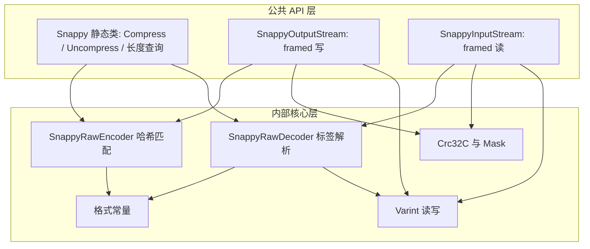

## 产品概述

在现有的底层二进制数据流工具箱项目中，新增一套纯托管的 Snappy 压缩与解压能力，用于解析和生成采用 Snappy 编码的自定义二进制文件（如 Parquet、Hadoop 相关格式），与工具箱内已有的其它压缩编解码器并列，保持零外部依赖、跨平台行为一致。

## 核心特性

- **原始块编解码**：支持 Snappy 标准原始块格式的压缩与解压，输出可被其它标准实现读取，也能读取其它实现产生的数据；覆盖长度前缀、字面量与三种复制指令。
- **分块流格式支持**：支持带流标识头、压缩块/未压缩块/可跳过块以及数据完整性校验的分块流格式读写，兼容 snzip / Hadoop，并能拒绝校验失败的数据。
- **双层使用接口**：面向字节数组的静态压缩、解压与未压缩长度查询接口；以及面向大文件的流式读写包装（支持底层流开关控制与惰性分块处理）。
- **健壮的边界校验**：对截断数据、非法回退距离、长度不符、校验和不匹配、未知块类型等非法输入进行严格检查并给出明确错误。
- **测试与报告**：在现有测试控制台程序中补充已知向量、往返一致性与异常用例，输出结构化测试报告。

## 技术栈选型

- 语言与框架：VB.NET（`Option Strict On` / `Option Explicit On`），目标框架 `net10.0`，`Microsoft.NET.Sdk`。
- 宿主项目：`binarydata-netcore5.vbproj`，`RootNamespace = Microsoft.VisualBasic.Data.IO`，程序集 `Microsoft.VisualBasic.Data.BinaryData`；新增代码位于 `Namespace Snappy`，即完整命名空间 `Microsoft.VisualBasic.Data.IO.Snappy`，与 `LZ77Stream`、`Bzip2` 平级。
- 依赖：库代码不引入任何新的原生或第三方依赖，仅沿用现有 `Core.vbproj` 引用；测试项目通过 Core 使用 `Microsoft.VisualBasic.ApplicationServices.Debugging.DebugAudit` 记录结果并生成报告。
- 测试形态：控制台测试程序（`test/test.vbproj`），不使用任何测试框架包。

## 实现方案

**策略**：新增独立子目录 `Snappy/`，按「基础工具 → 原始块编解码 → 公共 API/分块流」三层组织，完全对齐仓库既有的 `Lz4.vb`（静态块解码器）+ `Lz4Stream.vb`（`Stream` 派生惰性读）+ `BZip2OutputStream/BZip2InputStream`（对称命名流）范式，不触碰任何现有编解码器逻辑。

**关键技术决策与取舍**：

1. **不复用 `Bzip2.Math.CRC32`**：它是 IEEE 0x04C11DB7 多项式，而分块流要求 CRC32C（Castagnoli，反射多项式 0x82F63B78），强行复用会产出错误校验值；因此自带 256 项查表（运行时惰性生成以压缩源码体积）+ Mask/Unmask。
2. **不引入新架构/依赖**：README 明确「零原生依赖的纯托管压缩」是设计目标；沿用现有静态类 + `Stream` 派生类即可把改动限制在新增目录、测试与文档，`binarydata-netcore5.sln` 无需改动（不新增项目）。
3. **命名**：静态入口 `Snappy`（`NotInheritable Class` + 私有构造 + `Shared` 方法，对齐 `Lz4`/`Lzma`）；分块流采用 `SnappyOutputStream`（写→压缩）与 `SnappyInputStream`（读→解压），对齐项目既有 `BZip2OutputStream`/`BZip2InputStream` 的对称命名，即用户所述的「SnappyStream / SnappyReaderStream 之类的流包装」。
4. **静态 API 覆盖**：`Compress`/`Uncompress` 同时提供字节数组与 `Stream` 重载，另提供 `UncompressedLength`、`MaxCompressedLength`、`IsValidCompressedBuffer` 等查询接口，便于下游格式读取器预分配缓冲。

**性能与可靠性**：

- 压缩器：4 字节哈希 + 2 的幂大小哈希表（约 1 左移 14）找最长匹配，窗口 ≤ 65536、单次匹配长度 ≤ 64、尾部不足最短匹配时强制字面量；近似 O(n) 时间、O(块大小) 空间。一次性按 `MaxCompressedLength` 上界预分配输出缓冲并用游标写入，避免逐字节 `List(Of Byte)` 与反复扩容。
- 解码器：单次线性扫描 O(n)；字面量用 `Buffer.BlockCopy` 批量拷贝，仅当回退距离小于复制长度（重叠复制）退化为逐字节，按声明长度一次性分配输出，杜绝动态增长与 N+1 次分配。
- 流式：`SnappyInputStream` 按 chunk 惰性解压，内存最多驻留一个分块（默认 64 KiB）；`SnappyOutputStream` 按块缓冲写入，`Dispose` 尊重 `leaveOpen`。
- 安全：解码前读取 varint 声明长度并做上界检查（防恶意声明导致巨量分配），所有 tag、长度扩展字节、offset、length 均做输入与输出双重边界校验；校验和不匹配抛 `InvalidDataException`。

## 实现要点（执行细节）

- 项目启用了 `RemoveIntegerChecks=true`（关闭整数溢出检查），因此**不能依赖运行时溢出异常**，位移与整型转换必须用显式 `CInt`/`CUInt` 并配合手写边界判断；VB 的 `>>` 对 `UInteger` 的行为需实测确认。
- 格式细节：原始块开头为 LEB128 varint 未压缩长度（最多 5 字节，防无限循环）；tag 低 2 位分派 `00` 字面量（高 6 位 = 长度减一，若 ≥ 60 则高 6 位 = 59 + 后续字节数 1..4，小端存放长度减一）、`01` 一字节回退（长度 4..11、11 位偏移）、`10` 两字节回退（长度 1..64、2 字节小端偏移）、`11` 四字节回退（长度 1..64、4 字节小端偏移）。
- 分块流：stream identifier 精确为 `FF 06 00 00 73 4E 61 50 70 59`；chunk 头 = 1 字节类型 + 3 字节小端长度；`0x00` 压缩块与 `0x01` 未压缩块的载荷均为「4 字节 masked CRC32C + 数据」；`0x80` 至 `0xFE` 为可跳过块、`0xFF` 为流标识，`0x02` 至 `0x7F` 保留类型应拒绝；掩码为 `((crc &gt;&gt; 15) Or (crc &lt;&lt; 17)) + 0xA282EAD8`（32 位无符号回绕，用 `CUInt` 与 32 位掩码显式处理）。
- 复用现有约定：参数校验用 `ArgumentNullException(NameOf(x))` / `ArgumentOutOfRangeException`，格式错误用带上下文消息的 `InvalidDataException`，`Imports std = System.Math`，`Buffer.BlockCopy` / `Array.Copy`；库代码不写日志（避免热路径开销与日志噪声），错误信息可操作且不dump大载荷。
- 影响范围控制：仅新增 `Snappy/` 目录、修改 `README.md` 与 vbproj 元数据、`test/` 下文件；不改 `.sln`、不改 `LZ77Stream`/`Bzip2`/`PickleSerializer` 等既有逻辑，保持向后兼容。
- 测试项目前置修复：`test/test.vbproj` 必须先添加对 `Lz4LzmaTests\**` 的 Compile Remove（同时按需处理 None/EmbeddedResource），否则 SDK 默认 glob 会编译三个 `Imports Xunit` 文件而仓库无 xunit 包引用，导致构建失败；随后添加 `..\binarydata-netcore5.vbproj` 与 `..\..\..\..\Microsoft.VisualBasic.Core\src\Core.vbproj` 两条 ProjectReference。

## 架构设计



**数据流**：压缩 `原始字节 → RawEncoder（哈希找匹配，emit 字面量/复制） → varint 长度头 + 块数据`；分块写 `每 64 KiB 原始数据 → RawEncoder → Crc32C 掩码 → chunk 头 + 载荷`；分块读 `stream identifier → 逐 chunk（校验 CRC32C） → RawDecoder 或原样拷贝 → 输出缓冲 → Read 惰性供数`。

## 目录结构

```
BinaryData/
├── Snappy/
│   ├── SnappyConstants.vb        # [NEW] 集中定义格式常量：chunk 类型码、stream identifier、窗口与匹配上限、默认分块大小、literal/copy 标签位布局常量。Purpose: 单一事实源；Implementation: Friend Module，全部 Const，供编解码器与流类共享，避免魔法数字散落。
│   ├── Varint.vb                 # [NEW] LEB128 无符号 varint 的读写辅助。Functionality: WriteVarint(value, buffer, ByRef pos)、ReadVarint(src, ByRef pos, limit)；Implementation: Friend 静态类，最多 5 字节、越界/超长抛 InvalidDataException，供长度头与内部长度编码复用。
│   ├── Crc32C.vb                 # [NEW] CRC32C 计算与分块流掩码。Functionality: ComputeHash(bytes, offset, count)、Mask(crc)、Unmask(masked)；Implementation: 反射多项式 0x82F63B78 的 256 项查表（惰性生成一次）、32 位无符号回绕显式处理；不复用 Bzip2.Math.CRC32。
│   ├── SnappyRawEncoder.vb       # [NEW] 原始块压缩器。Functionality: Encode(input, offset, count) 输出「varint 长度头 + 字面量/复制指令流」；Implementation: 4 字节哈希 + 2 的幂哈希表找最长匹配（窗口 ≤ 65536、长度 ≤ 64、偏移编码按需要选 1/2/4 字节标签），预分配上界缓冲 + 游标写入，尾部强制字面量，Friend 类仅供 Snappy 与流类调用。
│   ├── SnappyRawDecoder.vb       # [NEW] 原始块解码器。Functionality: Decode(src, ByRef pos, count, expectedLength) 与 GetUncompressedLength；Implementation: 解析 varint 长度头后线性扫描四种标签，字面量 BlockCopy、重叠复制逐字节，严格校验输入边界、偏移不越出已输出区、输出不超过声明长度，非法一律 InvalidDataException。
│   ├── Snappy.vb                 # [NEW] 静态公共入口。Functionality: Compress / Uncompress（Byte() 与 Stream 重载）、UncompressedLength、MaxCompressedLength、IsValidCompressedBuffer；Implementation: NotInheritable Class + 私有构造，参数空值/范围校验，Stream 重载参照 Lzma.Decompress 用 MemoryStream + CopyTo 包装，内部委托给 RawEncoder/RawDecoder。
│   ├── SnappyOutputStream.vb     # [NEW] 分块流格式的压缩写流（Inherits Stream）。Functionality: 构造时写 stream identifier，Write 累积到 chunkSize 后压缩并写 chunk（0x00 或不可压缩时 0x01，含 masked CRC32C），Flush/Dispose 时冲刷尾块；Implementation: 重写 CanRead/CanSeek/CanWrite/Length/Position/Flush/Seek/SetLength/Write/Dispose，支持 leaveOpen，仅保留一个分块缓冲。
│   ├── SnappyInputStream.vb      # [NEW] 分块流格式的解压读流（Inherits Stream）。Functionality: 校验/跳过 stream identifier，逐 chunk 惰性读取，校验 CRC32C，跳过可跳过块，解压压缩块或原样输出未压缩块；Implementation: 构造 New(input, Optional leaveOpen)，Read 惰性供数、最多缓冲一个 chunk，重写全套 Stream 成员，未知类型/截断/校验失败抛 InvalidDataException，Dispose 尊重 leaveOpen。
│   └── NamespaceDoc.vb           # [NEW] 命名空间 XML 文档。Functionality: 说明原始块与分块流两种格式的关系、标签布局、CRC32C 掩码、与其它实现的兼容性，对齐 LZ77Stream/NamespaceDoc.vb 的中文详解风格。
├── binarydata-netcore5.vbproj    # [MODIFY] 仅更新 Description、PackageTags、PackageReleaseNotes，加入 Snappy 说明；SDK 默认 glob 自动编译 Snappy/ 下新文件，无需新增 Compile 项，不改动引用与配置节。
├── README.md                     # [MODIFY] 在核心特性、关键类型与 API、快速上手等处补充 Snappy 原始块与分块流条目、类清单及压缩/解压示例，保持中文文档风格一致。
└── test/
    ├── test.vbproj               # [MODIFY] 添加对 Lz4LzmaTests\** 的 Compile Remove（及配套 None/EmbeddedResource 排除）以避免编译 Xunit 文件；新增对 binarydata-netcore5.vbproj 与 Core.vbproj 的 ProjectReference。
    ├── Program.vb                # [MODIFY] 将 Hello World 改为 DebugAudit 驱动入口：Reset → Using Watch 分组运行 Snappy 套件 → Mark 断言计数 → Dump → SaveReport 输出 JSON → 依 FailureCount 设置 Environment.ExitCode，仿 Protobuf/test/Program.vb。
    └── SnappyTests/
        ├── TestSupport.vb        # [NEW] 断言与辅助模块（Friend Module，无命名空间，对齐 Protobuf/test/TestSupport.vb）：AssertBytesEqual / AssertEqual / AssertTrue / AssertThrows 统一调用 DebugAudit.Test，另含 ToHex / HexBytes / 随机与文本测试数据生成。
        ├── SnappyVectors.vb      # [NEW] 已知答案向量集合：手工构造的纯字面量、单字节重叠复制、literal 长度 60/61 与多字节扩展、三种 copy 标签、长距离偏移等标准压缩字节序列，以及分块流标识与 skippable/未压缩块样板字节。Purpose: 验证与官方实现兼容，而非仅自往返。
        ├── SnappyRawTests.vb     # [NEW] 原始块用例：向量解压断言、空输入、往返一致性（随机/文本/二进制/大缓冲）、长度查询、截断/非法偏移/长度不符/超长 varint 等异常拒绝、压缩结果可被 Uncompress 还原。
        └── SnappyFramedTests.vb  # [NEW] 分块流用例：stream identifier、压缩块/未压缩块/skippable 块、CRC32C 掩码正确性与损坏拒绝、分块 Read、多 chunk 拼接、未知 chunk 类型拒绝、leaveOpen 行为、与静态 API 互通。
```

## 关键代码结构（接口级契约，供测试与下游对齐）

```
' Snappy.vb —— NotInheritable Class，私有构造
Public Shared Function Compress(input As Byte()) As Byte()
Public Shared Function Compress(input As Stream) As Byte()
Public Shared Function Uncompress(compressed As Byte()) As Byte()
Public Shared Function Uncompress(input As Stream) As Byte()
Public Shared Function UncompressedLength(compressed As Byte()) As Integer
Public Shared Function MaxCompressedLength(sourceLength As Integer) As Integer
Public Shared Function IsValidCompressedBuffer(compressed As Byte()) As Boolean

' SnappyOutputStream.vb —— Inherits Stream（framed 压缩写）
Public Sub New(output As Stream, Optional leaveOpen As Boolean = False,
               Optional chunkSize As Integer = 65536)

' SnappyInputStream.vb —— Inherits Stream（framed 解压读）
Public Sub New(input As Stream, Optional leaveOpen As Boolean = False)
```