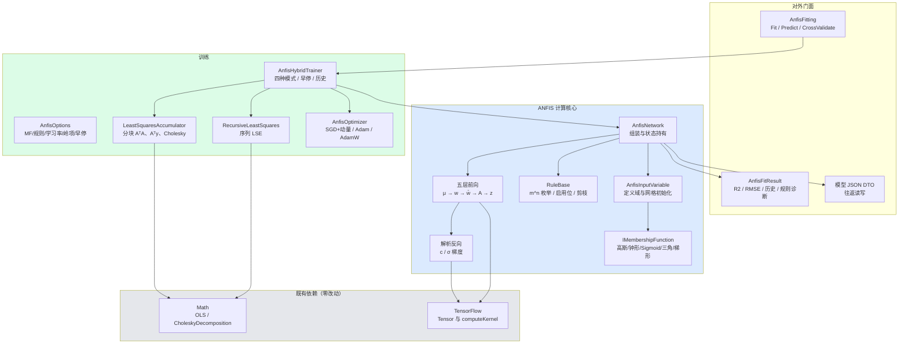

## User Requirements

在 `MachineLearning\ANFIS\ANFIS.vbproj` 中，按 `ANFIS\readme.md` 的算法描述实现以 Takagi-Sugeno 五层网络为骨架的自适应神经模糊推理系统（ANFIS）。系统需把模糊推理完整映射为可微计算图，用“最小二乘估计结论参数 + 反向传播修正前提参数”的混合学习从数据中同时学习隶属函数形状与规则结论。

## Product Overview

面向中低维、小样本、要求可解释性的回归建模任务。模型内部保留显式规则与隶属函数，可导出每条规则的触发强度与结论系数，用于诊断、剪枝与可视化；对外提供统一的拟合门面（Fit/Predict/CrossValidate）与结果对象（R2、RMSE、残差、训练历史、规则诊断），并可序列化为 JSON 复用。

## Core Features

- 隶属函数族：高斯、广义钟形、Sigmoid、三角、梯形，每个函数提供求值与参数解析导数；按训练集数据范围自动完成网格初始化（中心等距、宽度取间距一半）。
- 结构初始化：按每输入隶属函数数 m 枚举全部 m^n 条规则形成规则表，支持手工启用或禁用指定规则单元，规则数超上限时明确报错。
- 五层前向：模糊化、乘积触发强度、归一化强度、一阶 Sugeno 结论、加权求和；批量计算并缓存中间量供反向与管理端读取。
- 混合学习：纯梯度下降、梯度下降加一次性 LSE、梯度下降加逐轮 LSE（标准混合）、递推近似 LSE 四种策略；结论参数走线性最小二乘，前提参数走梯度下降，支持学习率衰减、梯度裁剪、早停与验证集监控。
- 数值稳健：乘积在对数域累加避免下溢，归一化分母接近零时输出零并屏蔽梯度，最小二乘加相对岭项并保证对称正定，宽度参数保持正值。
- 结果与可解释性：训练与验证 RMSE 曲线、R2、残差、每条规则平均触发强度、低触发规则剪枝（剪枝后自动重拟合），支持多输出共享同一前提结构。
- 模型持久化：隶属函数类型与参数、规则表、结论系数、特征名与训练配置完整往返，可直接加载预测。

## 依赖边界

本次迭代仅新增 ANFIS 工程内代码；TensorFlow、DeepLearning、Math 的 FuzzyLogic 三处依赖保持零改动。

## Tech Stack Selection

- 语言与运行时：VB.NET，net10.0（工程已配置 RootNamespace `Microsoft.VisualBasic.DeepLearning.ANFIS`，AssemblyName `Microsoft.VisualBasic.DeepLearning.ANFIS`）。
- 张量与算子：复用 `MachineLearning\TensorFlow`（`Tensor`、`computeKernel`、`ITensorCompute` 的 Add/Subtract/Multiply/Divide/Exp/Log/Square/Pow/Clip/MatMul/Transpose/Sum/Mean/Prod/Concat/Slice），不新增依赖。
- 线性代数：复用 `Math.NET5` 的 `OLS.Solve(a As Double(,), b As Double())`、`NumericMatrix.chol()` 与 `CholeskyDecomposition.Solve`；不引入新包。
- 序列化：`System.Text.Json` 自定义 DTO（与既有工程一致，规避 `Models` 反射式 XML 模型的耦合）。
- 构建：新增文件启用 `Option Strict On`，主工程 `<Compile Remove="_smoketest\**" />`，自测为独立 vbproj。

## Implementation Approach

### 核心判断

readme 描述的对象是“可微计算图 + 混合学习”，现有三个组件分别只提供“算子”“手动反传的写法范式”“Mamdani 模糊控制器”，因此 ANFIS 的计算核心必须在 ANFIS 工程内新写；复用点限定为：Tensor 算子做前向代数、Math 求解器做 LSE、DeepLearning 的 forward/backward 分层风格做代码组织。

### 关键公式与向量化（实现依据）

设批 N、输入维 n、每输入隶属函数数 m、规则数 R（默认 m^n）、结论参数 θ，维度 P = R(n+1)。

- 第 1 层：`μ[i,k] = exp(-(x_i - c_ik)^2 / (2σ_ik^2))`，形状 [N, n·m]。
- 第 2 层：按规则表对每个输入取对应列后逐元素连乘，`w_r = Π_i μ_{i,m(i,r)}`，形状 [N, R]；用 `log w` 累加后再 `exp`，并按行最大值平移避免下溢。
- 第 3 层：`w̄_r = w_r / S`，`S = Σ_r w_r`；`S` 小于阈值时整行输出 0 且梯度置零。
- 第 4/5 层：`f_r = x·p_r + q_r`，`z = Σ_r w̄_r f_r`；把第 4、5 层合并为一次矩阵乘 `z = A·θ`，其中
`A[:, r*(n+1)+j] = w̄_r * x_j`（j = 1..n），`A[:, r*(n+1)+n] = w̄_r`。
- 结论参数：解 `(AᵀA + λI)θ = Aᵀy`；λ 取相对值 `λ0 * tr(AᵀA) / P`。`AᵀA` 只累加上三角后镜像，满足 `CholeskyDecomposition` 的精确对称判据。
- 反向（`E = 0.5 * Σ(z-y)^2`，`δ = z - y`）：
- `∂E/∂θ = Aᵀδ`（与 LSE 的右端项同构，可复用同一累加器）；
- `∂E/∂f_r = w̄_r * δ`；
- `∂E/∂c_ik = Σ_{r: m(i,r)=k} w̄_r * δ * (f_r - z) * (x_i - c_ik) / σ_ik^2`；
- `∂E/∂σ_ik = Σ 同项 * (x_i - c_ik)^2 / σ_ik^3`。
依据恒等式 `(f_r - z)/S * w_r = w̄_r (f_r - z)`，实现中**不得**先求 `∂w/∂p` 再除以 μ（μ 趋于 0 时数值爆炸）。
- 前提参数化：σ 以 `log σ` 参与优化，更新后 `σ = exp(s)` 并夹紧到正区间下界，避免除零与宽度为负。
- 多输出：`A` 与前提结构共享，θ 每输出一列，同一 `AᵀA` 用多右端项一次分解多次回代。

### 学习策略映射（对应 readme 的四种方案）

- 纯 BP：仅梯度更新前提参数，θ 也走梯度（用于对照实验）。
- BP + 一次性 LSE：训练初用当前前提参数构造 A，解一次 θ 后冻结，只调前提。
- 标准混合：每轮先在全量训练集上前向累加 A 与 y 并重解 θ，再反向传播更新前提参数。
- 递推 LSE：按样本/小块用 Sherman-Morrison 形式更新 `(AᵀA)^-1` 与 θ，适用于流式或内存受限场景。

### 性能与规模控制

- 前向 `O(N·R·n)`；`A` 的物化为 `O(N·P)`，`AᵀA` 为 `O(P^2)`、构造 `O(N·P^2/2)`。n=4、m=3 时 P=405（约 1.3 MB）无压力；n=6、m=3 时 P=5103（约 208 MB）已临界。
- 因此：默认**分块**构造与累加（行块大小可配），不物化整张 A；提供 `MaxRules` 与 `MaxConsequentParams` 上限并在超限时抛出带指引的异常（提示减少 m、使用剪枝或改用递推 LSE）。
- 训练循环内复用 μ、w、w̄、δ 的缓冲数组，避免每步分配；并行只在按行块累加时启用，且各线程写各自的局部 `AᵀA` 分片后按固定顺序合并，保证固定种子下结果可复现。

### 数值与工程约束

- 所有前向/反向算子一律显式调用 `ElementwiseMultiply` 或 `computeKernel.Multiply`；`Tensor` 的 `*` 是矩阵乘，误用会在维度恰好合法时静默算错。
- 不依赖 `Tensor.Gradient`（无计算图、无自动微分），梯度全部解析给出并以中心差分做门禁校验。
- 不复用 `TrainerAlgorithm`：其按 `batch_size` 归一化梯度、对所有参数块统一更新、默认施加 L1/L2 衰减，与“θ 走 LSE、前提走 BP、按 epoch 做 LSE”的调度冲突；仅在代码组织上参照 `FullyConnectedLayer` 的分层 forward/backward 风格。
- 不引用 `DataMining.NET5`（FCM）；结构初始化通过委托注入，调用方可自行传入聚类中心。

## Implementation Notes

- 前向与 LSE 共用同一份 A 构造逻辑（单一函数返回分块结果），避免两处实现漂移导致“训练收敛但 θ 与 OLS 不一致”的隐蔽错误。
- Cholesky 失败（非正定）时按顺序降级：加大岭项重试、改用 `OLS.Solve` 高斯消元、最后回退到上一次有效 θ 并记录警告，绝不返回 NaN。
- 归一化分母、`exp` 参数、梯度累加值三处加有限性检查；一旦出现非有限值立即记录该轮规则触发强度分布，便于定位是哪条规则塌缩。
- 训练历史、剪枝结果、每轮 θ 范数写入结果对象，便于诊断；日志只输出标量与索引，不打印整批中间矩阵。
- VB 语法陷阱：局部变量不得与函数/属性同名；`Index`、`Call`、`Step`、`Next`、`Failure`、`sub`、`error` 为保留字；`If(cond, array, Nothing)` 需 `DirectCast` 指定类型；导入 `Microsoft.VisualBasic.Language` 的文件中 `List(Of T)`、`Dictionary` 可能被本仓自定义类型遮蔽，需全限定；同时导入 `System.Text.Json` 与本仓 `Javascript.JsonElement` 会产生二义性，用别名规避。
- 反向兼容：主工程仅新增文件与一条 `Compile Remove`，不改任何已有公共类型；不触碰 `Math\FuzzyLogic`（其 `MembershipFunction.X0..X3` 被 `MinValue/MaxValue/Range/Fuzzify` 与 `Models` 反射式序列化共同依赖）。

## Architecture Design



分层职责：`Fuzzy` 只负责隶属函数求值与导数；`Structure` 只负责规则拓扑与五层代数；`Training` 只负责参数求解与调度；`AnfisNetwork` 是唯一持有可变状态的对象，门面层不直接触碰数组。

## Directory Structure

```
MachineLearning\ANFIS/
├─ ANFIS.vbproj                              # [MODIFY] 新增 OptionStrict=On；新增 Compile Remove="_smoketest\**"；保持既有 4 条 ProjectReference 不变（如启用 NumericTable 入口再加 DataFittings 引用）。
├─ Class1.vb                                 # [DELETE] 空占位类，由实际模块替代。
├─ NamespaceDoc.vb                           # [NEW] 命名空间文档：说明五层映射、混合学习、规则表表示与引用关系。
├─ Fuzzy/
│  ├─ IMembershipFunction.vb                 # [NEW] 隶属函数契约：Kind、ParameterCount、GetParameters/SetParameters、Evaluate(x)、Gradient(x) 返回 (dμ/dc, dμ/dσ)、Clone、Describe。所有实现必须是纯函数（无内部可变状态），以支持并行求值。
│  ├─ MembershipFunctions.vb                 # [NEW] Gaussian、GeneralizedBell、Sigmoid、Triangular、Trapezoidal（平滑版）的 Evaluate 与解析导数；工厂按 kind 与参数数组创建；参数越界时抛带参数名的异常。
│  └─ AnfisInputVariable.vb                  # [NEW] 输入变量：名称、训练集统计得到的定义域、隶属函数列表；InitializeGrid(m) 按等距中心与 σ=间距/2 初始化；提供与规则表的列映射。
├─ Structure/
│  ├─ RuleBase.vb                            # [NEW] 规则表 Integer()(n × R)、m^n 全组合枚举（含超限检查）、启用/禁用某规则单元、平均触发强度统计、按阈值剪枝并返回重映射后的规则表、导出 IF-THEN 文本。
│  └─ AnfisLayers.vb                         # [NEW] 五层前向：μ 计算（逐输入）、log 域乘积得 w、归一化得 w̄、构造 A、z=A·θ；缓存 N/R/P 与各中间量；提供 BuildDesignMatrixChunk(rowStart,rowCount) 供 LSE 分块使用；不承载训练逻辑。
├─ AnfisNetwork.vb                           # [NEW] 模型主体：特征名、输入变量、规则表、θ（支持多输出列）、超参数快照；PredictRow/PredictBatch、GetRuleActivations、ExportFisText、ToJson/FromJson；所有属性变更走 SetPremiseParameters/SetConsequent 以维持缓存一致。
├─ Training/
│  ├─ AnfisOptions.vb                        # [NEW] MF 类型与每输入个数、规则启用掩码、学习模式、学习率与衰减、优化器选择、岭项系数、块大小、批大小、验证比例与划分种子、最大轮数、早停耐心、梯度裁剪阈值、MaxRules/MaxConsequentParams、随机种子；提供 Validate()。
│  ├─ LeastSquaresAccumulator.vb             # [NEW] 分块累加 AᵀA（只算上三角后镜像）与 Aᵀy（多右端项）；AddChunk、Solve（相对岭项 + Cholesky，失败时降级到 OLS.Solve）、Reset、ConditionEstimate（对角比）。
│  ├─ RecursiveLeastSquares.vb               # [NEW] 序列 LSE：维护逆相关矩阵与 θ，按块或样本更新；提供遗忘因子与数值复位（正则化重初始化）。
│  ├─ AnfisOptimizer.vb                      # [NEW] 前提参数优化：SGD+动量、Adam、AdamW；作用于 log σ；提供 ApplyGradients、Step、DecayLearningRate、Reset。
│  └─ AnfisHybridTrainer.vb                  # [NEW] 训练调度：四种模式；每轮 LSE 前向累加、反向逐块累加前提梯度、优化器更新、验证集评估、早停与历史记录；每次 LSE 后重算误差以保持历史一致。
├─ AnfisFitResult.vb                         # [NEW] 结果对象：R2、RMSE、SSE、残差、拟合值、每轮训练/验证指标、θ 范数历史、规则平均触发强度与剪枝记录、Iterations/Converged；GetY(row) 与 ToString。
├─ AnfisFitting.vb                           # [NEW] 门面：Fit(x As Double()(), y As Double(), options)、Predict(model, x)、CrossValidate（确定性折划分）、按委托注入的聚类初始化入口；参数与数据校验（样本数、维度、非有限值）。
└─ _smoketest/
   ├─ smoketest.vbproj                       # [NEW] 独立控制台工程，ProjectReference 指向 ANFIS.vbproj，AssemblyName 与输出目录独立。
   └─ Program.vb                             # [NEW] 断言集：前向对拍、梯度校验、LSE 对拍、函数逼近、四种模式对比、剪枝、序列化往返、确定性；失败返回非零退出码。
```

## Key Code Structures

```
' 隶属函数契约：参数化 + 解析导数，实现必须是纯函数
Public Interface IMembershipFunction
    ReadOnly Property Kind As MembershipKind
    ReadOnly Property ParameterCount As Integer
    Function GetParameters() As Double()
    Sub SetParameters(values As Double())
    Function Evaluate(x As Double) As Double
    ''' <summary>返回 (dμ/d中心类参数, dμ/d宽度类参数)；三角/梯形按分段给出</summary>
    Function Gradient(x As Double) As MembershipGradient
    Function Clone() As IMembershipFunction
End Interface

Public Structure MembershipGradient
    Public Center As Double
    Public Width As Double
End Structure
```

```
' 分块最小二乘累加器：只算上三角，保证 Cholesky 的精确对称判据
Public Class LeastSquaresAccumulator
    Public Sub New(parameterCount As Integer, outputCount As Integer, ridge As Double)
    ''' <summary>A 的形状为 (rows, parameterCount)；y 为 (rows, outputCount)</summary>
    Public Sub AddChunk(A As Double(,), y As Double(,))
    ''' <summary>返回 (parameterCount, outputCount) 的解；失败时降级并记录 Warning</summary>
    Public Function Solve(ByRef warning As String) As Double(,)
    Public Sub Reset()
End Class
```

## 验证门槛

- 前向：批量结果与逐样本标量参考实现最大绝对差不超过 1e-12。
- 梯度：中心差分（h=1e-6）与解析梯度相对误差小于 1e-6，覆盖中心参数与宽度参数。
- LSE：冻结前提参数时 θ 与 `OLS.LeastSquares(A, y)` 逐元素差小于 1e-9。
- 逼近：`y = sin(x1)*cos(x2)`（每输入 3 个隶属函数、9 条规则）验证集 RMSE 小于 0.05；一维 `y = sin(x)`（5 个隶属函数）RMSE 小于 0.01。
- 混合优于纯梯度：相同轮数下标准混合模式的验证 RMSE 更低。
- 剪枝：平均触发强度小于 1e-3 的规则移除后，RMSE 退化小于 5%。
- 确定性：固定种子与单线程下两次训练结果逐位一致。
- 构建：Debug 与 Release 均 0 警告 0 错误，自测退出码为 0。