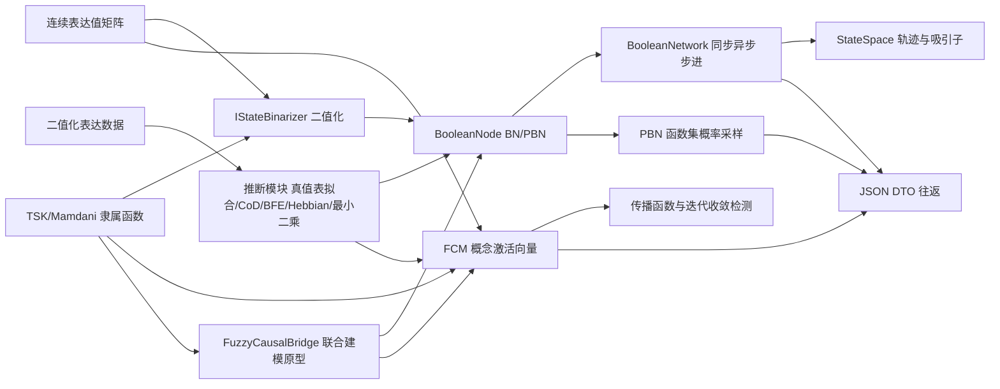

## 用户需求

在指定类库项目中新增布尔网络（BN）、概率布尔网络（PBN）、模糊认知图（FCM）三类建模组件，用于基因表达调控网络建模测试，并提供与现有模糊逻辑网络联合建模的最小可运行原型。所有组件以连续表达值优先接入，节点内部完成二值化或模糊化后给出输出。

## 产品概述

三类组件并列提供：BN 以真值表描述确定性调控逻辑；PBN 在 BN 基础上为每个基因持有多套布尔函数及选择概率并按概率采样；FCM 以加权有向图描述概念节点间的因果强度与连续激活传播。三者统一支持网络仿真、从表达数据推断结构/参数、JSON 往返，以及与 TSK/Mamdani 的桥接。

## 核心功能

- **BN/PBN 仿真内核**：真值表与布尔函数定义、同步与异步更新、状态轨迹与吸引子/周期检测；PBN 逐基因多函数与概率采样，采样可复现。
- **FCM 仿真内核**：概念节点、加权邻接矩阵、多种传播函数（Sigmoid、二值、分段线性）、加权迭代与收敛/极限环检测。
- **连续值接入**：固定阈值二值化与基于隶属函数的模糊二值化；FCM 直接接受连续激活值并复用 TSK 隶属函数。
- **表达数据推断**：BN 真值表拟合、PBN 的 CoD 与 Best-Fit Extension、FCM 权重的 Hebbian 与最小二乘学习。
- **持久化**：三类网络结构与参数 JSON 往返，含格式版本与严格校验。
- **联合建模原型**：TSK/Mamdani 连续输出经模糊化后进入 FCM 传播，再二值化驱动 BN/PBN，布尔状态反馈为模糊规则触发强度。
- **控制台自检**：记录断言并生成 JSON 测试报告，覆盖上述能力。

## 技术栈选择

- 语言与框架：VB.NET、`net10.0` SDK 风格类库，沿用 `FuzzyLogic.vbproj`（SDK 自动包含新增 `.vb`，无需改动编译项）。
- 新增命名空间：`Microsoft.VisualBasic.DataMining.FuzzyLogic.BooleanNetworks`（BN/PBN）、`.FuzzyCognitiveMaps`（FCM）、`.Hybrid`（联合建模桥接），与现有 `TSK`、`Logical.FuzzyLogic` 并列。
- JSON：沿用 TSK 的 DTO 模式（`formatVersion` 字段 + `Microsoft.VisualBasic.Serialization.JSON` 的 `LoadJSON(Of TDto)` / `ToJsonDto` / `FromModelDto`）。
- 模糊化复用：直接复用 `TSK.IMembershipFunction` 与 `MembershipFactory`，不重复实现隶属函数。
- 数值/拟合：复用既有项目引用——`Math.NET5.vbproj`（矩阵/线性代数）、`linear-netcore5.vbproj`（最小二乘）、`stats-netcore5.vbproj`，不新增引用。
- 测试：扩展 `_smoketest` 独立控制台工程，使用 `Microsoft.VisualBasic.ApplicationServices.Debugging.DebugAudit` 的 `Test`、`Require`、`Snapshot`、`SaveReport` 记录断言并输出 JSON 报告。

## 实现思路

以"真值表位掩码 + 节点包装 + 统一状态步进器"作为 BN 与 PBN 的共同底座：BN 是每基因单函数、概率为 1 的特例；PBN 在节点上扩展为"函数集合 + 选择概率 + 采样器"。FCM 另起一套基于 `Double(,)` 加权邻接矩阵的传播内核，逐步计算 `c_i(t+1) = f(Σ_j w_ji·c_j(t))` 并检测收敛或极限环。三者通过可插拔的二值化器/激活函数解耦连续值与离散逻辑。联合建模通过 `FuzzyCausalBridge` 串联 TSK 模糊化 → FCM 连续传播 → 二值化 → BN/PBN 步进，并把布尔状态映射为模糊规则触发强度，不改动现有 TSK/Mamdani 内部语义。

### 关键决策与权衡

- 真值表用 `ULong` 位掩码存储（`k` 个父节点占 `2^k` 位），单步求值 O(1)；默认 `maxParents=20`，超限回退 `BitArray` 避免组合爆炸。
- 网络状态在基因数不超过 64 时编码为 `ULong`，吸引子检测用"状态→首次步数"字典，时间 O(步数)、空间 O(已访问状态数)，不枚举全局状态图。
- PBN 与推断随机源采用 `<ThreadStatic>` 共享的种子化 `Random`，兼顾可复现与并发，避开"每网络一个 ThreadLocal 槽位"在 `TskNetwork.vb` 注释中已被实测证伪的做法。
- FCM 传播用 `Double(,)` 邻接矩阵乘 `Double()` 激活向量，复杂度 O(n²) 每步；迭代设最大步数与收敛阈值，避免不收敛死循环。
- 推断复杂度约 O(n × C(n,k) × 2^k × 样本数)，通过 `maxParents`（默认 4 至 5）、父集剪枝与早停控制规模；FCM 权重学习复用线性最小二乘与 Hebbian 增量更新两条路径。
- 联合建模仅在 `Hybrid` 桥接层实现最小示例，避免触碰 TSK/Mamdani 内核，控制波及范围。

### 性能与可靠性

- 逐步更新只重算受影响基因；提供可复用的单步工作区缓冲（`<ThreadStatic>`）避免每步分配，与 `TskNetwork` 的稳态迭代性能约定一致。
- 严格校验：基因/概念节点数、父节点上界、概率非负且和为 1、真值表长度必须为 `2^k`、邻接矩阵为方阵、激活值域与阈值合法。
- 推断与采样均支持显式种子；测试用固定种子保证可重复。

## 实现注意

- 新文件统一 `Option Strict On` + `Option Explicit On` + XML 文档注释，遵循现有命名与缩进风格。
- 库内不直接打印日志；断言经 DebugAudit 事件记录，避免大规模状态转储，报告写入 `_smoketest/results/`。
- 保持向后兼容：不修改现有 TSK/Mamdani 公共 API，`_smoketest\**` 的编译排除规则不变。
- 桥接层独立成 `Hybrid` 命名空间，原计划的 `FuzzyBooleanBridge` 职责上移至此并扩展覆盖 FCM，BN/PBN 核心设计保持不变。

## 架构设计



## 目录结构

```text
G:/pixelArtist/src/framework/Data_science/DataMining/FuzzyLogic/
├── BooleanNetworks/                              # [NEW] BN/PBN 组件，命名空间 ...FuzzyLogic.BooleanNetworks
│   ├── NamespaceDoc.vb                           # [NEW] 命名空间说明与连续值优先约定
│   ├── IBooleanRule.vb                           # [NEW] 布尔规则求值接口与 BooleanRuleKind 枚举，作为扩展点
│   ├── BooleanTruthTable.vb                      # [NEW] ULong 位掩码真值表：长度校验、按输入求值、And/Or/Not 组合、BitArray 回退
│   ├── BinarizationStrategy.vb                   # [NEW] 固定阈值与复用 TSK.IMembershipFunction 的模糊二值化，实现 IStateBinarizer
│   ├── BooleanNode.vb                            # [NEW] 基因节点：父节点索引、规则或规则集、连续输入二值化与布尔输出
│   ├── BooleanNetwork.vb                         # [NEW] BN：同步/异步步进、多步轨迹、只重算受影响基因、工作区复用
│   ├── ProbabilisticBooleanNetwork.vb            # [NEW] PBN：逐基因函数集与选择概率、种子化采样、更新语义与 BN 对齐
│   ├── StateSpace.vb                             # [NEW] 状态编码解码、轨迹记录、访问步数字典与吸引子/周期检测
│   ├── BooleanNetworkInference.vb                # [NEW] BN 推断：枚举父节点组合、多数投票拟合真值表、一致性计分
│   ├── PbnInference.vb                           # [NEW] PBN 推断：CoD 计算、Best-Fit Extension 缺失值处理、函数选择概率估计
│   └── BooleanNetworkDto.vb                      # [NEW] BN/PBN 的 JSON DTO 与 ToJson/FromJson/FromModelDto，含 formatVersion 与校验
├── FuzzyCognitiveMaps/                           # [NEW] FCM 组件，命名空间 ...FuzzyLogic.FuzzyCognitiveMaps
│   ├── NamespaceDoc.vb                           # [NEW] 命名空间说明，标注与 TSK 及 BN/PBN 的关系
│   ├── IActivationFunction.vb                    # [NEW] 激活/传播函数接口，定义值域与 Evaluate 契约
│   ├── ActivationFunctions.vb                    # [NEW] Sigmoid、二值、分段线性实现，可复用 TSK 隶属函数
│   ├── FcmConcept.vb                             # [NEW] 概念节点：名称、初始激活值、入边权重集合
│   ├── FuzzyCognitiveMap.vb                      # [NEW] FCM 内核：加权邻接矩阵、同步迭代、收敛与极限环检测、状态轨迹
│   ├── FcmInference.vb                           # [NEW] 权重写习：Hebbian 增量与复用 linear-netcore5 的最小二乘，缺失值跳过
│   └── FcmDto.vb                                 # [NEW] FCM 的 JSON DTO 与往返、formatVersion 与方阵校验
├── Hybrid/                                       # [NEW] 联合建模原型，命名空间 ...FuzzyLogic.Hybrid
│   ├── NamespaceDoc.vb                           # [NEW] 联合建模职责与数据流说明
│   └── FuzzyCausalBridge.vb                      # [NEW] 串联 TSK/Mamdani 模糊化 → FCM 传播 → 二值化 → BN/PBN，并回传模糊触发强度
├── _smoketest/
│   ├── Program.BooleanNetworks.vb                # [NEW] BN/PBN 自检：真值表、同步异步、吸引子、PBN 可复现、推断、JSON 往返
│   ├── Program.FuzzyCognitiveMaps.vb             # [NEW] FCM 自检：激活函数、迭代收敛、权重学习、JSON 往返
│   ├── Program.Hybrid.vb                         # [NEW] 联合建模自检：连续到模糊到布尔全链路与状态反馈
│   └── Program.vb                                # [MODIFY] Main 调用新增自检入口，汇总 DebugAudit.FailureCount 并返回退出码
├── README.md                                     # [MODIFY] 新增 BN/PBN、FCM、联合建模三章：命名空间、用法、推断、持久化、自检报告路径
└── FuzzyLogic.vbproj                             # [NO CHANGE] SDK 自动包含新增 .vb，编译项无需修改
```

## 关键代码结构

```
Public Interface IBooleanRule
    ReadOnly Property InputCount As Integer
    Function Evaluate(inputs As Boolean()) As Boolean
    Function ToTruthTable() As Boolean()
End Interface

Public Interface IStateBinarizer
    Function Binarize(value As Double) As Boolean
    Function BinarizeRow(values As Double()) As Boolean()
End Interface

Public Interface IActivationFunction
    ReadOnly Property LowerBound As Double
    ReadOnly Property UpperBound As Double
    Function Evaluate(value As Double) As Double
End Interface
```

## Agent Extensions

### SubAgent

- **code-explorer**
- Purpose：在实现前以 medium 深度核查 TSK/Mamdani 公共 API 契约、`Microsoft.VisualBasic.Serialization.JSON` 的 DTO 用法、`DebugAudit` 断言与报告接口、`_smoketest` 入口约定及是否存在命名冲突。
- Expected outcome：产出已核实的接入点清单（类型全名、方法签名、调用位置），使三大组件核心实现无需返工。