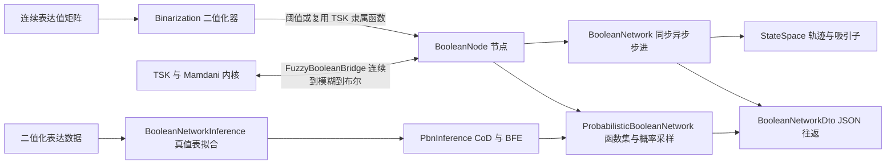

## 产品概述

在现有 `FuzzyLogic.vbproj` 类库中新增布尔网络（BN）与概率布尔网络（PBN）两套组件，用于基因表达调控网络的建模与测试，并提供与现有模糊逻辑网络（TSK / Mamdani）联合建模的最小可运行原型。组件面向连续表达值输入，节点内部完成二值化后给出布尔输出。

## 核心功能

- **BN / PBN 仿真内核**：真值表与布尔函数定义、同步与异步状态更新、状态轨迹记录、吸引子与周期检测；PBN 支持每个基因持有多套布尔函数及对应选择概率并按概率采样。
- **连续表达值接入**：节点直接接受连续表达值，支持阈值二值化与基于隶属函数的模糊二值化两种方式。
- **表达数据推断**：基于二值化表达矩阵拟合 BN 真值表；实现 PBN 的 CoD（变化系数）与 Best-Fit Extension 估计调控关系和函数选择概率。
- **持久化**：BN / PBN 结构与参数支持 JSON 往返，便于实验保存与复现。
- **联合建模原型**：提供连续 → 模糊 → 布尔的桥接，复用 TSK 隶属函数完成模糊化，并把布尔状态反馈给模糊规则，形成可运行示例。
- **控制台自检**：使用 DebugAudit 记录断言并生成 JSON 测试报告，覆盖上述能力。

## 技术栈

- 语言与框架：VB.NET、`net10.0` SDK 风格类库，沿用 `FuzzyLogic.vbproj`（无需改动工程文件的编译项，新增 `.vb` 由 SDK 自动包含）。
- 新增命名空间：`Microsoft.VisualBasic.DataMining.FuzzyLogic.BooleanNetworks`，与现有 `TSK`、`Logical.FuzzyLogic` 并列。
- JSON：沿用 TSK 的 DTO 模式（`formatVersion` 字段 + `Microsoft.VisualBasic.Serialization.JSON` 的 `LoadJSON(Of TDto)` / `ToJsonDto` / `FromModelDto`）。
- 模糊化复用：直接复用 `TSK.IMembershipFunction` 与 `MembershipFactory`，不重复实现隶属函数。
- 测试：扩展 `_smoketest` 独立控制台工程，使用 `Microsoft.VisualBasic.ApplicationServices.Debugging.DebugAudit` 的 `Test`、`AreEqual`、`Mark`、`SaveReport` 记录断言并输出报告。

## 实现思路

以“真值表位掩码 + 节点包装 + 统一状态步进器”作为 BN 与 PBN 的共同底座：BN 是每基因单函数、概率为 1 的特例；PBN 在节点上扩展为“函数集合 + 选择概率 + 采样器”，从而最大化代码复用。连续表达值经可插拔二值化器转为布尔状态。推断模块逐基因枚举有限的父节点组合，以多数投票拟合真值表并计算 CoD，缺失值用 Best-Fit Extension 跳过。联合建模原型通过接口把 TSK/Mamdani 的连续输出接入布尔网络，并把布尔状态映射为模糊规则触发强度，不改动现有推理语义。

### 关键决策与权衡

- 真值表用 `ULong` 位掩码存储（`k` 个父节点占 `2^k` 位），单步求值 O(1)；限制最大父节点数（默认 20）避免组合爆炸，超限改用 `BitArray` 回退。
- 网络状态在基因数不超过 64 时编码为 `ULong`，吸引子检测用步数字典记录访问状态，时间复杂度 O(步数)、空间 O(已访问状态数)，避免枚举全局状态图。
- PBN 随机源采用按线程共享的种子化 `Random`（`ThreadStatic`），兼顾可复现与并发，避免“每网络一个 ThreadLocal 槽位”被实测证伪的做法（与 `TskNetwork.vb` 注释中的性能教训一致）。
- 推断复杂度约为 O(n × C(n,k) × 2^k × 样本数)，通过限制 `maxParents`（默认 4 到 5）、剪枝与早停控制规模；不做全组合穷举。
- 联合建模仅在桥接层实现最小示例，避免触碰 TSK / Mamdani 内部逻辑，控制改动波及范围。

### 性能与可靠性

- 逐步更新只重算受影响基因；提供可复用的单步工作区缓冲（`ThreadStatic`）避免每步分配。
- 严格校验：基因数、父节点数上界，概率非负且和为 1，真值表长度必须为 `2^k`，二值化阈值与输入范围合法。
- 吸引子分析设置最大步数上限，防止不收敛场景死循环。

## 实现注意

- 新文件统一 `Option Strict On` + `Option Explicit On` + XML 文档注释，遵循现有命名与缩进风格。
- 库内不直接打印日志；测试断言通过 DebugAudit 事件记录，避免大规模状态转储（缓冲区默认 256 条），报告写入 `_smoketest/results/`。
- 保持向后兼容：不修改现有 TSK / Mamdani 公共 API，`_smoketest\**` 的编译排除规则保持不变。
- AI 与 Reproducibility：PBN 与推断的随机采样均支持显式传入种子，测试使用固定种子保证可重复。

## 架构设计

下图展示新增组件与现有模糊逻辑内核的关系：



## 目录结构

本次改动集中在新增 `BooleanNetworks` 目录、扩展 `_smoketest` 与更新文档。

```
G:/pixelArtist/src/framework/Data_science/DataMining/FuzzyLogic/
├── BooleanNetworks/                                  # [NEW] 布尔网络组件目录，命名空间 Microsoft.VisualBasic.DataMining.FuzzyLogic.BooleanNetworks
│   ├── NamespaceDoc.vb                               # [NEW] 命名空间说明，标注与 TSK、Mamdani 的关系及连续值优先约定
│   ├── IBooleanRule.vb                               # [NEW] 布尔规则求值接口与 BooleanRuleKind 枚举，作为 BN/PBN 与桥接层的扩展点
│   ├── BooleanTruthTable.vb                          # [NEW] 真值表位掩码实现：按父节点数校验长度、按输入位求值、And/Or/Not 组合、ToString 展示
│   ├── BinarizationStrategy.vb                       # [NEW] 二值化策略：固定阈值、以及复用 TSK.IMembershipFunction 的模糊隶属度阈值化，输出布尔状态
│   ├── BooleanNode.vb                                # [NEW] 基因节点：名称、父节点索引、规则或规则集合、连续输入读取与二值化、输出布尔值
│   ├── BooleanNetwork.vb                             # [NEW] BN：同步与异步单步、多步轨迹、状态读写、只重算受影响基因、单步工作区复用
│   ├── ProbabilisticBooleanNetwork.vb                # [NEW] PBN：逐基因函数集合与选择概率、按种子采样、同步与异步更新语义与 BN 对齐
│   ├── StateSpace.vb                                 # [NEW] 状态编码解码、轨迹记录、访问步数字典与吸引子及周期检测（含最大步数上限）
│   ├── BooleanNetworkInference.vb                    # [NEW] BN 推断：二值化表达矩阵上枚举父节点组合、多数投票拟合真值表、一致性计分
│   ├── PbnInference.vb                               # [NEW] PBN 推断：CoD 计算、Best-Fit Extension 处理缺失值、逐基因函数选择概率估计
│   ├── BooleanNetworkDto.vb                          # [NEW] BN/PBN 的 JSON 传输对象；ToJsonDto、ToJson、FromJson、FromModelDto，含 formatVersion 与严格校验
│   └── FuzzyBooleanBridge.vb                         # [NEW] 联合建模最小原型：TSK/Mamdani 连续输出经隶属函数模糊化后布尔化，并将布尔状态反馈为模糊规则触发强度
├── _smoketest/
│   ├── Program.BooleanNetworks.vb                    # [NEW] BN/PBN 自检章节：真值表、同步异步、吸引子、PBN 采样可复现、推断、JSON 往返、模糊桥接；全部用 DebugAudit 断言并 SaveReport
│   └── Program.vb                                    # [MODIFY] 在 Main 中调用新增自检入口，汇总 DebugAudit.FailureCount 并返回退出码
├── README.md                                         # [MODIFY] 增加 BooleanNetworks 章节：命名空间、BN/PBN 用法、推断与持久化示例、模糊联合建模原型说明、自检与报告路径
└── FuzzyLogic.vbproj                                 # [NO CHANGE] SDK 风格自动包含新增 .vb，已确认无需修改编译项
```

## 关键代码结构

以下接口是 BN/PBN 内核与模糊桥接层之间最关键的契约：

```
Public Interface IBooleanRule
    ReadOnly Property InputCount As Integer
    Function Evaluate(inputs As Boolean()) As Boolean
    Function ToTruthTable() As Boolean()
End Interface

Public Interface IStateBinarizer
    Function Binarize(value As Double) As Boolean
    Function BinarizeRow(values As Double()) As Boolean()
End Interface
```

## 子代理

- **code-explorer**
- Purpose：在实现前以 medium 深度核查 TSK/Mamdani 的公共 API 契约、`Serialization.JSON` 用法和 `_smoketest` 入口约定，确认新增类型无命名冲突并定位精确接入点。
- Expected outcome：产出一份已核实的接入点清单（类型全名、方法签名、调用位置），使核心实现无需返工。