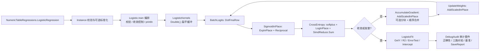

## 用户要求

审查并修复指定目录中逻辑回归实现的准确性问题，识别性能优化空间，并复用核心代码库既有的向量化与并行能力对训练热路径进行加速；采纳首轮审查给出的全部建议，先产出可执行的开发计划，再按计划分阶段落地。

## 产品概述

一个用于二分类建模的拟合模块：接收带 0/1 标签的样本表，输出可解释、可复现的拟合结果与正类概率预测，并附带正确性审计、数值对拍与性能基准报告。修复后所有预测入口语义一致，训练具备收敛控制与异常输入防护，评估结果真实反映拟合质量，且保持既有调用方可编译、可运行。

## 核心功能

- 统一概率输出：模型各预测入口返回同一正类概率，拟合误差记录与概率语义一致
- 正确的损失与评估：数值稳定的交叉熵成本、随训练变化的质量指标，替代恒为 1 的伪指标
- 稳健训练：标签与特征校验、可选截距、标准化参数在训练与推理间复用、收敛早停与发散防护
- 加速与可复现：向量化训练内核、可关闭的分块并行、确定性归约，标量/向量化/并行三路结果数值对拍
- 可验证交付：正确性断言、梯度有限差分检验、耗时基准数据，以及自动生成的测试报告

## 技术栈选型

- **语言与运行时**：VB.NET，目标框架 `net10.0`（沿用 `linear-netcore5.vbproj`、`_smoketest/smoketest.vbproj`、`test/test.vbproj` 的既有配置）。
- **既有程序集与命名空间**：`Microsoft.VisualBasic.Data.Bootstrapping`（根命名空间）、`Microsoft.VisualBasic.Data.Bootstrapping.Logistic`、`Microsoft.VisualBasic.Math.LinearAlgebra`（`Vector`、`NumericMatrix`）、`Microsoft.VisualBasic.Math.SIMD`（`SimdEngine`、`SimdMath`、`SimdReduce`、`SimdParallel`、`SIMDIntrinsics`、`SIMDEnvironment`）、`Microsoft.VisualBasic.ApplicationServices.Debugging.DebugAudit`。
- **依赖现状**：`linear-netcore5.vbproj` 第 203-204 行已直接引用 `Core.vbproj` 与 `Math.NET5.vbproj`，同项目 `LASSO/LassoFitGenerator.vb` 第 62 行已有 `Imports Microsoft.VisualBasic.Math.SIMD`，因此**无需新增 NuGet 包或程序集引用**；仅 `_smoketest/smoketest.vbproj` 建议补一条显式 `Core.vbproj` 引用，保证 console 审计程序确定可用 `DebugAudit`。
- **项目约定**：SDK 风格默认包含 `*.vb`（`linear-netcore5.vbproj` 仅 `Compile Remove` 了 `Test\**` 与 `_smoketest\**`），新增 `Logistic/LogisticKernels.vb` 与 `_smoketest/LogisticAudit.vb` 会被自动编译；`_smoketest/Program.vb` 的 `Sub Main` 是自检入口，`test/Program.vb` 是另一处独立 console 入口。

## 实现思路

**总体策略**：先建立可执行的正确性基线（审计测试 + 数值基准），再以最小改动修复数学缺陷，随后按「算法层 → 单线程向量化 → 可选分块并行」顺序优化；每一层都用同一组数据与 `DebugAudit` 断言验收，保证任何一层可单独回退。

**关键技术决策与权衡**：

1. **保持公共 API 源码级兼容**。`train`、`predict`、`GetY`、`R2`、`Polynomial.Factors`、`LogisticRegression(...)` 签名保留；内部统一收敛到一个 `PredictProbability(x)` 单一实现。理由：`ML_SHAP` 与表入口是既有调用方，改签名会放大影响面；`R2` 只换实现不换名字以满足 `IFitted`。
2. **截距作为独立标量而非额外特征列**。`Logistic` 新增 `Intercept` 标量（梯度为 `Σdelta/m`），`Polynomial.Factors` 仍为 d 个系数，`GetY` 计算 `σ(w·x + b)`。理由：若把 bias 插成一列，`Factors` 长度变成 d+1 会破坏 `IFitted.GetY` 与 `LinearShapModel.Coefficients` 的长度契约；独立标量还能让 SHAP 解析公式继续成立。
3. **删除 `computeCost(NumericMatrix)` 与 `sigmoid(NumericMatrix)`**，改为基于 `Double()` 的稳定形式。理由：`NumericMatrix` 的 `*` 是逐元素乘（`NumericMatrix.vb:1464-1466`），`Operator ^(Double, NumericMatrix)` 把操作数写反（`1427-1430`，会把 `E^(-z)` 算成 `(-z)^E`），且该方法全仓库无调用点；修外部矩阵类型属于无关重构，规避即可。
4. **一次性扁平化为 `Double(,)` 行主序连续内存**，配合 `SIMDIntrinsics.DotFmaRow`。理由：现有 `Double()()` 锯齿数组每行一次指针追逐；`Intrinsics.vb:252-260` 已说明项目 `Optimize=false` → JIT MinOpts、私有包装不内联，而 `DotFmaRow` 在循环体内直接 `LoadUnsafe`，实测更优。权衡：一次 O(m·d) 拷贝，摊到数千轮迭代可忽略。
5. **批量 sigmoid 走 `SimdMath.ExpInPlace` 而非 `SimdMath.Exp`**。前者是 AVX2+FMA 多项式真向量化（`SimdMath.vb:536-560`），后者只是标量 `Math.Exp` 循环（`430-443`）。流程为「写入 `-z` → `ExpInPlace` → `AddScalarInPlace(1)` → `SimdMath.Reciprocal`」。权衡：多项式截断误差约 1e-18 且输入被夹在 [-700,700]，对 sigmoid 饱和区结果无影响；对拍容差放宽到 1e-12。
6. **梯度累加直接用 `SimdEngine.AddScaledInPlace(delta, xi, gradient)`**。其语义 `acc += scalar * v` 与 `gradient(j) += delta * xi(j)` 完全匹配，内部转 `SIMDIntrinsics.AxpyInPlace` 单指令 FMA，无需自造内核。
7. **并行默认关闭、按工作量自适应启用**。每块一份独立 `Double(d)` 局部梯度，块内串行向量化，块尾**按块号顺序** `SimdEngine.AddInPlace` 合并 → 消除写冲突并固定归约次序，保证可复现。阈值按 `约 200000 / d` 估算，而非直接用 `SimdParallel` 的 `MinParallelLength=65536` / `ShouldParallelize`（需 len 不小于 131072）/ `ForRange` 默认 `minLength=4096`。
8. **算法层优先于指令层**。稳定 sigmoid、稳定 `softplus` 成本、收敛早停、特征标准化带来的迭代数下降通常达 1~2 个数量级，收益大于向量化的常数因子加速；固定 3000 轮与 `ALPHA=0.0001` 的既有行为通过可选参数保留。
9. **可复现性**：主路径只用 `SimdReduce` 的顺序内核；`SIMDConfiguration.disable` 与 `SimdParallel.Enable = False` 仅作为测试中的对照开关，不改全局默认值。这与 `Vectorized.vb:93-95` 的既有取舍一致。

**性能与可靠性**：单轮 O(m·d) 两遍 + O(d) 清零/更新，总计 O(T·m·d)，T 由早停显著下降；额外内存 O(m·d + d + 块数·d)，全部缓冲区在循环外预分配并复用，避免每轮 GC。瓶颈为超越函数与内存带宽；当 d 小于 16（`SimdReduce` 的 SIMD 门槛 `4 * Vector(Of Double).Count`）时保留标量快路径，避免 `T·m` 次函数调用反而变慢；不引入嵌套并行。复杂度最坏情形为完全不可分数据跑满 `ITERATIONS`，由 `Tolerance`/`MaxIterations` 与 NaN 检测兜底。

## 执行要点（Implementation Notes）

- **复用既有约定**：`Imports Microsoft.VisualBasic.Math.SIMD` 照 `LASSO` 先例；测试用 `DebugAudit.Test` / `AreEqual` / `CheckThrows` / `Watch(logOnExit:=False)` / `Mark` / `SaveReport`，**不要用** `<Conditional("DEBUG")>` 的 `Check`（Release 下会被消除）；`DebugAudit` 位于 `Core.vbproj` 的 `ApplicationServices\Debugger\DebugAudit.vb`。
- **影响面控制**：`ZScore(data, size)` 保留兼容重载，新增返回新数组并带出均值/标准差的重载；`Instance(label As Integer, ...)` 构造器保留，仅去除表入口的 `CInt` 转换；`NumericTableRegressions.LogisticRegression` 新增可选参数放在参数表末尾；`ML_SHAP/Models/LinearShapModel.vb` 仅把分类分支的 `.Intercept = 0` 同步为 `fit.Intercept`，不重构 SHAP 逻辑。
- **数值稳定**：sigmoid 用分段形式避免溢出；成本用 `max(z,0) - y*z + log(1 + exp(-|z|))`，杜绝 `log(0)`；`SimdMath.LogInPlace` 要求全正数，而 `1 + exp(-|z|)` 落在 [1,2] 满足契约；常量列标准差为 0 时标准化结果置 0；每轮检测 NaN/Inf 并中止训练。
- **标准化契约**：`Standardization`（均值/标准差）由 `Instance.ZScore` 产出、由 `LogisticFit` 持有、`GetY` 与 `predict` 必须先对输入应用同一变换；表入口默认关闭标准化，避免 `Polynomial.Factors` 变成标准化空间系数而破坏 SHAP 的 `phi = bi * (xi - E[xi])`。
- **对拍与精度**：用 `SIMDEnvironment.config = disable` 得标量基线、`SimdParallel.Enable = False` 得纯 SIMD 基线；三路权重偏差目标小于 1e-10、预测偏差小于 1e-12；明确接受 ULP 级差异（`SimdParallel.vb:85-87`）。
- **日志与输出**：把既有死字段 `println` 接上成本输出，但按固定轮数间隔采样，禁止打印特征/标签明细；`DebugAudit.Watch` 分别记录标量、SIMD、SIMD+Parallel 三段耗时，`SaveReport` 输出 JSON 报告，以 `FailureCount = 0` 决定 `Environment.ExitCode`。

## 架构设计

保持现有分层：表适配层 → 训练核心 → `IFitted` 模型 → 审计层，不引入新架构模式；新增 `LogisticKernels` 为 `Friend` 内部类，只承载可复用数值内核，不扩大公共 API。



数据流：`NumericTable` → `Instance()` → 扁平 `X(,)` 与 `labels()` → 每轮 `z → h → J → delta → grad → w,b` → `theta` → `LogisticFit`；`Standardization` 在 `LogisticFit` 与 `predict` 之间共享，确保训练/推理一致。

## 目录结构

以下列出全部将创建、修改或受影响的文件（路径相对工作区 `g:/GCModeller/src/runtime/sciBASIC#/Data_science/`）。

```
g:/GCModeller/src/runtime/sciBASIC#/Data_science/
├── Mathematica/Math/DataFittings/
│   ├── Logistic/
│   │   ├── Logistic.vb                  # [MODIFY] 公共 API 与编排层。保留 train/predict 签名；新增 Intercept、Tolerance、UseParallel、FitIntercept 等属性；sigmoid(Double) 改稳定分段 Math.Exp；删除 NumericMatrix 版 sigmoid 与错误 computeCost，改由内核提供稳定交叉熵；train 增加空集/标签 0-1/特征等长/dims 校验、偏置梯度、每轮成本与早停、NaN 检测、println 采样输出；predict 统一返回正类概率并先应用 Standardization；无参构造下 theta 为空时给出明确异常。
│   │   ├── LogisticKernels.vb           # [NEW] Friend 数值内核。负责 Double()() 到 Double(,) 扁平化、批量 logits（DotFmaRow，d 小于 16 走标量）、批量 sigmoid（ExpInPlace + AddScalarInPlace + Reciprocal）、稳定 softplus 成本（LogInPlace + SimdReduce.Sum）、梯度累加（AddScaledInPlace，可选分块局部缓冲 + 按块号顺序合并）、权重/偏置更新；全部缓冲区由调用方持有并复用，内部不分配大数组、不做嵌套并行。
│   │   ├── LogisticFit.vb               # [MODIFY] IFitted 适配。新增 Intercept 与 Standardization 属性；GetY 改为共用 PredictProbability（先标准化再 SimdReduce.Dot + bias），并校验 x 长度；R2 由 ErrorTest 计算为真实指标（log-loss/McFadden 或准确率映射），不再硬编码 1；CreateFit 改为预分配数组的 For 循环填充 IFitError()，Yfit 与 GetY 取同一函数，移除两层 LINQ 与 DirectCast 链。
│   │   ├── Instance.vb                  # [MODIFY] 样本与预处理。ZScore 保留 (data, size) 兼容重载，新增返回新数组且不修改输入、同时带出均值/标准差的重载；size 由 featureSize 推导并校验，常量列标准差为 0 时结果置 0；新增共享的 Standardization 结构与标签校验辅助；Load 保持不变。
│   │   └── NamespaceDoc.vb              # [MODIFY] 补充标签契约、概率语义、截距与标准化约定、并行可复现性说明。
│   ├── NumericTableRegressions.vb       # [MODIFY] 表入口 LogisticRegression。移除 CInt(yv(i))，直接传 Double 标签；末尾追加可选 fitIntercept、standardize、useParallel、tolerance 参数并转交模型；补充 XML 文档说明「不加 bias 列时决策面过原点」及启用标准化对系数解释性的影响；沿用 LogisticNS 别名。
│   └── _smoketest/
│       ├── Program.vb                   # [MODIFY] 自检入口。把 307-311 行的「仅断言非 Nothing」升级为数值断言（三路概率一致、正类概率大于 0.5、准确率阈值）；调用 LogisticAudit.Run() 并合并到 failures/ExitCode；BuildLogisticTable 保留。
│       ├── LogisticAudit.vb             # [NEW] DebugAudit 审计与基准套件（console）。包含梯度有限差分检验（eps=1e-6、相对误差小于 1e-6）、线性可分数据准确率、成本单调下降、三路概率一致性、ErrorTest 与 GetY 一致、边界 CheckThrows、ZScore 契约、标量/SIMD/SIMD+Parallel 三路权重与预测对拍；用 Watch 记录三段耗时、Mark/Snapshot 记录关键量、SaveReport 生成 JSON 报告，返回失败数。
│       └── smoketest.vbproj             # [MODIFY] 增加一条显式 Core.vbproj ProjectReference，确保 DebugAudit 在 console 审计程序中确定可用（不依赖传递编译资产）。
└── MachineLearning/ML_SHAP/Models/
    └── LinearShapModel.vb               # [MODIFY] 分类分支把 .Intercept = 0 改为 .Intercept = fit.Intercept；验证 Polynomial.Factors 长度仍等于特征数、Link=Sigmoid 与 GetY 的概率输出不存在重复 sigmoid；其余逻辑不动。
```

**受影响但不修改（只读核对）**：`DataFittings/Linear/IFitted.vb`、`DataFittings/TestPoint.vb`、`DataFittings/Linear/MLR/Error.vb`、`Mathematica/Math/Math/Algebra/Polynomial/Formula.vb`、`Mathematica/Math/Math/Algebra/Matrix.NET/NumericMatrix.vb`（外部 `^` 重载缺陷仅规避）、`Mathematica/Math/Math/Algebra/Vector/Models/Vector.vb`、`Mathematica/Math/Math/Distributions/pnorm.vb`、`DataFittings/test/Program.vb`（保留其独立 demo 入口）、`Microsoft.VisualBasic.Core/src/Math/SIMD/` 下全部内核文件、`Microsoft.VisualBasic.Core/src/ApplicationServices/Debugger/DebugAudit.vb`（用户规则指定的测试报告模块）。

## 关键代码结构

仅定义跨模块共享的两处契约，避免实现期出现签名分歧：

```
Namespace Logistic

    ''' <summary>按列标准化参数，训练与推理必须共用同一份</summary>
    Public Structure Standardization
        Public Property Means As Double()
        Public Property Sds As Double()
        Public ReadOnly Property IsEmpty As Boolean
        Public Function Apply(x As Double()) As Double()
    End Structure

    ''' <summary>向量化训练内核；缓冲区由 Logistic 持有，避免每轮分配</summary>
    Friend NotInheritable Class LogisticKernels
        Friend Shared Function Flatten(features As Double()()) As Double(,)
        Friend Shared Sub BatchLogits(x As Double(,), weights As Double(), bias As Double, z As Double())
        Friend Shared Sub SigmoidInPlace(z As Double(), h As Double())
        Friend Shared Function CrossEntropy(z As Double(), labels As Double()) As Double
        Friend Shared Function AccumulateGradient(x As Double(,), delta As Double(),
                                                  gradient As Double(),
                                                  useParallel As Boolean) As Double
        Friend Shared Sub UpdateWeights(weights As Double(), ByRef bias As Double,
                                        gradient As Double(), gradBias As Double,
                                        rate As Double)
    End Class

End Namespace
```

`AccumulateGradient` 的返回值是偏置梯度（`Σdelta`）；`Logistic.train` 负责除以样本数并按 `ALPHA` 缩放。`Standardization.Apply` 在 `IsEmpty` 为真时必须原样返回输入，以保证未开启标准化时行为与旧版完全一致。

## Agent Extensions

### Skill

- **lsp-code-analysis**
- Purpose：在改动公共 API 前，语义化定位 `predict`、`GetY`、`R2`、`LogisticRegression`、`ZScore`、`computeCost`、`Polynomial.Factors` 的定义、引用与实现，确认 `IFitted` 实现类清单与调用层级。
- Expected outcome：产出一份可核对的调用点清单，明确哪些文件必须同步修改、哪些只需回归验证，避免漏改 `ML_SHAP` 等跨项目调用方。

### SubAgent

- **code-explorer**
- Purpose：以 very thorough 级别横扫 `Data_science` 与 `Microsoft.VisualBasic.Core`，核对所有逻辑回归相关引用、`DebugAudit` 在既有 console 测试中的使用范式、`SIMD` 内核的既有调用惯例与分块并行范例（`SimdParallel.PairwiseDistance`）。
- Expected outcome：形成「调用点 + 测试/报告范式 + 可复用内核」三张清单，作为阶段 0 基线与各阶段验收的依据，并确认无遗漏的编译包含规则差异。