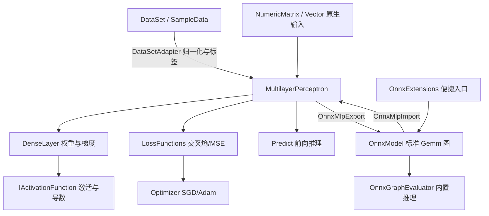

## 用户要求

在 `machine_learning-netcore5.vbproj` 中，基于底层 `LinearAlgebra.Vector` 与 `NumericMatrix` 对象构建多层感知机（MLP）模型，用于分类与回归任务；完成后在 `MLDataStorage.vbproj` 中增加对应的 ONNX 模型文件支持。

## 产品概述

在现有经典机器学习库中补齐全连接深度模型能力，使调用方既能用矩阵/向量原生 API 训练与推理 MLP，也能复用已有的归一化数据集抽象；并让训练好的 MLP 以标准 ONNX 格式落盘、还原与推理，与项目现有 CNN 的 ONNX 体系保持一致。

## 核心功能

- 可配置隐藏层的全连接 MLP，前向计算与反向传播均基于 Vector / NumericMatrix。
- 分类（Softmax + 交叉熵）与回归（恒等 + 均方误差）两种任务模式。
- 复用现有 IActivationFunction 与 ActiveFunction 表达式序列化；提供 SGD/Adam 等优化选项。
- 双入口：矩阵/向量级 API，以及 Fit(DataSet / SampleData) 便捷接口（含归一化与标签对接）。
- ONNX 双向转换：MLP 导出为 Gemm + Relu/Sigmoid/Tanh/Softmax 标准节点图，从 ONNX 还原 MLP。
- 使用现有 OnnxGraphEvaluator 直接对导出的 ONNX 图推理，并保证数值一致。
- 使用 DebugAudit 编写 console 测试并生成报告，不破坏现有 CNN 的 ONNX 行为。

## 技术栈选择

- 语言/框架：VB.NET，SDK-style vbproj，TargetFrameworks=net10.0，沿用两个目标项目现有配置（不新增第三方依赖）。
- 数值基础：`Microsoft.VisualBasic.Math.LinearAlgebra.Vector`（继承 GenericVector(Of Double)）与 `NumericMatrix`（继承 Vector(Of Double())，实现 INumericMatrix/GeneralMatrix）。核实可用运算：`NumericMatrix.New(m,n)`、`New(vals,m)`、`DotProduct(B As GeneralMatrix) As GeneralMatrix`、`DotMultiply(v As Vector) As Vector`、`ArrayPack()`、`Identity`、`random(m,n,...)`、`Zero`、`One`，以及 Vector 的逐元素与聚合运算。
- 激活函数：复用 `ComponentModel.Activations.IActivationFunction`（Default Property Evaluate(x As Double)/(a As Vector)、CalculateDerivative、Store As ActiveFunction）及其 ReLU/Sigmoid/HyperbolicTangent/Identical 等实现，通过 ActiveFunction.Parse 表达式往返。
- 数据集：复用 `ComponentModel.StoreProcedure.DataSet`（PopulateNormalizedSamples、NormalizeMatrix、output）、SampleData（features/labels）、SampleList。
- ONNX 基础设施：复用 `Microsoft.VisualBasic.MachineLearning.DataStorage.ONNX` 下的手写 Proto 类、OnnxTensor、OnnxModel、OnnxExport/OnnxImport 的 Gemm 约定与 OnnxGraphEvaluator（已支持 Gemm/Relu/Tanh/Sigmoid/Softmax/Softplus 等）。序列化仅用现有 Protobuf ProtoSerializer，无需 .proto 文件。

## 实现思路

1) 采用分层结构：全连接层持有权重(NumericMatrix)与偏置(Vector)及其梯度；模型编排层堆叠、损失与优化器；数据集适配器负责 DataSet/SampleData 与 NumericMatrix 的双向转换。前向用矩阵乘，反向用矩阵转置乘与链式法则，逐样本或小批量累加梯度。
2) MLP 的 ONNX 表示采用一维输入 `[1, inSize]` + 逐层 Gemm（transB=1，权重初始化器形状 `[out,in]`，命名 `fcN.weight`/`fcN.bias`）+ 激活节点，输出 Softmax（分类）或直连（回归），与现有 CNN 的 WriteFullyConnected / ReadGemm 约定一致，保证可被外部 ONNX 运行时与内置 evaluator 同时识别。
3) 关键决策：不改动现有 CNN 导出/导入与 Proto 结构，而是新增独立的 MLP 转换模块，避免回归风险；MLP 导出忽略 CNN 专有的 ChannelLastFlatten 选项（一维输入无需展平转置）；分类概率在导出时显式输出 Softmax，使 evaluator 与 MLP.Predict 数值可比。

性能与可靠性：训练主开销为每层矩阵乘，复杂度约每 epoch O(samples × Σ(in×out))；通过一次性把样本装配成 NumericMatrix 批量前向、复用梯度缓冲区、避免 N+1 次小规模分配来降低开销。维度不匹配、空数据、零除与不支持的 ONNX 算子均抛出带明确信息的异常（参照 OnnxUnsupportedOperatorException 风格）。

## 实现说明

- 新增 .vb 放入 SDK-style 项目的常规目录会自动纳入编译；测试文件置于被 `Compile Remove="test\**"` 排除的 test 子目录，走独立 test.vbproj，避免污染主程序集。
- 数值一致性以 Float64 精度比对（阈值可设 1e-9，Float 权重放宽），参照现有 PolicyModels/CNN roundtrip 测试写法。
- 日志/报告统一用 DebugAudit（Reset/Test/AreEqual/Mark/SaveReport/Dump/FailureCount），最终设置 Environment.ExitCode；不在报告中写入敏感数据或大体积张量。
- 保持向后兼容：现有 CNN 的 ToOnnx/ReadCNN 行为与扩展方法签名不变，仅新增 MLP 重载。

## 架构设计



## 目录结构

以 `g:/GCModeller/src/runtime/sciBASIC#/Data_science` 为根：

- MachineLearning/MachineLearning/MultilayerPerceptron/DenseLayer.vb [NEW] 全连接层：权重 NumericMatrix、偏置 Vector、缓存输入/输出/线性值供反向传播；实现前向与梯度计算。
- MachineLearning/MachineLearning/MultilayerPerceptron/LossFunctions.vb [NEW] 交叉熵（配合 Softmax）与均方误差损失及其梯度，分类/回归模式判定。
- MachineLearning/MachineLearning/MultilayerPerceptron/TrainingOptions.vb [NEW] 训练配置：学习率、epoch、批大小、优化器类型（SGD/Adam）、随机种子、收敛阈值。
- MachineLearning/MachineLearning/MultilayerPerceptron/MultilayerPerceptron.vb [NEW] 主模型：层堆叠、Forward/Backward、Fit/Predict（Vector 与 NumericMatrix 重载）、层的权重/激活元数据访问器（供 ONNX 导出）、基于 ActiveFunction 表达式的激活序列化。
- MachineLearning/MachineLearning/MultilayerPerceptron/DataSetAdapter.vb [NEW] DataSet/SampleData 与 NumericMatrix/标签矩阵互转，复用 NormalizeMatrix 与 output 标签名。
- MachineLearning/MachineLearning/MultilayerPerceptron/NamespaceDoc.vb [NEW] 命名空间 XML 文档，与项目现有 NamespaceDoc 风格一致。
- MachineLearning/MachineLearning/test/MlpTest/Program.vb [NEW] 用 DebugAudit 的分类（异或/多类）与回归（线性/非线性）训练收敛及预测测试，生成报告。
- MachineLearning/MLDataStorage/ONNX/OnnxMlpExport.vb [NEW] MLP→OnnxModel：逐层输出 Gemm（transB=1，fcN.weight/fcN.bias 初始化器）+ 激活节点 + Softmax/输出节点；复用 OnnxTensor.ToTensorProto 与 Proto 类。
- MachineLearning/MLDataStorage/ONNX/OnnxMlpImport.vb [NEW] OnnxModel→MLP：解析单输入图，按 Gemm/Relu/Tanh/Sigmoid/Softplus/Softmax/Identity 逐节点还原层与激活；维度校验与不支持算子抛异常。
- MachineLearning/MLDataStorage/ONNX/OnnxExtensions.vb [MODIFY] 新增 MLP 的 SaveOnnx/ToOnnx/ReadMLP/ReadModel 便捷入口（重载，不动现有 CNN 方法）。
- MachineLearning/MLDataStorage/test/Program.vb [MODIFY] 增加 MLP ONNX 往返（Float/Float64）、OnnxGraphEvaluator 与 MLP.Predict 数值一致、外部 Gemm 模型加载到 MLP 的测试，沿用现有报告流程。

## 关键代码结构

```
' MachineLearning: MLP 主模型的核心契约
Public Class MultilayerPerceptron
    Public Sub New(inputSize As Integer, hiddenSizes As Integer(), outputSize As Integer,
                   task As MlpTask, Optional hiddenActivation As ActiveFunction = Nothing)
    Public Function Forward(x As Vector) As Vector
    Public Function Predict(x As NumericMatrix) As NumericMatrix
    Public Sub Fit(x As NumericMatrix, y As NumericMatrix, Optional options As TrainingOptions = Nothing)
    Public Sub Fit(dataset As ComponentModel.StoreProcedure.DataSet, Optional options As TrainingOptions = Nothing)
    Public ReadOnly Property Layers As IReadOnlyList(Of DenseLayer)
End Class
```

```
' MLDataStorage: MLP 与 ONNX 双向转换契约
Public Module OnnxMlpExport
    Public Function ToModel(mlp As MultilayerPerceptron, Optional options As OnnxExportOptions = Nothing) As OnnxModel
End Module
Public Module OnnxMlpImport
    Public Function ToMLP(model As OnnxModel) As MultilayerPerceptron
End Module
```

## Agent Extensions

### SubAgent

- **code-explorer**
- Purpose: 在实现前精确核实 `LinearAlgebra.Vector` 与 `NumericMatrix` 可用于前向/反向传播的运算签名（矩阵乘、转置、逐元素、聚合）以及 SampleData/DataSet 的转换细节与 ONNX Gemm 约定。
- Expected outcome: 产出带文件路径与签名的核对清单，确保 MLP 与 ONNX 转换代码直接调用已存在的 API，不臆造方法。