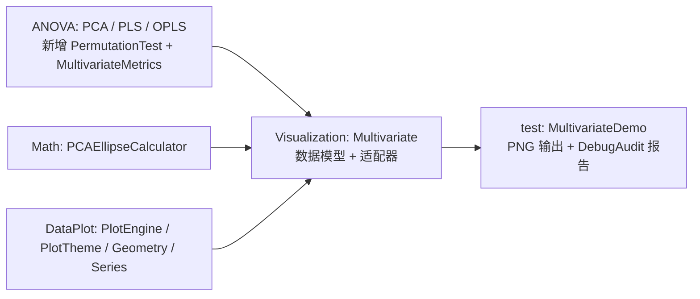

## 用户需求

在现有 sciBASIC 数据分析框架中，为多元统计分析（PCA / PLS-DA / OPLS-DA）结果补齐可视化能力，并补上置换检验这一缺失的统计模块。

## 产品概述

- 统计分析侧（ANOVA 项目）：提供完整的置换检验（permutation test），对响应变量 Y 随机置换 N 次后重跑 PLS/OPLS，逐次记录 R2Y、Q2 与置换相关系数，输出两条回归线的斜率/截距与显著性 p 值，并保留原始分布的缓存结果。
- 可视化侧（Visualization 项目）：新增一组基于统一绘图引擎的多元统计图表类，既可直接传入一次分析结果对象快速出图，也允许手工组装底层数据模型逐层绘制。
- 交付验收：在 test 项目提供可运行的 demo，用合成数据跑完整流程并输出多张 PNG 供人工检查，同时生成自检报告。

## 核心功能

1. 得分图（Score plot）

- 支持 PCA（PC1-PC2）、PLS-DA（T1-T2）、OPLS-DA（预测得分-正交得分）；
- 按分组着色，分组图例自动生成，点标签可选显示样本名；
- 分组置信椭圆：默认 95% 统计置信椭圆（正态/卡方，可切换 t 分布），另提供 k 倍标准差椭圆模式；
- 坐标轴标题自动附带该成分的解释方差百分比。

2. 碎石图/方差解释图

- 各成分贡献率柱状 + 累计贡献率折线（双信息叠加），支持成分名自定义与阈值参考线。

3. 载荷图与双标图

- PC1-PC2（或指定成分对）载荷散点 + 变量名标注，高载荷变量突出显示；
- 可选把得分点按缩放因子叠加，形成 biplot。

4. OPLS-DA S-plot 与 VIP/系数图

- S-plot：p(1) 对 p(corr) 散点，突出两端变量，带显著性参考线；
- VIP 条形图（可切换为回归系数条形图），VIP 大于 1 的变量用强调色与阈值线标示。

5. 置换检验图

- 横轴为置换相关系数、纵轴为 R2Y/Q2，双色散点；
- 两条最小二乘回归线并标注各自截距；
- 右上角标注原始模型指标与 p 值。

6. 模型诊断图

- 预测值对实测值散点（附对角线、R2/RMSEE 标注）；
- Hotelling T2 / SPE（DModX）样本诊断图，含临界阈值线，超限样本高亮。

7. 统一出图体验

- 所有图表共用同一套主题（背景、字体、调色板、线宽）与导出入口，可在不同绘图后端之间切换而不改业务代码。

## 视觉与效果

出版物级统计图风格：白底/浅灰绘图区、细网格、无多余装饰；分组配色使用高区分度色板（红橙蓝绿灰系），椭圆以半透明填充 + 实线描边；图例统一置于绘图区右上/外侧，"R2Y"/"Q2" 用固定色区分；标注文本（截距、p 值、R2、RMSEE）带浅色底框，避免与数据点重叠；300 dpi 导出，文字与线条在放大后仍清晰。

## 技术栈

- 语言/运行时：VB.NET（.NET 10），沿用现有 SDK 风格项目（`net10.0`），测试项目为 `net10.0-windows`
- 绘图：现有 `DataPlot` 框架的 `PlotEngine` 抽象基类 + `IGraphics` 抽象画布（GDI / Skia 等驱动可切换），统一 `Plot(size, dpi, driver)` / `SavePng` 导出
- 统计：现有 `ANOVA.vbproj` 的 `PCA` / `PLS` / `OPLS` / `StatisticsObject` / `MultivariateAnalysisResult`
- 椭圆算法：现有 `PCAEllipseCalculator`（正态卡方 / t 分布）+ `DataPlot` 的 `Geometry.EstimateEllipse`（k 倍标准差）
- 测试：`test.vbproj` 控制台 demo + `DebugAudit`（`Check/AreEqual/Mark/SaveReport`）生成测试报告
- 不引入任何第三方新依赖

## 实现方案

### 总体策略

采用"算法层 - 数据适配层 - 渲染层"三段式，严格复用现有代码，不新建绘图范式：

1. **算法层（ANOVA 项目，纯计算、无绘图依赖）**

- 新增 `PermutationTest` 模块与 `PermutationTestResult` 结果对象，风格对齐现有 `AnovaFTest`（构造/调用即算、结果对象只读属性）与 `KWResult`（`IsValid/InvalidReason`）。
- 指标提取统一走结果字段而非重算模型：`R2Y = 1 - SsPreds(末)/SsPreds(0)`（`SsPreds` 首元素即初始 SS，`PLS`/`OPLS` 均已填充），`Q2 = Q2Cums(末)`；两者都封装为公开的 `MultivariateMetrics` 辅助方法，供绘图与外部调用复用，避免公式散落多份。
- 置换实现：每次迭代构建只替换 Y 的 `StatisticsObject`（新增 `WithResponse(y)`），**共享 X 的 `XDataMatrix/XTransformed/XScaled/XMeans/XStdevs` 引用**，只重算 Y 的均值/标准差，从而避免每次 N 倍重复标准化（这是本方案的主要性能决策：把 N 次置换的 O(N·n·m) 标准化开销降为 0）；随后调用 `PLS.PartialLeastSquares` / `OPLS.OrthogonalProjectionsToLatentStructures`。
- 置换相关系数 x 轴用"置换后 Y 与原始 Y 的 Pearson 相关"，回归线用最小二乘（O(N) 闭式解），p 值为单侧上尾比例 `(count(perm ≥ orig) + 1) / (N + 1)`，加 1 修正避免 p = 0 的伪精确。
- 必须注意的既有行为：`PCA.PrincipalComponentAnalysis` 会就地破坏 `XScaled`，因此置换/适配流程中绝不把 PCA 的 `StatisticsObject` 再复用给 PLS/OPLS。

2. **数据适配层（Visualization 项目，新目录 `Multivariate/`）**

- 定义与绘图无关的中间模型：`ScoreSet`、`LoadingSet`、`SPlotPoint`、`VipEntry`、`VarianceComponent`、`PermutationSeries`、`PredictionSet`、`OutlierSeries`；并提供 `MultivariateAnalysisResult` 到这些模型的扩展方法（按 `analysis` 类型自动适配 PCA/PLS/OPLS 差异）。
- 分组解析优先级：显式传入分组 > `StatisticsObject.decoder` 反查 > `YVariables` 整数编码映射为 `Class 1..k` > 单一组 "All"。这是必要的，因为 `NumericTable.AsStatisticsObject` 会把 `YLabels/YLabels2` 都写成样本行名、`decoder` 为空。
- 轴方差解释率：PCA 直接用 `Contributions`；PLS/OPLS 由 `TPreds`×`PPreds` 对 `XScaled` 的平方和占比估算 R2X（O(n·m) 每成分），并在标签中标注。

3. **渲染层（Visualization 项目）**

- 每个图表类继承 `PlotEngine` 并只实现 `PlotInternal`，标准管线：`DrawBackground → ComputePlotArea → DrawPlotArea → DrawTitle → DrawAxisAndGrid → 图层（点/椭圆/线/柱） → DrawLegend`；坐标变换统一 `ToPixelX/ToPixelY`，标记统一 `DrawMarker`，回归线统一 `DrawAbline`，文字统一 `DrawLabel`，从而完全依赖抽象画布，**不出现任何具体驱动类型**。
- 椭圆：先投影到像素坐标再拟合/计算，避免 x/y 轴量纲不一致导致的椭圆拉伸变形（这是必须在注释中说明的坑）。填充用低 alpha 实心画刷 + 描边，绘制结束后严格 `ResetTransform`。
- Biplot：单坐标系下按 `缩放因子 = 0.8 × max(得分) / max(载荷)` 叠加变量向量，缩放系数打印在图例脚注中，避免引入双 y 轴带来的阅读歧义。
- 构造函数两种重载：`(result As MultivariateAnalysisResult, Optional groups, Optional sampleNames)` 便捷入口，以及 `(data As ScoreSet / LoadingSet / ...)` 手工组装入口，二者都落到同一个 `PlotInternal` 实现。

### 性能与可靠性

- 置换检验复杂度：`O(N × nFold × n × m × k)`，瓶颈在于重复 CV；通过共享 X 缩放、`Parallel.For`（每次迭代独立对象，无共享可变状态）、可选 `NumPermutations` 与进度回调（`Action(Of Integer)`）来控制；默认 200，demo 用 50 保证 CI 友好。
- 内存：不缓存每次置换的完整得分矩阵，只保留标量指标数组（R2Y/Q2/r），N=1000 时也仅数 KB。
- 稳健性：所有集合先判空（PCA 无 Q2/VIP/ToPreds、PLS 无 ToPreds、OPLS 无 Contributions）；样本数小于 3 时跳过椭圆并给出提示；过滤 NaN/Inf；成分索引越界回退到可用成分；`Q2` 缺失时置换图自动退化为单序列。
- 爆炸半径控制：`StatisticsObject.WithResponse` 仅新增方法、不改现有逻辑；绘图全部为新增文件；项目文件只新增一条引用。

## 架构设计



依赖方向单一（Statistical → Visualization → Test），无循环依赖：`ANOVA` 只依赖 DataFrame/Core/stats/Math。

## 关键代码结构

```
' ANOVA: MultivariateAnalysis/PermutationTest.vb
Public Class PermutationTestResult
    Public Property Analysis As Type            ' GetType(PLS) / GetType(OPLS)
    Public Property Count As Integer
    Public Property Correlation As Double()     ' 每次置换 Y 与原始 Y 的相关系数
    Public Property R2Y As Double()
    Public Property Q2 As Double()
    Public Property R2YSlope As Double
    Public Property R2YIntercept As Double
    Public Property Q2Slope As Double
    Public Property Q2Intercept As Double
    Public Property OriginalR2Y As Double
    Public Property OriginalQ2 As Double
    Public Property PValue As Double            ' 基于 R2Y 的单侧 p 值
    Public Property IsValid As Boolean
    Public Property InvalidReason As String
End Class

Public Module MultivariateMetrics
    Public Function R2Y(result As MultivariateAnalysisResult) As Double
    Public Function Q2(result As MultivariateAnalysisResult) As Double
    Public Function ComponentVariance(result As MultivariateAnalysisResult) As Double()
End Module

Public Module PermutationTest
    Public Function Test(statObject As StatisticsObject,
                         Optional n As Integer = 200,
                         Optional component As Integer = 2,
                         Optional analysis As String = "pls",
                         Optional seed As Integer? = Nothing,
                         Optional progress As Action(Of Integer) = Nothing) As PermutationTestResult
End Module
```

```
' Visualization: Multivariate/MultivariatePlotData.vb
Public Class ScoreSet
    Public Property SampleNames As String()
    Public Property Groups As String()
    Public Property X As Double()               ' 第一成分得分
    Public Property Y As Double()               ' 第二成分得分
    Public Property XLabel As String            ' 含解释方差百分比
    Public Property YLabel As String
End Class

Public Enum EllipseMode
    None
    Confidence                                  ' PCAEllipseCalculator: Normal / T
    StandardDeviation                           ' Geometry.EstimateEllipse: k 倍标准差
End Enum
```

## 目录结构

```
Data_science/
├── Mathematica/Math/ANOVA/
│   ├── MultivariateAnalysis/
│   │   ├── PermutationTest.vb                    # [NEW] 置换检验结果对象 + 测试入口。实现 Y 置换重跑 PLS/OPLS、R2Y/Q2 采集、最小二乘回归线、截距与单侧 p 值；支持 Parallel.For、随机种子、进度回调；样本或成分不足时返回 IsValid=False 而非抛异常。
│   │   ├── MultivariateMetrics.vb                # [NEW] 结果指标提取。R2Y（1 - SsPreds 末/首）、Q2（Q2Cums 末）、每成分 R2X 估算；全部判空并做除零保护，供绘图与外部复用。
│   │   └── StatisticsObject.vb                   # [MODIFY] 仅新增 WithResponse(y As Double()) As StatisticsObject：共享 X 相关矩阵引用、重建 Y 相关字段与统计量，用于置换时不重复标准化。不改动任何既有成员。
│   └── (ANOVA.vbproj 无需改动：SDK 风格自动包含新增文件)
│
├── Visualization/Visualization/
│   ├── data_visualize-netcore5.vbproj            # [MODIFY] 新增 ProjectReference: ..\..\Mathematica\Math\ANOVA\ANOVA.vbproj（唯一项目级改动）
│   └── Multivariate/                             # [NEW] 多元统计图表目录（沿用无 Namespace 块 + RootNamespace 惯例）
│       ├── MultivariatePlotData.vb               # [NEW] 中间数据模型与适配器。ScoreSet/LoadingSet/SPlotPoint/VipEntry/VarianceComponent/PermutationSeries/PredictionSet/OutlierSeries；MultivariateAnalysisResult 的 ToScoreSet/ToLoadingSet/ToSPlot/ToVip/ToPermutation/ToPrediction/ToOutlier 扩展方法；分组解析（显式 > decoder > 整数编码）；EllipseMode 枚举与绘图选项类。
│       ├── ScoreEllipseHelper.vb                 # [NEW] 椭圆绘制助手。像素空间下调用 PCAEllipseCalculator（Normal/T）或 Geometry.EstimateEllipse（k sigma），返回半透明填充 + 描边；点数不足或退化时安全跳过，确保 ResetTransform。
│       ├── MultivariateScorePlot.vb              # [NEW] 得分图。双构造（result / ScoreSet）；分组着色、可选样本标签、双模式椭圆、轴标题含解释方差、分组图例；支持指定成分对与 OPLS 正交轴。
│       ├── ScreeVariancePlot.vb                  # [NEW] 碎石/方差解释图。成分柱 + 累计折线、数值标注、可选阈值线；输入 Contributions 或 VarianceComponent 集合。
│       ├── MultivariateLoadingPlot.vb            # [NEW] 载荷图与双标图。载荷散点 + 变量标签 + 高载荷突出；可选叠加得分向量（缩放因子写入图例脚注）。
│       ├── MultivariateSPlot.vb                  # [NEW] S-plot。p(1) 对 p(corr) 散点、两端变量标签、零线与显著性参考线。
│       ├── MultivariateVipPlot.vb                # [NEW] VIP/系数条形图。排序、VIP 大于 1 阈值线高亮、可选切换为回归系数、变量名竖排避免重叠。
│       ├── MultivariatePermutationPlot.vb        # [NEW] 置换检验图。R2Y/Q2 对置换相关系数散点、两条回归线（DrawAbline）、截距与 p 值标注框、原始指标参考线。
│       ├── MultivariatePredictionPlot.vb         # [NEW] 预测-实测散点。y=x 对角线、R2 与 RMSEE 标注、按分组着色（YVariables 为类别编码时自动离散化）。
│       └── MultivariateOutlierPlot.vb            # [NEW] Hotelling T2 / SPE 诊断。样本序号对 T2 或 DModX、F 分布临界阈值线、超限样本高亮与标签。
│
└── Visualization/Visualization/test/
    ├── MultivariateDemo.vb                       # [NEW] 绘图 demo。构造 3 组 × 8 样本 × 40 变量的合成 NumericTable（含组特异标志物），跑 pca/plsda/oplsda 与置换检验（N=50），依次渲染全部图表到 AppContext.BaseDirectory 下的 multiv-* 目录，逐个用 DebugAudit.Check 校验文件存在与尺寸，最后 SaveReport 生成报告。
    ├── HeatmapDemo.vb                            # [MODIFY] Main 中新增 --mv / --all 开关分发到 MultivariateDemo.Run，保持 --heatmap / --3d 行为不变。
    └── test.vbproj                               # [MODIFY] 新增 ProjectReference: ..\..\..\Mathematica\Math\ANOVA\ANOVA.vbproj（StartupObject 保持 test.HeatmapDemo）
```

## 实施注意

- 文件风格：沿用项目现有惯例（`Imports std = System.Math` 别名、中文 XML 注释、无 `Namespace` 块、`Using` 释放 `Pen/Brush`），便于与现有 20 余个绘图类保持一致。
- 椭圆必须在像素坐标计算：统计椭圆的半轴随投影变换自动缩放，若在数据坐标计算再绘制会因 x/y 轴比例不同而变形。
- 多图层叠加（biplot、参考线、标注）可先绘制底层图再设置 `DrawFrame = False` 叠加，但本方案选择在单个 `PlotInternal` 内按图层顺序绘制，减少绘图区钉死的状态耦合。
- 日志与报告：demo 属于 console 测试程序，统一用 `DebugAudit.Check/AreEqual/Mark` 记录，并在结束调用 `SaveReport` 输出文本报告；控制台仅打印输出路径与关键指标，避免刷屏。
- 兼容性：不修改 `PlotEngine`、`PlotTheme`、`PCAEllipseCalculator` 等共享基础件的公开行为，仅新增类型，保证现有 19 个统计图表与 `ComplexHeatMap` 不受影响。

## Agent 扩展

### SubAgent

- **code-explorer**
- 用途：在动手编码前复核 `PlotEngine` 的受保护成员签名、`IGraphics` 可用绘图原语、`Series`/`PlotTheme` 字段，以及 `PLS`/`OPLS`/`StatisticsObject` 的公开调用方式与 `PCAEllipseCalculator` 的返回结构，确保新代码与真实 API 完全对齐。
- 预期结果：输出精确的成员签名清单与 2-3 个可直接照抄的调用范式，编码阶段无需反复试错编译。