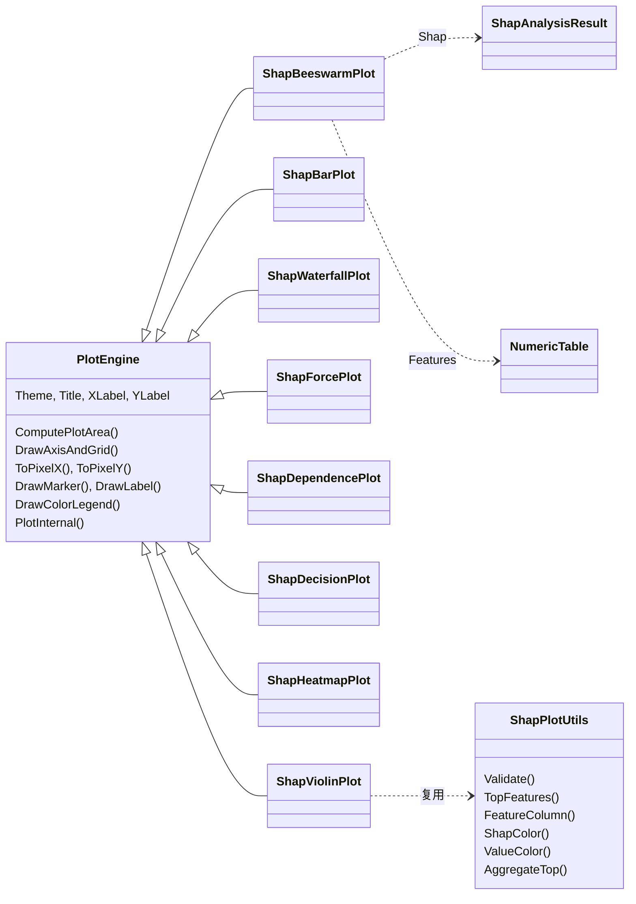

## Product Overview

为 SHAP 分析结果提供一套可直接出版使用的可视化图表：以统一分析接口输出的分析结果对象为数据来源，配合用户显式提供的样本特征表，在可视化层的 ShapPlot 模块中产出 8 类标准 SHAP 图（对齐 Python shap 包的语义），并提供可重复运行的演示程序。

## Core Features

### 全局解释类

- **蜂群图**：每行一个特征（按平均绝对 SHAP 值降序），每点一个样本，横轴为该样本在该特征上的 SHAP 值，颜色表示特征值高低（低值蓝、高值红），行内纵向抖动避免重叠，可限制显示的特征数量。
- **特征重要性柱状图**：以各特征的平均绝对 SHAP 值排序后绘制水平柱状图，可选按平均有符号 SHAP 值正负着色，并支持柱端数值标注。
- **小提琴图（简化版）**：对各特征的 SHAP 值做核密度估计，绘制横向分布轮廓与中位数标记；不内嵌箱线图。
- **热力图（简化版）**：以「样本 × 特征」矩阵按 SHAP 值着色（0 值居中对称色阶），附颜色条与稀疏行列标签，样本按模型输出排序；不含输出曲线。

### 局部解释类

- **瀑布图**：解释单个样本，从基线值出发按贡献绝对值从大到小逐级叠加（超出显示上限的合并为「其余 N 个特征」），红色表示正向推力、蓝色表示负向推力，末端标注模型输出。
- **力导向图**：与瀑布图信息等价但采用紧凑的水平布局，从基线向两侧伸展，顶部标注特征名与取值。
- **决策图**：横轴为累积 SHAP 值（基线至输出），纵轴为特征（按重要性排序），每条折线为一个样本，末端标注输出值，并以竖线标出基线。

### 交互分析类

- **依赖图**：横轴为指定特征的实际取值，纵轴为该特征的 SHAP 值，颜色为交互特征取值（未指定时自动选择与该特征 SHAP 值相关性最高的其他特征），可选叠加线性趋势线。

### 演示与验证

- 新增独立演示入口，使用内置确定性合成数据（120 样本 × 10 特征）批量生成上述 8 张图并落盘为 PNG，同时用项目的调试审计工具逐张断言「文件存在、内容非空」，输出审计报告后打印摘要。

## Tech Stack

- 语言/运行时：VB.NET，`net10.0`（`data_visualize-netcore5.vbproj` 现有目标框架）
- 绘图框架：`Microsoft.VisualBasic.Data.Plots`（`Visualization\DataPlot\DataPlot.vbproj`，`Engine\PlotEngine.vb`）
- 数据来源：`Microsoft.VisualBasic.Math.Statistics.ShapleyValue.ShapAnalysisResult` / `ShapExplanation`（`stats-netcore5.vbproj`）、`Microsoft.VisualBasic.Data.NumericTable`（`Core.vbproj`）
- 无新增项目引用：`data_visualize-netcore5.vbproj` 已引用 `Core.vbproj`(:160)、`stats-netcore5.vbproj`(:168)、`DataPlot.vbproj`(:171)；`ShapPlot\` 下新增 `.vb` 会被 SDK 默认 glob 自动编译（工程已 `Compile Remove` 掉 `test\**` 与 `Testing\**`，ShapPlot 不受影响），`ShapPlot\readme.md` 已被登记为 `EmbeddedResource`，无需改工程

## Implementation Approach

**总体策略**：不新建绘图管线，完全复用 `PlotEngine` 的两段式渲染（`Plot(...)` 负责建画布与导出，子类只实现 `PlotInternal`）。8 个图表类各自继承 `PlotEngine`，统一在构造函数中接收「分析结果 + 特征表 + 画布尺寸/主题/驱动」，并把所有几何计算放在 `PlotInternal` 内完成。

**关键决策**：

| 决策 | 理由 |
| --- | --- |
| 特征表作为**必填构造参数**（`NumericTable`） | 用户明确要求；`ShapAnalysisResult` 本身不含特征矩阵，蜂群图/依赖图/决策图/热力图都依赖原始取值来着色与排序 |
| 类上不放 `Shared Plot` 入口，沿用 `Plot(size, dpi, driver)` + `SavePng/Save` 扩展方法 | 与 DataPlot 全部 41 个图表类一致，避免二套 API |
| 数据在构造函数注入、`PlotInternal` 只读 | 与 `ViolinPlot`/`JitterPlot`/`HeatmapPlot` 的 `Groups`/`Matrix` 属性模式一致，支持 `Using` 与多次导出不同尺寸 |
| 共享几何/取值逻辑抽到 `ShapPlotUtils` 模块 | 8 张图都要「按重要性排序、取特征列、蓝红色阶、对称范围、top-N 聚合」，避免复制粘贴 |
| 小提琴轮廓复用 `Geometry.Density1D` | 已有高斯核 + Silverman 带宽实现，无需自写 KDE |
| 热力图/小提琴从简 | 用户确认；只保留矩阵着色与密度轮廓，去掉输出曲线、内嵌箱线图 |


**性能与可靠性**：

- 复杂度：单张图 O(n × p)，n 为样本数、p 为显示特征数；仅在 `PlotInternal` 开头一次性把所需特征列取出（`Double()(p)(n)`），严禁在逐点循环里调用 `features.Feature(name)`（内部为线性查找，会退化为 O(n × p × P)）。
- 小提琴图每特征一次 `Density1D`（默认 256 采样点），总量 O(p × n + p × 256)。
- 决策图/热力图按 `MaxSamples`/`MaxDisplay` 截断，默认 20 × 15，避免 200+ 样本时逐条折线导致像素级重叠与超长耗时。
- 维度校验集中在 `ShapPlotUtils.Validate`：样本数与解释条数不一致、特征数不足时抛 `InvalidConstraintException` 并给出具体数字；样本 ID 与行名对不上时**不抛异常**（回退为按下标对齐），保证 demo 与外部数据的健壮性。
- 所有 `Color`/`Brush`/`Pen`/`Font` 使用 `Using` 或主题共享实例，避免 GDI 句柄泄漏；画布所有权由基类 `Dispose` 管理，宿主注入模式（`New(g)`）不会被误释放。

**视觉规范（与 shap 包对齐）**：

- SHAP 值正负：正向推力红 `#FF0051`、负向推力蓝 `#008BFB`；热力图/蜂群图连续色阶用 `ScalerPalette.Seismic` / `cividis`，0 值居中对称。
- 特征值高低：低 `#008BFB` → 高 `#FF0051` 线性插值。
- 背景与字体全部走 `PlotTheme`（默认 `PlotTheme.Light()`），网格 `ShowGrid` 打开、绘图区留白用主题默认边距；颜色条用基类 `DrawColorLegend`，标题/轴标题用 `Title`/`XLabel`/`YLabel`。

## Architecture Design



数据流：调用方构造 `图表类(ShapAnalysisResult, NumericTable, width, height, theme)` -> 设置 `Title`/`MaxDisplay` 等 -> `plt.Plot()` 或 `plt.SavePng(path, dpi)` -> 基类 `PlotCore` 创建画布并调用 `PlotInternal` -> 子类用 `_g`/`_plotArea`/`ToPixelX`/`ToPixelY` 绘制图元 -> 导出 `GraphicsData`/PNG。

## Directory Structure

```
Visualization/Visualization/ShapPlot/
├── ShapPlotUtils.vb         [NEW] 共享工具模块（Public Module ShapPlotUtils）。职责：
│                                  Validate(shap, features) 维度校验（样本数/特征数/空数据，抛 InvalidConstraintException）；
│                                  TopFeatures(shap, topN) 按 MeanAbsShap 降序返回特征下标；
│                                  FeatureColumn(features, idx) 一次性取整列；Normalize(values) 归一到 0..1；
│                                  ShapColor(v, vmin, vmax) 正负红蓝色阶；ValueColor(t) 特征值蓝到红色阶；
│                                  SymmetricRange(values) 以 0 居中的对称范围；
│                                  AggregateTop(explanation, topN) 返回 (name, value, others) 供瀑布图/力导向图共用；
│                                  SampleId(features, i) 取行名并缺省回退 S0001 形式
├── ShapBeeswarmPlot.vb      [NEW] 蜂群图。继承 PlotEngine，构造函数 (shap, features, width, height, theme, driver)
│                                  与 (shap, features, g, theme)。属性 MaxDisplay=15、MarkerSize=4、MarkerAlpha=200、
│                                  JitterWidth=0.35、RandomSeed=42、ColorMap=ScalerPalette.cividis。
│                                  PlotInternal：纵向类别轴（yTicks=0..p-1，yLabels=特征名）、x 轴为 SHAP 值（对称范围）、
│                                  每特征一行按确定性随机抖动绘制半透明圆点、右上角纵向色条标注特征值范围
├── ShapBarPlot.vb            [NEW] 特征重要性柱状图。属性 MaxDisplay=15、ShowValueLabel=True、SignedColor=True、
│                                  BarColor。PlotInternal：水平柱（yTicks 为特征下标），柱长 = MeanAbsShap，
│                                  SignedColor 时按 MeanShap 正负取红/蓝，其余用主题调色板；柱端绘制 FormatNumber 数值
├── ShapWaterfallPlot.vb      [NEW] 瀑布图。属性 SampleIndex=0、SampleId（非空时优先按 ID 定位）、MaxDisplay=10、
│                                  ShowFeatureValues=True。PlotInternal：用 ShapPlotUtils.AggregateTop 取 top-N 与「其余」，
│                                  按 |贡献| 降序重排后逐级累加，绘制阶梯状矩形（红正蓝负）+ 连接线 +
│                                  基线/输出垂直参考线（DrawAbline）+ 行标签（特征名 = 取值）
├── ShapForcePlot.vb         [NEW] 力导向图。属性 SampleIndex=0、MaxDisplay=10、ArrowHeight。
│                                  PlotInternal：单行水平堆叠，负向段从基线向左、正向段向右依次排布，
│                                  段与段之间绘制箭头三角，段上/下交替标注特征名与取值，轴标注模型输出
├── ShapDependencePlot.vb    [NEW] 依赖图。属性 FeatureName（必填）、InteractionFeature（可空，自动选相关性最高者）、
│                                  ColorMap、ShowTrendLine=True、MarkerSize。PlotInternal：x = 特征取值、y = 该特征 SHAP，
│                                  逐点用交互特征取值取色；ShowTrendLine 时用最小二乘拟合后调用 DrawAbline；
│                                  右侧纵向色条标注交互特征名与范围
├── ShapDecisionPlot.vb      [NEW] 决策图。属性 MaxSamples=20、MaxDisplay=10、ShowFinalValue=True。
│                                  PlotInternal：y 轴为特征下标（自下而上按重要性升序），每条样本一条折线，
│                                  x 从 Baseline 逐步累加 Contributions，末端绘制标记并标注 AdditiveValue；
│                                  基线位置绘制虚线竖线
├── ShapHeatmapPlot.vb       [NEW] 热力图（简化）。属性 MaxDisplay=15、MaxSamples=0（0 表示全部）、
│                                  OrderBy="output"（按 AdditiveValue 升序）、ColorMap=ScalerPalette.Seismic、
│                                  ShowColorLegend=True。PlotInternal：不调用 ComputePlotArea，自算格子区；
│                                  逐格用 ColorScale.GetColor 填充，右侧 DrawColorLegend，行列标签稀疏抽取避免重叠；
│                                  不含输出曲线
└── ShapViolinPlot.vb        [NEW] 小提琴图（简化）。属性 MaxDisplay=15、Bandwidth=0（0 表示 Silverman）、
                                   ColorMap、ShowMedian=True。PlotInternal：每特征调用 Geometry.Density1D 求轮廓，
                                   以 y 为特征行、x 为 SHAP 值绘制左右对称多边形填充 + 中位数竖线；不内嵌箱线图

Visualization/Visualization/test/
├── ShapPlotDemo.vb          [NEW] 演示入口。Module ShapPlotDemo + Sub Main：
│                                  BuildSynthetic() 用 New Random(42) 生成 120×10 特征矩阵
│                                  （F1..F3 为有效特征，beta = 1.6 / -1.1 / 0.7；其余为噪声），
│                                  phi_j = beta_j * (x_j - mean_j) + 高斯小噪声，Baseline = 0.35，
│                                  组装 ShapAnalysisResult（FeatureNames/MeanAbsShap/MeanShap/Explanations/IsClassification=False）
│                                  与 NumericTable（rowNames=S0001..，featureNames=F1..F10，features）；
│                                  依次渲染 8 张图（1200×800，PlotTheme.Light()），SavePng 到
│                                  AppContext.BaseDirectory\shap_plots\<name>.png（dpi=150）；
│                                  每张图用 DebugAudit.Check 断言文件存在且长度大于 0，
│                                  最后 DebugAudit.SaveReport + DebugAudit.Dump 输出审计摘要
└── test.vbproj              [MODIFY] 仅改一行：StartupObject 由 test.HeatmapDemo 改为 test.ShapPlotDemo
```

## Key Code Structures

```
Namespace ShapPlot

    Public Class ShapBeeswarmPlot
        Inherits PlotEngine

        Public ReadOnly Property Shap As ShapAnalysisResult
        Public ReadOnly Property Features As NumericTable

        Public Property MaxDisplay As Integer = 15
        Public Property MarkerSize As Single = 4
        Public Property MarkerAlpha As Integer = 200
        Public Property JitterWidth As Single = 0.35F
        Public Property RandomSeed As Integer? = 42
        Public Property ColorMap As ScalerPalette = ScalerPalette.cividis

        Public Sub New(shap As ShapAnalysisResult, features As NumericTable,
                       width As Integer, height As Integer,
                       Optional theme As PlotTheme = Nothing,
                       Optional driver As Drivers = Drivers.Default)

        Public Sub New(shap As ShapAnalysisResult, features As NumericTable,
                       g As IGraphics, Optional theme As PlotTheme = Nothing)

        Protected Overrides Sub PlotInternal(ByRef g As IGraphics, canvas As GraphicsRegion)
            ' DrawBackground / ComputePlotArea / DrawPlotArea / DrawTitle
            ' DrawAxisAndGrid(xmin, xmax, -0.5, p - 0.5, xTicks, yIdx, Nothing, featureNames)
            ' 逐特征取列 -> 归一化 -> 抖动绘点 -> DrawColorLegend
        End Sub
    End Class

End Namespace
```

命名空间说明：`ShapPlot\` 下每个文件显式声明 `Namespace ShapPlot`，叠加工程 `RootNamespace=Microsoft.VisualBasic.Data.visualize` 后完整名为 `Microsoft.VisualBasic.Data.visualize.ShapPlot`。

需要的导入（各文件按需）：
`System.Drawing`、`Microsoft.VisualBasic.Data`（NumericTable）、`Microsoft.VisualBasic.Data.Plots`（PlotEngine / PlotTheme / Geometry / SavePng 扩展）、`Microsoft.VisualBasic.Imaging`（IGraphics / GraphicsRegion）、`Microsoft.VisualBasic.Imaging.Driver`（Drivers）、`Microsoft.VisualBasic.Imaging.Drawing2D.Colors`（ScalerPalette / ColorScale）、`Microsoft.VisualBasic.Math.Statistics.ShapleyValue`、`Imports std = System.Math`。

## Implementation Notes

- **API 事实（已核实，勿臆造）**：`PlotEngine.PlotInternal(ByRef g As IGraphics, canvas As GraphicsRegion)` 为 `MustOverride`；可用受保护成员包括 `_g`、`_plotArea`、`ComputePlotArea()`、`DrawBackground()`、`DrawPlotArea()`、`DrawTitle()`、`DrawAxisAndGrid(xmin, xmax, ymin, ymax, xTicks, yTicks, xLabels, yLabels, xLabelRotate)`、`ToPixelX/ToPixelY`、`GenerateTicks(min, max, tickCount)`、`AutoRange(data, ByRef min, ByRef max, pad)`、`FormatNumber`、`DrawMarker`、`DrawLabel`、`DrawColorLegend(cmap, vmin, vmax, rect, horizontal, tickCount, title)`、`DrawAbline(a, b, xmin, xmax, ymin, ymax, pen)`、`MeasureString`。
- `PlotTheme` **没有**单一 `Font` 或 `Margin` 属性，字体按角色取（`TitleFont`/`AxisLabelFont`/`TickLabelFont`/`LegendFont`/`AnnotationFont`），边距为 `MarginLeft/MarginRight/MarginTop/MarginBottom`。
- 导出走基类 `Plot(size As String, ppi, driver)` 与 `Microsoft.VisualBasic.Data.Plots` 中的扩展方法 `SavePng(plot, path, dpi)`；PNG 用默认 GDI 驱动，**不需要** `PlotDrivers.Register()`（该调用只在导出 SVG/PDF/PS 前需要）。
- 演示程序若 `Imports Microsoft.VisualBasic.Data`，`IO.Path` 会被解析到 `Microsoft.VisualBasic.Data.IO`；请改用别名 `Imports NumericTable = Microsoft.VisualBasic.Data.NumericTable` 或显式写 `System.IO.Path`/`System.IO.File`（此前 ML_SHAP 改造已踩过同一坑）。
- 类别轴绘制方式：把 `yTicks` 传为 `0..p-1` 的 `Double()`、`yLabels` 传特征名，让 `DrawAxisAndGrid` 负责刻度与标签，避免手工排版。
- 颜色与画笔：`ColorScale.GetColor(v, vmin, vmax, cmap)` 返回 `Color`；批量绘制时把 `Pen`/`SolidBrush` 提到循环外复用（颜色会变化时按需创建并在 `Using` 中释放）。
- 抖动确定性：`RandomSeed` 有值时用 `New Random(RandomSeed.Value)` 生成抖动，保证 PNG 可复现、便于回归比对。
- `DrawColorLegend` 的 `rect` 留空时垂直贴绘图区右侧、水平贴下方；蜂群图/依赖图用垂直色条，热力图用垂直色条 + `tickCount=5`。
- 边界数据：单样本数据集、单一特征、全零 SHAP 值、`MeanAbsShap` 长度小于 `FeatureNames` 长度等情况都要能出图（`SymmetricRange` 遇到零范围时回退为正负 1）。
- 不改动 `DataPlot`、`Core`、`stats`、`ShapAnalysisResult`、`NumericTable`、`ShapPlot\readme.md` 以及测试项目已有的三个 demo 文件；除 `StartupObject` 外不修改 `test.vbproj`。

## 验证

- `dotnet build "g:\GCModeller\src\runtime\sciBASIC#\Data_science\Visualization\Visualization\data_visualize-netcore5.vbproj"`
- `dotnet run --project "g:\GCModeller\src\runtime\sciBASIC#\Data_science\Visualization\Visualization\test\test.vbproj"`
- 期望：`test\bin\Debug\net10.0-windows\shap_plots\` 下生成 `beeswarm.png`、`bar.png`、`waterfall.png`、`force.png`、`dependence.png`、`decision.png`、`heatmap.png`、`violin.png` 共 8 张图，以及 `shap-plot-report.json`；`DebugAudit.FailureCount` 中不出现由本 demo 断言产生的失败项。