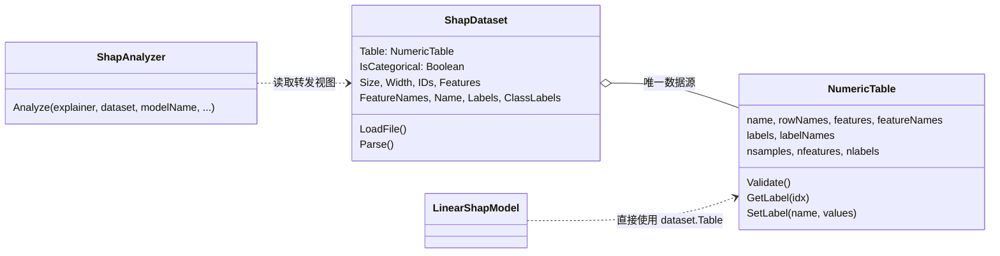

## 用户需求

对 SHAP 分析模块的数据集对象进行重构：不再采用「数据集继承通用数值表」的方案，而是删除数据集中与通用数值表重复的字段，把通用数值表作为数据集对象的一个成员属性（组合方式），由该成员作为唯一的数值数据来源。

## 产品概述

本次改造不改变任何算法行为与对外可见的数据格式，只调整数据集对象的内部结构与职责划分：

- 数据集中不再保存样本 ID、特征矩阵、特征名、标签向量等数值数据的副本，统一由内部持有的通用数值表承载；
- 数据集对象自身只保留「是否为分类数据集」这一附加信息，以及「从文本文件装载数据」的能力；
- 数据集对象对外暴露的属性名、返回类型与取值语义保持完全等价，因此所有既有调用方（分析门面、四类模型适配器、测试程序、R 脚本导出入口）无需改动即可继续工作；
- 唯一需要一并修正的是两处「因为数据来源改变而产生额外开销或多余转换」的代码：模型训练中重复组装数值表的语句可以删除，以及在循环中反复读取标签向量应当先取到局部变量。

## 核心特性

- 单一数据来源：样本数、特征数、特征矩阵、特征名、样本 ID、标签、类别标签等视图都从同一个数值表派生，不再有两套可能不一致的数据。
- 接口兼容：数据集对象继续保持可被矩阵/行名相关算法接口消费的能力，原有的属性名与类型不变。
- 装载逻辑精简：解析后直接构造通用数值表并复用其维度校验，删除手写的维度一致性检查循环。
- 行为等价性可验证：在测试程序中追加断言，逐一校验「转发视图」与「底层数值表」完全一致（样本数、特征数、矩阵与列名引用同一份数据、标签与类别标签逐项相等）。

## 技术栈

- 语言/运行时：VB.NET（`net10.0`），沿用现有项目 `MachineLearning/ML_SHAP/ML_SHAP.vbproj`
- 依赖：已引用 `Microsoft.VisualBasic.Core/src/Core.vbproj`（`ML_SHAP.vbproj` 第 63 行），`NumericTable` 与 `INumericMatrix` / `ILabeledMatrix` 均可直接使用，**无需新增任何项目引用或 NuGet 包**
- 无 UI、无序列化格式变更

## 实现策略（组合方案）

**核心思路**：`ShapDataset` 从「数据的拥有者」降级为「一张数值表 + 一个分类标记 + 一个文本装载器」。数值数据全部存放在只读成员 `Table As NumericTable` 中，原有的 PascalCase 属性改为零拷贝的只读转发视图。

**关键决策与权衡**：

| 决策 | 理由 |
| --- | --- |
| 不做继承，改为组合 | VB 大小写不敏感，`Features`/`FeatureNames`/`Name` 与基类同标识符，子类无法显式声明；`NumericTable` 仍在快速演进（已 738 行），未来新增 `Size`/`Width`/`IDs` 会与子类别名冲突（隐式隐藏，BC40004） |
| `Labels` 保持 `Double()` | 继承时与 `NumericTable.labels`（`Double()()`）只能靠 `Shadows` 共存，会出现「同一对象按静态类型看到不同成员」；组合下由 `Table.GetLabel(0)` 派生，语义唯一 |
| `Table` 声明为 `ReadOnly` | 仅在 `Sub New` 中赋值并做 `Nothing` 校验，转发属性无需判空；同时防止外部替换数据表导致 `IsCategorical` 语义漂移 |
| 保留只读转发属性 | 对已发布 nuget（`GeneratePackageOnBuild=True`，Version 10.8.9797.36764）零破坏；`test/Program.vb`（20+ 处）、`ShapAnalyzer.vb`、`RanFog`/`Glmnet`/`Linear` 适配器全部零改动 |
| `ShapDataset` 显式实现 `INumericMatrix` / `ILabeledMatrix` | 弥补组合相比继承丢失的类型互操作；由于 `NumericTable` 的这两个成员是 Private 接口实现，必须经 `DirectCast(Table, 接口)` 转发 |
| `Parse` 复用 `NumericTable` 公开构造函数 + `Validate()` | 删除手写维度校验循环（原 199-205 行），装载逻辑由 ~50 行降到 ~10 行 |


**性能与可靠性**：

- 转发属性为 O(1) 引用返回（`Features`/`FeatureNames`/`IDs`/`Name`/`Size`/`Width`），无额外分配；
- `Labels` / `ClassLabels` 每次访问都会按样本数 `new` 一个数组：`RanFogShapModel.vb:122`、`GlmnetShapModel.vb:466`、`LinearShapModel.vb:174` 均为单次访问，O(n) 一次性开销可接受；但 `XGBoostShapModel.vb:98-100` 在 LINQ lambda 内按行访问 `dataset.Labels(i)`，改造后会退化为 **O(n²) 分配**，必须提前取出局部变量 —— 这是本次唯一需要处理的热路径；
- `Parse` 的维度错误异常类型由 `InvalidDataException` 变为基类 `Validate()` 抛出的 `InvalidConstraintException`（已确认全仓库无代码 catch 前者的维度错误分支），计划中需明确记录；
- `Labels` 由「可能为 `Nothing` 的字段」变为「标签为空时返回空数组」，`GlmnetShapModel.vb:468`、`RanFogShapModel.vb:176` 的判空/长度判断依然成立。

**避免技术债**：不修改 `Microsoft.VisualBasic.Core/src/Data/NumericTable.vb`，不引入「Protected Overridable 工厂方法」这类对基类的侵入式改造；新代码全部落在 `ML_SHAP` 项目内部。

## 架构设计



数据流：`ShapDataset.Parse` 解析文本行 -> 构造 `NumericTable`（`rowNames` / `features` / `featureNames` / `labels`（n×1）/ `labelNames = {"Y"}`）-> `Table.Validate()` -> `New ShapDataset(table, isCategorical)`；下游算法与报告只读取 `ShapDataset` 的转发属性或直接消费 `Table`。

## 目录结构

```
MachineLearning/ML_SHAP/
├── Data/
│   └── ShapDataset.vb            [MODIFY] 重写为组合结构。删除 Name/IDs/Labels/Features/FeatureNames/Size/Width
│                                          的字段存储与重复文档；新增 ReadOnly 属性 Table、构造函数
│                                          Sub New(table, isCategorical)（含 Nothing 校验）、8 个只读转发
│                                          属性（Size->nsamples、Width->nfeatures、IDs->rowNames、
│                                          Features->features、FeatureNames->featureNames、Name->name、
│                                          Labels->GetLabel(0)、ClassLabels->GetClassLabel(0)，标签为空时返回
│                                          空数组）；Implements INumericMatrix / ILabeledMatrix 并经接口
│                                          DirectCast 转发；Parse 改为构造 NumericTable + Validate()；
│                                          LoadFile / ParseValue 逻辑不变；文件区头部的 Summaries 注释块同步更新
├── Models/
│   ├── LinearShapModel.vb        [MODIFY] 第 118-121 行删除手工组装 NumericTable 的语句，改为
│                                          Dim table As NumericTable = dataset.Table；其余（124、135、171-175、
│                                          184-185 行）保持不变
│   └── XGBoostShapModel.vb       [MODIFY] 第 98-100 行把 dataset.Labels 提到 lambda 之外取局部变量
│                                          （Dim y As Double() = dataset.Labels），lambda 内改用 y(i)，
│                                          避免 O(n²) 分配
├── test/
│   └── Program.vb                [MODIFY] 仅在 RunDataset 的 LoadFile 之后追加一组 DebugAudit 等价性断言，
│                                          不修改任何现有断言与输出格式；报告仍由既有 WriteAuditReport 输出
└── README.md                     [MODIFY] 补充 Table 成员说明；第 59 行参数说明、第 138 行「只有单列 Labels」
                                           描述、第 20 行把 ShapDataset 归入 ShapleyValue 命名空间的描述（实际在
                                           Microsoft.VisualBasic.MachineLearning.SHAP）一并订正
```

不改动文件（需在实现后通过编译确认零改动）：`ShapAnalyzer.vb`、`Models/RanFogShapModel.vb`、`Models/GlmnetShapModel.vb`、`Evaluation/ModelPrediction.vb`、`Report/ShapCsvWriter.vb`、`G:\GCModeller\src\R-sharp\studio\Rsharp_kit\MLkit\SHAP.vb`、`Microsoft.VisualBasic.Core/src/Data/NumericTable.vb`。

## 关键代码结构

```
Imports System.Globalization
Imports System.IO
Imports Microsoft.VisualBasic.ComponentModel.DataSourceModel
Imports Microsoft.VisualBasic.Data
Imports Microsoft.VisualBasic.Math

Public Class ShapDataset
    Implements INumericMatrix
    Implements ILabeledMatrix

    ' 唯一数据真源；仅在 Sub New 中赋值并做 Nothing 校验
    Public ReadOnly Property Table As NumericTable

    ' SHAP 侧唯一附加状态
    Public Property IsCategorical As Boolean

    Sub New(table As NumericTable, Optional isCategorical As Boolean = False)

    ' 只读转发视图（零数据复制，保持原有名字与返回类型）
    Public ReadOnly Property Size As Integer              ' Table.nsamples
    Public ReadOnly Property Width As Integer             ' Table.nfeatures
    Public ReadOnly Property IDs As String()              ' Table.rowNames
    Public ReadOnly Property Features As Double()()       ' Table.features
    Public ReadOnly Property FeatureNames As String()     ' Table.featureNames
    Public ReadOnly Property Name As String               ' Table.name
    Public ReadOnly Property Labels As Double()           ' Table.GetLabel(0)，空时 New Double() {}
    Public ReadOnly Property ClassLabels As Integer()     ' Table.GetClassLabel(0)，空时 New Integer() {}

    ' 接口转发：NumericTable 中这两个成员是 Private 接口实现，只能经接口引用调用
    Private Function ArrayPack(Optional deepcopy As Boolean = False) As Double()() Implements INumericMatrix.ArrayPack
    Private Function GetLabels() As IEnumerable(Of String) Implements ILabeledMatrix.GetLabels

    Public Shared Function LoadFile(path As String, isCategorical As Boolean, Optional name As String = Nothing) As ShapDataset
    Public Shared Function Parse(lines As IEnumerable(Of String), isCategorical As Boolean, Optional name As String = Nothing) As ShapDataset
    Private Shared Function ParseValue(s As String, line As Integer) As Double
End Class
```

实现注意：

- 文件内新增 `Imports Microsoft.VisualBasic.Math` 后，若需数学函数请写全 `System.Math.`，避免与 `Microsoft.VisualBasic.Math` 命名空间产生歧义；
- `Parse` 构造 `NumericTable(rows.ToArray, ids.ToArray, Enumerable.Range(1, rows(0).Length).Select(Function(i) $"F{i}"))` 时必须设置 `.labels`（n×1）与 `.labelNames = New String() {"Y"}`，否则 `MultipleLinearRegression` / `LogisticRegression` 依赖的「缺省第一个标签列」行为会改变；
- 保留文件头 `#Region` 中自动生成的哈希标记行不变。

## 验证

- 编译：`dotnet build "G:\GCModeller\src\runtime\sciBASIC#\Data_science\MachineLearning\ML_SHAP\ML_SHAP.vbproj"`
- 端到端：`dotnet run --project "G:\GCModeller\src\runtime\sciBASIC#\Data_science\MachineLearning\ML_SHAP\test\test.vbproj"`（自动定位 `Data_science\MachineLearning\MachineLearning\RandomForests\training_categorical.txt` 与 `training_regression.txt`，两文件已确认存在），输出 `shap_output\` 与 `shap-test-report.json`
- 断言记录方式遵循项目规则：统一使用 `DebugAudit.Check`，结果由既有 `DebugAudit.SaveReport` 写入报告