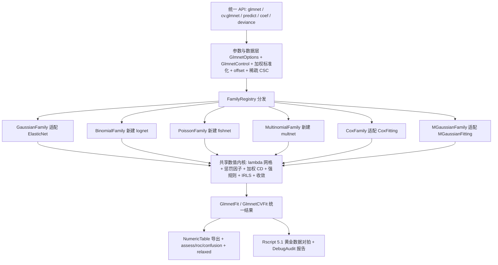

## 产品概述

在 `g:/pixelArtist/src/framework/Data_science/MachineLearning/GLMNet/GLMNet.vbproj` 工程中复刻 GNU R `glmnet` 5.1 的程序包能力，形成一套与 R 端同语义、可对拍验证的回归建模工具。产物是可供现有框架调用的 .NET 类库与二维表入口，并附带基于本地 Rscript 的黄金数据对拍自检与测试报告。

## 核心 Features

- **统一拟合入口**：以一套参数对象调用 `glmnet`，参数与 R 5.1 对齐（`alpha`、`lambda`/`nlambda`、`lambda.min.ratio`、`weights`、`offset`、`standardize`、`intercept`、`penalty.factor`、`lower.limits`/`upper.limits`、`exclude`、`dfmax`/`pmax`、`thresh`/`maxit`、`type.gaussian`、`type.multinomial`、`standardize.response`）。
- **六类模型家族**：`gaussian`、`binomial`、`poisson`、`multinomial`、`cox`、`mgaussian` 均返回同一形态的正则化路径结果；`cox` 支持 Efron 平局、`mgaussian` 支持响应标准化。
- **统一结果对象**：截距、稀疏系数路径、`lambda`、`df`、`dev.ratio`、`nulldev`、非零变量数、收敛状态，并支持导出为二维表。
- **统一预测与系数提取**：按 `type`（link/response/coefficients/nonzero/class）与 `s`（数值或 `lambda.min`/`lambda.1se`）取结果，支持 `exact` 插值与预测期 `offset`。
- **统一交叉验证**：`foldid`、`type.measure`（mse/deviance/class/auc/mae/C）、`grouped`、`keep`，输出 CV 均值、标准误、`lambda.min`、`lambda.1se` 与 1-SE 规则。
- **5.1 扩展能力**：`relax` 的 relaxed lasso 与 gamma 网格、稀疏输入、`assess`/ROC/混淆矩阵/C 指数评估、Cox 的 (start, stop] 与分层响应。
- **对拍与报告**：用本地 `C:\Program Files\R\R-4.5.0\bin\Rscript.exe` 核验 glmnet 版本并导出六类示例数据的黄金结果，逐项比对后生成测试报告。
- **兼容性约束**：复用现有 `DataFittings` 与 `ElasticNet` 组件，保持其既有公开行为与自检通过，不改动无关模块。

## 一、技术栈选择

- **语言与运行时**：沿用现有 VB.NET / `net10.0` SDK 风格工程（目标工程与两个依赖工程均已为 `net10.0`），不引入新语言或新 NuGet 包。
- **现有基础设施**（已核实）：`Microsoft.VisualBasic.Core`（`NumericTable`、`IFitted`、`SIMDIntrinsics.DotFma/AxpyInplace`、`DebugAudit`）、`Math.NET5.vbproj`（数值与 `SparseMatrix`，但为行字典结构，需另建列压缩结构）、`Math.Statistics`、`DataMining.NET5.vbproj`、`machine_learning-netcore5.vbproj`（`GLMNet.vbproj` 现有 7 个引用）。
- **参考基准**：GNU R 4.5.0 + glmnet 5.1，通过 `C:\Program Files\R\R-4.5.0\bin\Rscript.exe` 生成黄金数据；R 仅作为离线对拍工具，不是运行时依赖。
- **许可策略**：按 Friedman 2010、Simon 2011/2013、Tibshirani 2012 strong rules、Tay 2023 与 glmnet 5.1 官方文档做独立实现，不移植 R 包内核源码；与兄弟工程保持 GPL-3.0-or-later。

## 二、实现策略

1. **先统一契约，再接入内核**：当前三套内核（`ElasticNetFit`、`MGaussianFit`、`CoxFit`）各有结果类、预测签名与 CV 枚举，无法直接映射 R 的单一 API。先在 `GLMNet` 内建立 `GlmnetOptions` / `IGlmnetFamily` / `FamilyRegistry` / `GlmnetFit` / `GlmnetCVFit`，把"入口—求解器—结果"三段解耦。
2. **复用优先、补齐缺口**：`gaussian`、`mgaussian`、`cox` 通过适配器复用现有求解器；`binomial`、`poisson`、`multinomial` 在 `GLMNet/Families/` 内新建带惩罚的 IRLS + 加权坐标下降内核（现有 `Logistic` 为无惩罚梯度下降、`PoissonFitting` 为无惩罚 IRLS 且强制 n 大于 p，均不能直接充当 `lognet`/`fishnet`）。
3. **共享数值层下沉**：加权标准化、lambda 网格、惩罚因子重缩放、强规则/active set、收敛判据、稀疏 CSC、IRLS 步长折半集中在 `Internals/`，供六个 family 共用，避免六份重复实现。
4. **向后兼容扩展**：对既有工程只做"放宽 `Private` 到 `Friend` + 追加末尾 `Optional` 参数"的修改，不改公开签名与默认值；`NumericTable` 入口按 `NumericTableElasticNet.vb` 的惯例放在 `GLMNet` 程序集内，避免循环依赖。
5. **性能取舍**：路径求解复杂度约为 `O(L·n·p)`（L 为 lambda 步数），warm start + 列主序 + SIMD 使单次坐标扫描为 `O(n)`；强规则/active set 将热循环降到 `O(n·活跃列数)`，稀疏 CSC 降到 `O(nnz)`。多分类为 `O(L·n·p·K)`，瓶颈在三维系数张量，采用按 lambda 复用缓冲与分组更新。CV 为 `O(folds·L·n·p)`，按折缓存标准化统计量与折外预测，避免重复遍历。
6. **默认语义以 R 5.1 实测为准**：`alpha=1`、`nlambda=100`、`thresh=1e-7`、`lambda.min.ratio` 依 n 与 p 取 0.01 或 0.0001；`cox.ties` 的 5.1 默认值由 R 端核验脚本确认后再固定。

## 三、执行要点

- **复用既有模式**：`NumericTable` 扩展方法、`toNumericTable()`、`IFitted`、`Silent` 保留参数、`SIMDIntrinsics` 列主序点积/AXPY、XML 文档注释风格；`NamespaceDoc.vb` 已存在，扩充为完整 API 地图即可。
- **口径统一**：以 glmnet 的加权 `1/n` 标准化为唯一口径；`RidgeFitting` 的 ddof=n−1 与 `ElasticNet` 的 ddof=n 差异须在适配层显式换算，对拍时记录换算因子。
- **VB 大小写不敏感**：避免局部变量与属性同名（现有代码已有 `alphaColumn` 先例）；模块名与结果类名不得仅靠大小写区分。
- **日志与报告**：库内不输出控制台噪声；自检统一走 `g:/pixelArtist/src/framework/Microsoft.VisualBasic.Core/src/ApplicationServices/Debugger/DebugAudit.vb` 的 `Snapshot`、`Check`、`Require`、`CheckThrows`、`Mark`、`SaveReport`，照抄 `_smoketest/PoissonAudit.vb` 的结构；报告不写入敏感数据或大矩阵。
- **R 对拍前置校验**：先以只读方式核验 `Rscript.exe` 与 `packageVersion("glmnet")` 为 5.1；缺失或版本不符时在审计报告中给出可操作提示并终止对拍，不静默安装软件包、不改动系统环境。
- **对拍容差分级**：`lambda` 与 `df` 近似严格一致，系数与 `dev.ratio` 用相对容差 1e-3，`cvm/cvsd` 用 1e-3，`lambda.min/lambda.1se` 比较网格下标；差异超限时记录快照而非中断全部用例。
- **影响范围控制**：不新增 R# 脚本绑定，不重构 LOESS/LM/Ridge/LASSO 等无关模块；`PoissonFitting.vb` 保持只读复用其数学公式；`relax`、稀疏输入、自定义 GLM family 以可开关方式接入；现有 `DataFittings/_smoketest` 与 `ElasticNet/_smoketest` 必须继续通过。

## 四、架构设计



数据流：调用方传入矩阵或 `NumericTable` → 参数校验与加权预处理 → 生成/采用 lambda 网格 → family 内核沿路径 warm-start 求解 → 统一结果对象 → `predict`/`coef`/`deviance`/CV/评估；自检程序读取 R 导出的黄金数据并逐项断言。

## 五、目录结构

```
g:/pixelArtist/src/framework/Data_science/
├── MachineLearning/GLMNet/
│   ├── GLMNet.vbproj                  # [MODIFY] 保留现有 7 个 ProjectReference 与包元数据；追加 InternalsVisibleTo("test") 与 README 打包项。
│   ├── NamespaceDoc.vb                # [MODIFY] 在现有 glmnet 5.x 说明后补充命名空间地图与参数对照表。
│   ├── README.md                      # [NEW] R 5.1 与 VB API 参数映射、运行方式、对拍容差与黄金数据再生成步骤。
│   ├── GlmnetEnums.vb                 # [NEW] GlmnetFamily、PredictionType、CVMeasure、GlmnetError、CoxTies 兼容枚举。
│   ├── GlmnetOptions.vb               # [NEW] 统一参数对象：alpha/lambda/nlambda/lambda.min.ratio/weights/offset/standardize/intercept/penaltyFactor/limits/exclude/dfmax/pmax/thresh/maxit/type.gaussian/type.multinomial/standardize.response/relax/foldid/keep。
│   ├── GlmnetControl.vb               # [NEW] 全局数值控制与 jerr 错误码、trace 开关；集中默认常量。
│   ├── GlmnetFit.vb                   # [NEW] 统一结果：a0、beta 路径、lambda、df、dev.ratio、nulldev、nzero、nobs、nvars、converged、jerr、toNumericTable()。
│   ├── GlmnetCVFit.vb                 # [NEW] cvm/cvsd/cvup/cvlo/nzero/lambda.min/lambda.1se/glmnet.fit/foldid/name/keep 折外预测。
│   ├── GlmnetSolver.vb                # [NEW] glmnet() 与 cv.glmnet() 顶层入口、参数校验、family 分发、全量重拟合。
│   ├── GlmnetPredict.vb               # [NEW] predict(type,s,exact,newoffset)、coef(s)、deviance、s 插值与 s="lambda.min"/"lambda.1se" 解析。
│   ├── NumericTableGLMNet.vb          # [NEW] 表入口扩展：GlmnetFit/GlmnetCV/GlmnetPredict，按 NumericTableElasticNet.vb 的模式读取特征与标签列。
│   ├── Families/
│   │   ├── IGlmnetFamily.vb           # [NEW] family 求解器契约：Fit/Predict/Measure；统一输入上下文与路径结果。
│   │   ├── FamilyRegistry.vb          # [NEW] family 字符串/枚举解析、结果对象装配、 unsupported 选项显式报错。
│   │   ├── GaussianFamily.vb          # [NEW] 适配 ElasticNetEngine，处理 alpha/lambda 语义换算与权重、offset、限值。
│   │   ├── BinomialFamily.vb          # [NEW] lognet：0/1 因子、两列成功失败矩阵、比例响应 + weights；IRLS 加权最小二乘 + 弹性网 CD、deviance/class/auc。
│   │   ├── PoissonFamily.vb           # [NEW] fishnet：log link、offset 直接加在 link scale、eta 钳制与步长折半、deviance/nulldev；解除 n 大于 p 限制。
│   │   ├── MultinomialFamily.vb       # [NEW] multnet：softmax 组-lasso、grouped/ungrouped、p×K×L 系数张量、class 预测与多维 predict。
│   │   ├── CoxFamily.vb               # [NEW] 适配 CoxFitting/CoxCV，映射 HR、C 指数、基线生存、strata 与 start-stop 响应。
│   │   └── MGaussianFamily.vb         # [NEW] 适配 MGaussianFitting/CV，映射 2norm 路径、standardize.response 与多响应预测。
│   ├── Internals/
│   │   ├── GlmnetData.vb              # [NEW] 统一输入容器：稠密/CSC 设计矩阵、响应、weights、offset、foldid、特征名。
│   │   ├── WeightedStandardizer.vb    # [NEW] 加权均值/方差/列尺度与反变换，统一 ddof 口径。
│   │   ├── LambdaGrid.vb              # [NEW] lambda.max 的加权 KKT 推导、自定义序列校验、nlambda 与 lambda.min.ratio 规则。
│   │   ├── PenaltyFactor.vb           # [NEW] penalty.factor 校验、0 永不惩罚、缩放至和为 p、exclude/limits 应用。
│   │   ├── CoordinateDescent.vb       # [NEW] 共享加权 CD 内核、软阈值、残差增量、强规则/active set、dfmax/pmax 早停。
│   │   ├── IrlsKernel.vb              # [NEW] 二项/泊松/多分类共享 IRLS：工作响应、权重、步长折半、目标相对改进判据。
│   │   ├── SparseCSC.vb               # [NEW] 列压缩稀疏矩阵与列遍历接口，替代按行字典 SparseMatrix 的热路径。
│   │   └── Convergence.vb             # [NEW] thresh 判据、jerr 映射、NaN/Infinity 守卫与迭代统计。
│   ├── Evaluation/
│   │   ├── TypeMeasure.vb             # [NEW] mse/mae/deviance/class/auc/C 指标与最大化方向标记。
│   │   ├── AssessGLMNet.vb            # [NEW] assess/roc/confusion/CIndex、CV 曲线与路径导出二维表。
│   │   └── RelaxedFit.vb              # [NEW] relax=TRUE 的 gamma 网格与无惩罚重拟合、CV 选 gamma。
│   └── test/
│       ├── test.vbproj                # [MODIFY] 追加 R 脚本与 golden 数据的 None/CopyToOutputDirectory 项；现有引用已足够。
│       ├── Program.vb                 # [MODIFY] 替换 Hello World 为 DebugAudit 自检入口、异常兜底与报告路径。
│       ├── GlmnetAudit.vb             # [NEW] 六 family 对拍断言、边界用例、CheckThrows 非法参数校验、容差快照。
│       ├── R/check_version.R          # [NEW] 用 Rscript 核验 glmnet 版本为 5.1 并输出环境信息。
│       ├── R/export_golden.R         # [NEW] 固定种子导出 QuickStart/Binomial/Poisson/Multinomial/Cox/MultiGaussian 示例及拟合、CV、predict 结果。
│       └── data/                      # [NEW] 由 R 脚本生成的黄金 CSV 与元数据（lambda、beta、a0、df、dev.ratio、nulldev、cvm/cvsd）。
├── Mathematica/Math/ElasticNet/
│   ├── ElasticNetFitting.vb           # [MODIFY] 将 Prepare/PrepareColumns/CoordinateDescent/AlphaGrid/BackTransform 由 Private 放宽为 Friend；追加末尾 Optional 的 weights/offset/penaltyFactor/limits 重载，保持现有 5 个公开签名与默认值不变。
│   └── ElasticNetEngine.vb            # [NEW] 同程序集公开适配器，向 GLMNet 暴露加权预处理、lambda 网格、路径求解与系数反变换。
├── Mathematica/Math/DataFittings/
│   ├── MGaussian/MGaussianFitting.vb  # [MODIFY] 末尾追加 Optional 的 offset/penaltyFactor/limits/exclude/dfmax/pmax，扩展 ValidateData；现有 Fit 行为不变。
│   ├── MGaussian/MGaussianCV.vb       # [MODIFY] 追加 Optional 的 foldid/keep，支持统一 cv.glmnet 复用。
│   ├── COX/CoxFitting.vb              # [MODIFY] 末尾追加 Optional 的 weights/offset/limits，扩展 ValidateData；保留 Efron 默认与既有 Fit 签名。
│   └── COX/CoxCV.vb                   # [MODIFY] 追加 Optional 的 foldid/keep，保持 grouped 与 seed 行为。
└── Mathematica/Math/DataFittings/Poisson/PoissonFitting.vb  # 只读依赖：复用 deviance/logLikelihood/eta 钳制思路，不修改文件、不解除其 n 大于 p 约束。
```

## 六、关键代码结构（接口级定义，不含实现）

```
' GLMNet/Families/IGlmnetFamily.vb：六个 family 共用的最小契约
Friend Interface IGlmnetFamily
    ReadOnly Property Family As GlmnetFamily
    Function Fit(data As GlmnetData, options As GlmnetOptions, control As GlmnetControl) As FamilyPath
    Function Predict(fit As GlmnetFit, newx As GlmnetData, s As Double(), type As PredictionType) As PredictionBundle
    Function Measure(pred As PredictionBundle, y As GlmnetData, measure As CVMeasure) As Double()
End Interface
```

`GlmnetOptions` 集中承载 R 5.1 参数；`FamilyPath` 为内核输出（各 lambda 的截距、系数、df、deviance、nulldev、收敛状态）；`PredictionBundle` 承载 link/response/class/nonzero/coefficients 五类结果。三者只暴露字段与签名，具体类型在实现时按现有命名风格定稿。

## Agent Extensions

### SubAgent

- **code-explorer**
- Purpose: 以 medium 到 very thorough 的程度跨 `DataFittings`、`ElasticNet`、`GLMNet` 三个工程枚举求解器、结果类型、`NumericTable` 入口与自检用例的定义和调用点。
- Expected outcome: 产出按 family 分组的符号清单与依赖清单，明确哪些公开签名可直接复用、哪些成员因 Private/Friend 需要放宽、哪些调用方会受可选参数扩展影响，作为后续所有编码任务的影响范围基线。

### Skill

- **lsp-code-analysis**
- Purpose: 对 `ElasticNetFitting`、`MGaussianFitting`、`CoxFitting`、`PoissonFitting`、`DebugAudit` 做定义、引用、实现与调用层级导航，核验成员可访问性与符号引用。
- Expected outcome: 得到精确的引用报告，确保适配层不会调用不可见成员、不会遗漏既有调用方，并在修改访问级别或追加可选参数后验证无破坏性变更。