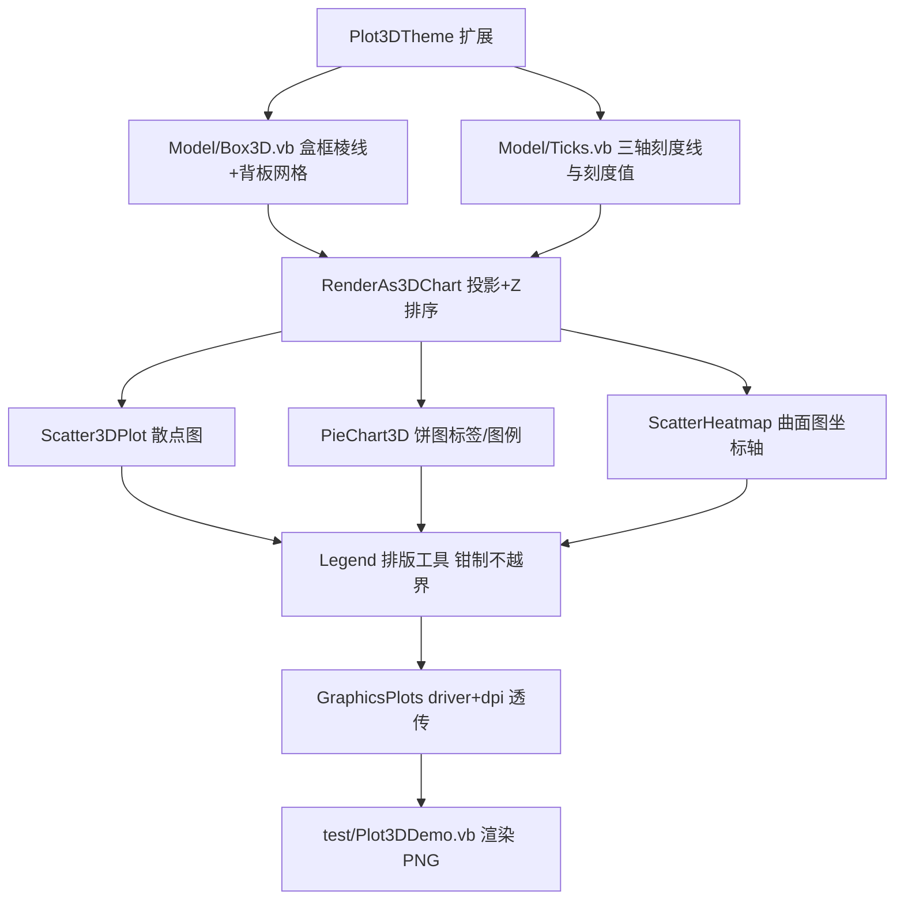

## 用户需求

对 `G:\GCModeller\src\runtime\sciBASIC#\Data_science\Visualization\DataPlot\Plot3D` 中现有的三个三维图表（三维散点图、三维饼图、三维曲面图）的渲染代码做**出版级**优化，并在 `Visualization\Visualization\test\test.vbproj` 中新增这三个三维图的 demo 测试代码。

## 产品概述

把 sciBASIC 现有的"能画出来"的三维插图，升级为可直接用于论文/报告插图的出版级三维图表：具备完整的三维坐标系（盒框、背板网格、三轴刻度与刻度值）、规范的轴标题与图表标题、不越界且排版考究的图例、可控的驱动与 DPI 导出，以及深度淡化/光照等层次感增强。

## 核心功能

- **三维散点图（Scatter3DPlot）**：三维盒框 + 三个背板网格 + 三轴刻度线与刻度值 + 轴标题/图表标题；图例按实际文字尺寸精确测量并钳制在画布内；可选按 Z 深度淡化点尺寸与透明度；保留凸包、点形状与 d3js 防重叠标签排版。
- **三维饼图（PieChart3D）**：真正绘制标签（切片内百分比/名称或引线标签），新增分类图例、标题、可配置切片厚度与圆弧细分数、可选切片分离（explode）、背景/边距/驱动/DPI 可配。
- **三维曲面图（ScatterHeatmap）**：补齐被注释掉的坐标轴（三轴刻度、刻度值、轴标题）；修正算错的图例位置并支持非 GDI 驱动；去掉写死的 `Drivers.GDI`、透传 driver 与 dpi；默认页边距与标题区；可选线框、光照与深度淡化。
- **共享主题与几何设施**：扩展 `Plot3DTheme`（标题/副标题/刻度字体/网格描边/盒框描边/刻度格式/显示开关/深度淡化/抗锯齿），新增三维盒框与刻度生成器，保持既有字段与 `LegendObject` 兼容。
- **演示**：在 `Visualization\Visualization\test` 中新增 `Plot3DDemo.vb`，渲染散点/饼图/曲面三张 PNG 到输出目录，并由 `HeatmapDemo.Main` 按命令行参数分派（`--heatmap` / `--3d` / 缺省全部）。

## 技术栈

- 语言/框架：VB.NET，`net10.0`；工程 `Visualization\DataPlot\DataPlot.vbproj`（`RootNamespace = Microsoft.VisualBasic.Data.Plots`，`GenerateDocumentationFile = True` → 新增/改动 Public 成员必须写 XML 注释，注释内不得出现 `--`）。
- 绘图：`Microsoft.VisualBasic.Imaging`（`IGraphics` / `Drawing2D.g.GraphicsPlots` / `Drawing3D`：`Camera`、`PainterAlgorithm`、`Surface`、`Shape3D`、`Models.Isometric.Shapes.Pie`）、`Drawing-net4.8` 的 GDI 驱动。
- 演示工程：`Visualization\Visualization\test\test.vbproj`（`net10.0-windows`，`StartupObject = test.HeatmapDemo`，已引用 DataPlot / imaging / Drawing-net4.8 / Core / Math 等，`HeatmapDemo.Sub New` 已 `ImageDriver.Register()`）。

## 实现方案

### 总体策略

以"共享 3D 排版层 + 三种图各自治具"的方式重构：先在 `Plot3D` 内补齐**坐标系与主题**这两块公共能力（盒框、刻度、轴标题、图例排版工具），再让散点图/饼图/曲面图分别接入，避免三份重复实现。

### 关键技术决策

1. **坐标系建模统一走 `Element3D` 管线**
`RenderAs3DChart` 已具备"Transform(相机旋转+投影) → 计算 X/Y 线性映射 → `PainterAlgorithm.OrderProvider` 按 `Location.Z` 排序 → 逐元素 Draw → d3js labeler 排版标签"的完整管线。所有新增图元（盒框棱线、背板网格、刻度线、刻度值、轴标题、饼图标签）都实现为 `Element3D` 派生对象，即可自动获得 Z 排序与坐标映射，**不需要自己写投影**。

2. **三轴刻度与刻度值（出版级的核心）**

- 现有 `AxisDraw.Axis` 只有 3 条带箭头主轴 + 3 个轴名，且 `Grids.Grid1` 只在底面画网格、只有 X/Y 刻度值，**Z 轴完全没有刻度**。
- 新增 `Plot3D\Model\Ticks.vb`：沿三条主轴按 `Geometry.NiceTicks`（与 2D 图表同款取整策略）生成刻度短线 + 数值标签（`Geometry.NumberLabel`），轴标题沿轴向外偏移一个字号避免与刻度值重叠。
- 新增 `Plot3D\Model\Box3D.vb`：由 `xrange/yrange/zrange` 生成 12 条棱；三个背板（X-Y / X-Z / Y-Z）复用 `Grids.Grid1/2/3` 的思路，并按相机朝向只画"背面"，避免遮挡数据点。
- `AxisDraw.Axis` **保留原签名并追加 Optional 参数**（`showTicks`、`tickCSS`、`tickFormat`、`showBox`），保证 `Grids`/ggplot 旧调用不变。

3. **图例排版（保证不越界）**

- 散点图现用 `maxLegendLabelSize.Height * 1.125` 当图例宽度（明显错误），改为用 `LegendPlotExtensions.MaxLegendSize(legends, g)` 实测宽高，再按 `region` 钳制 `left/top`（`Math.Min/Max` 保证 `left >= region.Left` 且 `left + w <= canvas.Width`）。
- 曲面图现用 `left = width - lsize.Width + 150`（把图例推出画布）与 `top = height/3`，改为按图例实测尺寸 + 主题边距钳制。
- 曲面图图例原先用 `ColorMapLegend(...)` 生成 `GraphicsData` 后 `DrawImageUnscaled(DirectCast(legend, ImageData).Image, ...)`，**强依赖 GDI 位图**：改为 GDI 驱动沿用位图叠加、非 GDI 驱动走自绘色标（用同一套 `Designer.GetBrushes(mapName, mapLevels)` 色板画渐变条 + `Geometry.NiceTicks` 刻度），从而支持 SVG/PS。

4. **驱动与 DPI 透传**

- `g.GraphicsPlots(size, padding, bg, plotAPI, Optional driver, Optional dpi)` 已支持两者：曲面图去掉写死的 `Drivers.GDI`，三个入口统一追加 `Optional driver` / `Optional dpi As Integer = 300`（出版默认 300 dpi）。
- 抗锯齿：`GraphicsPlots` 只在 `#If NET48` 分支设置 `SmoothingMode/TextRenderingHint`，net10 路径没有；`IGraphics` 上未发现 `SmoothingMode` 属性 → 策略为"先用 [subagent:code-explorer] 确认是否存在质量开关 API，有则设置；否则以高 dpi 超采样导出并在 XML 注释中说明"，**禁止臆造 API**。

5. **三维饼图的出版化**

- 现有 `pt`/`alpha` 是死代码 → 标签从未绘制。新增标签元素：按 `(r/1.5, alpha).ToCartesianPoint()` 计算切片中心，绘制"名称 + 百分比"（或引线到画布侧边的标签），并接入 d3js labeler 防重叠。
- `New Pie(centra, r, start, sweep, 20, 1)` 固定 20 段/厚度 1 → 开放 `Optional vertices% = 64` 与 `Optional height# = 0.25 * r`（面片更平滑、厚度适中），并提供 `Optional explode!` 沿角平分线平移切片。
- 新增 `Optional title、`Optional showLegend`、`Optional bg、`Optional padding、`Optional dpi%`、`Optional driver`；保留 `PieSlice.AsSlices` 与 `Plot3D(data, camera, driver)` 的参数名以免破坏调用方。

6. **性能考量**

- 曲面图 `xn/yn` 默认 100 → 10⁴ 量级四边形；`SurfacePainter` 逐面片 `FillPolygon` 为 O(F)，是主要开销。面片数应受 `mapLevels`/网格密度控制，保留 `parallel` 求值；`Data.vb` 的 `Tqdm.Wrap` 与 `"...".info` 进度输出在库代码中应静默（避免污染调用方控制台）。
- 刻度/盒框/网格元素数量与刻度数线性相关（百级），可忽略；Z 排序为 O(N log N)。

7. **兼容性与影响面（签名可改，但必须同步调用方）**

- `Plot3DTheme` 被 `DataPlot\ThemeBridge.vb!ToPlot3DTheme` 与 `ggplot\Internal\ggplot.vb!plot3D` 使用 → **只新增带默认值的字段**，不删改既有字段。
- `Plot3D.Legend.LegendObject` 被 ggplot 十余处引用 → 只增不改。
- R# 绑定 `src\R-sharp\Library\graphics\Render3D\plot3D.vb` 调用 `scatter3D.Plot(serials:=..., camera:=..., bg:=...)` → 重排签名时同步更新该文件（保留这三个命名参数可免改）。
- 其余引用 Plot3D 的调用方（`GCModeller\CLI_tools\eggHTS\CLI\Enrichment\KOBAS.vb`、`ggplot\Internal\layers\scatter\ggplotScatterheatmap.vb`）需用 [subagent:code-explorer] 精确定位后同步。

## 实现要点（防回归）

- **GDI 驱动的 `IGraphics.FillRectangle(brush, x, y, w, h)` 是空实现**（`gr\Drawing-net4.8\Graphics\GDICanvas.vb:2121/2148`）→ 任何新增矩形填充必须走 `Rectangle`/`RectangleF` 重载，否则静默不绘制。
- **分数坐标会留 1px 白缝**：相邻面片/网格线共用顶点或对齐整像素，否则出版图出现细缝。
- VB 大小写不敏感：局部变量不得与属性/类型同名（`Surface`、`Camera`、`Plot`、`Grid`）；新增 Public 成员必须有 XML 注释（工程开了 `GenerateDocumentationFile`）。
- 演示数据必须是**中性合成数据**（3 组高斯簇散点 / 5 段占比 / sin·cos 或高斯曲面），不得出现未发表的学术内容（上一轮已将品种名替换为 Group A~E / Feature01~30）。
- 边界情形：单一切片、零值总和（`AsSlices` 已用 `If(total = 0, 0, ...)` 保护）、曲面常量函数（`levels` 已 clamp）、空序列、极端相机角度下盒框/图例仍不越界。

## 架构设计



## 目录结构

```
Data_science/Visualization/
├── DataPlot/
│   ├── Plot3D/
│   │   ├── Plot3DTheme.vb          # [MODIFY] 新增字段：titleCSS/subtitleCSS、tickCSS、gridStroke、boxStroke、
│   │   │                           #           tickFormat、showBox/showGrid/showTicks、legendTitleCSS、
│   │   │                           #           depthFade、antialias（全部带默认值，保证 ThemeBridge 与旧调用方不变）
│   │   ├── Model/
│   │   │   ├── Axis.vb             # [MODIFY] AxisDraw.Axis 追加 Optional 参数（刻度、盒框、格式），保留原签名
│   │   │   ├── Box3D.vb            # [NEW] 由三轴范围生成 12 条棱 + 三个背板网格，按相机朝向只画背面
│   │   │   └── Ticks.vb            # [NEW] 沿三轴生成刻度短线 + 数值标签（Geometry.NiceTicks + NumberLabel）
│   │   ├── Scatter3DPlot.vb        # [MODIFY] 接入盒框/刻度；图例改用 MaxLegendSize 实测并钳制；
│   │   │                           #          新增 depthFade、title/dpi 透传
│   │   ├── PieChart3D.vb           # [MODIFY] 绘制切片标签与图例；开放 height/vertices/explode/title/
│   │   │                           #          bg/padding/dpi/driver；保留 PieSlice.AsSlices
│   │   ├── ScatterHeatmap.vb       # [MODIFY] 恢复并重写坐标轴；图例位置按实测尺寸钳制 + 非 GDI 自绘色标；
│   │   │                           #          去掉写死的 Drivers.GDI，透传 driver/dpi；默认 padding 与标题区
│   │   └── Data.vb                 # [MODIFY] 静默 Tqdm/info 进度输出（库行为）
│   └── ThemeBridge.vb              # [MODIFY] 按需把新主题字段纳入 ToPlot3DTheme（保持旧字段语义）
└── Visualization/test/
    ├── Plot3DDemo.vb               # [NEW] Module Plot3DDemo：Run(outDir) + 散点/饼图/曲面三个演示，
    │                               #       合成数据，PNG 输出到 AppContext.BaseDirectory
    └── HeatmapDemo.vb              # [MODIFY] Main 按参数分派：--heatmap 只跑热图、--3d 只跑三维、缺省全部
```

## 关键代码结构

```
''' <summary>三维绘图主题（在既有字段之上扩展，全部带默认值以保持向后兼容）。</summary>
Public Class Plot3DTheme
    ' --- 既有字段保持不变：padding / background / axisStroke / axisLabelCSS /
    '     tagCSS / tagColor / mainTextColor / legendBoxStroke / drawLegend / drawLabels
    Public Property titleCSS As String          ' 图表标题字体
    Public Property subtitleCSS As String       ' 副标题字体
    Public Property tickCSS As String           ' 刻度值字体
    Public Property gridStroke As String        ' 背板网格描边
    Public Property boxStroke As String         ' 三维盒框描边
    Public Property tickFormat As String        ' 刻度值格式（默认 "G2"）
    Public Property showBox As Boolean          ' 是否绘制盒框
    Public Property showGrid As Boolean         ' 是否绘制背板网格
    Public Property showTicks As Boolean        ' 是否绘制刻度线与刻度值
    Public Property depthFade As Double         ' 深度淡化强度，0 表示关闭
End Class

''' <summary>由三轴数值范围生成出版级三维坐标系元素（盒框棱线、背板网格、刻度线与刻度值、轴标题）。</summary>
Friend Module AxisFrame3D
    Function Box(css As CSSEnvirnment, x As DoubleRange, y As DoubleRange, z As DoubleRange,
                 theme As Plot3DTheme, camera As Camera) As IEnumerable(Of Element3D)
    Function Ticks(css As CSSEnvirnment, x As DoubleRange, y As DoubleRange, z As DoubleRange,
                   labels As (X As String, Y As String, Z As String), theme As Plot3DTheme) As IEnumerable(Of Element3D)
End Module
```

## Agent Extensions

### SubAgent

- **code-explorer**
- Purpose：精确定位三处 API 的现有调用方（`Scatter3DPlot.Plot`、`PieChart3D.Plot3D`、`ScatterHeatmap.Plot`）在 R# 绑定、ggplot、eggHTS/KOBAS 中的具体调用点，并确认 `IGraphics` 是否暴露抗锯齿/质量开关（`SmoothingMode`/`CompositingQuality`）以及 `Geometry.NiceTicks`、`ColorMapLegend`、`MaxLegendSize` 的准确签名。
- Expected outcome：得到"改动影响面清单 + 可直接编译调用的精确 API 签名"，避免臆造 API 与漏改调用方。

### Skill

- **lsp-code-analysis**
- Purpose：对 `Plot3DTheme`、`LegendObject`、`AxisDraw.Axis`、`Grids` 做引用/实现导航与改动影响分析，确认新增字段与追加 Optional 参数不会破坏 ggplot 与 R# 侧调用。
- Expected outcome：明确"只增不改"的安全边界，并在签名调整后快速定位需要同步修改的文件。