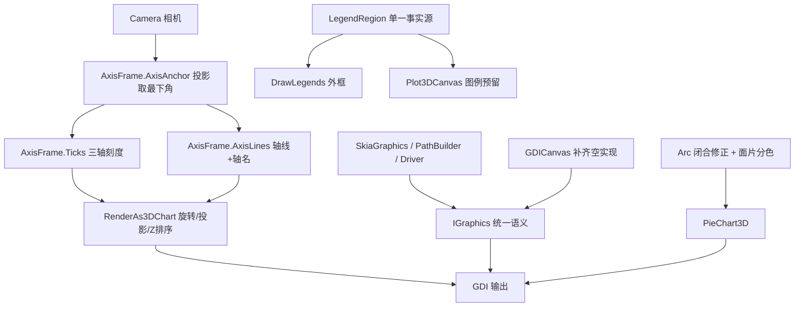

## 用户需求

在 `Visualization/test/Plot3DDemo.vb` 已配置 GDI+ 与 Skia 双后端的前提下，修复三个三维图表的渲染缺陷，并让两个图形封装后端的输出保持一致。

## 产品概述

把当前"能出图但有明显排版缺陷、且两个后端观感不同"的三维图表，修正为刻度/图例/切片几何都对齐、GDI+ 与 Skia 结果一致的可出版插图。

## 核心功能

1. **三维饼图切片对齐**：消除切片之间的细缝与"外弧不连续"（现每片比名义张角少 1/vertices），并给顶面/侧面/底面分色，使厚度可辨识、侧壁不再表现为随机细色条；explode 后各片外缘仍为同一圆。
2. **坐标轴刻度搬到左下角**：三维散点图与三维曲面图的 X/Y/Z 刻度线与刻度值、轴线箭头、轴名，统一跟随相机移动到盒体的"前下角"（随视角自适应，不是写死某个坐标边）。
3. **图例外框与内容对齐**：外框严格包裹内容并四边留白均匀，首行文字不再压在边框上、右侧不留空、底部不留大空白。
4. **双后端语义对齐**：修正 Skia 封装中被误用的 API 语义（椭圆中心/半径、圆弧把度当弧度、字号 4/3 差、文字锚点、填充规则、抗锯齿、折线、裁剪），补齐 GDI 封装的空实现 stub，使同一调用在两个后端产出同一结果。

## 视觉结果

- 饼图：切片紧密相接（可选 explode 时缝隙均匀）、侧面有明暗层次、标签清晰。
- 散点/曲面：刻度与刻度值集中在左下方，与轴对齐且不压数据；轴名紧随轴端。
- 图例：圆角外框紧贴内容、四边留白一致；Skia 下圆角、色块、字号与 GDI+ 一致。

## 技术栈

- VB.NET / net10.0；涉及四个工程：`gr\Drawing-net4.8`、`gr\Microsoft.VisualBasic.Imaging`、`Microsoft.VisualBasic.Drawing`（Skia 后端）、`DataPlot`（3D 图表）、`Visualization\test`（演示）。
- 3D 管线：`Camera`（旋转+投影）+ `RenderAs3DChart`（Element3D 变换/Z 排序）+ `PainterAlgorithm.PainterBuffer`（曲面/多边形）。
- 后端封装：`IGraphics`（Core 中的 `Drawing\GDI+\Interface.vb`，接口不变）、`GDICanvas`/`Graphics2D`、`SkiaGraphics` + `Interop\PathBuilder.vb` + `Driver.vb`。

## Implementation Approach

### 一、饼图：几何闭合 + 面片分色（DataPlot + imaging）

1. `Models\Paths\Circle.vb` 的 `Arc`：改为"按 `vertices` 等分并补上末端点"——`sweep ≠ 360` 时推 `vertices + 1` 个点（首点 = start，末点 = start + sweep），`sweep = 360` 时保持 `vertices` 个点避免重复点。这样相邻切片的共享边界完全重合，细缝消失；`Cylinder` 走 `Paths.Circle` 不受影响。
2. `PieChart3D.Plot3D`：利用 `Extrude` 的面序约定（`paths(0)=底面(reverse)`、`paths(1)=顶面`、其余为侧面）为同一个切片分配三种颜色：顶面 = 基色、侧面 = 基色 ×0.84、底面 = 基色 ×0.72（用 HSV/线性缩放实现，避免直接减 RGB 造成偏色）。同时给每个面片加 0.6px 同色描边（`BufferPainting(drawPath)` 之外自绘），压掉抗锯齿接缝。
3. explode 保持"刚体平移 + 沿角平分线"，但把 `radius` 按 `1 + explode` 同步放大（`Pie(origin', 1+explode, ...)`），使各片外缘落在同一圆上，"台阶"消失。
4. `TopFaceIndex` 随面序调整（现在是 `paths(1)`），标签锚点仍取顶面质心。

### 二、刻度搬到左下角（DataPlot）

1. 新增 `AxisFrame.AxisAnchor(camera, x, y, z) As (corner As Point3D, xDir As Integer, yDir As Integer)`：把盒体 8 个角点投影，取**屏幕 y 最大**（最下）的角为锚点（同分时取 x 最小）；在锚点处比较两条水平棱的屏幕走向（`|dx|` 更大者为 X 棱），据此确定 `xDir/yDir` 的符号。
2. `AxisFrame.Ticks` 改为基于该锚点生成：X 刻度沿 X 棱、Y 刻度沿 Y 棱、Z 刻度沿锚点处的竖棱；刻度值与刻度线的外推方向由锚点相对盒心的方位决定（`±X`/`±Y`），保证标签永远朝盒体外侧、不压数据。
3. 新增 `AxisFrame.AxisLines(css, ranges, labels, theme, camera)`：在锚点处画 3 条带箭头的主轴 + 3 个轴名（X/Y 轴名位于棱的远端并再外推 8%，Z 轴名位于竖棱顶端外推），替换 `Scatter3DPlot` / `ScatterHeatmap` 里对 `AxisDraw.Axis` 的调用。**`AxisDraw.Axis` 保持原签名与原行为不变**（ggplot 的 `g3d.vb` 在用）。
4. 曲面图的 `Polygon` 面片与坐标系共用同一 `RenderAs3DChart` 缩放，锚点变动后仍然对齐；`BackGrids` 逻辑不变。

### 三、图例外框对齐（DataPlot 基类 + 3D 复用）

1. 在 `Plot3D\Legend\LegendPlot.vb` 抽出单一事实源：

```
Public Function LegendRegion(topLeft As PointF, gSize As SizeF,
count As Integer, maxTitle As SizeF,
Optional d As Integer = 10) As RectangleF
```

规则：`rowH = Max(gSize.Height, maxTitle.Height)`；`width = gSize.Width + 5 + maxTitle.Width + 2d`；`height = count*rowH + (count-1)*d + 2d`；`X = topLeft.X - d`、`Y = topLeft.Y - d`。

2. `DrawLegends` 用该函数画外框（把 `-1.2d` 改为 `-d`），并在 `DrawLegend` 里把首行文字改为 `Max(0, (rowH - titleH)/2)`，消除"文字压边框"。
3. `Plot3DCanvas.MeasureLegendBox / DrawLegendBlock` 改为直接调用 `LegendRegion`，散点图/饼图/曲面（色标）三处的预留宽度都由它算出，调用方与绘制方不再各算一套。

### 四、Skia 与 GDI+ 语义对齐（两个封装后端）

**A. Skia 几何/路径（`SkiaGraphics.vb`、`Interop\PathBuilder.vb`）**

- `FillEllipse`：改为 `m_canvas.DrawOval(New SKRect(x, y, x + width, y + height), paint)`（外接矩形语义）。
- `DrawCircle`：宽高改 `2 * radius`，与 GDI 扩展 (`d = r*2`) 一致。
- `PathBuilder.AddArc`：按**度**直接传 `skia.ArcTo(oval, startAngle, sweepAngle, forceMoveTo)`；`AddEllipse` 改 `x, y, x + r1*2, y + r2*2`；`AddCurve` 用 `CubicTo/QuadTo`；`FillMode` 同步到 `SKPathFillType`；未支持 op 保持抛错但补 `AddString/AddPie` 的明确注释。
- `FillPolygon`：设 `path.FillType = SKPathFillType.EvenOdd`（对齐 GDI+ Alternate）；`<3` 点改为抛 `ArgumentException`（与 GDI+ 一致）。
- `DrawLines`：改成一条 `SKPath`（MoveTo + LineTo…）后一次 `DrawPath`，得到正确 join 与连续虚线相位。
- `SetClip`：`SKClipOperation.Difference` → `Intersect`（对齐 GDI+ `SetClip` 语义）。
- 抗锯齿：`DrawLine`、`DrawRectangle(*)`、`DrawPolygon`、`DrawPath(stroke)`、`DrawPath(Polygon2D)` 的 `SKPaint` 统一 `IsAntialias = True`。

**B. 文字（`SkiaGraphics.vb`、`Driver.vb`、`DrawingInterop.vb`、`GraphicsText.vb`）**

- 字号：Skia 统一 `px = font.Size * 96.0/72.0`（GDI+ 的 pt→px 换算），并用**样式感知**的 `font.CreateSkiaTypeface`（`Interop\Interop.vb:246-257`）代替 `SKTypeface.FromFamilyName(name)`，使 Bold/Italic 也一致。
- `MeasureString`：改为行框高度 `ascent + |descent| + leading`（`SKFont.Metrics`），宽度取 `MeasureText` 并按 GDI+ 的内边距补一个固定比例（约 1/6 em）——这是图例行距/标题/刻度布局差异的总根源；`width`/`layoutArea` 重载实现为"按宽度折行后累加行高"。
- `DrawString(angle)`：Skia 改为 `Save → Translate(x,y) → RotateDegrees(angle) → DrawText(s, 0, ascent) → Restore`，锚点=左上角（与 GDI+ 的 `RotateAt(point)` 一致）；顺手修 `Graphics2D.vb:299` 负角度的 `Sin(angle*180/Pi)` 单位错误。

**C. GDI 侧补齐空实现（`GDICanvas.vb`）**

- `FillRectangle(brush, x, y, w, h)`（Integer 与 Single 两个重载）改为 `Graphics.FillRectangle(sbrush, x, y, w, h)`（直接调原生，避免走到另一个被重写的重载形成递归）。
- `DrawRectangles(pen, rects())` 两个重载改为 `Graphics.DrawRectangles(...)`。
- 说明：clip 系列在 GDI 是 no-op，本次不改（避免影响既有 2D 图表），只在 Skia 侧纠正 `SetClip` 语义。

### Implementation Notes（防回归）

- `IGraphics` 接口不做任何增删（只改实现），避免牵连 SVG/PostScript/Dx 后端。
- Skia 字号/度量修正会改变**所有** Skia 图的文字布局（正是需求），必须回归热图 demo 与 2D 示例，确认不炸版。
- `DrawLegends` 外框公式会让 ggplot 图例外观变化 1~6px（更贴合内容）；`LegendObject` 结构不动。
- `Arc` 修正只影响 `Pie`（`Cylinder` 用 `Paths.Circle`），张角变化极小但会消除缝隙。
- 顶点数：饼图默认 `vertices=96`，每片新增 1 个点可忽略；曲面图面片数不变。
- 全部新增 Public 成员需 XML 注释（DataPlot `GenerateDocumentationFile=True`），注释内不得出现 `--`；VB 大小写不敏感，局部变量不得与属性同名。
- 已知陷阱：GDI 的 `FillRectangle(brush,x,y,w,h)` 是空实现（本次补上）；`IGraphics` 上没有任何抗锯齿开关，只能逐后端处理。

## Directory Structure

```
Data_science/Visualization/
├── DataPlot/Plot3D/
│   ├── PieChart3D.vb            # [MODIFY] 面片分色（顶/侧/底）、顶层描边、explode 外弧一致、TopFaceIndex 随面序调整
│   ├── Model/Frame3D.vb         # [MODIFY] 新增 AxisAnchor 相机自适应锚点；Ticks 改为锚点驱动；新增 AxisLines
│   ├── Model/Axis.vb            # [KEEP] AxisDraw.Axis 签名与行为不变（ggplot 依赖）
│   ├── Legend/LegendPlot.vb     # [MODIFY] 抽出共享 LegendRegion；修正外框公式；首行文字垂直居中
│   ├── Device/Plot3DCanvas.vb   # [MODIFY] MeasureLegendBox/DrawLegendBlock 改用 LegendRegion
│   ├── Scatter3DPlot.vb         # [MODIFY] 改用 AxisLines（左下锚点）；图例预留宽度取 LegendRegion
│   └── ScatterHeatmap.vb        # [MODIFY] 改用 AxisLines（左下锚点）；色标预留宽度与图例函数统一
├── gr/Microsoft.VisualBasic.Imaging/Drawing3D/Models/Paths/Circle.vb
│                                # [MODIFY] Arc 补末端点（sweep<360 推 vertices+1 点）
├── gr/Drawing-net4.8/
│   ├── Graphics/GDICanvas.vb    # [MODIFY] 补齐 FillRectangle(x,y,w,h) 两个重载与 DrawRectangles 两个重载
│   └── Graphics/Graphics2D.vb   # [MODIFY] DrawString(angle) 负角度分支的单位错误
└── Microsoft.VisualBasic.Drawing/
    ├── SkiaGraphics.vb          # [MODIFY] FillEllipse/DrawCircle/DrawLines/SetClip/FillPolygon/AA/DrawString(angle)/MeasureString
    ├── Driver.vb                # [MODIFY] MeasureString 改为行框度量（ascent+descent+leading + 内边距）
    └── Interop/PathBuilder.vb   # [MODIFY] AddArc 用度、AddEllipse 用 2r、AddCurve 用贝塞尔、同步 FillMode
```

## Architecture Design



## Key Code Structures

```
' 相机自适应锚点：返回最下方盒角与其 X/Y 棱方向
Friend Function AxisAnchor(camera As Camera, x As DoubleRange, y As DoubleRange, z As DoubleRange) _
    As (corner As Point3D, xDir As Integer, yDir As Integer)

' 图例外框唯一计算入口（调用方与绘制方共用）
Public Function LegendRegion(topLeft As PointF, gSize As SizeF,
                             count As Integer, maxTitle As SizeF,
                             Optional d As Integer = 10) As RectangleF
```

## Agent Extensions

### SubAgent

- **code-explorer**
- Purpose：复核 Skia/GDI 封装中本轮要改的每个方法的确切签名与调用方（尤其 `FillEllipse`/`DrawCircle`/`DrawLines`/`SetClip`/`MeasureString` 与 `PathBuilder`），并确认 `AxisDraw.Axis`、`DrawLegends`、`Pie` 的外部调用方不受影响。
- Expected outcome：得到可直接编译的修改清单与行号，避免臆造 API、漏改调用方。

### Skill

- **lsp-code-analysis**
- Purpose：对 `IGraphics`、`SkiaGraphics`、`GDICanvas`、`LegendPlotExtensions.LegendRegion`、`AxisFrame.Ticks` 做引用/实现导航与影响分析，确认只改实现不改接口，且新增的 Public 成员没有命名冲突。
- Expected outcome：明确"接口不变、只改实现"的安全边界，并列出需同步回归的调用点（ggplot、热图、2D 图表）。