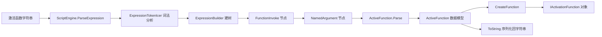

## 产品概述

针对机器学习模型序列化中的激活函数存储，重写「激活函数字符串 → 激活函数数据模型」的解析逻辑：借助项目底层数学库已有的表达式字符串解析能力，先把文本解析为函数调用表达式树，再从表达式树生成激活函数对象。同时扩展底层解析器，让表达式树原生支持命名参数（参数名与参数值）；并补充控制台测试验证序列化往返一致性，输出测试报告。

## 核心功能

- 将激活函数文本表达式解析为函数调用表达式树，函数名与参数列表从树中读取
- 表达式树新增命名参数节点，同时携带参数名与参数值表达式
- 从表达式树生成激活函数数据模型，兼容有参函数与无参函数
- 保持既有序列化文本格式 `name(arg:=value, ...)` 与所有调用方兼容
- 控制台测试覆盖有参、无参表达式，用 DebugAudit 记录断言并生成测试报告

## 技术栈

- 语言与框架：VB.NET，.NET 10；项目 `Mathematica\Math\Math\Math.NET5.vbproj`（程序集 Microsoft.VisualBasic.Math.Core，根命名空间 Microsoft.VisualBasic.Math）与 `MachineLearning\MachineLearning\machine_learning-netcore5.vbproj`（已通过 ProjectReference 引用前者）。
- 复用能力：`Microsoft.VisualBasic.Math.Scripting.ScriptEngine.ParseExpression` → `ExpressionTokenIcer.GetTokens` → `ExpressionBuilder.BuildExpression` → `Microsoft.VisualBasic.Math.Scripting.MathExpression.Impl.Expression` 表达式树。
- 测试：现有 console 测试工程 `MachineLearning\MachineLearning\test\test.vbproj`，使用 `Microsoft.VisualBasic.ApplicationServices.Debugging.DebugAudit` 记录断言、标记与 `ToJson` 报告。

## 实现思路

扩展底层词法器识别 `:=` 并产出新的赋值 token，构建器把「符号 + 赋值 + 值表达式」组装为命名参数节点；`ActiveFunction.Parse` 只用 `ScriptEngine.ParseExpression` 得到 `FunctionInvoke`，读取 `funcName` 与 `parameters`，把命名参数节点转换为 `NamedValue()`。`CreateFunction()`、`ToString()` 与所有调用点保持不变。

关键决策与权衡：

- 用户已确认「同时扩展底层解析器」。让表达式树成为唯一解析入口，避免在激活函数层再做一次字符串切分，消除双重解析逻辑；代价是改动跨两个项目，需做影响面扫描。
- 新节点 `NamedArgument` 继承 `Expression`，使 `FunctionInvoke.parameters As Expression()` 无需改签名；其 `Evaluate` 与 `GetVariableSymbols` 委托给内部 `value`，保证求值链、`Substitute`、`Simplify` 等遍历逻辑不崩溃。
- `Parse` 返回类型保持 `As ActiveFunction`。现有调用点（如 `MultilayerPerceptron.vb:98`、`OnnxMlpImport.vb:150,157`、`test\Module1.vb:67`）均依赖该签名，改签名会扩大爆炸半径。
- 容错：`ParseExpression` 使用 `throwEx:=False`；结果非 `FunctionInvoke` 时抛出带原文信息的 `ArgumentException`；无参函数返回长度为 0 的非 Nothing 数组，保证 `Item(name)` 的 `FirstOrDefault` 不抛空引用。
- 性能：词法与建树均为单次线性扫描，时间复杂度 O(n)，n 为表达式长度；解析仅发生在模型加载期，不在推理热路径；去掉正则与多次 `StringSplit`，开销低于原实现。

## 实现注意事项

- `ExpressionTokenIcer.walkChar` 使用 `buf` 加 `cacheNext` 回塞机制：新增 `:` 分支时必须先 flush 已有符号（例如 `alpha`），再消费紧随其后的 `=`，不能让 `:` 或 `=` 残留在符号名里；同时兼容 `alpha:=2`、`alpha := 2`、`alpha:=-1` 三种写法。
- `GetTokens` 中 `buf = 1` 的二次派发块需为新的赋值 token 增加分支，确保 flush 后的缓存字符被正确产出。
- 新增 `MathTokens` 枚举成员属穷举型变更：先用 [subagent:code-explorer] 扫描所有对 `MathTokens` 的 `Select Case` 与分支判断，确认无遗漏后再改，防止破坏 `x^2+3*x`、阶乘、逻辑字面量等既有表达式。
- `ExpressionCompiler.CreateExpression` 遍历 `FunctionInvoke.parameters`，需对 `NamedArgument` 解包到 `.value`，否则其他调用方编译含命名参数的表达式会遇到未知节点类型。
- 数值文本用不依赖区域设置的方式输出（如 `CultureInfo.InvariantCulture`），避免 `Literal.ToString()` 在当前区域为逗号小数点时把 `2.5` 写成 `2,5`，导致 `Item(name)` 转 `Double` 出错。
- 不改动 `ActiveFunction.ToString()`、`CreateFunction()` 与任何 `IActivationFunction` 实现；测试按参数名的数值语义比较，不要求 `2.0` 与 `2` 字符串完全相同。
- 解析失败信息中保留原始表达式文本，但不输出大段模型数据；不在解析路径增加日志，避免批量加载模型时日志刷屏。

## 架构设计



模块职责：词法层负责 token 化（含 `:=`）；建树层负责把 token 序列组装为函数调用与命名参数节点；激活函数层只消费表达式树并映射到 `ActiveFunction`；测试层验证 `ToString` 与 `Parse` 的往返。

## 目录结构

```
g:\GCModeller\src\runtime\sciBASIC#\Data_science\Mathematica\Math\Math\Scripting\
├── Expression\
│   ├── MathToken.vb                    # [MODIFY] MathTokens 枚举新增赋值 token 成员，供词法器与构建器识别 `:=`
│   ├── ExpressionTokenIcer.vb          # [MODIFY] walkChar/GetTokens 识别 `:` 加 `=` 组合，flush 符号名后产出赋值 token，兼容空格与负号
│   ├── ExpressionBuilder.vb            # [MODIFY] AsCallFunction 中增加私有参数构建辅助方法，识别「符号 + 赋值 + 值表达式」并生成 NamedArgument；其余参数仍走 BuildExpression
│   ├── ExpressionCompiler.vb           # [MODIFY] CreateExpression 增加 NamedArgument 解包分支，委托给内部 value 表达式
│   └── Expression\
│       └── NamedArgument.vb           # [NEW] 命名参数表达式节点，继承 Expression，持有 name 与 value，实现 Evaluate/GetVariableSymbols/ToString
g:\GCModeller\src\runtime\sciBASIC#\Data_science\MachineLearning\MachineLearning\
├── ComponentModel\ActiveFunctions\
│   └── ActiveFunctionXml.vb            # [MODIFY] 重写 Parse：导入 Scripting 与 Impl 命名空间，调用 ScriptEngine.ParseExpression，读 FunctionInvoke.funcName/parameters，把 NamedArgument 转为 NamedValue()，处理非法输入与无参情况
└── test\
    └── Module1.vb                     # [MODIFY] 新增 activeFunctionParseTest：覆盖 BipolarSigmoid(alpha:=3)、Sigmoid(alpha:=2)、ReLU()、HyperbolicTangent()，用 DebugAudit.Test/Check/Mark 断言并用 ToJson 输出报告
```

## 关键代码结构

```
Namespace Scripting.MathExpression.Impl
    Public Class NamedArgument : Inherits Expression
        Public Property name As String
        Public Property value As Expression
        Public Sub New(name As String, value As Expression)
        Public Overrides Function Evaluate(env As ExpressionEngine) As Double
        Public Overrides Function GetVariableSymbols() As IEnumerable(Of String)
        Public Overrides Function ToString() As String
    End Class
End Namespace
```

`ActiveFunction.Parse` 签名保持 `Public Shared Function Parse(expression As String) As ActiveFunction`；只需从 `FunctionInvoke.funcName` 取函数名、从 `parameters` 中的 `NamedArgument.name` 与 `NamedArgument.value` 取参数名与数值文本。

## Agent Extensions

### SubAgent

- **code-explorer**
- Purpose: 在修改 `MathTokens` 枚举与新增 `NamedArgument` 节点前，扫描底层 Scripting 目录与 MachineLearning 中对 token 类型、表达式节点的所有分支判断和遍历点，确认影响面。
- Expected outcome: 给出需要同步适配的文件与方法清单（至少覆盖 ExpressionBuilder、ExpressionCompiler、各节点 ToString 依赖点），确认没有遗漏的穷举分支后，再执行词法器与构建器改动。