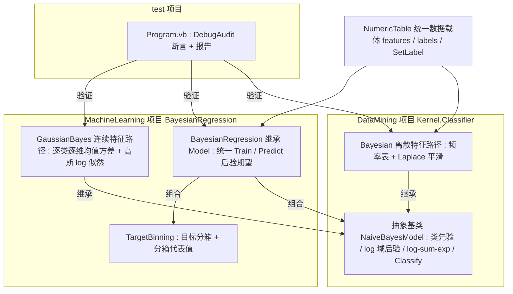

## User Requirements

- 优化 `DataMining\DataMining\Kernel\Bayesian.vb` 朴素贝叶斯分类器：修正概率计算、提升数值稳定性与计算性能，并把已弃用的输入数据结构替换为项目统一的数据载体；允许调整公开接口。
- 在 `MachineLearning\MachineLearning\machine_learning-netcore5.vbproj` 项目中，基于改造后的分类器拓展出「朴素贝叶斯回归」能力。
- 回归需同时提供离散特征与连续特征两条实现路径，且对外使用统一 API。
- 在现有 `test` 项目中追加可运行验证程序，记录测试结果并生成测试报告，不新建项目。

## Product Overview

一套面向数值二维表的朴素贝叶斯建模能力：底层是经过修正与加速的分类器，上层把分类器包装为对连续目标做预测的回归模型。输入为带标签的数值表，输出为类别判定或连续预测值，并附带可查阅的验证报告。

## Core Features

- 分类器修正：条件概率按该类别样本数归一；对未见过的特征值做平滑，避免整体归零；概率累加避免多特征连乘下溢；预计算先验与频率表，消除逐次全表扫描。
- 数据结构现代化：以统一数值表承载特征与标签，预测结果可按约定写回标签列。
- 回归预测：把连续目标离散为若干区间，再按各区间的后验概率对区间代表值加权求期望，输出单一连续值。
- 双路径统一 API：离散特征走频率表似然，连续特征走高斯似然；共用训练入口、预测入口与后验计算。
- 边界处理：空数据表、特征维度不一致、零方差、特征数量极多、目标值恒定等情形有明确且可验证的行为。
- 验证报告：分类正确性、平滑与下溢边界、后验归一性、回归误差均以断言记录并导出为报告，失败通过退出码体现。

## Tech Stack Selection

- 语言与运行时：Visual Basic .NET；两个库项目 `net10.0`，测试项目 `net10.0-windows`。仅使用现有项目引用（`Core.vbproj`、`DataMining.NET5.vbproj`、`Math.NET5.vbproj`），不引入新包、不新建项目、不改目标框架。
- 统一数据载体：`Microsoft.VisualBasic.Data.NumericTable`（已核实为项目文档指定的统一数值表；`features As Double()()`、`labels As Double()()`；构造重载 `New(x As IEnumerable(Of Double()), y)` 分别支持回归 Double 标签与分类 Integer 标签；`GetLabel(idx)`、`GetClassLabel(idx) As Integer()`、`SetLabel(name, values)`、`Validate()`）。
- 数值工具：`Microsoft.VisualBasic.Math.Distributions.pnorm.ProbabilityDensity(x, m, sd)`（已核实存在，Math 项目已被两个库项目引用）；均值/方差用一次性循环统计。
- 测试报告：`Microsoft.VisualBasic.ApplicationServices.Debugging.DebugAudit`（Core 项目，已核实无 `Compile Remove` 排除）。
- 模型惯例：`Microsoft.VisualBasic.MachineLearning.Model` 空基类（`IterationReporter.vb:119`），`Train` / `Predict` 命名，一个算法一个目录即一个 Namespace，配 `NamespaceDoc.vb`。

## Implementation Approach

**策略**：把「朴素贝叶斯回归」拆为三层——共享的后验推断核心、目标分箱、可替换的似然策略。训练时先把连续目标分箱成类别标签，用朴素贝叶斯拟合类别后验；预测时以 `ŷ = Σ_k P(k|x) · rep(k)` 的后验期望还原连续值。离散路径复用优化后的分类器频率表，连续路径改用逐类逐维高斯似然，二者共用同一套训练/预测入口。

**关键决策与取舍**：

1. 共享抽象基类放在 DataMining 的 `Kernel.Classifier`，因为两条路径的 log 域累加、log-sum-exp 归一化、`Classify` 完全相同；machine_learning 已引用 DataMining，依赖方向单向不成环。`Bayesian` 不继承 `MachineLearning.Model`（避免反向依赖），只有回归包装类继承它并以组合方式持有 `NaiveBayesModel`，与 `SVMModel` / `RanFog` 的 `Inherits Model` 惯例保持一致。
2. 不套用 `IterationReporter(Of T As Model)`：它是迭代式训练框架（`Train(parallel)` + 进度回调），而朴素贝叶斯是一次闭式统计，强行套用属于误用既有模式。仅继承空基类 `Model` 以保证类型体系一致（KISS / YAGNI）。
3. 数值稳定：全程 log 域累加后 log-sum-exp 归一化；加性平滑系数可配，未见特征值得到非零概率；高斯路径对方差设下限避免除零；代表值取箱内训练目标均值，空箱退化为区间中点。
4. 数据结构现代化：用 `NumericTable` 替换标记 `<Obsolete>` 的 `IntegerEntity`；离散路径把特征值规范为整型类别键以延续原语义；回归预测可经 `SetLabel` 写回标签列，符合 NumericTable 文档约定。
5. 由于全目录检索确认 `Bayesian` 无任何外部调用者，公开签名可自由调整，不保留兼容重载（避免无意义的兼容层）。

**性能与复杂度**：原 `Classify` 每次预测为 `O(K·D·N)` 的嵌套 LINQ 全表扫描，且 `P(Y)` 反复重算、`Load` 重复枚举 `Data.First`。改造后构建期一次性 `O(N·D)` 建频率表/统计量并缓存类先验与 log 表，预测期降为 `O(K·D)` 字典查表；高斯路径构建 `O(N·D)`、预测 `O(K·D)`。空间为 `O(K·D·V)`（离散频率表）或 `O(K·D)`（高斯参数）。瓶颈在训练表构建，采用单次遍历 + 字典累加消除重复扫描；批量预测复用同一模型实例，避免逐样本重建。

## Implementation Notes

- 复用已核实 API，不臆造路径或方法名：`NumericTable` 的构造/`GetLabel`/`GetClassLabel`/`SetLabel`/`Validate`；`pnorm.ProbabilityDensity`；`DebugAudit.Mark / Check / AreEqual / CheckThrows / Capture / SaveReport / ToJson / Dump / FailureCount / Reset`。
- 热路径：`Posterior` / `Predict` 内不得重新枚举 `features`、不得重算先验；先验、频率表、log 表全部在 `Load` / `Train` 时算好并冻结。
- 日志与报告：库代码保持静默；仅测试程序用 `DebugAudit` 记录断言，报告只保存类别数、箱数、误差、后验和等标量，不 dump 大矩阵；报告目录用 `AppContext.BaseDirectory` 下 `report/`，`SaveReport` 会自动建目录。
- 爆炸半径控制：`DataMining.NET5.vbproj` 的 `<NoWarn>$(NoWarn);BC40000</NoWarn>` 因其他遗留类型仍在使用而必须保留，不要删除；`Visualization\Visualization\Extensions.vb` 仅构造 `IntegerEntity`（不调用分类器），无需改动。两个库 `.vbproj` 均为 SDK 风格，自动包含新增 `.vb`，无需新增 `Compile Include`。唯一需要修改的配置是 `test.vbproj` 的 `StartupObject`。
- 兼容性：`test` 目录已存在多个 `Sub Main()`（`svm\SVMDemo.vb:110` 与 `rf.vb:59`），依赖 `StartupObject` 消歧；新增测试入口必须放在带命名空间的独立模块中，并在新 `Main` 中保留对 `SVMDemoProgram.Main()` 的可达性（例如按命令行参数转发），避免默认入口调整后 SVM demo 无法运行。

## Architecture Design



数据流：`NumericTable` → 目标分箱生成整数类别列 → 按 `BayesFeatureMode` 选择 `Bayesian`（频率表）或 `GaussianBayes`（μ/σ²）拟合 `NaiveBayesModel` → `Predict` 取 log 域后验经 log-sum-exp 归一化 → 与 `TargetBinning` 代表值加权求和 → 连续预测值（可选 `SetLabel` 写回）。

## Directory Structure

本次改动集中在 3 个位置：DataMining 的分类器内核（1 改 1 新）、MachineLearning 新增的 `BayesianRegression` 算法目录（4 新）、现有 test 项目（1 新 1 改）。

```
G:/pixelArtist/src/framework/Data_science/
├── DataMining/DataMining/Kernel/
│   ├── NaiveBayesModel.vb          # [NEW] 共享朴素贝叶斯抽象基类，命名空间 Microsoft.VisualBasic.DataMining.Kernel.Classifier。
│   │                                #   职责：持有类别数组、类先验（log 域）、特征维度；实现 log-sum-exp 归一化的
│   │                                #   Posterior(x) 与 argmax 的 Classify(x)；声明 MustOverride LogLikelihood(x, classIndex)
│   │                                #   供离散/高斯两种子类实现。要求：后验长度为类别数且和为 1，输入维度不符时给出明确异常。
│   └── Bayesian.vb                 # [MODIFY] 优化后的离散（分类型）朴素贝叶斯分类器，Inherits NaiveBayesModel。
│                                    #   职责：以 NumericTable 取代 IntegerEntity；Load(table, classColumn) 单次遍历构建
│                                    #   每类每维每值的频率表并缓存类先验；实现带可配平滑系数的 log 似然；保留
│                                    #   Classify / P(X,Y) / ToString 语义但改为新签名；空表、维度不一致、未知特征值
│                                    #   的边界行为明确。要求：消除嵌套 LINQ 全表扫描，预测期仅字典查表。
├── MachineLearning/MachineLearning/BayesianRegression/
│   ├── TargetBinning.vb            # [NEW] 连续目标分箱器。职责：由训练目标向量计算 min/max 与 K 个等宽区间，
│   │                                #   提供 BinIndex(y)、区间代表值（箱内训练目标均值，空箱用中点）、区间边界；
│   │                                #   处理目标恒定与 K 小于等于 1 的退化情形。是离散/连续两条路径共用的组件。
│   ├── GaussianBayes.vb            # [NEW] 连续特征高斯似然模型，Inherits NaiveBayesModel。职责：训练期按类别与维度
│   │                                #   统计均值/方差（方差下限保护），实现高斯 log 似然；可复用
│   │                                #   Microsoft.VisualBasic.Math.Distributions.pnorm 的密度语义，但优先采用闭式 log 形式防下溢。
│   ├── BayesianRegression.vb       # [NEW] 统一对外回归模型，Inherits Microsoft.VisualBasic.MachineLearning.Model。
│   │                                #   职责：定义 BayesFeatureMode 枚举（Discrete / Continuous）与配置（箱数、平滑系数、方差下限）；
│   │                                #   提供 Train(table, targetColumn, mode, ...) 与 Predict(x) / Predict(X) / PredictPosterior(x)；
│   │                                #   按 mode 组装 Bayesian 或 GaussianBayes，预测返回后验期望；提供批量预测与可选 SetLabel 写回。
│   └── NamespaceDoc.vb             # [NEW] 命名空间文档，遵循项目「一算法一 NamespaceDoc」惯例，说明两条路径的适用范围。
├── MachineLearning/MachineLearning/test/
│   ├── BayesianRegressionTest/
│   │   └── Program.vb              # [NEW] 可运行验证入口，命名空间 test.BayesianRegressionTest、Public Module Program、
│   │                                #   Public Sub Main()。按 Cloudy.Test\Program.vb 范式：Reset + Mark → 若干测试过程内
│   │                                #   AreEqual / Check / CheckThrows / Capture → SaveReport(txt) + 写 ToJson(json) +
│   │                                #   Console.WriteLine(Dump()) → FailureCount 大于 0 时 Environment.ExitCode = 1。
│   │                                #   覆盖：分类正确性、零频平滑、多维下溢、后验归一、维度/空表异常、离散与连续
│   │                                #   两条回归路径的 MSE/MAE 阈值与预测范围。保留 SVMDemoProgram.Main() 的可调用入口。
│   └── test.vbproj                 # [MODIFY] 仅调整 StartupObject 指向 test.BayesianRegressionTest.Program；
│                                    #   其余属性与全部 ProjectReference 保持不变。
├── DataMining/DataMining/DataMining.NET5.vbproj      # [无需改动] BC40000 抑制需保留。
└── MachineLearning/MachineLearning/machine_learning-netcore5.vbproj  # [无需改动] SDK 自动包含新增 .vb，已引用 DataMining 与 Math。
```

## Key Code Structures

以下为本次新增、且被多个模块共同依赖的核心契约（仅接口级声明，无实现体）：

```
' DataMining/DataMining/Kernel/NaiveBayesModel.vb
' Namespace Microsoft.VisualBasic.DataMining.Kernel.Classifier
Public MustInherit Class NaiveBayesModel
    Public ReadOnly Property Classes As Integer()
    Public ReadOnly Property LogPriors As Double()
    Public ReadOnly Property FeatureWidth As Integer
    Protected MustOverride Function LogLikelihood(x As Double(), classIndex As Integer) As Double
    Public Function Posterior(x As Double()) As Double()
    Public Function Classify(x As Double()) As Integer
End Class
```

```
' MachineLearning/MachineLearning/BayesianRegression/BayesianRegression.vb
' Namespace Microsoft.VisualBasic.MachineLearning.BayesianRegression
Public Enum BayesFeatureMode
    Discrete
    Continuous
End Enum

Public Class BayesianRegression : Inherits MachineLearning.Model
    Public Sub Train(table As NumericTable, targetColumn As Integer,
                     Optional mode As BayesFeatureMode = BayesFeatureMode.Discrete,
                     Optional bins As Integer = 10,
                     Optional smoothing As Double = 1.0)
    Public Function Predict(x As Double()) As Double
    Public Function Predict(X As Double()()) As Double()
    Public Function PredictPosterior(x As Double()) As Double()
End Class
```

## Agent Extensions

### SubAgent

- **code-explorer**
- Purpose: 在改动公开签名之前，复核 `Bayesian` 的全部调用点、`NumericTable` 读写 API 与可复用的正态密度/均值方差工具，确认改造爆炸半径与依赖方向。
- Expected outcome: 产出确切的调用点清单与可复用 API 结论，确认无外部调用者、无循环依赖、无需同步修改的遗漏位置，作为重构前置依据。