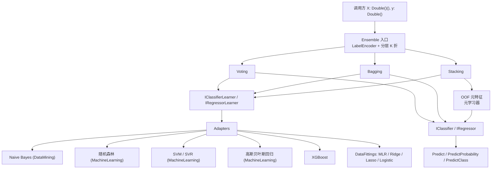

## 产品概述

在 `Bootstrapping.vbproj` 中新增一套可插拔的集成学习框架，把项目内已有的异质算法族（DataFittings 回归/逻辑回归、随机森林、SVM/SVR、高斯贝叶斯回归、XGBoost、Naive Bayes）统一到同一套分类/回归契约下，并实现 Voting、Bagging、Stacking 三类集成器，同时覆盖二分类、多分类与单输出回归。

## 核心功能

- **统一模型契约**：定义分类器（输出按类别顺序对齐的概率向量）、回归器（输出标量）、以及可复现的基学习器训练器接口；支持直接用委托注入自定义模型，不改变任何既有算法库的实现。
- **算法适配层**：为六类算法族各提供适配器，屏蔽输入形态（`Double()()`、`Node()`、`FVec`、`NumericTable`）与输出语义（概率、后验、原始分值、回归值）的差异；同时提供「包装已训练模型」入口，用于训练入口不可直接调用的算法。
- **Voting 集成**：硬投票与软投票，支持非负权重与自动归一化；分类输出类别与概率，回归输出加权均值。
- **Bagging 集成**：有放回采样训练多个同质基学习器，分类做概率平均、回归支持均值/中位数聚合；采样、分折全部使用显式种子以保证结果可复现。
- **Stacking 集成**：K 折外推（OOF）生成元特征再训练元学习器；分类的元特征为各基模型概率向量拼接（含类别对齐），回归为各基模型预测值；元学习器同样走统一契约，可替换。
- **配套基础设施**：标签编码/解码、分层 K 折划分、OOF 生成、概率归一化与类别对齐、分类指标（准确率、对数损失、混淆矩阵）与回归指标（RMSE、MAE、R2）。
- **可验证交付**：console 审计程序用 `DebugAudit` 记录断言与耗时并生成 JSON 报告，覆盖 OOF 唯一性、类别对齐、单类别退化、空数据、维度不一致等边界。

## 视觉与交互效果

本任务为算法库与 console 审计程序，不涉及界面。对外表现是可被上层脚本/应用直接调用的 API：一行构造集成器、`Train` 后即可 `Predict`/`PredictProbability`，并能在训练后查看基模型数量、聚合权重、OOF 指标等诊断信息。

## Tech Stack Selection

- **语言与运行时**：VB.NET，`net10.0`，沿用 `Bootstrapping.vbproj` 既有配置（`RootNamespace=Microsoft.VisualBasic.MachineLearning.Bootstrapping`、`GenerateDocumentationFile=True`、`GeneratePackageOnBuild=True`）。
- **依赖现状**：`Bootstrapping.vbproj:45-55` 已直接引用 `Core.vbproj`、`DataMining.NET5.vbproj`、`linear-netcore5.vbproj`、`machine_learning-netcore5.vbproj`、`xgboost.vbproj`，**无需新增任何 ProjectReference 或 NuGet 包**；`NumericTable` 位于 `Core.vbproj`，可直接使用。
- **不引入**第三方算法库；所有基学习器均来自上述四个既有项目。
- **测试**：新增 console 测试项目，使用 `Microsoft.VisualBasic.ApplicationServices.Debugging.DebugAudit` 记录断言与耗时并 `SaveReport` 输出 JSON。

## Implementation Approach

### 总体策略

采用「接口隔离 + 适配器 + 组合」三层结构：先用接口把异质模型统一成 `IClassifier` / `IRegressor` 与对应的 `I*Learner`，再用适配器把六个算法族接进来，最后用组合实现三种集成器。集成器只依赖接口，不依赖具体算法，因此后续新增算法只需补一个适配器。

### 关键决策与权衡

1. **不复用现有 `Model` 基类**。`MachineLearning.Model`（`IterationReporter.vb:119`）是空 `MustInherit Class`，`Bootstrapping.Model`（`Model.vb:13`）继承 `ODEs` 属于常微分方程模型，二者都不承载 `Train`/`Predict`。新增 `Bootstrapping.Ensemble` 子命名空间，既避免与既有 `Model`、`Softplus`、`Standardization` 等同名成员冲突（VB 大小写不敏感），也避免污染现有 ODE 命名空间。
2. **分类契约只暴露「类别数组 + 概率向量」**。`PredictClass` 用扩展方法按 `argmax` 派生，适配器只需实现两个成员，减少重复代码；概率向量顺序严格等于 `Classes`，这是 Voting/Stacking 能正确平均的前提。
3. **基学习器接口带 `classes` 参数**。`Fit(x, y As Integer(), classes As Double())` 中 `y` 是类别索引，`classes` 是全局标签顺序。这样标签编码只在集成器入口做一次，适配器无需重复编码，也不可能出现类别索引错位。
4. **适配器双入口**：`Fit(...)` 内部训练，`Wrap(model)` 包装已训练模型。`RanFog.Run(Data)`、`SVM.Training.Train(Problem, Parameter)`、xgboost `Predictor` 的训练/加载入口差异较大，双入口保证即使某条训练链路不可用，也能通过 `Wrap` 接入，不阻塞整体框架。
5. **Stacking 必须用 OOF**。若直接用基模型在训练集上的预测构造元特征，元学习器会学到基模型的过拟合噪声。采用分层 K 折（分类按类别分层）生成 OOF，且复用同一份 `LabelEncoder` 与 `Classes`，保证元特征与最终基模型预测同分布。
6. **确定性优先**。Bagging 采样与 K 折划分使用独立的 `Random(seed)` 实例，不使用共享全局随机源；`Bagging`/`Stacking` 的基模型训练默认串行，提供 `Parallel` 开关并默认关闭，因为 `RanFog`/`Predictor` 内部已有批量并行，嵌套并行会抢线程。
7. **不做模型持久化**。第一版聚焦可用与可测；序列化留给后续（`IFitted` 体系已有部分 XML 标注，但各算法族格式不统一）。
8. **拒绝静默降级**。单类别训练集、概率全零、权重为负或和为零、`X` 行长度不齐、`X.Length` 与 `y.Length` 不等，全部抛出带上下文的 `ArgumentException`/`InvalidOperationException`。

### 性能与可靠性

- 单次预测成本为各基模型预测成本之和；Bagging 为 `nModels` 倍，Stacking 为 `基模型数 + 1`（元学习器）。
- Voting/Stacking 的概率聚合为 `O(nModels × nClasses)`，可忽略；主要开销在基模型训练。
- `Bagging` 与 `Stacking` 的分块并行只放在「基模型循环」这一层，避免在单个模型内部再并行。
- 概率归一化使用单趟遍历并做下溢截断（`1e-15`），对数损失不会出现 `log(0)`。
- 所有聚合结果都会做 `Double.IsNaN`/`IsInfinity` 检查，异常时抛出明确异常而不是静默返回 NaN。

## Implementation Notes

- **命名与文档**：新类型统一放在 `Microsoft.VisualBasic.MachineLearning.Bootstrapping.Ensemble`；XML 注释避免在 `<see cref="..."/>` 中写带括号的签名与特殊字符，统一用 `<c>...</c>`，因为 `GenerateDocumentationFile=True` 下非法 XML 注释会直接编译失败。
- **VB 语法约束**：`ByRef` 参数不能进入 lambda（会报 BC36639）；单行 `Sub()` lambda 内不能直接放函数调用表达式，需写成多行语句块；私有字段不能与公共属性同名（BC30260）。
- **类别对齐**：所有适配器返回的概率向量长度必须等于 `Classes.Length`；二分类适配器内部把单概率 `p` 展开成 `[1-p, p]`。
- **权重处理**：`Voting` 的权重若非空，长度必须等于基模型数，且全部非负、和大于 0，随后归一化；为空时等权。
- **空模型保护**：训练前调用 `Predict` 抛 `InvalidOperationException`；`nModels`/`folds` 必须大于等于 1（`folds` 至少为 2 才有意义）。
- **避免重复劳动**：优先复用 `NumericTable` 做便捷入口，但内部统一转成 `Double()()` + `Double()`，减少每条链路的分支。
- **影响面控制**：只新增文件，不修改 `Model.vb`、`Graph2Vec.vb`、`GraphEmbedding`、`Node2Vec`；不改动任何既有算法库实现。
- **日志与诊断**：集成器暴露 `BaseModelCount`、`OofScore`、`Weights` 等只读属性供审计与排查；不打印训练明细，避免污染 console 输出。

## Architecture Design



数据流：原始 `(X, y)` 先经 `LabelEncoder` 统一成「整数类别索引 + 升序类别数组」，再由集成器驱动基学习器训练；分类器输出概率向量，`Voting`/`Bagging` 直接聚合，`Stacking` 先经 K 折得到 OOF 再喂给元学习器；最终统一通过 `IClassifier`/`IRegressor` 对外预测。

## Directory Structure

```
Data_science/MachineLearning/Bootstrapping/
├── Bootstrapping.vbproj                         # [MODIFY] 仅在需要时把默认 Compile 排除项与测试项目分离；四个模型库引用已存在，无需新增
├── Ensemble/
│   ├── NamespaceDoc.vb                          # [NEW] 命名空间文档：契约、类别对齐、并行与可复现约定
│   ├── Abstractions/
│   │   ├── IClassifier.vb                       # [NEW] Classes + PredictProbability
│   │   ├── IRegressor.vb                        # [NEW] Predict(x) As Double
│   │   ├── IClassifierLearner.vb                # [NEW] Name + Fit(x, yIndex, classes)
│   │   ├── IRegressorLearner.vb                 # [NEW] Name + Fit(x, y)
│   │   ├── VotingMode.vb                        # [NEW] Hard / Soft
│   │   ├── BaggingAggregation.vb                # [NEW] Mean / Median
│   │   ├── DelegateClassifierLearner.vb         # [NEW] 用 Func 委托注入自定义分类器
│   │   └── DelegateRegressorLearner.vb          # [NEW] 用 Func 委托注入自定义回归器
│   ├── Core/
│   │   ├── LabelEncoder.vb                      # [NEW] Double 标签与类别索引互转，Classes 升序，单类别与空输入校验
│   │   ├── BootstrapSampler.vb                  # [NEW] 有放回采样，独立 Random(seed)
│   │   ├── CrossValidation.vb                   # [NEW] 分层 K 折、OOF 索引生成、参数校验
│   │   ├── EnsembleMetrics.vb                   # [NEW] Accuracy / LogLoss / Confusion / RMSE / MAE / R2
│   │   └── ProbabilityMath.vb                   # [NEW] 二分类展开、归一化、类别对齐、argmax、下溢截断
│   ├── Adapters/
│   │   ├── NaiveBayesAdapter.vb                 # [NEW] Bayesian.Load + Posterior/Classify
│   │   ├── RandomForestAdapter.vb               # [NEW] RanFog.Run(Data) + Predict，含 Wrap 入口
│   │   ├── SvmAdapter.vb                        # [NEW] Problem/Node/Parameter 构造，C_SVC 概率与 EPSILON_SVR
│   │   ├── GaussianBayesRegressorAdapter.vb     # [NEW] BayesianRegression.Predict
│   │   ├── XGBoostAdapter.vb                    # [NEW] Predictor + FVecTransformer.fromArray，含 Wrap 入口
│   │   └── DataFittingsAdapter.vb               # [NEW] MLRFit / RidgeFit / LassoFit / LogisticFit 包装
│   ├── Voting/
│   │   ├── VotingClassifier.vb                  # [NEW] 硬/软投票、加权归一、类别对齐、Train 返回 Me
│   │   └── VotingRegressor.vb                   # [NEW] 加权均值
│   ├── Bagging/
│   │   ├── BaggingClassifier.vb                 # [NEW] bootstrap 采样 + 概率平均 + 可选并行
│   │   └── BaggingRegressor.vb                  # [NEW] mean/median 聚合 + 可选并行
│   └── Stacking/
│       ├── StackingClassifier.vb                # [NEW] 分层 K 折 OOF 概率拼接 + 元分类器
│       └── StackingRegressor.vb                 # [NEW] K 折 OOF 预测拼接 + 元回归器
└── test/
    ├── test.vbproj                              # [NEW] Exe，引用 Bootstrapping.vbproj 与 Core.vbproj
    └── EnsembleAudit.vb                         # [NEW] DebugAudit 审计：OOF 唯一性、类别对齐、边界、基线对比、SaveReport
```

## Key Code Structures

```
Namespace Ensemble

    ''' <summary>统一的分类器输出契约</summary>
    Public Interface IClassifier
        ''' <summary>类别标签，升序；概率向量长度必须等于该数组长度</summary>
        ReadOnly Property Classes As Double()
        ''' <summary>与 Classes 顺序严格对齐的后验概率</summary>
        Function PredictProbability(x As Double()) As Double()
    End Interface

    ''' <summary>统一的回归器输出契约</summary>
    Public Interface IRegressor
        Function Predict(x As Double()) As Double
    End Interface

    ''' <summary>可复现的基学习器训练器（分类）</summary>
    Public Interface IClassifierLearner
        ReadOnly Property Name As String
        ''' <param name="yIndex">类别索引，取值范围 [0, classes.Length)</param>
        Function Fit(x As Double()(), yIndex As Integer(), classes As Double()) As IClassifier
    End Interface

    ''' <summary>可复现的基学习器训练器（回归）</summary>
    Public Interface IRegressorLearner
        ReadOnly Property Name As String
        Function Fit(x As Double()(), y As Double()) As IRegressor
    End Interface

End Namespace
```

## Agent Extensions

### SubAgent

- **code-explorer**
- Purpose：以 very thorough 级别确认 `RanFog.Run(Data)` 的 `Data`/`Result` 结构与 `Predict` 语义、`SVM.Problem`/`Node`/`Parameter`/`SVMPrediction` 的构造方式与概率接口、xgboost `Predictor` 的训练与加载入口（`Booster` 创建路径）、`BayesianRegression` 的训练方法与 `Bayesian.Load` 的类别列约定、`LassoFit` 的权重/截距读取方式。
- Expected outcome：产出一份「算法族 → 训练入口 → 预测入口 → 输入转换 → 输出语义」四列表，作为适配器实现的唯一依据；并明确哪些算法只能走 `Wrap(已训练模型)` 通道。

### Skill

- **lsp-code-analysis**
- Purpose：在适配器落地前对上述符号做一次语义级交叉验证（定义、引用、实现），作为 code-explorer 文本盘点的补充。
- Expected outcome：确认符号签名的准确性；若 VB 语言服务未提供 provider（此前已出现过该情况），立即按 skill 的 fallback 策略改用 `code-explorer` 的结论，不重复尝试。