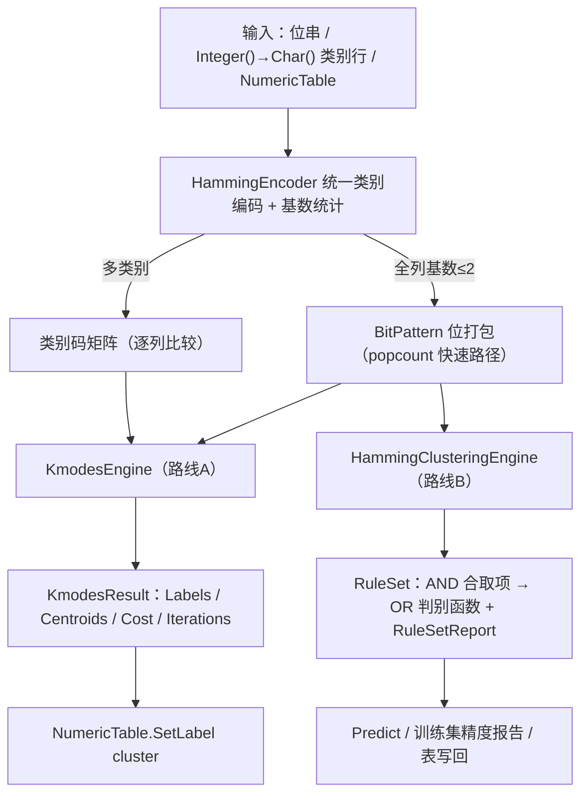

## 用户需求

在 `DataMining\DataMining.NET5.vbproj` 项目的 `DataMining\Clustering\Hamming` 目录中，按照该目录 `readme.md` 描述的 Hamming 聚类方法实现完整可用的算法模块。

## Product Overview

一个面向二值与定类数据的 Hamming 聚类工具箱，覆盖 readme 中的两条主线：以「异或取 1 的位数」为度量的 k-modes 无监督聚类，以及 Muselli–Liberati 的监督式布尔规则提取。同一套距离度量同时服务于「分组」与「可解释规则输出」，两者可串联使用（先聚类得到标签列，再由标签列抽取规则）。

## Core Features

- **Hamming 距离度量**：支持 `"10110010"` 形式的二进制位串、`Integer()` / `Char()` / `String()` 类别向量、以及数值化后的二值行；提供等权与加权两种距离，并在长度不等时明确报错；附带相似度换算。
- **位级快速路径**：把等长位串打包为机器字列表，用异或加 popcount 计算距离，使高维指纹（感知哈希、SimHash 等 64 位以上场景）仍能保持高效；支持位串与打包形式之间往返，`"10110010"` 回显保持原样。
- **路线 A：k-modes 无监督聚类**：随机或 k-modes++ 加权方式初始化 k 个质心；按最近 Hamming 距离分配样本（并列时取较小簇号以保证结果可复现）；逐位取众数更新质心（二值即按位多数表决，平票规则固定）；迭代至质心不变或达到最大迭代次数。输出每样本簇标签、各簇成员、众数质心、总代价、迭代次数与是否收敛，并可选并行计算。
- **路线 B：监督式规则提取**：按类别聚合样本，类内以 Hamming 距离阈值生成簇，把簇内所有样本取值相同的位固定为合取项（AND），同类簇以 OR 合并成判别函数，再做剪枝以降低复杂度；对未被覆盖的正例补充更具体的合取项，保证训练集完全一致；最终输出可读规则（如 `x1 ∧ ¬x3 → class 1`）与整体/分类别精度、召回、F1 报告。
- **统一表入口**：以数值二维表为输入跑 Hamming 聚类，把簇编号写入 `cluster` 标签列；可再以 `cluster` 列作为类别读取特征并抽取规则，或将规则应用回表写回预测标签列。
- **边界与可用性**：覆盖 k=1、样本全同、空簇、单类别、全部位都被固定/无位可固定等情形，均有确定行为与注释说明。
- **自测**：以 readme 中 A/B/C/D 四个 8 位串（两两距离 3/1/6/5）等用例做断言，验证距离、位打包、两簇分组、众数质心、表扩展与规则精度。

## Tech Stack Selection

- 语言/运行时：VB.NET，`net10.0`（沿用工程现状，不引入新 TFM）。
- 工程：`DataMining\DataMining.NET5.vbproj`（SDK 风格，`RootNamespace=Microsoft.VisualBasic.DataMining`，`GenerateDocumentationFile=True`，已 `Compile Remove="test\**"`，SDK 默认通配包含新增 `.vb`，**无需修改 vbproj**）。
- 依赖：仅使用已引用的 `Core.vbproj` / `Math.NET5.vbproj` 与 BCL；位运算用 `System.Numerics.BitOperations.PopCount(ULong)`，哈希用 `System.HashCode`，随机用 `Microsoft.VisualBasic.Math.RandomExtensions`。
- 测试：`DataMining\test\test.vbproj`（Exe，`StartupObject=Testing.AprioriTest`），以新增 `hamming` 子命令承载断言。

## Implementation Approach

整体策略：**一层度量 + 两条算法 + 一组表适配**，全部收敛到同一个「类别编码」中间表示，避免三份距离实现。

1. **统一编码（HammingEncoder）**：把外部输入统一转换为 `Integer()()` 类别码 + 每列基数 `cardinality()`。

- 位串 → 字符 `'1'/'0'` → 位；
- `Char()`/`String()` 行 → 每列建立 `Dictionary(Of String, Integer)` 字典映射（按首次出现顺序，确定性编码）；
- `Double()()` → 默认按「非零/阈值」二值化，或按 `Optional binary As Boolean` 切换为「离散整数」当类别处理。
- 若所有列基数 ≤ 2，则额外打包为 `BitPattern`，走 popcount 快速路径；否则走逐列比较 + 提前退出。

2. **路线 A（KmodesEngine）**：k-modes++ 初始化（首个质心随机，后续按 D² 加权抽样，seed 可指定以保证复现）→ 分配（并行 `Enumerable.Range(...).AsParallel().AsOrdered()`，并列取最小簇号）→ 逐位列众数更新（平票取最小类别码，空簇保留旧质心并计数）→ 质心不变或达 `maxIterations` 收敛。复杂度：初始化 `O(k·n·W)`，每轮分配 `O(n·k·W)`（W = ⌈d/64⌉），模式更新 `O(n·d)`。
3. **路线 B（HammingClusteringEngine）**：类内单链式簇生成（阈值 `theta` 默认按维度自适应，可覆盖）→ 每簇取「全体成员取值相同的位」为合取项、记录覆盖集合 → 同类 OR 合并 → 剪枝（逐个尝试去掉字面量，若去掉后训练集精度不下降则删除；再去掉被同类其它规则完全覆盖的冗余规则）→ **一致性兜底**：对仍未被覆盖的正例，以该样本自身模式（或仅在未覆盖正例间贪心泛化）生成专用合取项，确保训练集 100% 一致。预测：取命中的最具体合取项（字面量最多）；无命中返回 -1。
4. **表适配（HammingTableExtensions）**：`hammingCluster` 用 `NumericTable.NumericRows()` 取特征、`SetLabel("cluster", labels.Select(Function(l) l + 1))`（**1 基编号，与 `dbscan`/`bisectingKMeans` 一致**）；`hammingRuleExtract` 用 `GetLabel(labelColumn)` 取类别；`hammingRulePredict` 写回 `hamming_rule`。
5. **命名空间**：`Hashing`/`Hamming` 在 `Microsoft.VisualBasic.DataMining` 下无冲突（全仓仅 `SimHashIndex` 内部有私有 Hamming 逻辑，与本次无重叠），统一用 `Namespace Hamming`，与 `KMeans`/`FuzzyCMeans` 的扁平风格一致。

**关键取舍**：

- 内部标签 **0 基**（算法层），仅在表扩展层 +1，避免算法与表示层耦合。
- 位串打包采用「下标 i → 第 i\64 个字第 i Mod 64 位（LSB 起）」，保证 `ToString()` 逐字回显原字符串；距离对位序不敏感，因此该约定只影响回显与 `BitAt`。
- 不引入 LINQ 嵌套子查询做距离矩阵（会大量分配），改用 `for` 循环 + 局部累积，降低 GC 压力。
- 剪枝只在「训练集精度不下降」前提下进行，避免为压缩规则而牺牲 readme 强调的完全一致性。

## Implementation Notes

- **必然踩到的 VB 陷阱**：`Xor`/`Not`/`And`/`Or` 是关键字，位运算方法必须命名 `XorWith`/`NotOf` 或加方括号；局部变量不可与所在函数/属性同名（`Dim centroids` 在 `Centroids` 属性所在类中会改语义）；`If(cond, arr, Nothing)` 需 `DirectCast(Nothing, Double()())`；Module 成员不能 `Shared`；`Math`/`Parallel` 裸名可能被遮蔽（用 `Imports std = System.Math`）；XML 注释不能含 `--`、续行每行都要 `'''`。
- **XML 注释强制**：主工程开启 `GenerateDocumentationFile`，所有 `Public` 类型/成员/属性/参数都要写注释，否则构建出警告；目标为 0 警告 0 错误。
- **确定性**：所有并列（初始距离加权抽样的随机源、分配并列、众数平票、规则命中并列）都要有明确规则并写入注释；测试一律传 `seed`。
- **性能**：二值数据走 `BitPattern` + `PopCount`（W 个字的异或），类别数据逐列比较并在 `distance > best` 时提前跳出；并行只用于「样本→质心」的分配阶段（写回按 `AsOrdered` 保序），避免共享状态竞态。
- **影响面控制**：只新增 `Hamming/` 下文件与测试文件；`test/AprioriTest.vb` 仅在未知命令判定之前插入 `hamming` 分支，`selftest` / `bench` 行为逐字保持不变；`DataMining.NET5.vbproj` 不动。
- **验证命令**：`dotnet build DataMining/DataMining.NET5.vbproj -c Debug`、`dotnet run --project test/test.vbproj -- hamming`、`dotnet run --project test/test.vbproj -- selftest`（回归）。

## Architecture Design



模块职责：`HammingDistance`（纯函数度量，无状态）→ `BitPattern`（位打包值对象）→ `KmodesEngine`/`HammingClusteringEngine`（算法，仅依赖前者）→ `HammingTableExtensions`（适配层，唯一依赖 `NumericTable`）。规则模型 `Rules.vb` 被引擎与表扩展共同引用，保持单一事实源。

## Directory Structure

```
Data_science/DataMining/DataMining/
├── Clustering/Hamming/
│   ├── NamespaceDoc.vb              # [NEW] Namespace Hamming + Module NamespaceDoc。XML summary 说明「以位级不一致为相似性判据」、两条路线、适用边界（双零匹配/稀疏/加权）。
│   ├── HammingDistance.vb           # [NEW] Public Module HammingDistance。Between(ULong,ULong)=PopCount(x Xor y)；Between(ULong(),ULong()) 多字累加；Between(String,String)/Between(Char(),Char()) 逐位比较；Between(Of T)(T(),T()) 用 EqualityComparer；Weighted(...) 按位权重加权和；Similarity=1-d/dim；私有 EnsureSameLength 抛 ArgumentException。
│   ├── BitPattern.vb                # [NEW] Public NotInheritable Class BitPattern。打包 ULong() + BitLength；FromString/FromBooleans/FromValues(threshold)；BitAt/Words/DistanceTo/XorWith/AndWith/NotOf；重写 Equals/GetHashCode（System.HashCode，含长度避免碰撞）/ToString（逐位回显 "10110010"）；构造函数校验空串与非法字符。
│   ├── Kmodes.vb                    # [NEW] KmodesResult（Labels 0 基 / Clusters 成员索引 / Centroids 众数向量 / Cost / Iterations / Converged / K / EmptyClusters）+ KmodesEngine。Run(rows As Double()(), k, seed?, initialization, maxIterations, parallel)；RunPatterns(BitPattern(), k, ...)；k-modes++ 初始化、并行分配、按位众数更新、空簇保留旧质心、收敛判定。
│   ├── Rules.vb                     # [NEW] Literal(feature,value,ToString→x1/¬x1)、ConjunctionRule(literals/classIndex/covered/Matches/ToString)、ClassRule(类标签+OR 项/Predict)、RuleSet(Classes/Predict -1 未命中/ToString)、RuleSetReport(OverallAccuracy/PerClass: precision/recall/f1/support/混淆计数)。
│   ├── HammingClustering.vb         # [NEW] HammingClusteringEngine（Muselli–Liberati）。Run(patterns, labels, theta?, prune, minCoverage)；类内簇生成→固定位合取→同类 OR→精度保持剪枝→未覆盖正例兜底；RuleSet.BuildReport 计算训练集精度/召回并回填 Report。
│   └── HammingTableExtensions.vb    # [NEW] <HideModuleName> Public Module。<Extension> hammingCluster(source, k, seed?, parallel, labelName:="cluster") 写 1 基 cluster；hammingRuleExtract(source, labelColumn:="cluster", threshold:=0.5, theta?, prune) 返回 RuleSet；hammingRulePredict(source, rules, ...) 写 hamming_rule。
├── README.md                        # [MODIFY] 「核心能力 / 聚类」表格新增 Hamming 行（`Clustering.Hamming`，k-modes + 布尔规则提取），包标签可选追加 hamming。
└── test/
    ├── AprioriTest.vb               # [MODIFY] Main 中在未知命令分支前插入 `If command = "hamming" Then ... HammingSelfTest.Run(failures)`，沿用 failures 汇总与退出码 1/0；不改 StartupObject，不动 selftest/bench。
    └── HammingSelfTest.vb           # [NEW] Friend Module HammingSelfTest。Run(failures As List(Of String)) + 私有 Check(名称,条件) 助手；覆盖 readme 四串距离 3/1/6/5、位串往返、三角不等式、加权距离、两簇 k-modes 划分（同簇同标签等价判定）、按位多数表决质心、k=1/全同/空簇、类别（Char 非二值）场景、NumericTable cluster 列长度与取值、规则集 100% 训练精度与可读回显、剪枝后规则数不增。
```

## Key Code Structures

```
Namespace Hamming

    Public NotInheritable Class BitPattern
        Public Shared Function FromString(bits As String) As BitPattern
        Public Shared Function FromValues(values As Double(), Optional threshold As Double = 0.5) As BitPattern
        Public ReadOnly Property BitLength As Integer
        Public ReadOnly Property Words As ULong()
        Public Function BitAt(index As Integer) As Boolean
        Public Function DistanceTo(other As BitPattern) As Integer
        Public Overrides Function ToString() As String   ' 回显 "10110010"
    End Class

    Public Class RuleSet
        Public ReadOnly Property Classes As ClassRule()
        Public ReadOnly Property Report As RuleSetReport
        ''' <summary>返回命中的类标签，未命中返回 -1</summary>
        Public Function Predict(pattern As BitPattern) As Integer
    End Class

    Public Structure Literal
        Public ReadOnly Feature As Integer   ' 位下标（0 基，避免使用关键字 Index）
        Public ReadOnly Value As Boolean
    End Structure
End Namespace
```