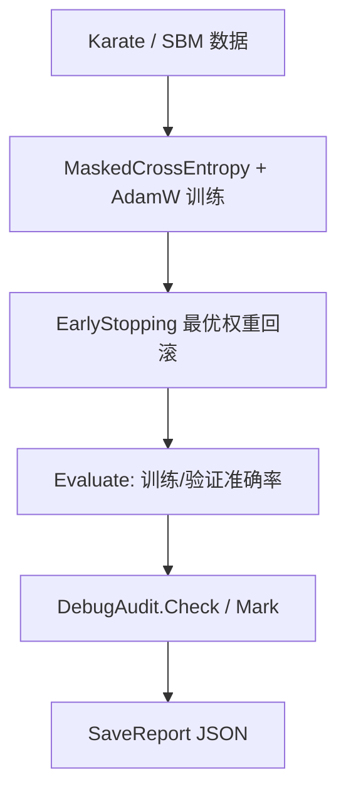

## 产品概述

在现有 sciBASIC# 机器学习体系内，为空白工程 `GCN\GCN.vbproj` 实现一套可独立使用的 **Kipf & Welling 图卷积神经网络（GCN）** 库，用于半监督节点分类，并保持与 `GNN`、`DeepLearning/CNN`、`TensorFlow` 现有实现一致的 **fp64 主存储 + fp32 计算热点** 的混合精度架构。算法依据 `GCN\readme.md`（`H^(l+1) = σ(D̃^(-1/2) Ã D̃^(-1/2) H^(l) W^(l))`，`Ã = A + I`）。

## 核心功能

- **图归一化**：由边列表构造加自环的邻接矩阵 `Ã`，按 `D̃^(-1/2) Ã D̃^(-1/2)` 对称归一化；度值与归一化系数用双精度累加；同时产出稠密矩阵与 CSR 稀疏结构，并按图拓扑版本缓存，避免每次前向重算。
- **多层 GCN 卷积层**：每层做“邻居加权聚合 + 线性变换 + 激活”，权重与偏置可训练；提供与层数匹配的反向传播（输入梯度、权重梯度、偏置梯度）。
- **两条消息传递路径**：小图走稠密矩阵乘；规模/稀疏度达标时走 CSR 稀疏乘（`SparseCsr` + `SpMM`），两条路径数值可对齐、可切换。
- **多层网络模型**：可配置层数与隐藏维度（默认 2 层：隐藏层 + 输出层），层间可插 Dropout；对外暴露 `[节点数, 特征维]` 的输入与 `[节点数, 类别数]` 的 logits/概率，并提供单点与全图预测。
- **半监督训练**：仅在有标签节点上计算交叉熵（掩码交叉熵内核），支持学习率、weight decay、早停（按验证损失/准确率，回滚到最优权重）、训练历史记录（损失、训练/验证准确率逐 epoch）。
- **混合精度分层**：权重、梯度、优化器状态、归一化系数、logits、损失全部双精度；`·H`、`W·Z`、`dW = dY·Zᵀ`、`dZ = Wᵀ·dY` 等算力热点在规模达标时降到单精度计算再升回双精度，可直接落到 CUDA 后端；并提供总开关与诊断计数以便回退与观测。
- **示例与验证**：在 `GNN\test` 中以 Karate Club 经典小图与合成社区结构（SBM）同质图演示训练与预测，覆盖“精度提升/损失下降”“稠密与稀疏结果一致”“fp32 与 fp64 结果一致且确实命中加速路径”等断言，并把断言与度量写入测试报告。

## 技术栈

- 语言/运行时：VB.NET（`net10.0`），与既有 `GNN`、`DeepLearning`、`TensorFlow` 工程一致
- 张量算子：`TensorFlow.vbproj`（`Tensor` fp64 / `TensorF` fp32 / `TensorH` fp16、`SparseCsr`、`ITensorCompute`、`MixedPrecisionOps`、`MixedPrecisionPolicy`、`MixedPrecisionDiagnostics`、`MaskedCrossEntropy`）
- 图数据结构：复用 `GNN.vbproj` 的 `Graph`（`GetAdjacencyMatrix` / `GetNormalizedAdjacencyMatrix` / 拓扑版本缓存）
- 层基础设施：复用 `GNN` 的 `Layer`、`ActivationType`、`Apply/Derivative`、`DropoutLayer`
- 测试：`GNN\test\test.vbproj`（Console）+ `DebugAudit`（`Microsoft.VisualBasic.ApplicationServices.Debugging`）

## 实现策略与关键决策

### 1. 精度分层（沿用既有范式，不新造机制）

- **fp64 必留**：`W`、`bias`、全部梯度、AdamW 的一阶/二阶矩、`Â`、`logits`、交叉熵与梯度归一化、早停统计。理由：`MixedPrecisionPolicy.PrecisionClass.MustDouble` 已把“损失/优化器/归一化统计量”定义为不可协商的双精度；且单精度二阶矩易溢出成 `Inf` 并永久污染参数。
- **fp32 热点**：`·H`（稠密 GEMM 或 CSR SpMM）、`Z·Wᵀ`、`dW = dY·Zᵀ`、`dZ = Wᵀ·dY`。统一经 `MixedPrecisionOps.MatMul` / `MixedPrecisionOps.SpMM`（规模与数值安全由 `MixedPrecisionPolicy.Decide` + `IsSafeForSingle` 判定），转回 fp64 后再参与后续计算。
- **集中路由**：新增 `GCNPrecision` 模块，照搬 `DeepLearning/CNN/PrecisionRouter.vb` 的范式——`Try*` 返回 `Nothing`、`*Or` 保证有结果、`Enabled` 总开关、诊断计数，使“静默回退”可观测、可断言、可一键回退。不复用 CNN 的 `PrecisionRouter`，因为它只覆盖 Conv2D 族，直接把 GEMM/SpMM 混进去会污染职责。

### 2. 布局决策：内部统一“特征主序”（关键，必须显式设计）

`SpMM` 的既有契约是 `dense[batch, csr.Rows] × CSR(Rows, Columns) → [batch, Columns]`（见 `TensorComputeBase.SpMM`：`od(bo+ci(k)) += xv*vv(k)`），即“稠密 × 稀疏”，而 GCN 需要 `·H`。

- 由于 `Â = D̃^(-1/2) Ã D̃^(-1/2)` 严格对称，`SpMM(Â, Hᵀ) = HᵀÂ = (ÂH)ᵀ` 成立。
- 因此层内统一以 **`[features, nodes]`** 布局传递激活值 `Hᵀ`：传播 = `SpMM(Â, Zᵀ)`（稀疏）或 `MatMul(Â, Zᵀ)`（稠密，等价写法 `Zᵀ·Â`）；变换 = `W·Zᵀ` 仍是标准二维 GEMM；反向 `dHᵀ = SpMM(Â, dZᵀ)`、`dW = dYᵀ·Z`、`dZᵀ = Wᵀ·dYᵀ`，全部无需额外转置。
- 仅在模型边界各转置一次：输入 `[n,d] → [d,n]`、输出 `[C,n] → [n,C]`，代价 `O(n·d)`，相对每层 `O(n²·d)` 可忽略。
- 层的公开方法用 `*T` 后缀（`ForwardT` / `BackwardT`）显式标注转置布局，模型层负责边界转换，杜绝隐式布局假设。
- 备选方案（不采用）：每层前后各转置一次——虽然接口更“直观”，但每层多两次全量拷贝，且会让“为什么这里转置”散落在多处。

### 3. 稀疏路径与缓存

- `Graph.GetNormalizedAdjacencyMatrix()` 只给稠密 fp64（带拓扑版本缓存）。新增 `NormalizedAdjacency` 在 GCN 侧一次性构建：稠密 fp64、CSR（`SparseCsr`，`nnz = 边数 + n`，值即归一化后的权重）、`NonZeros`、以及可选的 fp32 镜像（`TensorF`），并用图结构版本号失效缓存。
- 默认按“稠密 vs 稀疏”自动选择：`nnz` 与 `n²` 的比较 + `MixedPrecisionPolicy.SpmmNnzThreshold`；也允许显式指定 `PropagationMode.Dense/Sparse/Auto`，便于测试对拍。
- 稀疏路径的热点仍走 fp32：`MixedPrecisionOps.SpMM(csr, denseF)` → `CudaTensorF.SpMM`；不达标回退 `Tensor.computeKernel.SpMM`（fp64）。

### 4. 训练器与优化器（不复用 GNN 现有实现的原因）

`GNN.AdamOptimizer` 全程 `Single` 且无 weight decay；`GNN.Trainer.TrainEpoch` 手写 softmax+CE 且梯度未按有效标签数归一化。GCN 需要：

- `GCNAdamW`：独立类（不继承 `GNN.Optimizer`，因其 `LearningRate As Single`），fp64 状态 `m/v`、解耦权重衰减、偏差修正，优先调用 `Tensor.computeKernel.TryAdamWStep`（设备端快路径），返回 `False` 时走主机循环。
- `SemiSupervisedTrainer`：整图全批量训练；损失与梯度统一由 `Tensor.computeKernel.MaskedCrossEntropy(logits, labels, trainMask, dLogits)` 产出（损失与梯度都除以有效标签数，天然可比）；验证用 `mask` 子集上的损失与准确率；`EarlyStopping`（patience + 最优权重快照/回滚）。
- 梯度生命周期：每步 `ResetGradients()` 再反传，避免跨 step 无界累积（`Layer.ResetGradients` 已提供默认实现）。

### 5. 可测试性与数值验证

三重对拍，缺一不可：

1. **dense vs sparse**：同一权重、同一 `Â`，两条传播路径的 logits 最大绝对差（若都走 fp64 应 ≈1e-15，走 fp32 则放宽到 1e-5）。
2. **fp32 vs fp64**：切换 `MixedPrecisionPolicy.Enabled` 前后损失/logits 差（阈值 1e-4），并用 `MixedPrecisionDiagnostics.Of("MatMul").Accelerated > 0` 证明“确实降了精度”。
3. **公式手算**：readme 第 4 节 4 节点小例子（`d̃₁=4`、他人 `d̃=2`），逐值验证归一化系数与单层输出，锁定行/列主序方向。

### 6. 性能与复杂度

- 前向：稠密 `O(L·(n²d + n d h))`；稀疏 `O(L·(nnz·d + n d h))`。
- 反向：与前向同阶（多两次 GEMM）。
- 归一化构建一次性 `O(n² + m)` 并缓存；`Â` 稠密占用 `8n²` 字节，大图建议显式切 `Sparse`（可选构造时不建稠密矩阵）。
- 小图自动不降精度（Karate n=34 时 `34³ = 39k < 262144`），避免“小规模降精度反而更慢”。

## 架构设计

```mermaid
graph LR
  G[Graph: 边表 + 节点特征] --> N[NormalizedAdjacency<br/>Ã=A+I, D̃^-1/2]
  N --> ND[Dense  (fp64)]
  N --> NS[CSR Â (SparseCsr, fp64)]
  ND --> PM[GCNPrecision.MatMulOr<br/>fp32 GEMM]
  NS --> PS[GCNPrecision.SpMMOr<br/>fp32 SpMM]
  PM --> L[GraphConvLayer<br/>W/bias fp64, 持久梯度]
  PS --> L
  L --> H[GCNNetwork<br/>多层 + Dropout]
  H --> LO[logits fp64]
  LO --> CE[MaskedCrossEntropy<br/>fp64 损失/梯度]
  CE --> OPT[GCNAdamW<br/>fp64 m/v + weight decay]
  OPT --> L
```



## 目录结构

```
Data_science/MachineLearning/
├── GCN/
│   ├── GCN.vbproj                              # [MODIFY] 补齐包元数据（Title/Description/Authors/PackageTags/Version），保持现有 ProjectReference 不变；注意该工程未开启 ImplicitUsings，源文件需显式 Imports System.Collections.Generic / System.Linq / System.IO 等
│   ├── readme.md                               # [MODIFY] 追加“实现说明”章节：分层精度表、转置布局约定、稠密/稀疏选择规则、最小用法示例
│   ├── NamespaceDoc.vb                         # [NEW] 命名空间文档（照 GNN/NamespaceDoc.vb 风格），说明 GCN 的定位、与 GNN 的关系、精度策略
│   ├── Adjacency/
│   │   └── NormalizedAdjacency.vb               # [NEW] 对称归一化邻接的承载与缓存。职责：由 Graph 构造 Ã=A+I；用 Double 累加度并算 1/√d̃（度数直接进入归一化系数，误差会放大到整行权重）；产出 Dense(fp64 Tensor)、Sparse(SparseCsr)、NonZeros、可选 fp32 镜像；按图结构版本号失效缓存（避免每次前向 O(n²) 重建）；提供 PropagationMode 选择。实现要求：绝不改写 Graph 的缓存张量；仅在 nnz>0 时允许纯稀疏构造
│   ├── Precision/
│   │   └── GCNPrecision.vb                     # [NEW] GCN 专用精度路由模块（照 CNN/PrecisionRouter.vb）。职责：MatMulOr / SpMMOr / SpMMOrF；TrySpMM 返回 Nothing 表示不适用；Enabled 总开关；决策走 MixedPrecisionPolicy.Decide(ComputeBound/MemoryBound) + IsSafeForSingle；每次决策写入 MixedPrecisionDiagnostics（算子名 GCN.MatMul / GCN.SpMM）。要求：所有函数“不适用返回 Nothing”，带 Or 后缀保证有结果
│   ├── Layers/
│   │   └── GraphConvLayer.vb                   # [NEW] Kipf GCN 卷积层。状态：W[outF,inF]、bias[1,outF]、持久 _weightGradient/_biasGradient（反向必须 Array.Copy 写回持久张量 + MarkHostModified，切勿换引用）、缓存 Zᵀ/dYᵀ 供反向。方法：ForwardT(inputT As Tensor /*[inF,n]*/, adjacency) As Tensor /*[outF,n]*/、BackwardT(gradT) As Tensor、GetParameters/GetGradients/ResetGradients、可选 activation。要求：传播走 GCNPrecision（稠密/稀疏自适应），变换与反向走 GCNPrecision.MatMulOr；在 XML 注释中说明“为何用转置布局”（SpMM 契约 + Â 对称）
│   ├── Models/
│   │   └── GCNNetwork.vb                       # [NEW] 多层 GCN 网络（默认 2 层：in→hidden(ReLU, Dropout)→classes(无激活)）。职责：对外 Forward(features[n,d], graph 或 NormalizedAdjacency) → logits[n,C]；边界处各转置一次；ForwardLogits / ForwardProbabilities(Softmax via computeKernel.Softmax(logits,1)) / Predict(nodeIndex) / PredictAll / SetTraining / GetParameters / GetGradients / PrintModelInfo；支持 dropoutRate、每层激活与 bias 开关、随机种子（保证可复现）
│   └── Trainer/
│       ├── GCNAdamW.vb                         # [NEW] fp64 AdamW。状态 m/v 为 fp64 Tensor；LearningRate/Beta1/Beta2/Epsilon/WeightDecay As Double；优先 computeKernel.TryAdamWStep(param, grad, m, v, lr, b1, b2, eps, bc1, bc2, wd)，返回 False 时走主机 fp64 循环；ZeroGrad/Step
│       ├── EarlyStopping.vb                    # [NEW] 早停与最优权重快照。职责：patience/minDelta/mode(min loss / max acc)；记录 best 值；保存/回滚参数（对每个参数 Tensor 做 Data 拷贝，避免别名）；Supporting: BestEpoch/BestValue/ShouldStop
│       └── SemiSupervisedTrainer.vb            # [NEW] 半监督全图训练循环。职责：Train(graph, labels, trainMask, valMask, epochs, optimizer) → TrainingHistory；每步 ResetGradients → Forward → MaskedCrossEntropy(logits, labels, trainMask, dLogits) → Backward → Step；每 epoch 记录 trainLoss/trainAcc/valLoss/valAcc；早停命中后回滚最优权重；Evaluate(graph, labels, mask) 返回 (loss, accuracy)；支持 printEvery 控制台输出
│
└── GNN/test/
    ├── test.vbproj                             # [MODIFY] 增加 <StartupObject>test.Program</StartupObject>（若编译器仍报多入口，则把 Demo.vb 的 Main 改名为 RunTemporalDemo，保留文件）；无需新增引用（已引用 GCN/TensorFlow/GNN/ILCudaTensor/Core/Math/Graph）
    ├── Demo.vb                                 # [KEEP] 原时序 GNN demo，保持内容不变（不再作为入口）
    ├── Program.vb                              # [NEW] 唯一入口 Module Program：DebugAudit.Reset()/MaxEvents；依次 runSuite("Karate Club", …)、runSuite("合成 SBM", …)、runSuite("稠密 vs 稀疏", …)、runSuite("混合精度", …)；每组 try/catch 内 Mark+Check 记录崩溃；结束 DebugAudit.SaveReport(AppContext.BaseDirectory + "gcn-test-report.json")，打印 FailureCount，返回值 = FailureCount
    └── Graphs/
        ├── KarateClub.vb                       # [NEW] Zachary Karate Club 常量数据（34 节点、78 条无向边内置为数组，不依赖外部资源文件），节点特征取 one-hot 单位阵，两类标签（真实划分）+ 每类仅取少量节点做训练标签
        ├── SyntheticSbm.vb                     # [NEW] 合成同质图生成器：n=300、3 个社区、p_in=0.08 / p_out=0.01 的同质边、特征维度 16（社区信号 + 噪声），固定随机种子；按比例切分 train/val/test 掩码（如 10%/10%/80%）
        └── GCNTestSuite.vb                     # [NEW] 全部用例。Karate：训练 200 epoch，断言 val/test 准确率 ≥ 0.85、最终损失 < 初始损失 × 0.5；SBM：断言 val 准确率 ≥ 0.85、损失下降、早停或跑满 epoch；稠密 vs 稀疏：同权重对比 logits（阈值 1e-4，fp64 模式 1e-9）；混合精度：Enabled=False vs True 的损失差 < 1e-4，且 MixedPrecisionDiagnostics.Of("MatMul").Accelerated > 0；公式校验：用 readme 4 节点例子逐值验证
```

## 关键代码结构

```
Namespace Microsoft.VisualBasic.DeepLearning.GCN

    ''' <summary>传播路径选择：小图用稠密，大图/高稀疏用 CSR</summary>
    Public Enum PropagationMode
        Auto = 0
        Dense = 1
        Sparse = 2
    End Enum

    ''' <summary>对称归一化邻接 Â = D̃^(-1/2) Ã D̃^(-1/2) 的载体与缓存</summary>
    Public Class NormalizedAdjacency
        Public ReadOnly Property Nodes As Integer
        Public ReadOnly Property Dense As Tensor        ' fp64 [n, n]，按需构建
        Public ReadOnly Property Sparse As SparseCsr    ' fp64 CSR，nnz = 边数 + n
        Public ReadOnly Property NonZeros As Integer
        Public Property Mode As PropagationMode
    End Class

    ''' <summary>单层 GCN：H' = σ(Â · H · Wᵀ + b)，输入/输出为“特征主序”布局 [features, nodes]</summary>
    Public Class GraphConvLayer
        Public Sub New(inFeatures As Integer, outFeatures As Integer,
                       Optional activation As ActivationType = ActivationType.ReLU,
                       Optional useBias As Boolean = True,
                       Optional name As String = Nothing)
        Public Function ForwardT(inputT As Tensor, adjacency As NormalizedAdjacency) As Tensor
        Public Function BackwardT(gradT As Tensor) As Tensor
        Public Function GetParameters() As List(Of Tensor)
        Public Function GetGradients() As List(Of Tensor)
    End Class

End Namespace
```

## 实现注意事项

- **不要篡改共享算子**：本次不改 `TensorFlow`、`GNN`、`DeepLearning` 的现有代码；GCN 只新增自己的文件，风险面收敛在 `GCN\` 与 `GNN\test\`（外加 vbproj 的 `StartupObject` 一行）。
- **形状契约**：`MixedPrecisionOps.SpMM` 要求 `dense.Shape(1) = csr.Rows`，`MixedPrecisionOps.MatMul` 要求 `a.Shape(1) = b.Shape(0)`；所有入口先做显式形状校验并给出可定位的错误信息（含实际 shape），避免 VB `Option Strict Off` 下的静默错算。
- **持久梯度**：`GraphConvLayer` 的 `_weightGradient/_biasGradient` 必须在构造时分配，反向时用 `Array.Copy` 写回 + `MarkHostModified()`；优化器在训练前一次性 `GetGradients()` 拿引用，换引用会导致“静默不学习”。
- **版本号/缓存**：批量写 `Tensor.Data` 后必须 `MarkHostModified()`；`NormalizedAdjacency` 的 CSR/稠密镜像与 `Graph` 的拓扑版本绑定，图结构变更后必须失效。
- **日志**：训练进度用 `printEvery` 节流（默认 10），不打印全量张量；诊断用 `MixedPrecisionDiagnostics.Report()` 在测试里输出一次即可，避免日志噪音。
- **Debug 断言**：`DebugAudit.Check` 带 `<Conditional("DEBUG")>`，测试必须以 Debug 配置运行；关键“必须成立”的前置条件（形状、NaN 检查）用 `Require`，避免在 Release 下静默通过。
- **数值卫生**：每 epoch 检查 loss 是否有限（`Double.IsNaN/IsInfinity`）并断言；单精度降级前由 `IsSafeForSingle` 把关，测试中显式覆盖“输入含极大值 → 自动回退 fp64”的分支。

## Agent Extensions

### SubAgent

- **code-explorer**
- Purpose: 在动手实现前/实现中复核 `Tensor`、`TensorF`、`SparseCsr`、`MixedPrecisionOps`、`ActivationType`、`Graph` 的精确签名与命名空间，以及 `GNN\test` 现有文件与新入口的冲突点
- Expected outcome: 一份符号签名核对结果（含遗漏的重载与命名空间差异），确保新增代码一次编译通过、不出现“调用不存在的重载”

### Skill

- **lsp-code-analysis**
- Purpose: 对 `Tensor`/`SparseCsr`/`Graph` 做符号定义跳转与引用检索，确认 `SpMM` 形状契约、`MarkHostModified` 使用惯例，以及新增 `GCN` 类型名是否与既有 `GCNConvLayer`/`GCNModel` 冲突
- Expected outcome: 类型命名与 API 布局确认清单，以及受影响文件范围（限 `GCN\` 与 `GNN\test\`），防止引入编译期重名或跨工程破坏