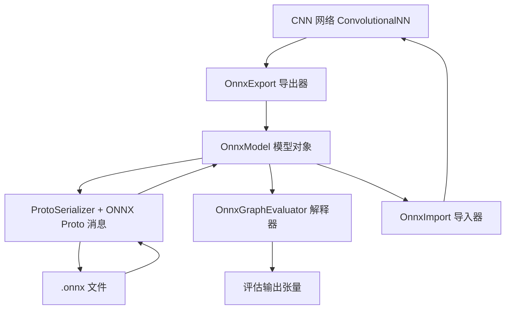

## 用户需求

在 MLDataStorage（VB.NET 数据持久化工程）中新增对 ONNX 模型文件格式的完整支持，使 DeepLearning 工程中训练完成的 CNN 卷积神经网络能够以 ONNX 格式保存到磁盘，并能够从 ONNX 文件重新加载为可推理（并可继续训练）的 CNN 网络对象。开发完成后，使用 9 个真实策略模型文件完成读取、推理与转换验证。

## 产品概述

为机器学习框架补齐"模型互操作"能力：训练流程产出的卷积网络不再只能以私有二进制格式落盘，而是可以导出为业界通用的 ONNX 文件，供外部工具链、仿真器或其它语言加载；反过来，外部导出的 ONNX 模型也能直接读入框架，用于查看结构、执行前向推理，或还原成可继续训练的网络对象。

## 核心功能

- **CNN 导出 ONNX**：把网络逐层翻译为标准计算图（卷积、池化、激活、全连接、Softmax 等），权重与偏置一并写入；导出精度默认单精度，可切换为双精度以与内部权重完全一致；可配置目标算子集版本与元信息。
- **ONNX 加载为 CNN**：解析文件后按层顺序还原网络，权重、偏置、卷积核尺寸、步长、填充、激活参数全部恢复；还原后的网络预测结果与原网络一致。
- **模型解析与摘要**：读取任意 ONNX 文件并输出可视化摘要，包括模型元信息、算子集版本、图名称、节点序列（算子类型与输入输出名称）、张量形状、初始化器清单与统计信息、模型自带元数据（如关节名、观测项名称）。
- **图前向推理**：不依赖任何外部推理引擎，直接对 ONNX 计算图执行前向计算，支持矩阵乘、矩阵加、逐元素加减乘除、ELU/ReLU/LeakyReLU/Sigmoid/Tanh/Softmax、卷积、最大池化、局部响应归一化、转置、展平、重排、拼接、常量与恒等算子；输入观测向量，输出动作向量。
- **策略模型还原为网络**：把强化学习策略模型（输入归一化 + 全连接 + ELU 堆叠）转换为框架内的网络对象，归一化操作被等价折算进首层权重与偏置，使还原后的网络输出与原始文件推理结果一致。
- **自动化测试与报告**：对策略模型目录下 9 个模型逐一执行解析、推理、转换三类检查；另做网络导出后再导入的往返一致性检查（单精度与双精度各一轮），比对逐层权重与预测输出；所有结果记录成可读测试报告并落盘，失败项以非零退出码体现。
- **兼容性**：保持既有私有模型格式读写能力不变，新增能力以独立模块叠加，不影响原有调用方。

## 技术栈

- 语言/框架：VB.NET，`net10.0`（与现有工程一致）
- 序列化：复用仓库已有工程 `G:\pixelArtist\src\framework\Data\BinaryData\Protobuf\Protobuf.vbproj`
（`Namespace = Microsoft.VisualBasic.Data.IO.Protobuf`，含 `ProtoSerializer`、`ProtoMemberAttribute`、`ProtoReader/ProtoWriter`）
- 目标工程：`MLDataStorage.vbproj`（`RootNamespace = Microsoft.VisualBasic.MachineLearning.DataStorage`），已由用户添加 Protobuf 工程引用；`ONNX\` 目录已预留
- 被测网络：`DeepLearning.NET6.vbproj`（`Microsoft.VisualBasic.MachineLearning.CNN`）
- 测试：`MLDataStorage\test\test.vbproj` 控制台程序 + `DebugAudit`（`Microsoft.VisualBasic.ApplicationServices.Debugging`）
- 零新增 NuGet 依赖（全仓库当前无任何 `PackageReference`）

## 实现方案

### 关键决策与依据

1. **protobuf 走特性驱动序列化，而非手写 wire 编解码**
`Serialization\Reflection\TypeInfo.vb` 与 `SerializableField.vb` 已确认支持：嵌套消息、`List(Of T)` / 数组（packed 与非 packed 双向兼容读取）、`Byte()`（映射到 bytes 标量而非 repeated）、`Dictionary(Of String, String)`（映射）、枚举（按 int32 varint）、`Nullable`。因此 ONNX 消息只需定义成普通类 + `ProtoContract`/`ProtoMember`，用 `ProtoSerializer.Deserialize(Of ModelProto)` 一步完成解析，代码量与出错面远小于手写。唯一约束：被标注成员必须同时可读可写（`CanRead AndAlso CanWrite`），故所有 ONNX 消息字段用可读写 `Property` 并默认初始化集合。

2. **图布局采用标准 NCHW**
CNN 内部 `DataBlock` 是 channel-last `(SX*y + x)*Depth + d`。逐层分析后确认：卷积、池化、逐通道激活在两种布局下函数等价（仅通道索引对应），因此导出图保持 ONNX 标准 NCHW，只在**全连接层**做一次权重展平顺序换位：`w_onnx[i, (c*H + y)*W + x] = w_cnn[i, (y*W + x)*C + c]`；卷积核由每通道 `(KH, KW, C)` 转置为 `(OutC, C, KH, KW)`；转置卷积按 `(C_in, C_out, KH, KW)` 转置。导入时执行逆变换。正确性由"导出→导入→预测比对"和"导出→解释器预测比对"两条独立断言共同保证。

3. **引入公开只读属性，杜绝反射**
`ConvolutionLayer`/`Conv2DTransposeLayer` 的 `in_sx/stride/padding` 是 `Friend`，`FullyConnectedLayer`/`PoolingLayer` 的相关字段是 `Private`，跨程序集不可见。按已确认方案，在 DeepLearning 侧补最小公开只读属性（不改任何现有签名、不改变字段语义），MLDataStorage 侧全部走公共 API。

4. **权重读写统一走 `BackPropagationResult`**
该属性对所有带参数层 yield 的顺序固定：`filters(0..out_depth-1)` 再 `biases`，且每块的 `Weights` 直接返回内部数组引用，可在另一程序集就地赋值；`DataBlock.SetValues` 是 `Friend` 不可用，此路径是唯一不需要反射的写权重通道。层对象用公共构造函数按 `OutputDefinition` 链重建，`def` 的正确推进保证 `num_inputs`、`out_sx/out_sy` 自洽；不使用 `build*` 系列（会随机初始化并改写共享 `def`）。

5. **激活与归一化的映射**
策略模型使用 ELU 而框架无此层，故新增 `EluLayer`（`LayerTypes.Elu = 19`，追加枚举值不影响既有二进制模型的取值）。策略模型头部的 `Sub(mean)` → `Div(std)` 在导入时按线性等价折算进首个全连接层：`W'_ij = W_ij / s_j`，`b'_i = b_i - Σ_j W_ij * m_j / s_j`，数学上完全等价，避免为归一化引入新层类型。网络末尾 `ConvolutionalNN` 要求 `output As LossLayer`：末节点是 Softmax 则加 `SoftMaxLayer`，否则加 `RegressionLayer`（其 `forward` 为恒等，不影响输出）。

6. **精度可配置**
默认 `TensorDataType.Float`（写 `raw_data` 小端 float32），可切换 `Double`（写 `double_data` 或 `raw_data` float64）。读取侧同时兼容 `raw_data` 与 typed data 两种落盘方式、兼容 `FLOAT/DOUBLE/INT64/INT32/BOOL`，统一升为 `Double()` 参与计算，保证框架内部数值语义不变。

### 性能与可靠性

- 导出/导入均为 O(参数个数) 拷贝，卷积核转置为一次线性重排；单个策略模型 793 KB，解析 + 推理在毫秒级。
- 解释器 `Conv` 采用朴素循环 `O(N·OutC·OutH·OutW·C·KH·KW)`，测试规模下可接受；张量统一以 `Double()` 行主序 + `Integer()` 形状表示，避免重复分配。
- 所有长度前缀由 `ProtoReader.PushLimit/PopLimit` 强制边界校验，天然防御畸形文件；解释器对不支持算子抛 `NotSupportedException` 并携带算子名与节点名，导入对形状不匹配抛 `InvalidDataException`，不做静默降级。
- 新增文件不触碰既有 `SaveModelCNN/ReadModelCNN` 路径，向后兼容；DeepLearning 侧只做"新增"，不改动现有成员签名与序列化字段。

## 架构设计



分层职责：

- **Proto 层**：只描述 ONNX 消息结构与枚举，不含业务逻辑
- **Model 层**：文件读写、摘要、初始化器索引、输入输出形状查询
- **Runtime 层**：张量表示与算子实现，纯函数，可独立测试
- **Adapter 层**：`OnnxExport` / `OnnxImport` 负责 CNN 与计算图之间双向翻译（形状推导、权重转置、归一化折叠）

## 目录结构

```
MLDataStorage/
├── ONNX/
│   ├── NamespaceDoc.vb              # [NEW] 命名空间文档，说明 ONNX 支持的范围与不支持算子的处理策略
│   ├── Proto/
│   │   ├── OnnxEnums.vb             # [NEW] TensorDataType(UNDEFINED/FLOAT/DOUBLE/INT32/INT64/BOOL...)、AttributeType(FLOAT/INT/STRING/TENSOR/FLOATS/INTS...)、DataLocation 枚举
│   │   ├── OnnxTensorProto.vb       # [NEW] TensorProto（dims、data_type、raw_data、float_data、double_data、int32_data、int64_data、name、doc_string）、AttributeProto（name/f/i/s/t/floats/ints/strings/doc_string/type）、Segment；全部用 ProtoMember 标注字段号，集合默认初始化
│   │   ├── OnnxGraphProto.vb        # [NEW] NodeProto（input/output/name/op_type/attribute/domain）、GraphProto（node/name/initializer/input/output/value_info/metadata_props）、ModelProto（ir_version/producer_name/producer_version/domain/model_version/doc_string/graph/opset_import/metadata_props）
│   │   └── OnnxValueInfo.vb         # [NEW] ValueInfoProto、TypeProto（tensor_type.elem_type/shape）、TensorShapeProto.Dimension（dim_value/dim_param）、OperatorSetIdProto、StringStringEntryProto
│   ├── OnnxTensor.vb                # [NEW] 运行时张量：Dims + Double()，提供 Rank/Length/Reshape/转置(NHWC↔NCHW)/逐元素运算；TensorProto 与张量双向转换，处理 raw_data 与 typed data、各 dtype 校验、float32/float64 写出
│   ├── OnnxModel.vb                 # [NEW] OnnxModel.Load/LoadFrom(stream)/Save/SaveTo；属性 IrVersion/Producer/Graph/OpsetImports/Metadata；方法 GetInitializer(name)、InputShapes、OutputShapes、SupportedOps、Summary()（文本摘要）
│   ├── OnnxOperators.vb             # [NEW] 算子实现（纯函数）：Gemm(alpha/beta/transA/transB)、MatMul、Add/Sub/Mul/Div（含偏置广播）、Relu/LeakyRelu/Elu/Sigmoid/Tanh/Softmax(axis)、Conv、MaxPool、LRN、Transpose、Flatten、Reshape、Concat、Constant、Identity、Dropout、Cast
│   ├── OnnxGraphEvaluator.vb        # [NEW] 前向调度：按节点顺序求值，维护 名称→张量 环境；Run(Dictionary(Of String, Double())) 与 Run(ParamArray 输入)；未支持算子抛出携带节点信息的异常
│   ├── OnnxExport.vb                # [NEW] ConvolutionalNN → OnnxModel；层→节点映射、卷积核/全连接权重转置、opset/ir_version/精度选项；对 Maxout/FourierFeature/Concat/SVM 明确抛 NotSupportedException
│   ├── OnnxImport.vb                # [NEW] OnnxModel → ConvolutionalNN；按 OutputDefinition 链用公共构造函数建层、经 BackPropagationResult 回填权重、Gemm/MatMul 与 Flatten 处理、输入归一化折叠进首个全连接、末尾补 SoftMax/Regression
│   └── OnnxExtensions.vb            # [NEW] 便捷入口：cnn.SaveOnnx(path, options)、OnnxFile.ReadModel(path)、OnnxFile.ReadCNN(path)、cnn.ToOnnx()
├── MLDataStorage.vbproj             # [MODIFY] 无结构变更（Protobuf 引用已由用户添加，保留 ONNX 目录条目）；确认新文件被默认 glob 收集
└── test/
    ├── Program.vb                   # [MODIFY] ONNX 测试主程序（DebugAudit 记录 + 报告落盘 + 退出码）
    └── test.vbproj                  # [MODIFY] 视需要补充 Core / Protobuf 直接引用，确保可访问 DebugAudit

DeepLearning/
├── CNN/LayerTypes.vb                # [MODIFY] 追加 <Description("elu")> Elu = 19
├── CNN/LayerBuilder.vb              # [MODIFY] 新增 buildEluLayer(Optional alpha As Double = 1.0)
├── CNN/CNNLayers.vb                 # [MODIFY] 新增 elu_layer(Optional alpha As Double = 1.0) 规格工厂
├── CNN/Layers/EluLayer.vb           # [NEW] ELU 激活层：forward 为 x>0 ? x : alpha*(exp(x)-1)，backward 传递导数（x>0 ? 1 : 输出+alpha），提供 Alpha 只读属性，Type = LayerTypes.Elu
├── CNN/Layers/ConvolutionLayer.vb   # [MODIFY] 增加只读属性 InputShape/OutputShape/KernelSize/StrideSize/PaddingSize
├── CNN/Layers/Conv2DTransposeLayer.vb # [MODIFY] 同上，并暴露 UseBias
├── CNN/Layers/PoolingLayer.vb       # [MODIFY] 同上
├── CNN/Layers/FullyConnectedLayer.vb # [MODIFY] 增加只读属性 InputLength(=num_inputs)/OutputSize(=out_depth)
├── CNN/Layers/LeakyReluLayer.vb     # [MODIFY] 暴露 Slope
├── CNN/Layers/DropoutLayer.vb       # [MODIFY] 暴露 DropProbability
└── CNN/Layers/LocalResponseNormalizationLayer.vb # [MODIFY] 暴露 Size
```

## 关键代码结构

```
' ONNX/OnnxExport.vb —— 导出选项（精度与版本元信息，默认单精度）
Public Class OnnxExportOptions
    Public Property OpsetVersion As Long = 13
    Public Property IRVersion As Long = 7
    Public Property WeightPrecision As TensorDataType = TensorDataType.Float
    Public Property ProducerName As String = "sciBASIC.DeepLearning"
    Public Property ModelName As String = "cnn"
End Class

' DeepLearning 侧新增的公开只读形状/超参数（示例：卷积与全连接层）
Public Class ConvolutionLayer
    Public ReadOnly Property InputShape As OutputDefinition    ' in_sx/in_sy/in_depth
    Public ReadOnly Property OutputShape As OutputDefinition   ' out_sx/out_sy/out_depth
    Public ReadOnly Property KernelSize As Integer
    Public ReadOnly Property StrideSize As Integer
    Public ReadOnly Property PaddingSize As Integer
End Class

Public Class FullyConnectedLayer
    Public ReadOnly Property InputLength As Integer    ' = num_inputs
    Public ReadOnly Property OutputSize As Integer     ' = out_depth
End Class
```

## 执行注意事项

- 复用既有约定：新文件沿用 `DataPack\*.vb` 的文件头风格（`#Region "Microsoft.VisualBasic::..."` + GPL3 头），命名空间省略、落到 `RootNamespace`（`ONNX` 子目录使用 `Namespace ONNX`，`Proto` 使用 `Namespace ONNX.Proto`）。
- 测试程序必须直接构造 `New DataBlock(x, y, depth, 0)` 并写入 `Weights` 后调用 `predict(db)`；**不要**使用 `predict(v As Double())`，因为它内部执行 `v/1.0 - 0.5` 会破坏观测向量。
- 断言容差：float32 往返 `1e-6`；float64 往返与"导入 vs 解释器"比对 `1e-9`；禁止用完全相等比较浮点。
- 枚举追加 `Elu = 19` 只追加不改值；`LayerTypes` 上已有 `Linear = FullyConnected`，注意避免重复值。
- 导入构造 `FullyConnectedLayer` 时若上游是卷积/池化，`def` 必须显式设为 `(num_inputs, 1, 1)` 以保证 `num_inputs` 与 ONNX 展平长度一致，并在 `def` 上同步 `outX/outY/depth`。
- 解释器与导入器对不支持的算子只抛异常、不猜测；异常文本包含节点名、算子名与建议（如"AveragePool 暂不支持"）。
- 每个 ONNX 消息类都要有无参构造函数与可读写属性，集合属性在声明处初始化（`= New List(Of T)`），否则 `ProtoSerializer` 会因 `CanWrite` 检查或空引用失败。

## Agent Extensions

### SubAgent

- **code-explorer**
- Purpose: 在动手前核对两件事：其一，`Protobuf` 工程反射序列化器对 ONNX 所需字段形态（packed repeated int64、bytes、map、嵌套 repeated 消息）的实际行为与边界；其二，DeepLearning 侧 `PoolingLayer`/`Conv2DTransposeLayer`/`DropoutLayer`/`LocalResponseNormalizationLayer` 的精确构造签名与私有字段位置，确保新增只读属性一次写对。
- Expected outcome: 输出一份带文件路径与行号的结论清单，确认消息类定义方式与需修改的层文件清单，避免因反射序列化约束或签名不符导致的返工。