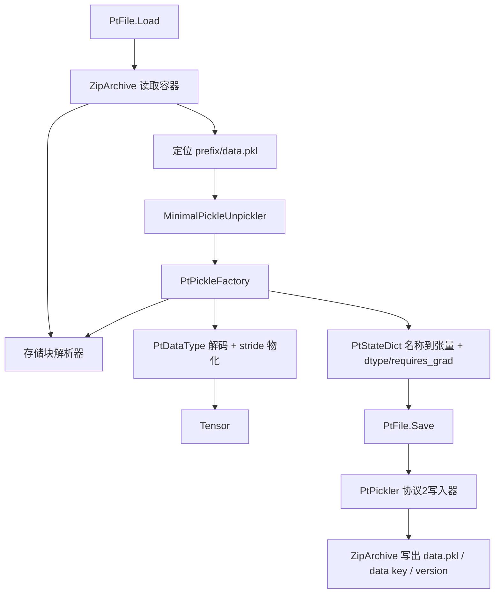

## 产品概述

在 MLDataStorage 项目的 PT 模块中，为 TensorFlow 项目的 `Tensor` 对象补齐 PyTorch `.pt` 模型权重文件（新式 zip 序列化格式）的读取与写出能力，使 sciBASIC# 可以直接消费 PyTorch 训练产出的权重文件，也能把自身的张量重新产出为 PyTorch 可加载的 `.pt` 文件。

## 核心功能

- 读取 `.pt` 文件：解析 zip 容器（`data.pkl`、`data/<key>`、`version`）与 pickle 流，把其中的张量重建为 `Tensor` 对象，返回"名称 → 张量"的权重字典
- 写出 `.pt` 文件：把"名称 → 张量"的权重字典写成标准 PyTorch zip 格式，并包含可被 PyTorch 识别为存储块的二进制数据
- 元信息保留：读取时保留每个张量的元素类型与是否需要梯度；重新保存时按原类型回写，默认按单精度写出
- 与已有张量对象互通：读出的张量可直接参与现有张量运算，现有张量也可直接保存
- 容错与诊断：非 pt 文件、缺少 `data.pkl`、存储块缺失、存储块长度与元素数不一致、形状与步长越界等异常给出明确错误信息
- 往返验证：用 KcatNet 项目提供的真实 PyTorch 模型文件（小型字典文件与 23 MB 的模型权重文件）做"读取 → 写出 → 再读取"的往返测试，逐张量比对数值与形状，并输出测试报告

## 技术栈

- 语言/框架：VB.NET，`net10.0`，目标工程 `MLDataStorage/MLDataStorage.vbproj`
- 压缩容器：`System.IO.Compression.ZipArchive`（net10.0 内置，无需新增包引用）
- Pickle 反序列化：复用已引用的 `binarydata-netcore5.vbproj` 中 `Pickle.MinimalPickleUnpickler` + `Pickle.IPickleObjectFactory`
- Pickle 序列化：现有 `Pickle.MinimalPicklePickler` 不支持持久化 ID（`BINPERSID`），因此在 PT 模块内实现最小协议 2 写入器
- 张量类型：`Microsoft.VisualBasic.MachineLearning.TensorFlow.Tensor`
- 测试：`MLDataStorage/test/test.vbproj`（Exe），使用 `Microsoft.VisualBasic.ApplicationServices.Debugging.DebugAudit` 记录并生成报告

## 实现方案

### 总体策略

`.pt` 文件本质是 zip 容器：`<prefix>/data.pkl` 是 pickle 流，其中每个权重值都是由 `torch._utils._rebuild_tensor_v2(pid, offset, size, stride, requires_grad, backward_hooks)` 构造的对象；`pid` 是持久化 ID 元组 `("storage", dtype, key, location, numel)`，真实数值字节放在 `<prefix>/data/<key>`。因此：

- **读取**：用 `ZipArchive` 读出 `data.pkl`，交给 `MinimalPickleUnpickler.UnpickleFromBytes(..., New PtPickleFactory(resolver))`；工厂在 `Construct` 中识别 `torch._utils._rebuild_tensor_v2` / `_rebuild_tensor` / `_rebuild_parameter`，用 `pid` 中的 `key` 从 zip 读取对应存储块，按 dtype 解码并按 `offset/size/stride` 物化为行优先 `Double()`，最终构造 `New Tensor(data, shape)`。
- **写出**：自实现协议 2 pickle 写入器，按 PyTorch 的语义直接产出 `OrderedDict(name -> _rebuild_tensor_v2(...))`，其中存储块引用用 `BINPERSID` 表达，数值字节写入 `data/<key>`，同时写入 `version`（内容 `"3"`）。

### 关键文件格式决策（基于对真实文件的核实）

- 两个样本文件分别是 `degree/data.pkl`+`data/0..2`+`version` 与 `archive/data.pkl`+`data/0..N`+`version`，说明 **zip 前缀不固定**，读取时必须由以 `/data.pkl` 结尾的条目反推前缀。
- 样本文件的 dtype 使用旧式 storage 类名（`torch.LongStorage`、`torch.FloatStorage`），且 `location` 可能是 `cuda:0`；因此 dtype 解析必须同时支持**旧式 storage 类名**与**新式 dtype 记号**（`torch.float32` 等），而读取存储字节时**不能依赖 location**（数据总在 zip 内）。
- 存储块字节长度 = `numel × itemsize`（`data/0`=16000 字节 → 4000 个 float32）；实现中若发现 `numel × itemsize ≠ 实际字节长度`，以实际字节长度重新推导元素数并对齐校验，避免个别文件字段不一致导致整文件读取失败。
- 写出时 `pid` 采用新式 dtype 记号（`torch.float32` 等），`location` 固定写 `cpu`，并提供"使用旧式 storage 类名"的选项以满足老版本 PyTorch 的兼容诉求。

### 数据类型映射

| dtype 记号 | 旧式 storage 类名 | 字节/元素 | 读取 | 写出 |
| --- | --- | --- | --- | --- |
| float32 | FloatStorage | 4 | 单精度 → Double | 默认写出类型 |
| float64 | DoubleStorage | 8 | 直通 | 支持 |
| float16 | HalfStorage | 2 | 半精度 → Double | 支持（写入时按半精度舍入） |
| bfloat16 | BFloat16Storage | 2 | bfloat16 → Double | 支持 |
| int64/int32/int16/int8 | Long/Int/Short/CharStorage | 8/4/2/1 | 有符号整数 → Double | 支持 |
| uint8/bool | Byte/BoolStorage | 1 | 无符号/布尔 → Double | 支持 |
| 其它 | — | — | 抛 `NotSupportedException`（带 dtype 名称） | 抛 `NotSupportedException` |


### 张量物化（stride 支持）

PyTorch 张量可能是转置/切片视图，非连续。读取时按 `size` 多维索引、`stride` 计算线性位置：`index = offset + Σ idx(d) × stride(d)`，逐元素拷出为行优先 `Double()`；单元素/标量（`size` 为空或长度 0）按形状 `{1}` 构造，规避 `Tensor.UpdateDimProds` 对 0 阶形状的限制。

### 性能与可靠性

- 时间/空间复杂度均为 `O(总元素数)`；23 MB / 约 200 个张量的模型可一次读完，无需分块。
- 存储块按 `key` 缓存（`Dictionary(Of String, Double())`），同一存储被多个张量引用时只解码一次，避免重复 I/O 与重复分配。
- 解码走 `MemoryMarshal`/`BitConverter` 的批量路径，热循环内不使用 LINQ；`data.pkl` 一次性读入内存（样本仅 62 KB），存储块按条目流式读取，避免整体拷贝。
- 写出采用流式写入 `ZipArchive` 条目，复用固定大小缓冲区；内存峰值约为单个张量的字节数。
- 失败时给出可操作的错误信息（文件路径、条目名、张量名、期望/实际字节数、形状、步长），不静默降级。

### 兼容性与影响面

- 不改动 `binarydata-netcore5.vbproj`、不改动 `TensorFlow.vbproj`、不改动 `MLDataStorage.vbproj` 的引用关系；PT 模块为叠加式新增，ONNX 模块与既有二进制模型格式不受影响。
- 命名空间遵循 ONNX 子目录的惯例：文件内写 `Namespace PT`（完整名 `Microsoft.VisualBasic.MachineLearning.DataStorage.PT`），`NamespaceDoc.vb` 使用 `Namespace Global....` 形式。
- 已知限制（写入文档注释）：不支持 `torch.save(整个 nn.Module)` 的对象图与优化器状态中的非张量内容；嵌套字典读取时按点号路径展开为扁平名称；写出时每个张量独占一个存储块（不还原权重共享/视图关系），数值本身无损。

## 架构设计



## 目录结构

```
g:/pixelArtist/src/framework/Data_science/MachineLearning/MLDataStorage/
├── PT/
│   ├── NamespaceDoc.vb      # [NEW] 命名空间文档：说明 .pt 容器结构、dtype 映射表、读取/写出能力边界与已知限制（不支持整模型对象图、不还原权重共享）。
│   ├── PtDataType.vb        # [NEW] dtype 抽象：枚举 ElementType（Float32/Float64/Float16/BFloat16/Int64/Int32/Int16/Int8/UInt8/Bool）；
│   │                        #        提供 ElementSize、dtype 记号↔旧式 storage 类名双向解析、Double()↔Byte() 编解码（半精度/bfloat16 手工换算）、未知类型抛出 NotSupportedException。
│   ├── PtStorage.vb         # [NEW] 存储块：标识（key/dtype/location/元素数/原始字节）；提供按需解码为 Double()、由 Double() 编码为字节、元素数兜底推导（字节长度/元素大小）。
│   ├── PtStateDict.vb       # [NEW] 权重字典对象视图：名称→Tensor，附带每项的 dtype 与 requires_grad；提供索引器、Names、Count、Summary()、AsTensors()；
│   │                        #        以及 Save(path) 便捷方法（按各项原始 dtype 回写）。
│   ├── PtPickleFactory.vb   # [NEW] Pickle.IPickleObjectFactory 实现：识别 torch._utils._rebuild_tensor_v2/_rebuild_tensor/_rebuild_parameter 与 torch.Size；
│   │                        #        解析持久化 ID 元组（仅依赖 ToString 识别 dtype，因为 PythonGlobalRef 是 Friend 类型）；调用存储块解析器读取字节；
│   │                        #        按 offset/size/stride 物化；requires_grad 映射到 Tensor.IsVariable；缓存已解码存储块；参数缺失/越界时抛出带张量名的 InvalidDataException。
│   ├── PtPickler.vb         # [NEW] 最小协议 2 pickle 写入器：PROTO/BINUNICODE/BININT1/BININT/MARK/TUPLE1-3/TUPLE/GLOBAL/REDUCE/BINPERSID/SETITEMS/STOP；
│   │                        #        产出 OrderedDict(name→_rebuild_tensor_v2(...))，持久化 ID 元组写 ("storage", torch.<dtype>, "<key>", "cpu", numel)，可选旧式 storage 类名模式。
│   └── PtFile.vb            # [NEW] 文件门面：Load(path)→Dictionary(Of String, Tensor)、LoadStateDict(path)→PtStateDict、
│                            #        Save(path, IDictionary(Of String, Tensor), Optional dtype)、Save(path, PtStateDict)、Load(stream)、Save(stream, ...)；
│                            #        zip 前缀探测、缺 data.pkl/非 zip/版本条目校验、异常路径包装（包含文件路径上下文）、流式写存储块。
└── test/
    ├── PtTests.vb           # [NEW] PT 往返测试模块（Public Sub Run）：读取 degree.pt 与 model_KcatNet.pt（名称集合/张量数量/形状/有限值/storage 字节长度一致性）；
    │                        #        写出到临时文件→再读回→逐值比对（单精度要求完全相等）；校验 zip 条目与 version；异常用例（非 zip、缺 data.pkl）；
    │                        #        全部通过 DebugAudit.Test/AreEqual/Mark 记录，输出 pt-test-report.txt。
    └── Program.vb           # [MODIFY] 在 Main 中接入 PT 测试入口（支持命令行参数只跑 PT 测试），保留现有 ONNX 测试流程与报告逻辑不变。
```

## 关键代码结构

```
Namespace PT

    Public Enum PtElementType
        Float32
        Float64
        Float16
        BFloat16
        Int64
        Int32
        Int16
        Int8
        UInt8
        Bool
    End Enum

    Public Class PtStateDict
        Default Public ReadOnly Property Item(name As String) As Tensor
        Public ReadOnly Property Names As String()
        Public ReadOnly Property Count As Integer
        Public ReadOnly Property ElementTypes As IReadOnlyDictionary(Of String, PtElementType)
        Public Function AsTensors() As Dictionary(Of String, Tensor)
        Public Sub Save(path As String)
    End Class

    Public Class PtFile
        Public Shared Function Load(path As String) As Dictionary(Of String, Tensor)
        Public Shared Function LoadStateDict(path As String) As PtStateDict
        Public Shared Sub Save(path As String, tensors As IDictionary(Of String, Tensor),
                               Optional dtype As PtElementType = PtElementType.Float32)
        Public Shared Sub Save(path As String, state As PtStateDict)
    End Class

End Namespace
```

## 实施注意点

- `Pickle.PythonGlobalRef` 是 `Friend`，PT 工程不可直接类型判断，只能对持久化 ID 元组中的 dtype 元素调用 `ToString()` 得到 `"torch.FloatStorage"` / `"torch.float32"` 再解析；不要为了访问该类型而修改 binarydata。
- `BINPERSID` 在现有 unpickler 中只是"弹出再压回"，pid 元组会作为 `_rebuild_tensor_v2` 的第一个参数进入工厂；工厂必须接受 `PythonTuple` 与 `Object()` 两种形态。
- 现有 pickler 不支持持久化 ID，因此写出必须用 PT 内的写入器；`MinimalPicklePickler` 保持原样。
- 生成的 `data.pkl` 中 memo 索引需要与 `BININPUT/LONG_BINPUT` 一致；为降低复杂度可以完全不写 memo（合法 pickle），但若写 memo，索引超过 255 时必须用 `LONG_BINPUT`。
- 写出路径不得改变原有 ONNX 测试流程与报告文件名；PT 测试使用独立报告文件，失败时仍以退出码 1 结束。
- 测试中真实模型路径不存在时以 `DebugAudit.Test(False, ...)` 明确记录为失败，而不是静默跳过。

## Agent Extensions

### SubAgent

- **code-explorer**
- Purpose: 在实现测试代码前，确认 `DebugAudit` 的公开方法签名（Reset/Test/AreEqual/Mark/SaveReport/Dump/FailureCount）以及 `test.vbproj` 的引用与入口约定，避免误用 API
- Expected outcome: 得到可直接调用的测试记录 API 清单与测试工程入口改造方式，保证 `PtTests.vb` 与 `Program.vb` 的改动一次通过编译