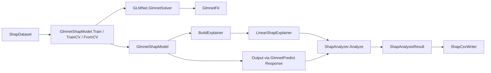

## 产品概述

为 `ML_SHAP` 增加对 `GLMNet`（R `glmnet` 5.1 的 VB.NET 复刻）模型的 SHAP 可解释性支持，使 glmnet 训练的模型能与随机森林、XGBoost、线性/逻辑回归一样，产出逐样本贡献矩阵、全局特征重要性排序与 CSV 报告。

## 核心功能

- 覆盖 glmnet 全部六个 family：`gaussian`、`binomial`、`poisson`、`multinomial`、`mgaussian`、`cox`
- 支持在正则化路径（多步 lambda）中选择解释目标：按步下标或按具体 `s` 值选取，缺省使用路径最后一步（惩罚最弱）
- 支持从交叉验证结果构建解释模型，可直接选用 `lambda.min` 或 `lambda.1se`
- 多响应模型（multinomial / mgaussian）可指定要解释的响应列（类别），并保持与类别标签顺序一致
- 提供统一的训练、批量预测、预测评估（MSE/RMSE/R2/Accuracy）与解释器构建入口，输出结构与现有三个适配器完全一致
- `cox` 以风险得分（link scale）作为解释目标，文档中明确说明其基线含义较弱
- 测试程序将 glmnet 作为第 4 个模型参与横向对比（含路径模型与 CV 选优模型），按既有命名规则导出 SHAP 明细与全局重要性 CSV
- 测试程序使用 `DebugAudit` 记录断言与耗时，并生成 JSON 测试报告
- README 补充 glmnet 适配章节、响应尺度映射表与依赖说明，工程元数据同步更新

## 边界与约束

- 不修改现有 `LinearShapModel`、`RanFogShapModel`、`XGBoostShapModel` 与 `ShapAnalyzer` 的行为
- 保持既有的「训练 → 构建解释器 → 分析 → 导出」调用链与命名风格，新能力以独立文件新增

## 技术栈选择

- 语言/框架：VB.NET，目标框架 `net10.0`，沿用 `ML_SHAP.vbproj` 现有配置（RootNamespace `Microsoft.VisualBasic.MachineLearning.SHAP`，AssemblyName `Microsoft.VisualBasic.MachineLearning.SHAPAnalysis`）
- 模型来源：`GLMNet` 工程的公共 API —— `GLMNet.GlmnetSolver.Fit` / `GLMNet.GlmnetSolver.CrossValidate` / `GLMNet.GlmnetPredict.Predict` / `GLMNet.GlmnetFit.GetCoefficients`
- 归因算法：复用 `Microsoft.VisualBasic.Math.Statistics.ShapleyValue.LinearShapExplainer`（解析式线性 SHAP），不引入任何新依赖
- 测试与报告：`ML_SHAP/test`（console 程序）+ `Microsoft.VisualBasic.Core` 的 `Microsoft.VisualBasic.ApplicationServices.Debugging.DebugAudit`

## 实现方案

### 核心思路

glmnet 在固定 lambda 上本质是 link scale 上的线性模型，因此 SHAP 可解析求解，无需采样或子集枚举：

- 单特征贡献：`phi_j = beta_j * (x_j - E[x_j])`
- 基线值：`baseline = a0 + Σ beta_j * E[x_j]`

`GlmnetFit` 的系数已经是原始量纲（与 R `coef()` 可直接对拍），因此 `E[x_j]` 直接取训练集特征列均值即可，与 `LinearShapModel` 的算法完全同构，可直接复用 `LinearShapExplainer`，避免新增归因代码。

### 关键决策与权衡

1. **复用 `LinearShapExplainer` 而非自建解释器**

- 理由：公式一致、`Baseline/Size/FeatureNames/Explain` 契约已统一，`ShapAnalyzer.Analyze` 可直接消费；避免在 GLMNet 侧新增归因实现造成双份维护
- 代价：`LinearShapExplainer` 只接受一维系数，多响应模型必须通过 `ResponseIndex` 选定一类（用 `ResponseIndex` 换取了零改动）

2. **响应尺度统一走 `GlmnetPredict.Predict`**

- `Output(x)` 实现为 `GlmnetPredict.Predict(Fit, {x}, PredictionType.Response, Lambda)(0)(ResponseIndex)`
- 这样 `binomial` → 概率、`poisson` → 期望计数、`cox` → 风险得分、`multinomial` → softmax 概率、`gaussian`/`mgaussian` → 预测值，全部与 GLMNet 的 `LinkToResponse` 语义天然一致
- 关键原因：`FamilyRegistry`、`IGlmnetFamily`、`GlmnetData` 都是 `Friend`，跨程序集不可用，复制 sigmoid/exp/softmax 会造成语义漂移，故一律通过公共预测入口取值

3. **lambda 选择双通道**

- 路径通道：`lambdaIndex` 大于等于 0 时用 `Fit.GetCoefficients(index)` 取精确步；否则用 `GetCoefficients(s)` 走网格线性插值；两者都不给则取 `Count - 1`
- CV 通道：`FromCV(cvFit, dataset, s:="lambda.1se" 或 "lambda.min")` → `Fit = cvFit.glmnetFit`，`LambdaIndex = index1se` 或 `indexMin`，`Lambda = lambda1se` 或 `lambdaMin`，保证与 CV 曲线最优点严格对齐
- 便捷通道：`TrainCV` = `CrossValidate` + `FromCV`，避免调用方重复样板代码
- 不默认启用 `exact:=True`：该选项会在目标 lambda 上重拟合整条路径，代价等于一次完整坐标下降求解，仅作为显式选项暴露

4. **响应矩阵重载处理 cox / mgaussian**

- `ShapDataset` 只有单列 `Labels`，而 `cox` 需要 `(time, status)` 两列、`mgaussian` 需要 K 列
- 提供 `Train(dataset, family, y As Double()(), options, ...)` 重载接收显式响应矩阵；单列标签路径在遇到 `cox` / `mgaussian` 时抛出 `ArgumentException` 并给出「请使用响应矩阵重载」的明确提示，而不是让内核抛出晦涩的维度错误

5. **family 名称映射本地实现**

- `FamilyRegistry.Name` 为 `Friend`，无法跨程序集调用；在适配器内用私有 `Select Case` 输出 R 风格名称（`gaussian`/`binomial`/`poisson`/`multinomial`/`cox`/`mgaussian`），用于 `Name` 属性与 CSV 前缀

### 性能与可靠性

- 复杂度：解析式 SHAP 为 `O(n * p)`，`n` 为被解释样本数（继续受 `ShapAnalyzer.maxSamples` 控制），单样本为 `O(p)`；相比 TreeSHAP 无需子集枚举，成本可忽略
- 求解成本集中在 `GlmnetSolver.Fit` 的路径拟合；`Train` 只拟合一次，`BuildExplainer` 只做一次系数抽取与列均值计算，均为 `O(n * p)`
- 输入校验：`ResponseIndex` 必须落在 `[0, nresponses - 1]`，`lambdaIndex` 必须落在 `[0, Count - 1]`，`Family` 非法时抛 `ArgumentException`，避免静默产出错误解释
- 数值安全：`multinomial` 的概率输出由 GLMNet 的 softmax 保证归一；`cox`/`poisson` 的 `exp` 由 GLMNet 的 `Convergence.SafeExp` 保证不溢出

## 架构设计

沿用 `ML_SHAP` 现有「适配器 + 门面」架构，不改动门面，只横向增加一个适配器：



- 适配器职责：持有 `GlmnetFit` 与 lambda 选择、暴露 `Predict`/`Output`/`PredictResult`、把 `(p+1) x K` 系数矩阵投影为单响应系数向量并构建解释器
- 门面职责不变：`ShapAnalyzer` 负责逐样本求贡献、累加绝对/有符号均值、生成 `ShapAnalysisResult`
- 依赖方向：`ML_SHAP` → `GLMNet` → (`DataFittings` / `Math.Statistics` / `MachineLearning`)，单向无环，不产生反向引用

## 目录结构

```
MachineLearning/ML_SHAP/
├── Models/
│   └── GlmnetShapModel.vb   # [NEW] glmnet 六个 family 的 SHAP 适配器。
│                            #   - 成员：Fit (GlmnetFit)、Training (ShapDataset)、Family、ResponseIndex、
│                            #     LambdaIndex、Lambda、IsClassification、Name、Coefficients、Intercept、
│                            #     Link、ResponseName
│                            #   - Train(dataset, family, options, lambdaIndex, s, responseIndex)：单响应路径拟合，
│                            #     family 为空时按 dataset.IsCategorical 推断 binomial/gaussian
│                            #   - Train(dataset, family, y, options, ...)：显式响应矩阵重载，供 cox (time,status) 与
│                            #     mgaussian 多列响应使用
│                            #   - TrainCV(dataset, family, options, s, responseIndex)：CrossValidate + FromCV 封装
│                            #   - FromCV(cvFit, dataset, s, responseIndex)：从 cvFit.glmnetFit 与 indexMin/index1se 构建
│                            #   - Predict / Output / PredictResult / BuildExplainer：与既有三个适配器同名同契约
│                            #   - 私有辅助：ComputeFeatureMeans（列均值）、FamilyName（FamilyKind 到 R 风格名映射，
│                            #     因 FamilyRegistry 为 Friend 必须本地实现）、ResolveCoefficients（按 lambdaIndex 或 s 取系数）
│                            #   - BuildExplainer 内部：coef(index) 第 0 行为截距，beta_j 取 coef(j+1)(responseIndex)，
│                            #     再 new LinearShapExplainer(beta, means, featureNames, intercept, link)
├── test/
│   └── Program.vb            # [MODIFY] 在 RunDataset 中新增第 4 个模型 glmnet：
│                            #   - 编号 [1/3]..[3/3] 调整为 [1/4]..[4/4]
│                            #   - 按 isClassification 选择 family（binomial / gaussian），GlmnetOptions 设 Alpha=1.0
│                            #   - 路径末端模型：Train(..., lambdaIndex := fit.Count - 1) 后走既有 RunShap 导出 CSV
│                            #   - CV 选优模型：CrossValidate + FromCV(s:="lambda.min")，产出一套独立 CSV
│                            #   - 用 Using DebugAudit.Watch(...) 包裹各模型训练与 SHAP 分析以记录耗时
│                            #   - 用 DebugAudit.Check 断言解释样本数、系数长度、identity link 下的加性一致性
│                            #   - 结束调用 DebugAudit.SaveReport(输出目录/shap-test-report.json) 并打印 Dump()
│                            #   - 每个模型保持既有 Try/Catch 容错，单个模型失败不影响其余流程
├── README.md                 # [MODIFY] 第三节命名空间地图表补 GLMNet 行；
│                            #   新增「GLMNet（glmnet）适配」章节：解析式 SHAP 公式、family 到响应尺度映射表
│                            #   （gaussian/mgaussian→预测值、binomial→概率、poisson→期望计数、multinomial→softmax 概率、
│                            #   cox→风险得分）、lambda 选取方式（下标 / s / CV）、ResponseIndex 用法与 cox 基线说明；
│                            #   第八节依赖列表补 GLMNet；第七节实现要点补「glmnet 为解析式 O(n*p)，无采样开销」
└── ML_SHAP.vbproj            # [MODIFY] Description 与 PackageReleaseNotes 补充 glmnet family 适配说明；
                             #   ProjectReference 已由用户添加，无需改动
```

## 关键代码结构

```
Public Class GlmnetShapModel
    Public Property Fit As GlmnetFit
    Public Property Training As ShapDataset
    Public Property ResponseIndex As Integer
    Public Property LambdaIndex As Integer      ' 小于 0 表示按 s 插值
    Public Property Lambda As Double
    Public ReadOnly Property Family As FamilyKind
    Public ReadOnly Property IsClassification As Boolean   ' Binomial 或 Multinomial
    Public ReadOnly Property Name As String                ' 形如 GLMNet[binomial]
    Public ReadOnly Property Coefficients As Double()      ' 单响应 beta，长度 p
    Public ReadOnly Property Intercept As Double
    Public ReadOnly Property Link As Func(Of Double, Double)

    Public Shared Function Train(dataset As ShapDataset, family As String,
                                 Optional options As GlmnetOptions = Nothing,
                                 Optional lambdaIndex As Integer = -1,
                                 Optional s As Double? = Nothing,
                                 Optional responseIndex As Integer = 0) As GlmnetShapModel

    Public Shared Function Train(dataset As ShapDataset, family As String, y As Double()(),
                                 Optional options As GlmnetOptions = Nothing,
                                 Optional lambdaIndex As Integer = -1,
                                 Optional s As Double? = Nothing,
                                 Optional responseIndex As Integer = 0) As GlmnetShapModel

    Public Shared Function TrainCV(dataset As ShapDataset, family As String,
                                   Optional options As GlmnetOptions = Nothing,
                                   Optional s As String = "lambda.1se",
                                   Optional responseIndex As Integer = 0) As GlmnetShapModel

    Public Shared Function FromCV(cvFit As GlmnetCVFit, dataset As ShapDataset,
                                  Optional s As String = "lambda.1se",
                                  Optional responseIndex As Integer = 0) As GlmnetShapModel

    Public Function Predict(features As Double()()) As Double()
    Public Function Output(x As Double()) As Double
    Public Function PredictResult() As ModelPrediction
    Public Function BuildExplainer() As IShapExplainer
End Class
```

## 实现注意事项

- `GlmnetFit.GetCoefficients(index)` 返回 `(p+1) x K`，**第 0 行是截距**；取特征系数必须用 `j + 1`，否则整体错位且加法一致性断言会异常
- 严禁访问 `FamilyRegistry`、`IGlmnetFamily`、`GlmnetData`、`FamilyPath` 等 `Friend` 成员；family 名称映射与响应尺度变换全部走公共 API
- `binomial` 传两列 `y` 会被解释为 `(success, failure)` 并改变样本权重语义，单列路径必须保持一列
- `multinomial` 的单列类别编码会在内核中自动 one-hot，类标顺序为排序后的唯一值，因此 `ResponseIndex` 与 `Fit.classLabels` 顺序严格对应，`ResponseName` 也应从 `classLabels` 取
- 加性一致性断言只在 identity link（`gaussian` / `mgaussian`）上做严格的 `baseline + Σ phi == Output` 比较；`binomial`/`poisson`/`cox`/`multinomial` 应在 link scale 上用 `Fit.LinearPredictor` 与 `Baseline + Σ phi` 对拍，避免把响应变换误判为计算错误
- `DebugAudit.Check` 带 `Conditional("DEBUG")`，测试必须以 Debug 配置运行才有断言与报告内容；报告统一用 `SaveReport` 写到输出目录，并在结尾打印 `Dump()`
- 本次不改动 `ShapAnalyzer`、`ShapCsvWriter`、既有适配器与 `test.vbproj`（GLMNet 通过 `ML_SHAP` 的 ProjectReference 传递引用），以最小爆炸半径交付