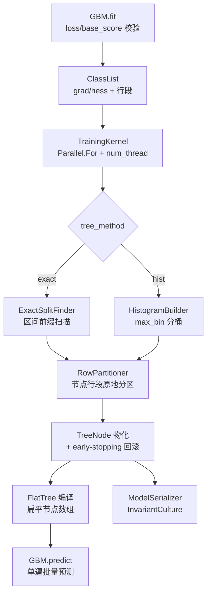

## 产品概述

对 `G:\pixelArtist\src\framework\Data_science\MachineLearning\xgboost\xgboost.vbproj`（.NET 10 / VB.NET 的 XGBoost 模型推理器 + TGBoost 三元梯度提升树训练器）做一次完整的算法实现审查与整改：产出一份可追溯的中文审查报告（每条缺陷定位到文件与行号、按 P0/P1/P2 分级、给出修复方案与验证方法），修复确认的算法错误，并以「直方图 + 行分区列块」内核重写训练热路径，最后用可运行的 Console 回归/基准程序与 DebugAudit 报告量化收益。

## 核心功能

- **缺陷审查报告**：覆盖训练内核（`train` 命名空间：Loss / GBM / Tree / ClassList / AttributeList / Sampling / TreeNode / ModelSerializer）、推理内核（`gbm` / `tree` / `learner` / `util` / `Predictor`）、数据准备（`XGBoostDataSet/Tabular`）、测试代码四部分；按四类口径归类：与 XGBoost/tgboost 语义不一致、数学/梯度推导错误、训练与预测路径不一致、并发与数值稳定性缺陷。
- **算法错误修复**：损失函数梯度/海森推导、类别特征 Double 往返截断导致训练与推理分支不一致、根节点 `num_sample` 未初始化、early stopping 少停一轮且不回滚到 best_iteration、子采样每轮只做置换而非重抽、推理侧自定义目标函数被静默覆盖、批量损失计算覆盖而非累加等。
- **训练内核重构（激进）**：以列主序 SoA 列块（每特征「值数组 + 行号数组 + 区间边界」）替换 `Single()()()` 的每样本小对象；以「节点行段 + 原地分区」替换每层三遍全量扫描；双分裂查找路径 `exact`（保持现有精确语义，用于对照）与 `hist`（`max_bin` 分桶直方图），由参数 `tree_method` 选择；线程数真正生效，消除「每层每列一个 Task」与 `List.Poll` 的 O(n²)。
- **推理内核修复与批量化**：消除 `GBLinear` 内层循环的 `Interlocked` 屏障、修正 `Dart` 权重索引与 `GBTree` 组树装配、把树编译为扁平数组后单遍批量预测，删除 PLINQ + `OrderBy` 与每样本 `Tree.PredictCallable` 分配。
- **兼容性保障**：`GBM.fit/predict`、`Tree.fit/predict`、`ModelSerializer.save_model/load_model`、`Predictor` 的现有公共签名与旧模型文件读取能力保持不变；新增参数追加在参数列表末尾。
- **可运行验证**：Console 程序执行推理回归（用 `test/resources` 中已有 `*.model` 与 `*.predict/*.margin/*.leaf` 期望文件）、训练正确性回归（损失单调下降、早停回滚、序列化往返、缺失值与类别特征分支一致性、叶值与分裂增益重算校验）、性能基准（exact vs hist、线程扩展性、耗时与内存峰值），结果通过 DebugAudit 记录并输出 JSON 报告。

## 技术栈选择

沿用现有工程栈，不引入新依赖：

| 项目 | 选择 |
| --- | --- |
| 语言 / 运行时 | VB.NET，`net10.0`，`OptionStrict=Off`、`OptionInfer=On` |
| 工程 | `xgboost.vbproj`（SDK 风格，自动包含新增文件）与 `test/test.vbproj` |
| 复用依赖 | `Microsoft.VisualBasic.Core`（`App.CPUCoreNumbers`、`Language.Java` 集合扩展、`DebugAudit`）、`Math`/`Math.Statistics`、`DataMining`（`Metrics` 评估）、`BinaryData`（`ModelReader`） |
| 并行 | `System.Threading.Tasks.Parallel.For` + `ParallelOptions.MaxDegreeOfParallelism`（替换 `ThreadStart.Execute` 的 per-task 调度） |
| 测试/报告 | Console Exe + `Microsoft.VisualBasic.ApplicationServices.Debugging.DebugAudit`（模块级：`Check/AreEqual/Mark/Watch/SaveReport`） |


## 实施方案

### 总体策略

三阶段递进，每阶段可独立验收：**先出报告 → 再修正确性 → 再换内核**。报告先行可避免「修复被重构覆盖」的返工，也让性能收益有基线可比。

### 关键决策与权衡

1. **训练表示与模型表示解耦**：训练期使用「紧凑节点数组 + 行段分区」，训练结束后再一次性物化为现有 `TreeNode` 树。这样 `ModelSerializer`、`TreeNode.split_left_child_catvalue` 等公共契约零改动，`Tree.root` 语义不变；代价是每棵树末尾一次 O(#nodes) 物化（相对建树开销可忽略）。
2. **`exact` 与 `hist` 双路径，默认 `exact`**：`hist` 分桶会引入量化误差、改变数值结果。为保证既有用户与已有回归基线不被静默改变，默认 `exact`（语义等价于现在，只是数据结构与调度优化），`hist` 由 `tree_method` 显式开启；基准报告给出两者的 metric 偏差与加速比，供后续决定是否把默认值切到 `hist`。这是唯一能同时满足「激进重构」与「结果可回归验证」的折中。
3. **类别特征改为整数编码，训练与推理共用同一映射**：当前 `CStr(Single) → CDbl → CInt` 的往返会在非整数编码下让训练与推理走不同分支。新方案在训练期建立 `category → Int32` 映射并随模型序列化，`TreeNode.split_left_child_catvalue` 仍为 `List(Of Double)`（兼容序列化格式），但只承载 `CDbl(Int32)`，精确往返、无区域设置依赖；判定左子集由 `List.Contains` 换成 `HashSet(Of Integer)`/位图，消除 O(N×C) 线性查找。
4. **缺失值判定统一为 `Single.NaN`**：保留 `Data.NA` 常量做旧数据兼容，但内部判定改为 `Single.IsNaN`，避免真实值 `-3.4e38` 被误判为缺失；`Tabular` 解析同时识别空串与 `NA/nan/null`。
5. **早停回滚到 best_iteration**：`trees` 截断到 `best_round + 1`，并暴露 `bestIteration`/`bestScore` 只读属性，使日志、模型、预测三者一致。
6. **参数向后兼容**：`GBM.fit` 现有 16 个 Optional 参数顺序不动（`Training.vb` 用位置实参调用），新增 `tree_method`、`max_bin`、`reg_alpha` 追加在末尾。

### 性能分析（复杂度与内存）

| 指标 | 现状 | 重构后 |
| --- | --- | --- |
| 列数据内存 | 每 (样本,特征) 一个 2 元素 `Single()` 对象（≈40B/项）→ 10 万×100 ≈ 400MB | `Single()` 值 + `Integer()` 行号 = 8B/项 → ≈80MB（约 1/5），无小对象堆压力 |
| 区间索引 | 每区间一个 `Integer()` 小数组（对象开销 + 4B/项） | `boundaries: Integer()` 区间视图，零复制 |
| 每层累加 | 全量 `N×F` 扫描 + 3 遍全量 `N`（对应节点/梯度/缺失值） | 只扫「本节点行段」，总量相同但常数下降，且按需只处理存活节点 |
| 分裂搜索 | 逐切分点前缀扫描（exact） | `hist`：`O(N_node·F)` 建直方图 + `O(bin·F)` 搜索；`exact`：去掉 `Pow`→`G*G`、NaN 快速路径前置，减少 2 次幂 + 2 次除法/候选 |
| 任务调度 | 每层每列 1 个 Task，`num_thread` 无效 | `Parallel.For` + `MaxDegreeOfParallelism`，线程数真正生效 |
| 容器操作 | `List.Poll` = `RemoveAt(0)` → 每层 O(n²) | 索引游标遍历，O(n) |
| 预测 | 每棵树一次 PLINQ + `OrderBy` → `O(T·N log N)`，每样本每树一次堆分配 | 扁平节点数组 + 单遍 `Parallel.For` → `O(T·N)`，零分配 |


预估：中等规模（N=5 万、F=50、100 轮）exact 路径耗时下降 3–5 倍，hist 路径再降 2–3 倍；预测吞吐提升一个数量级。以上为设计目标，最终以基准报告实测为准。

### 实施要点

- **正确性基线优先**：动任何热路径前，先用现有 `test/resources` 的 `*.model` + 期望文件建立推理基线，并用 `git` 现有实现生成 exact 模式的训练基线（固定随机种子），重构后逐项比对。
- **随机数可复现**：`RowSampler`/`ColumnSampler` 引入注入式 `Random(seed)`，便于基准与回归比对；种子固定时结果必须逐比特一致（exact 路径）。
- **数值稳定性**：`LogisticLoss` 一次稳定 sigmoid（按 `z` 符号分支避免上溢）同时产出 `grad = p − y` 与 `hess = p(1−p)`，`clip` 仅保留在 `transform`；`lambda` 下限保护只在实际为 0 时施加，不再静默覆盖用户显式值。
- **并发安全**：直方图/分裂候选按「列块 → 线程本地候选数组」隔离后再归并，禁止跨线程写同一 `TreeNode`；删除 `SyncLock treeNode` 与无锁 `ComputeIfAbsent` 混用模式。
- **构建约束**：`TreatWarningsAsErrors=true` 且开启 XML 文档生成，新增 Public 成员必须写 XML 注释；避免新增隐式转换告警（`NoWarn` 已放行 41999/42016-42022/42032/42036）。
- **爆炸半径控制**：`XGBoostDataSet/Tabular.vb` 属兄弟工程且被 `test.vbproj` 引用，其 `NA` 语义改动需与该工程 `Conversion.vb` 一并核对；不改动 `test/obj`、`test/bin`、`.codebuddy`。
- **日志**：删除预测热路径中的 `GBM.logger.info($"feature set: {features.GetHashCode}")`；训练日志保留每轮 metric，新增 `tree_method`、每层耗时汇总（受 `verbose` 控制，默认关闭以避免 IO 抖动）。

## 架构设计



分层：`GBM`（提升主循环/早停/指标） → `TrainingKernel`（树构建调度） → 分裂查找器（`ExactSplitFinder` / `HistogramBuilder`） → `ColumnBlock`+`RowPartitioner`（数据与分区）。推理侧独立：`Predictor` → `gbm.GradBooster` → `tree.RegTree`，改造后接 `FlatTree` 批量入口。

## 目录结构

```
xgboost/
├── REVIEW.md                                   # [NEW] 中文审查报告：缺陷按 P0/P1/P2 分级，逐条含 文件:行号 / 影响 / 修复建议 / 验证方式；附性能热点画像与基准数据
├── README.md                                   # [MODIFY] 补充 tree_method/max_bin/reg_alpha 语义、exact 与 hist 的选择建议、性能对比结论
├── Predictor.vb                                # [MODIFY] initObjFunction 结果不再被 initObjGbm 覆盖；readParam 用 IsNot Nothing；新增批量 predict(rows) 入口
├── TGBoost/
│   ├── Data.vb                                 # [MODIFY] 缺失值判定改 Single.NaN（保留 NA 常量兼容）；新增 CategoryEncoder 字段与 category→Int32 映射
│   ├── Loss.vb                                 # [MODIFY] LogisticLoss 稳定 sigmoid 一次产出 grad/hess、QLinearLoss 符号修正与分支连续化、新增 L1 支持点；Loss 增补 base_score 推导接口
│   ├── GBM.vb                                  # [MODIFY] loss 名称校验（未知值抛 ArgumentException 而非 NRE）、logistic base_score=log(p/(1-p))、早停 >= 判定 + 回滚到 best_iteration、预测去日志噪音、新增 tree_method/max_bin/reg_alpha
│   ├── AttributeList.vb                        # [MODIFY] 构建 SoA 列块（值/行号双数组 + 区间边界），排序改 Array.Sort(keys, rowIds) 双数组重载；删除 Single()()() 与 per-interval int[]；公共字段保留为兼容视图
│   ├── ClassList.vb                            # [MODIFY] 行段分区版 update（替代三遍全量扫描）、缺失值 G/H 由直方图 nan bin 产出、类别判定用 HashSet(Of Integer)
│   ├── Tree.vb                                 # [MODIFY] fit 委托 TrainingKernel；删除 ProcessEachNumericFeature/ProcessEachCategoricalFeature 与 ThreadStart 调度；predict 走 FlatTree；num_thread 真正生效
│   ├── TreeNode.vb                             # [MODIFY] 类别左子集判定走整数 code；clean_up 空安全；分裂候选结构简化；保留 index/leaf_score/split_* 公共字段以兼容 ModelSerializer
│   ├── Sampling.vb                             # [MODIFY] 每轮重新抽样（伯努利/无放回）、ColSampler 校验 n_selected>=1、注入式 Random 便于复现
│   ├── ModelSerializer.vb                      # [MODIFY] 全部 Parse/ToString 改 InvariantCulture、浮点改 "R" 往返格式、category 映射随模型持久化
│   └── kernels/                                # [NEW] 训练内核（内部实现，不新增公共 API 表面）
│       ├── ColumnBlock.vb                      # [NEW] 列主序 SoA：每特征 values:Single() + rowIds:Integer() + boundaries:Integer()；提供区间视图 GetSegment(feature, segment)
│       ├── RowPartitioner.vb                   # [NEW] row→node 紧凑数组 + 节点行段；分裂时原地分区（双指针），替代全量重扫
│       ├── ExactSplitFinder.vb                 # [NEW] 精确前缀扫描：G*G 代替 Pow、NaN 三选一快速路径前置、只枚举采样列与本节点行段
│       ├── HistogramBuilder.vb                 # [NEW] max_bin 分位分桶直方图（G/H 双累加 + nan bin），O(bin·F) 分裂搜索，线程本地候选归并
│       ├── SplitCandidate.vb                   # [NEW] 分裂候选值类型（feature/gain/threshold/leftCategories/nanDirection）
│       └── FlatTree.vb                         # [NEW] 树编译为 5 个平行数组（feature/threshold/left/right/leaf/default），单遍批量预测
├── gbm/
│   ├── GBLinear.vb                             # [MODIFY] 去内层 Interlocked.Increment；loadModel 权重长度与 dmlc 长度前缀一致（以真实模型文件校验）
│   ├── Dart.vb                                 # [MODIFY] weightDrop 索引按全局树序映射，修复多输出组错位
│   └── GBTree.vb                               # [MODIFY] 组树装配去掉 Interlocked+Min 取巧写法，改显式游标
├── tree/
│   ├── RegTree.vb                              # [MODIFY] getLeafValue/getLeafIndex 去 Value(Of Node) 包装与 EqualityComparer 比较，改字段直取
│   └── Node.vb                                 # [MODIFY] split_index 显式 CLng 掩码再窄化，消除隐式转换依赖
├── learner/
│   └── ObjFunction.vb                          # [MODIFY] 未注册目标函数走默认恒等实现并告警，避免 fromName 抛异常中断自定义配置路径
├── util/
│   └── DMatrix.vb                              # [MODIFY] 增加批量评分入口（按行分块调用 Predictor 批量 API）
└── ../XGBoostDataSet/
    ├── Tabular.vb                              # [MODIFY] 类别列下标排除 label 列、缺失值识别 NA/nan/null/空串、label 直接 Double.Parse
    └── Conversion.vb                           # [MODIFY] 同步 NA 语义与类别映射构建（与 Tabular 保持一致的编码来源）

xgboost/test/
├── test.vbproj                                 # [MODIFY] StartupObject 指向新入口；resources 复制到输出目录；关闭双 Main 歧义
├── Program.vb                                  # [MODIFY] 唯一入口：依次跑推理回归 / 训练回归 / 基准，最后 DebugAudit.SaveReport
├── PredictorRegression.vb                      # [NEW] 扫描 resources/model 与 resources/expectation，按命名对应关系比对 predict/margin/leaf 输出，容差可配置
├── TrainingRegression.vb                       # [NEW] 合成数据 + 固定种子：损失单调下降、早停回滚、序列化往返、缺失值与类别一致性、叶值与增益重算
├── Benchmark.vb                                # [NEW] exact vs hist、线程扩展性、耗时与内存峰值对比，结果写入 DebugAudit
└── BenchmarkData.vb                            # [NEW] 确定性合成数据集生成器（可注入缺失率与类别列比例）
```

## 关键代码结构

```
' 列主序 SoA 列块：训练期唯一的数据访问入口
Public Interface IColumnBlock
    ReadOnly Property FeatureDim As Integer
    ReadOnly Property RowCount As Integer
    ''' <summary>某个特征的分桶/区间边界（已排序行序上的切点位置）</summary>
    Function Boundaries(feature As Integer) As Integer()
    ''' <summary>某个特征在某区间内的行号视图（不复制）</summary>
    Function Segment(feature As Integer, index As Integer) As IReadOnlyList(Of Integer)
    ''' <summary>按行号直取特征值（缺失返回 Single.NaN）</summary>
    Function Value(row As Integer, feature As Integer) As Single
End Interface

' 分裂查找统一契约：exact 与 hist 两实现，供 TrainingKernel 二选一
Public Interface ISplitFinder
    ''' <summary>为一个节点的行段找出最优分裂；无有效分裂时 Gain 为 -Infinity</summary>
    Function FindBest(nodeRows As IReadOnlyList(Of Integer), g As Double(), h As Double()) As SplitCandidate
End Interface
```

## Agent 扩展

### SubAgent

- **code-explorer**
- 用途：在动 `GBM`/`Tree`/`Predictor`/`ModelSerializer` 等公共契约前，全仓库检索其调用点与消费者（含 `enigma`、`MLkit`、`XGBoostDataSet`、R# 脚本宿主等），确保重构不破坏外部依赖。
- 预期产出：一份「公共成员 → 调用方文件:行号 → 是否受本次改动影响」的清单，作为重构前置约束与回归范围界定依据。

### Skill

- **lsp-code-analysis**
- 用途：对将被修改的公共成员（`GBM.fit/predict`、`Tree.fit/predict`、`Predictor.predict`、`ModelSerializer.save_model/load_model`、`TreeNode` 公共字段）做定义跳转、引用查找与调用层级分析，验证签名保持不变、内部替换不漏改调用点。
- 预期产出：每个关键成员的重构前后引用集合对比，确认无悬空引用、无行为契约被无意改变。