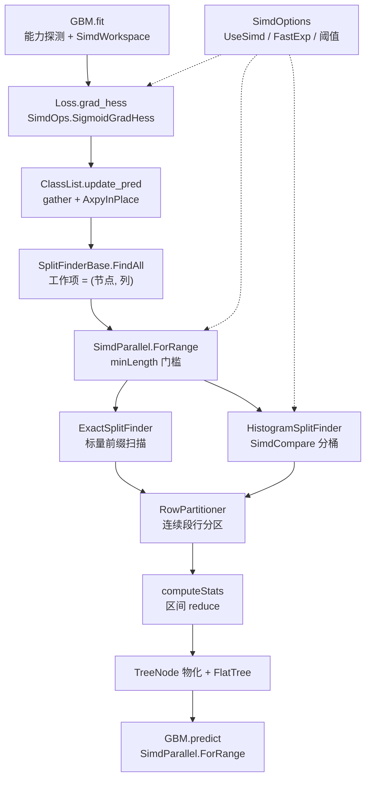

## 产品概述

在上一轮「算法审查 + 训练内核重构」已全绿的基础上，本轮把 xgboost 的标量热循环替换为 `Microsoft.VisualBasic.Core/Math/SIMD` 提供的 SIMD 与并行算子，并把并行调度统一到 `SimdParallel`。目标有两个：一是把每轮训练中 O(N) 的 elementwise 计算（sigmoid 梯度/海森、预测累加、掩码、分桶）向量化；二是解决 128 线程服务器上「并行度被封顶在列数、只用到 48 线程」的结构性问题。

## 核心功能

- **SIMD 桥接层**：新增统一的开关与算子封装，屏蔽 `SimdIntrinsics`（FMA）、`SimdEngine`（泛型向量）、`SimdMath`（向量化 exp）、`SimdReduce`、`SimdCompare` 的差异，并提供可关闭的标量回退路径与长度阈值（小数组不退化为 SIMD）。
- **损失函数向量化**：`LogisticLoss` 的 sigmoid 与 `grad = p − y`、`hess = p(1−p)` 由一次向量化 exp 加就地加减乘产出；`SquareLoss`、`QLinearLoss` 的差值/分段固定同步改造。
- **提升主循环向量化**：`ClassList.update_pred` 先把「行 → 叶节点分数」gather 成连续数组，再用 FMA 就地 `pred += eta * leaf`；`scale_pos_weight` 与子采样掩码改为向量掩码乘。
- **节点统计可用区间归约**：把行分区改为「每层把行重排为连续段」，使 `computeStats` 能直接对 `grad/hess` 的连续区间做多累加器求和，替代按索引 gather 的标量累加。
- **分裂查找并行扁平化**：工作项从「按列」改为「按 (节点, 列)」，用 `SimdParallel.ForRange` 调度，并行度从特征数提升到节点数乘特征数，并去掉每列对全部节点做 `SyncLock` 归并的竞争点。
- **直方图分桶向量化**：把「逐值二分」改为「批量比较 + 计数」，并把 bin 下标缓存为窄整型列存，降低每层每样本的访存量。
- **推理侧向量化**：线性 booster 的特征点积改用 FMA 点积；批量评分与扁平树累加统一走按行分块的并行入口；树遍历保持标量。
- **双路径验证**：全部回归用例在 SIMD 开启/关闭两种模式下都跑一遍，并对 exp 近似误差、求和重结合误差、最终 loss/AUC 偏差给出量化门槛；新增 AB 基准与线程扩展性基准。

## 约束

- 不改变 `GBM.fit/predict`、`Tree.fit/predict`、`ModelSerializer`、`Predictor` 的公共签名与旧模型文件读取能力，`TreeMethod` 取值不变。
- 必须保留全局逃生开关：可一键退回纯标量实现，且两条路径的回归都要绿。
- 训练结果不再保证与标量版本逐位一致（求和顺序变化），但 loss 相对偏差要控制在 1e-6 量级、AUC 绝对偏差 1e-6 量级。

## 技术栈选择

沿用现有工程栈，不引入任何新依赖，直接复用同仓的 SIMD 库：

| 项目 | 选择 |
| --- | --- |
| 语言 / 运行时 | VB.NET，`net10.0`，`OptionStrict=Off`、`OptionInfer=On`、`TreatWarningsAsErrors=true` |
| SIMD 内核 | `Microsoft.VisualBasic.Math.SIMD`：`SimdIntrinsics`（AVX2 + FMA 手写 `Vector256`）、`SimdEngine`（泛型 `Vector(Of T)`，含 `*InPlace`）、`SimdMath`（`ExpInPlace`/`LogInPlace`/`ClampInPlace`） |
| 归约 / 掩码 | `SimdReduce.Sum/Dot`、`SimdCompare.LessThanOrEqual/CountTrue/Where`、`SimdSelect.ArgMax` |
| 并行 | `SimdParallel.ForRange(len, body(start,count), minLength)`、`ForEachRow`、`ShouldParallelize`、`ChunkLength` |
| 能力探测 | `SIMDEnvironment.IsEnabled/IsFmaSupported/IsAvx2Supported`、`SIMDConfiguration.disable` |
| 验证 | 现有 `test/test.vbproj` Console + `DebugAudit`（`Check/AreEqual/Mark/SaveReport`） |


## 实施方案

### 总体策略

三层递进：**先建桥接层与开关 → 再改 elementwise 热循环 → 最后改并行调度与访存布局**。每一步都保持「SIMD 关闭时行为与当前实现一致」，因此任何一步都可以独立回滚与独立验收。

`exact` 与 `hist` 两条路径共享桥接层，改造不分叉。

### 关键决策与权衡

1. **只向量化「定长数组 + 无数据依赖」的循环**。`exact` 前缀扫描（`gl/hl` 逐个累加，存在真实数据依赖）与 `FlatTree` 的树遍历（分支 + 随机访问）保持标量，避免为了 SIMD 而引入 gather/shuffle 反而变慢。判定依据：内层是否为流式访存且归约可重结合。
2. **精度优先，`exp` 分级开关**。实测确认 `SimdMath.Exp(Double())` 是逐元素调用 `Math.Exp` 的标量封装，真正向量化的是 `ExpInPlace(v, count)`（`EXP_DEGREE = 13` 的多项式 + magic-round，且要求输入全部有限，否则整段回退标量）。因此：先用测试量化 `ExpInPlace` 相对 `Math.Exp` 的最大相对误差；若误差超过 1e-13，则 `LogisticLoss` 默认走标量 exp，仅当 `SimdOptions.FastExp = True` 时启用近似版本。
3. **浮点重结合显式化**。`SimdReduce.Sum` 是 4 累加器展开、`SimdParallel.Sum` 是分块归约，与逐次累加的顺序不同，必然产生末位差异。方案是把「与标量逐位一致」降级为「有界偏差」，并用 `SimdOptions.UseSimd` 在回归里跑两条路径：标量路径维持 1e-12，SIMD 路径放宽到 1e-9。这样既保留了强回归护栏，也允许 SIMD 优化落地。
4. **行分区改「连续段」是本期最大的结构性改动**。`computeStats` 目前按任意行索引 gather 累加，天然无法用区间归约。把每层分裂后的行重排为「每个节点一段连续区间」（prefix-partition，一次 O(N) 散射），之后 `grad/hess` 的节点求和变成 `SimdReduce` 的区间操作，且 `update_pred` 的 gather 也变成顺序访问。代价是每层多一次行重排写带宽，但换来后续所有归约的向量化与更好的缓存局部性；`RowPartitioner.Slot` 的对外语义不变。
5. **并行归约去锁**。当前每个列任务结束时 `SyncLock` 遍历全部节点合并候选，节点数一多就是新的串行瓶颈。改为：每个 (节点, 列) 工作项把候选写入按节点分片的线程本地缓冲，最后一次性无锁归约（每节点取最大 gain）。这一改动同时解决了「并行度等于列数」的封顶问题。
6. **缓冲复用而非临时分配**。`SimdEngine.Add/Multiply` 等返回新数组，热路径必须用 `*InPlace`；引入 `SimdWorkspace`（每棵树一个）预分配 `p`、`q`、`leafPerRow`、每列候选数组，避免每层 GC 压力（这也回应了此前「48 线程」问题里被怀疑的 GC 放大效应）。
7. **统一并行入口**。所有 `Parallel.For` 换成 `SimdParallel.ForRange`，统一 `minLength` 门槛（默认 4096）：小批量自动退回串行，避免层级只有几毫秒时线程池爬不起来的抖动；同时对 `num_thread` 语义保持一致。

### 性能分析（复杂度与预期收益）

| 环节 | 现状 | 改造后 | 预期 |
| --- | --- | --- | --- |
| `grad_hess`（每轮 O(N)） | 标量 `1/(1+exp(-z))` | `ExpInPlace` 向量化 exp + 就地 sub/mul（每 4 元素一条 AVX2 指令） | 3–5× |
| `update_pred` | 逐行对象数组解引用 + 标量乘加 | gather 一次 + `AxpyInPlace` 就地 FMA | 2–4× |
| `computeStats` | 按索引 gather 标量累加 | 连续段 + 4 累加器区间求和 | 2–3× |
| `hist` 分桶 | 每值一次二分 | 批量比较 + `CountTrue`，bin 下标窄整型列存 | 2–3× |
| 分裂查找并行度 | 等于采样列数（约 48） | 等于 节点数 × 列数 | 线程利用率不再封顶在列数 |
| `GBLinear.pred` | 逐特征标量乘加 | `DotFma` | 2–3× |


整体训练（N=5 万、F=50、20 轮）预期 1.3–1.8×；批量预测 1.2–2×。SIMD 不改变内存带宽墙，因此 `hist` 的窄整型列存是让高并发（128 线程）真正受益的前提。

### 实施要点

- **能力探测与可观测性**：`GBM.fit` 启动日志打印 `SIMDEnvironment.IsEnabled / IsFmaSupported / IsAvx2Supported`、生效的 `Vector(Of Double).Count`、`SimdOptions` 各项阈值，便于在 Linux 服务器上一眼确认优化是否真的启用。
- **逃生开关**：`SimdOptions.UseSimd` 默认 `True`，可用环境变量 `XGB_SIMD=0` 或 `SIMDConfiguration.disable` 关闭；关闭后必须走与当前实现数值一致的标量分支。
- **短数组与小节点**：`CanVectorize(len)` 不满足或行数小于阈值时直接走标量，避免小节点（十几行）因 SIMD 开销变慢。
- **并发安全**：`SimdWorkspace` 按树独占，工作项只写自己的分片；禁止跨线程写共享 `SplitCandidate` 数组。
- **爆炸半径**：不改 `XGBoostDataSet`、不改 `ModelSerializer` 文本格式、不动 `test/obj`、`test/bin`。
- **构建约束**：新增 Public 成员必须写 XML 注释（`GenerateDocumentationFile=true` + `TreatWarningsAsErrors=true`）；SIMD 桥接层内部成员用 `Friend` 减少公共表面积。

## 架构设计



分层：`SimdOptions`（策略与阈值）→ `SimdOps`（算子封装与标量回退）→ `SimdWorkspace`（缓冲复用）→ 训练内核（Loss / ClassList / SplitFinder / ColumnBlock）→ 推理侧（GBLinear / Predictor / FlatTree）。所有 SIMD 调用都收敛在 `SimdOps` 一处，便于统一降级与统计。

## 目录结构

```
xgboost/
├── TGBoost/
│   ├── SimdOptions.vb                  # [NEW] SIMD 策略开关与阈值。定义 UseSimd（默认 True，支持环境变量 XGB_SIMD=0 关闭）、FastExp（默认 False，是否允许多项式近似 exp）、MinVectorLength、MinParallelLength、MaxDegreeOfParallelism 归一化逻辑；提供 Describe() 返回一行可观测字符串供训练日志打印
│   ├── kernels/
│   │   ├── SimdOps.vb                  # [NEW] 唯一 SIMD 桥接层。封装 SigmoidGradHess(pred,label,grad,hess,len)、Axpy、MaskMultiply、GatherLeafScores、SumRange、BinIndexBulk、DotFma 等；每个方法内部先做「是否可用 + 长度阈值」判定，不满足时走与当前实现等价的标量循环；集中处理 SimdEngine 的 InPlace 版本以避免每次分配
│   │   ├── SimdWorkspace.vb            # [NEW] 每棵树独占的预分配缓冲（p、q、leafPerRow、per-node 候选分片、bin 下标缓存）。提供 Reset(rowCount, nodeCapacity) 与按需增长，避免每层重复分配
│   │   ├── RowPartitioner.vb           # [MODIFY] 行分区改为 prefix-partition：每层分裂后把父节点的行按 left/right/nan 重排为连续区间，并暴露 RowsRange(node) 返回 (start,count)；Slot 语义保持不变以兼容现有调用
│   │   ├── SplitFinderBase.vb          # [MODIFY] FindAll 工作项从「按列」扁平化为「按 (节点, 列)」，改用 SimdParallel.ForRange；每个工作项写自己的分片缓冲，取消逐列 SyncLock 全节点归并，改为末尾一次性无锁归约；computeStats 改为对连续区间调用 SimdOps.SumRange
│   │   ├── ColumnBlock.vb              # [MODIFY] 为每个特征缓存窄整型 bin 下标列存（UInt16，桶数超过 65535 时回退 UInt32）；GetBins 的双检锁改为一次性构建并发布不可变对象，去掉热路径上的 SyncLock
│   │   ├── HistogramSplitFinder.vb     # [MODIFY] 分桶改用 SimdOps.BinIndexBulk（批量比较 + CountTrue），替代逐值二分；直方图累加按 bin 顺序扫描窄整型列存以提升带宽利用率
│   │   ├── ExactSplitFinder.vb         # [MODIFY] 保持前缀扫描的标量语义，仅接入新的扁平化调度与连续段行视图，确保数值结果与当前实现一致
│   │   └── FlatTree.vb                 # [MODIFY] AccumulateAll 改用 SimdParallel.ForRange（带 minLength 门槛）；保留逐树标量遍历，避免分支向量化带来的 gather 开销
│   ├── Loss.vb                         # [MODIFY] LogisticLoss.grad_hess 走 SimdOps.SigmoidGradHess（一次向量化 exp 产出 grad 与 hess）；transform 使用 SimdOps 的 sigmoid/clamp；SquareLoss、QLinearLoss 的差值、分段裁剪改为就地向量运算；保留标量分支以支持 UseSimd=False
│   ├── ClassList.vb                    # [MODIFY] update_pred 改为「gather 叶分数 + AxpyInPlace」；update_grad_hess 的 scale_pos_weight 与 sampling 的掩码改走 SimdOps.MaskMultiply；initialize_pred 改用块填充
│   └── GBM.vb                          # [MODIFY] 训练开始时探测并记录 SIMD 能力与 SimdOptions，创建并按轮复用 SimdWorkspace；不改变任何公共参数与返回语义
├── gbm/
│   └── GBLinear.vb                     # [MODIFY] pred 的特征点积改为 SimdIntrinsics.DotFma（先用 FVec 骨架化成 Double() 或仅在稠密 FVecArray 实现上启用）；bias 累加保持标量顺序
├── Predictor.vb                        # [MODIFY] 批量 predict(rows) 改走 SimdParallel.ForEachRow，保留单样本入口不变
├── REVIEW.md                           # [MODIFY] 追加「SIMD 优化」章节：改造点清单、精度取舍（exp 近似误差实测值）、浮点重结合策略、AB 与扩展性实测数据、何时应关闭 SIMD
├── README.md                           # [MODIFY] 补充 SimdOptions / XGB_SIMD 环境变量说明、128 线程场景下的调参与预期
└── test/
    ├── SimdPrecision.vb                # [NEW] 精度与等价性用例：ExpInPlace 与 Math.Exp 的最大相对误差（z 覆盖 -40..40）、Sum 重结合偏差、SigmoidGradHess 与标量版逐元素偏差、BinIndexBulk 与二分结果完全一致；全部通过 DebugAudit 记录
    ├── SimdBenchmark.vb                # [NEW] AB 基准（UseSimd True/False 的 grad_hess、update_pred、computeStats、分桶、整体训练耗时）与线程扩展性基准（num_thread 取 1/8/32/48/128 的耗时曲线与有效并行度）
    ├── TrainingRegression.vb           # [MODIFY] 关键断言改为双路径执行：SIMD 路径容差 1e-9，标量路径维持 1e-12；新增「SIMD 与标量的 final loss 相对偏差、AUC 绝对偏差」断言
    ├── Benchmark.vb                    # [MODIFY] 输出中标注本次运行是否启用 SIMD、FMA、向量宽度
    └── Program.vb                      # [MODIFY] 串入 SimdPrecision 与 SimdBenchmark，报告文件名区分 simd/scalar
```

## 关键代码结构

```
' SIMD 策略开关：所有阈值集中在这里，便于在服务器上按 NUMA/核数调优
Public NotInheritable Class SimdOptions
    Public Shared Property UseSimd As Boolean          ' 默认 True，XGB_SIMD=0 可全局关闭
    Public Shared Property FastExp As Boolean          ' 默认 False，是否允许多项式近似 exp
    Public Shared Property MinVectorLength As Integer  ' 小于该长度直接走标量
    Public Shared Property MinParallelLength As Integer' 小于该长度不并行（对齐 SimdParallel.minLength）
    Public Shared ReadOnly Property IsActive As Boolean' UseSimd AndAlso SIMDEnvironment.IsEnabled
    Public Shared Function Describe() As String
End Class

' 唯一 SIMD 桥接层：可用性判定 + 标量回退都在这里完成，热路径不再直接调用 SimdEngine
Friend Module SimdOps
    ''' <summary>一次向量化 exp 同时产出 grad = p - y 与 hess = p(1-p)</summary>
    Friend Sub SigmoidGradHess(pred As Double(), label As Double(), grad As Double(), hess As Double(),
                               count As Integer, workspace As SimdWorkspace)
    ''' <summary>就地 y += alpha * x（FMA 优先，退化到 SimdEngine.AddScaledInPlace）</summary>
    Friend Sub Axpy(alpha As Double, x As Double(), y As Double(), count As Integer)
    ''' <summary>按行索引收集叶分数到连续缓冲，供 Axpy 使用</summary>
    Friend Sub GatherLeafScores(nodes As TreeNode(), buffer As Double(), count As Integer)
    ''' <summary>对连续区间求和（优先 SimdReduce，短区间走标量）</summary>
    Friend Function SumRange(values As Double(), start As Integer, count As Integer) As Double
    ''' <summary>批量求 bin 下标，结果必须与二分查找逐个一致</summary>
    Friend Sub BinIndexBulk(values As Single(), bounds As Single(), bins As UShort(), count As Integer)
    ''' <summary>掩码乘：values(i) *= mask(i)</summary>
    Friend Sub MaskMultiply(values As Double(), mask As Double(), count As Integer)
End Module
```

### Skill

- **lsp-code-analysis**
- Purpose: 在替换 `LogisticLoss.grad_hess`、`ClassList.update_pred/update_grad_hess/sampling`、`SplitFinderBase.FindAll/computeStats`、`GBLinear.pred`、`Predictor.predict` 的内部实现前后，做定义跳转与引用查找，确认签名未变、无遗漏调用点、无悬空引用。
- Expected outcome: 得到每个被改成员的调用点清单与重构前后引用集合对比，证明公共契约未被破坏。

### SubAgent

- **code-explorer**
- Purpose: 收尾阶段全仓扫描 `Parallel.For`、`SyncLock`、临时数组分配与直接 `SimdEngine` 调用，确认 SIMD 调用已全部收敛到 `SimdOps`、无遗留标量热循环、无重复缓冲区。
- Expected outcome: 一份「热点改造完成度清单」，列出仍为标量且属于热路径的循环（含文件与行号）及理由，作为验收依据。