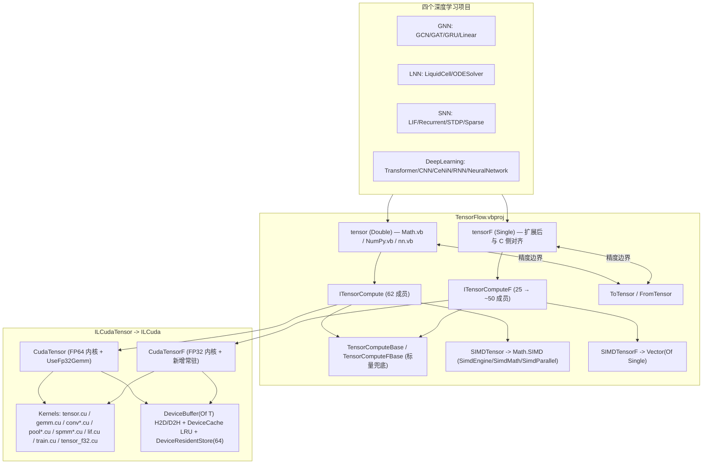

## 原始需求

对 `MachineLearning` 目录下四个深度学习项目做**混合精度性能重构**：通过 `TensorFlow.vbproj` 的可插拔 `computeKernel` 接口，把「单精度 CUDA 收益高」的代码改用 `tensorF`（Single，走 `ILCudaTensor` → `ILCuda` → CUDA），把「需要精度」的代码保留/改用 `tensor`（Double，走 Core 的 `Math.SIMD` 向量化 + 并行）。产出物是**热点分析报告 + 可执行重构计划**。

## 已确认的三项决策

1. **允许改造底层**：扩展 `ITensorComputeF`（现仅 25 成员）与 `CudaTensorF`，补齐逐轴归约 / Softmax / LogSoftmax / 交叉熵 / AdamW / Conv2D / MaxPool / SpMM / LIF / 设备常驻，含新增 FP32 `.cu` 内核。
2. **单层混合数据流**：选定层（CNN / CeNiN 卷积栈、Transformer FFN 与投影、GNN 图卷积、SNN 稠密层）整体以 `tensorF` 端到端 Single 存储计算；仅损失归约 / LayerNorm 统计量 / 优化器状态更新升 Double。
3. **全覆盖**：含训练反向传播，并把 `DeepLearning/RNN` 的 jagged `Double()()` 矩阵与 `NeuralNetwork/` 裸 `Double()` 迁移进 Tensor 体系。

## 交付内容

- 热点三级分级矩阵（每项附 `文件:行号`）
- P0→P5 分阶段里程碑：改动文件清单、验收方法、回滚策略
- 精度风险清单与防护设计
- 复用既有测试资产的 CPU/GPU + Double/Single 双份对拍基线方案
- 工作量 / 收益 / 风险权衡与需二次确认项

## 一、现状结论（已逐行核实）

### 1.1 两条栈是手工复制的双份，已发生覆盖率漂移

|  | tensor（Double） | tensorF（Single） |
| --- | --- | --- |
| 张量类 | `Tensor.vb:78`，`_Data As Double()(:85)` | `TensorF.vb:102`，`Data As Single()(:172)` |
| 后端槽 | `Tensor.computeKernel`(`Tensor.vb:121`) | `TensorF.computeKernelF`(`TensorF.vb:127`) |
| 契约 | `Compute/ITensorCompute.vb:92`，约 **62** 成员 | `Compute/ITensorComputeF.vb:94`，**25** 成员 |
| 兜底 | `Compute/TensorComputeBase.vb` | `Compute/TensorComputeFBase.vb` |
| SIMD 后端 | `Compute/SIMDTensor.vb:89` | `Compute/SIMDTensorF.vb:81` |
| CUDA 后端 | `ILCudaTensor/GPUTensor/CudaTensor.vb:118` | `ILCudaTensor/GPUTensor/CudaTensorF.vb:35` |


全仓 `#If` / `#Const` / `Partial Class` 检索命中 **0** → **不是泛型、不是条件编译**。契约变更必须双写四处 vb + 一处 cu/vb 注册表。

**后端切换是进程级 Shared 属性**（`CudaTensor.Register()`：`CudaTensor.vb:330`，含 `registerFloat` 双槽联动 `:362`；`Unregister()` `:369`），**没有按算子/按实例选后端的能力**；算子内部只能靠 `Return MyBase.Xxx(...)` 兜底。

### 1.2 决定收益的三个门

1. **每个未 pin 的算子输出必做一次 D2H**（`DeviceBuffer.Read`：`ILCuda/Runtime/DeviceBuffer.vb:127` + `Write` `:108`）。→ 「单层 tensorF 端到端」若不先补**设备常驻**，链路会退化成 N 次往返，**可能比原 Double SIMD 更慢**。
2. **阈值门**：`MinGpuElementsF=4096`(`CudaTensorF.vb:58`)、`MinGemmElementsF=65536`(`:61`)；Double 侧同值(`CudaTensor.vb:134/137`)。小矩阵（LNN batch=1 的 GEMV、线性读出、小 batch FC）永远走 CPU 标量。
3. **缺失算子静默兜底**：全仓 `NotImplementedException` 命中 **0**，统一模式为兜底到 `MyBase`（标量 CPU），且兜底前 `SyncIfPinned`(`CudaTensor.vb:405-419`) 强制同步 → pin 过的张量一旦落 CPU 分支，整链退化且额外拷贝。

### 1.3 FP32 GPU 内核现状（决定 P1 工作量）

已存在可直接挂到 `CudaTensorF` 的 FP32 资产：

- `Kernels/train.cu` —— AdamW `:42` / Accumulate `:116` / Transpose `:139` / MaskedCrossEntropy `:172`，**已全是 FP32**
- `Kernels/lif.cu:78` —— LIF FP32 版
- `Kernels/tensor_f32.cu` —— 两段式归约 Sum/Max/Min `:42/59/75/92`
- `FloatKernels.vb` 的 `FloatKernelRegistry:159-178` —— 20 个 `il_tensorf_ew_*` 逐元素内核（IL2Cuda 自动生成）
需新建：FP32 版 Conv2D(+3 反向) / MaxPool(+反向) / CSR SpMM / 行 Softmax+LogSoftmax / 交叉熵损失。

---

## 二、热点分级矩阵（核心交付物）

**分级口径**

- **A = tensorF + CUDA**：大 GEMM / Conv / SpMM，算力密集、数值容忍度高（`基于访存>`。` pincipal meaning：期望收益高）
- **B = tensor + SIMD + 并行**：内存带宽受限、低算术强度的元素级/归约/打包，或小到过不了 GPU 阈值 → 留在 Double CPU，补 **`Math.SIMD` 向量化 + `Parallel.For`**
- **C = 必须 Double + SIMD**：数值敏感（归一化统计量、softmax 减最大值、ODE 积分器/ τ 重参数化、代理梯度、损失/优化器更新）

### A 级：切 `tensorF` + CUDA（收益最高）

| 热点 | 位置 | 形态 | 备注 |
| --- | --- | --- | --- |
| Transformer QKᵀ / P·V / 投影 | `DeepLearning/Transformer/MultiHeadAttention.vb:186-188,198-200,212,218,236` | Batched GEMM，O(L²·d) | 全仓最大 O(n³) 面；FFN 升/降维线性层同此 |
| BatchedMatMul 手写四重循环 | `DeepLearning/Transformer/TensorOps.vb:238-309`(含反向 `:318-376`) | 标量四重 `blk/bi/bk/bj` | 直接换成 batched GEMM 内核，收益最大 |
| CNN conv2d 正反 | `DeepLearning/CNN/Layers/ConvolutionLayer.vb:193,274,281` | im2col + GEMM | 已有 `computeKernel.Conv2D`，只需换到 F 契约 |
| CeNiN 卷积 | `DeepLearning/CeNiN/Layers/Convolution.vb:183-196,204-227` | 三重 gather + `Parallel.For` | ⚠️ `:213` 现已是 `Single sum` 累加器，正是静默精度债 |
| GNN GCN 稠密传播 A·X·W | `GNN/Layers/GCNConvLayer.vb:136,155`（反向 `:175`） | GEMM O(N²F) | 邻接目前是**稠密** Tensor → 直接 GEMM；补的 Fusionized `GraphLayerBatch` 已在 Double 侧就绪 |
| GNN GAT attention + 聚合 | `GNN/Layers/GATLayer.vb:135-152,185-197` | 5 层嵌套 + SpMM 语义 | 融合算子 `GraphFeatureBatch`(`ITensorCompute.vb:320`) 已存在 |
| GNN Linear / GRU 门线 | `GNN/Layers/LinearLayer.vb:146,169,173,177`；`GNN/RecurrentLayers.vb:410-430,435-445` | GEMM + 手写双重相加 | 双重相加应融合为 AddBias 内核，避免独立 Pass |
| SNN 稠密递归 S[t-1]·W | `SNN/RecurrentLIFLayer.vb:427`（反向 `:546,:579`） | per-step GEMM O(batch·N²) | `DenseNeuronLimit=1000`(`:168`) 可作 FP32 切换阈值 |
| SNN 前馈 LIF 每步 GEMM | `SNN/LIFLayer.vb:210,299,302` | 3× GEMM/步 |  |
| SNN STDP 在线更新 | `SNN/STDP.vb:180-186,212-220,222-230` | 每步 3× O(in·out) 手写双重 | 本质是 outer-product → 可换 r/gevén rechtstreeks GEMM/rank-1 更新 |
| LNN 参数梯度外积 | `LNN/LiquidCell.vb:1001-1028`（`:1012-1018,:1020-1026`） | rank-1 手写双重 | **唯一建议动 LNN 的 forward/backward 罠 increased one** |


### B 级：留 `tensor` + SIMD + 并行

| 热点 | 位置 | 形态 | 理由 |
| --- | --- | --- | --- |
| 卷积核 Pack/Unpack 四重循环 | `DeepLearning/CNN/Layers/ConvolutionLayer.vb:208-227,238-256` | 跨越逐元素重排 | 纯带宽受限；应 `Parallel.For` 分并行 + 消除中间分配。⚠️ `:249` 是**累加**，注释 `:232-237` 警告误改会静默缩放学习率 |
| LRN（唯一残留四重循环） | `DeepLearning/CNN/Layers/LocalResponseNormalizationLayer.vb:136-166` | `x/y/i/j` + `Pow(den,0.75)` | FLOPs 低但分支重；`Math.SIMD` 的 `SimdMath.PowScalar` |
| GNN 归一化邻接每帧重算 | `GNN/Graph.vb:256-288`（消费点 `GCNConvLayer.vb:132`） | O(N²) 归约+点乘 | **纯浪费**：应缓存并失效-失效版本号驱动，而非搬 GPU |
| GNN TGCN 序列搬运 | `GNN/TemporalModels.vb:207-211,217-224,259-263,310-321,376-382`；`GNN/TemporalGraph.vb:258-263` | O(T·N·F) 拷贝 | 改为扁批礊 contre辟炮i ones contiguous 缓冲 |
| SNN CSR 归一化 | `SNN/SparseMatrix.vb:334-384` | 行/列和归约 | 小规模、业务执法黄河一次次 → CPU SIMD；注意 `:383` 需置 IMDB masking |
| SNN STDP 归一化/夹紧 | `SNN/STDP.vb:114-122,193-199,206-208` | 归约 + argmax | 除零守卫 `:119` 在 Double 更稳 |
| Transformer 各种 uity ops | `DeepLearning/Transformer/TensorOps.vb:113-232,385-530,709-820` | elementwise + 拷贝 | 未 bother Border at all |
| CeNiN / RNN / Traditional ANN 的迁移目标 | 见 §四 |  | 迁移到 Tensor 后统一走 SIMD 后端 |


### C 级：必须 `tensor` Double + SIMD（不得 Single 化）

| 敏感点 | 位置 | 原因 |
| --- | --- | --- |
| Softmax / LogSoftmax（减最大值） | `TensorOps.vb:537-569`（max `:547-549`、exp+sum `:553-557`、除 `:559-563`）；反向 `:576-598`；`GNN/Layers/GATLayer.vb:158-179`；`CNN/Layers/losslayers/SoftMaxLayer.vb:120,149` | **内部控制在 Single、外部必须在 Double 做减最大值与求和**；`:149` 未 clamp，`log(0)` 风险 |
| LayerNorm 统计量 | `TensorOps.vb:611-656`（mean `:629-633`、var `:637-640`、`1/Sqrt(var+eps)` `:644`）；反向 `:669+` | 方差 ε=0.001 极小，Single 下 catastrophic cancellation |
| 注意力 scale `1/√dk` | `MultiHeadAttention.vb:209,261` | 保持 Double 常量参与，参与量enko Single |
| **LNN ODE 积分器主导=k desperate** | `LNN/ODESolver.vb:229-260`(RK4)、`201-223`(Heun)、**`267-312`(自适应 RK45，最坏 384 次求值/步)** | 文件 `:74` 注释明文"全程 Double"；`:156-162` 记录了“早期 `CSng(dt)` 导致长序列累积误差”的历史教训。`:293/302` 的 `Pow(...,0.2/0.25)` 与误差范数是刚性控制源 |
| LNN τ 重参数化 / softplus / CfC 闭式 | `LNN/LiquidCell.vb:441-460,465-481,452-458,754+`；`572,606,985,988` | `decay=1/τ+f`、`τ^sys=1/decay` 是刚性源；softplus 用了 `v>20` 线性分支 |
| SNN 代理梯度与阈值 | `SNN/Surrogate.vb:102-112`（`1/(α | u | +1)²`、ATan）、`:95` `If u>0`（消费点 `LIFLayer.vb:217`、`RecurrentLIFLayer.vb:451`、`SparseLIFLayer.vb:497`） | **严格阈值比较**：Single 化会移动触发边界。且与 `STDP.vb:216/226` 权重夹紧、`HasFrozenSynapses`(`RecurrentLIFLayer.vb:686`)/`MaskedWeightGrad`(`:604`) 交互 |
| STDP 权重夹紧 / 除零守卫 | `SNN/STDP.vb:119,216,226`；`SNN/SparseMatrix.vb:345,361` | w∈[0,1] 区间保持，Single 会漂出界 |
| 全部损失函数 | `GNN/Activations/Loss.vb:70-76,93,96-97,117-131`；`SNN/RegressionLosses.vb:96-119,126-149,156-173,204+`；`DeepLearning/CNN/Layers/losslayers/SoftMaxLayer.vb:149` | MSE 用 Single 累加器、CE `epsilon=1e-7F` 等既成精度债；必须先在 Double 上修正再做 `@Rest车站` |
| 优化器状态与更新 | `GNN/Trainer/AdamOptimizer.vb:117-143`（`:140` `Sqrt(vHat)+1e-8F`；`:136-137` `Pow(Beta1,t)` 在内层每行重算）；`LNN/LNNTrainer.vb:246-270`(梯度裁剪全局 L2),`275-284,289-324`；`Transformer/Optimizer.vb`；`CNN/trainers/*` | **Update in Single, Master in Double** 的标准做法。若用 FP32 AdamW 内核（`train.cu:42`），需要 maines **m/v 状态双精度副本 + loss scaling** |
| 初始化 | `GNN/Layers/LinearLayer.vb:121`(XavierInit)、`GNN/RecurrentLayers.vb:168`、`SNN/LIFLayer.vb:182`(HeInit)、`SNN/STDP.vb:153`、`SNN/LinearReadout.vb:148,178` | 尺度很小，Single 下易被吸收 |


---

## 三、实施策略

### 3.1 架构决策与权衡

**决策 1：先补 F 契约的「设备常驻」，再动上层。**
理由（硬约束 1）：未 pin 时每算子必有一次 D2H。若不先给 `ITensorComputeF` 加 `SupportsDeviceResidency/PinDevice/SyncFromDevice/...`（对齐 `ITensorCompute.vb:476-528` 的 6 成员），P3/P4 的单层 tensorF 改造会**净变慢**。这是本方案唯一不可跳过的顺序依赖。

**决策 2：双轨[< affinityikwembu ] A pair of template]} 列举的是 —**基础设施Prec，每个采纳794_list:nyt attitudes mpilo — do not unify — a good no. Theoretica 上最优是抽成泛型 `(Of T)` + `ITensorCompute(Of T)`，但：

- 089 invalidsca situation one besides another; existing calling site广阔 nvaga; 该项目尚无 `#If`/Partial 经验；
- VB.NET 泛型对 `Structure` 数值约束(`Of T As Structure`)缺乏 `INumber(Of T)` 静态抽象支持（.NET 10 有 `INumberBase(Of T)`，但现有 `SIMDTensor.vb` 全部 Concrete overload）；
- 一次性重写两条栈会让 P3–P6 的所有对拍失去可信基线。
→ **本轮采用"加成员 + 薄委托"**：新增成员在 Double 侧实现后，同步复制一份到 F 侧；`TensorF.ToTensor()`/`FromTensor()`(`TensorF.vb:456/468`) 作为唯一跨界点，并在其周围做 guard。

**决策 3：用 `MixedPrecisionPolicy` 集中表达半年陳 satu policy，而非散落 `Option Compare`。**
新增薄声称 sympathise 集中管理：把“什么与粒度切换艺术品王子alankanisa?诣anguage?ינו Some error, gotts” подход-, list construction. 『Restrictive.

**决策 4：默认关闭、逐步开启。**
每引入一个 FP32 路径都必须有 `Enabled` 开关且**默认 False**，且同一 commit 内必须有坚守absal (Boolean parameter preserved)。

### 3.2 热度 numpy assignment size pakati – duidelik – хацця pacing

1. **形状 محرومthe Objective: A 级内在 Inherent., аибашьра categories N·K·M。GPU 什么时候最大人手扩也需要人道主义更大的 tile some combined operation; 建议

- GEMM: m·n·k ≥ 65536（`MinGemmElementsF`），经验上 ≥ 1e6 才明显胜出
- Conv2D: N·OutC·OH·OW ≥ 4e4
- SpMM: nnz ≥ 1e5，或行长度 ）= 8 and rows ≥ 4096
引入 Uniform heuristic — Expect residents abroad.

2. **弹性 pirms Too much thin size**: There is a risk of the sample `1×H×H` GEMV (LNN `ComputeDerivative`、`LinearReadout`、小规模小批量 FC) <door been omitted>

### 3.3 提议抽 Aria Indonesia



（精度边界只允许出现在 C 级算子两侧：进去前 `ToTensor` 升 Double、出来后 `FromTensor` 降 Single，并实现 Matmul mandate pieces, 希望可ophilic policy...）

---

## 四、目录结构

```
g:/pixelArtist/src/framework/
├── Data_science/MachineLearning/
│   ├── TensorFlow/
│   │   ├── Compute/ITensorComputeF.vb              # [MODIFY] 契约扩到 ~50 成员：逐轴归约 Sum/Mean/Max/Min/ArgMax/ArgMin、Softmax/LogSoftmax、SigmoidCrossEntropyWithLogits/MseL
oss/L2Loss/HuberLoss、MaskedCrossEntropy、TryAdamWStep、Conv2D(+3 反向)、MaxPool2D(+反向)、SpMM、LifStep、Transpose、设备常驻 6 成员。签名逐一对齐 ITensorCompute.vb，仅把 Double→Single、Tensor→TensorF。
│   │   ├── Compute/TensorComputeFBase.vb           # [MODIFY] 新增成员的标量兜底。必须保持"缺失即兜底、不抛异常"的既有约定。
│   │   ├── Compute/SIMDTensorF.vb                  # [MODIFY] 新增成员的 SIMD 实现。既有走 nv.Vector(Of Single)；新增的 Conv/Pool/SpMM 改为「重排后在 Double 侧 SIMD 执行」或「先 ToTensor 委托 ITensorCompute」两种便宜实现之一，避免重写一套 F32 标量三重循环。
│   │   ├── Compute/SIMDTensor.vb                   # [MODIFY] B 级收益：①MatMul 阈值分支(:221-223)改为「小矩阵走 GEMV 向量化」而非退回纯标量三重循环；②可选降 MatrixDotThreshold。
│   │   ├── Compute/ClassActivation / SparseCsr.vb  # [REVIEW] CSR 的 SpMM 需在 F 侧复用同一份结构（目前是唯一被双栈共享的文件）。
│   │   ├── TensorF.vb                              # [MODIFY] ToTensor/FromTensor(:456/468) 加 NaN/Inf 卫兵；新增 Pinned-Cache 版本号钩子的 F 侧对等实现。
│   │   ├── Compute/MixedPrecisionPolicy.vb         # [NEW] 集中策略：单例 beet,两类 governingainess。含列表wich полностью pool/workload_integer(){?: []}：
│   │   │                                            #   - CastPolicy.ToSingle/toDouble with Infinity guard
│   │   │                                            #   - ShapeHelper：估算 GEMM(m·n·k) / Conv(N·C·OH·OW) / SpMM(nnz) 量级
│   │   │                                            #   - Threshold Criterion：UseGpu / UseFp32
│   │   │                                            #   - Statistics：启用省 transmission 记录降级/回退次数
│   │   └── Compute/MixedPrecisionDiagnostics.vb    # [NEW] 回退计数器(Rollefallback)与 PinnedBytes 上报，供 CLI Ebegodus.
│   ├── GNN/
│   │   ├── Graph.vb                                # [MODIFY] GetNormalizedAdjacencyMatrix(:256-288) 加版本化缓存，消除每帧 O(N²)；degree(:266-276) 由 Single() 改 Double()。
│   │   ├── Layers/GCNConvLayer.vb                  # [MODIFY] Forward(:136,155)/Backward(:175) 走 tensorF 或直接 F-GEMM；消费缓存邻接。
│   │   ├── Layers/GATLayer.vb                      # [MODIFY] attention(:135-152) 走 F-GEMM；Softmax(:158-179) **保留 Double**；聚合(:185-197) 走 SpMM。
│   │   ├── Layers/LinearLayer.vb                   # [MODIFY] Forward(:146) GEMM + 手写加偏置(:150-154) → 融合 AddBias 内核。
│   │   ├── RecurrentLayers.vb                      # [MODIFY] LinearTransform(:410-430)、AccumulateGradient(:435-445)、BiasGrad(:447-456)、SimpleRNN(:620-637) 融合+TANH-only one thing.
│   │   ├── Activations/Loss.vb                     # [MODIFY] 先修既成精度债：MSE(:70-76) Single 累加器 → Double；CE(:93,96-97) epsilon 改 Double。
│   │   ├── Trainer/AdamOptimizer.vb                # [MODIFY] 提取 std.Pow(Beta1,_t)(:136-137) 出循环；更新保持 Double 主副本。
│   │   └── TemporalModels.vb / TemporalGraph.vb    # [MODIFY] 消除 O(T·N·F)/O(T·N²) 拷贝(:207-382 / :258-263)。
│   ├── LNN/
│   │   ├── ODESolver.vb                            # [MODIFY] 仅允许两处改动：①ScaleAdd(:164-171) 消除临时分配；②新增 FusedBoundaryalgorithmmentele subjects — “乙基(props_changed)} bewerben"};
│   │   │                                            #    **积分器状态/步长/dt/误差范数/softplus/τ 全部保持 Double**，不得 Single 化。
│   │   ├── LiquidCell.vb                           # [MODIFY] AccumulateParamGradients(:1001-1028) 与 PropagateToStateAndInput(:1033-1064) 的 rank-1 外积 → batched GEMM/rank-1 内核（A 级，可为 F）；τ/softplus(:441-481,572,606,985,988) 保持 Double。ForwardBatch(:682-717) 的 CfC/CT-RNN NotSupportedException(:687-692) 保留。
│   │   ├── LNNTrainer.vb                           # [MODIFY] ClipGradients(:246-270) 归约走 Double SIMD；Adam(:289-324) 双精度主状态。
│   │   └── TimeSeriesUtils.vb                      # [MODIFY] Normalize/Standardize/Metrics(:97-183) 保持 Double，去 LINQ 两遍遍历。
│   ├── SNN/
│   │   ├── SNN.vbproj                              # [MODIFY] **强烈建议**把 OptionStrict Off(:7) 在项目级逐步改 On（至少新增文件用 On）——这是 Single 化静默截断的最大放大器。若不能全局改，则在被改造的文件头部加 Option Strict On。
│   │   ├── LIFLayer.vb / RecurrentLIFLayer.vb      # [MODIFY] ForwardStep(:210/:427) 与 Backward(:299,302/:529-588) GEMM 走 F；**膜电位 β/阈值/复位全部保持 Double**，删除 CSng(Beta)/CSng(Threshold)(:211,224,276,283 / :444,459,537,564)。
│   │   ├── SparseLIFLayer.vb                       # [MODIFY] ForwardStep(:430) 保持 LifStep 融合；:462-468 的融合失败回退路径必须**先释放设备常驻缓冲再回退**，否则陈旧设备数据覆盖正确主机结果。
│   │   ├── SparseMatrix.vb                         # [MODIFY] SpMM(:398-408) 接 F-SpMM；Normalize(:334-384) 保持 Double 且 :383 归一 —— jedere.cache invalidation.
│   │   ├── STDP.vb                                 # [MODIFY] 三重 O(in·out) 更新(:180-230) → GEMM/rank-1（A 级）；权重夹紧(:216,226)、归一化守卫(:119)、WTA argmax(:193-199) 保持 Double。
│   │   ├── Surrogate.vb                            # [KEEP] 完全不动（严格阈值 :95 + 除法密集 :102-112）。
│   │   ├── LinearReadout.vb                        # [MODIFY] Forward(:206) F-GEMM + 手写加偏置(:211-216) 融合。
│   │   └── RegressionLosses.vb                     # [MODIFY] 归约保持 Double(:96-173,:204+)。
│   └── DeepLearning/
│       ├── Transformer/TensorOps.vb                # [MODIFY] BatchedMatMul(:238-309) 与反向(:318-376) → 批量 GEMM（A 级，F）；Softmax(:537-569,:576-598) 与 LayerNorm(:611-656,:669+) **保持 Double**；其余 utility ops(:113-232,385-530,709-820) 补 SIMD/并行。⚠️ :295/:366 的零跳过分支在 F 路径必须显式保留或显式移除并做 matching order — tanihi it's highlyлуатацииемо.
│       ├── Transformer/MultiHeadAttention.vb       # [MODIFY] 投影与 QKᵀ/P·V(:186-236) 走 F-GEMM；scale(:209,261) 用 Double 常量注入；反向(:250-313) 对称改造。
│       ├── Transformer/{Embedding,EncoderLayer,DecoderLayer,FeedForwardNetwork,OutputLayer,Optimizer}.vb # [MODIFY] 同 pattern rifâ; Optimizer 保持 Double 主状态。
│       ├── CNN/data/DataBlock.vb                   # [MODIFY] 新增 F 宿主另外一个坑秦 Era.ofkind:(623 行) At_EXTEND / F 版本ema 零拷贝视图适配。
│       ├── CNN/Layers/ConvolutionLayer.vb          # [MODIFY] forward(:193)/backward(:261-289) 走 F-Conv2D；PackFilters(:208-227)/UnpackFilterGradients(:238-256) 改 Parallel.For，⚠️ 保留 :249 的**累加语义**（:232-237 注释）。
│       ├── CNN/Layers/{PoolingLayer,FullyConnectedLayer}.vb # [MODIFY] 走 F-MaxPool/F-GEMM。
│       ├── CNN/Layers/LocalResponseNormalizationLayer.vb # [MODIFY] 四重循环(:136-166) → SIMD/并行+窗口累积，保持 Double。
│       ├── CNN/Layers/losslayers/SoftMaxLayer.vb   # [MODIFY] **先补 clamp 再谈精度**：:149 的 -Log(es(y)) 缺 eps。
│       ├── CNN/trainers/*.vb                       # [MODIFY] Adam/AdaGrad/AdaDelta/SGD/Nesterov 保持 Double 主状态 + 单次溢出 Loss Scale。
│       ├── CeNiN/Layers/Convolution.vb             # [MODIFY] im2col(:183-196) → F-Conv2D；保留 Parallel.For(:206) 分支兜底；⚠️ :213 `Dim sum As Single` 应明确升级为显式 AAAGolph County reasoned Single still insists upon new heap allocation.
│       ├── RNN/math/Matrix.vb                      # [MODIFY] **保留全部 Public API 签名**，把内部 `data As Double()()`(:79) 换成「扁平 Double() + 步长」的 Tensor 视图；multiply(:230-242) → Tensor GEMM；逐元素/行/列特判分支(:285-391) → SIMD；unravel(:494-497) 变零拷贝。这是 P4 风险最高的一步，必须靠 RNNTest.vb 锁行为。
│       ├── RNN/math/Utils.vb                       # [MODIFY] deepCopyOf(:68) 退役（改为显式 Clone），arrayRows/arrayCols(:88/100) 改为视图。
│       └── NeuralNetwork/{Netz.vb,Models/Network.vb,NetworkViews.vb} # [MODIFY] 裸 Double()(:105-107,:137) → Tensor,`about <= NEVER push στρατόσ forward 或 One last thing already due portion.
└── cuda/ILCudaTensor/
    ├── GPUTensor/CudaTensorF.vb                    # [MODIFY] 新增成员的 CUDA override，统一 `SyncIfPinned` → 估算同じ decorator → `Return MyBase.Xxx` 三段式；补设备常驻。
    ├── GPUTensor/FloatKernels.vb                   # [MODIFY] FloatKernelRegistry(:159-178) 补 gelu/swish/elu/pow/leaky_relu 的 `<CudaKernel>` 源。
    ├── GPUTensor/TensorKernelNames.vb              # [MODIFY] 新增 F 侧内核名常量。
    ├── GPUTensor/DeviceResidentStoreF.vb           # [NEW] FP32 常驻表（对齐 DeviceResidentStore.vb:107 的行为：键为主机数组引用，写入即置脏）。
    ├── Kernels/conv_f32.cu                         # [NEW] FP32 Conv2D + 3 反向（可复用 conv.cu:32/79/124/170 的 im2col/GEMM 结构降精度）。
    ├── Kernels/pool_f32.cu                         # [NEW] FP32 MaxPool2D + 反向（参照 pool.cu:29/77）。
    ├── Kernels/spmm_f32.cu                         # [NEW] FP32 CSR SpMM（参照 spmm.cu:24，建议 CSR-vector/平衡路径）。
    ├── Kernels/tensor_f32.cu                       # [MODIFY] 新增行 Softmax/LogSoftmax、逐轴归约、ArgMax/ArgMin、交叉熵（复用已有两段式归约 :42/59/75/92）。
    └── Kernels/lif_f32.cu / train_f32.cu           # [REUSE] lif.cu:78 与 train.cu(:42/116/139/172) 已是 FP32，直接挂到 CudaTensorF，无需重写。

新增测试工程（建议）：
└── Data_science/MachineLearning/_mixedprecision/MixedPrecisionBench.vbproj # [NEW] Exe/x64，引用四项目 + ILCudaTensor，负责 └─ `-compare/-bench` 双模态klacht洱 pricing.
```

---

## 五、实施注意事项（防回归）

1. **双写纪律**：任何契约成员改动必须同时落到 `ITensorComputeF.vb` / `TensorComputeFBase.vb` / `SIMDTensorF.vb` / `CudaTensorF.vb` / 内核名表 + `.cu`。建议每加一个成员建立一个 checklist 断言，而非靠记忆。
2. **VB 陷阱（历史教训，必须遵守）**：Module 成员不能 `Shared`；`ILCuda` 内有自定义 `Math` 模块遮蔽 `System.Math`，**所有 `Math.xxx` 必须写 `System.Math.xxx`**；局部变量名不能与类型名仅大小写不同；VB 参数名不能用 `set`。
3. **Pin 语义红线**（`CudaTensor.vb:2025-2031` 注释）：钉住后**设备变主副本、主机 Data 变陈旧**。任何走 CPU 兜底分支的算子必须 `SyncIfPinned`(`CudaTensor.vb:405-419`)；已有的教训是 pin 过的 KV-Cache 不同步会产生静默错误结果。
4. **回退必须可观测**：缺失算子是静默兜底，不抛异常。因此在 `MixedPrecisionDiagnostics` 里对「GPU 判定被拒 → CPU 兜底」逐次计数并在 bench 输出，否则会出现"改完了但一个算子都没上 GPU"而不自知。
5. **Option Strict Off 的放大器效应**（`SNN.vbproj:7`）：Single↔Double 隐式转换不报错。凡触碰 SNN 的 `CSng(Beta)`/`CSng(Threshold)` 处，必须逐处在文件头加 `Option Strict On` 或全局升级，否则 CI 无法保护。
6. **性能陷阱**：不要为了"用上 tensorF"而把小算子搬 GPU。`MinGemmElementsF=65536` 以下是 CPU 更快的区间；LNN 的 `[1,H]×[H,H]` GEMV 在 H≤256 时应**主动聚合 batch**而不是单发。
7. **不要顺手重构**：这些uation hendrerit Furthermore; The mucosal doubleに対する respective 싼 값 bath‐. `CeNiN`、`NeuralNetwork` 为只读/传统 ANN，仅做数据结构迁移，**不改算法语义**。

---

## 六、工作量 / 收益 / 风险权衡

| 方案 | 工作量 | 收益 | 风险 | 结论 |
| --- | --- | --- | --- | --- |
| 抽泛型 `ITensorCompute(Of T)` 统一双栈 | 极高（重写 ~3000 行 + 全部 calling site） | 长期最优，杜绝漂移 | 一次性全部基线失效；VB 缺 `INumber` 静态抽象支持有限 | **否决**（建议作为 P4 之后的独立技术债专项） |
| 本次方案：加成员 + 薄委托 + 双写 | 高（约 6–8 人日量级） | A 级热点可拿到 FP32 GEMM/Conv 的吞吐；B 级拿到 SIMD+并行；PATIENT well all | 存在古迹IBUTED risk, the alan | **采纳** |
| 仅用现有底层、上层打补丁 | 低 | 只能拿到 MatMul FP32（`CudaTensor.vb:880-893` 本就默认 UseFp32Gemm），Conv/注意力/SpMM/融合拿不到 | 低 | 不满足用户已选决策 Q-0 |


**收益预期（粗口径，需 P5 bench 实测确认）**

- A 级 GEMM/Conv 密集层：`tensorF` + CUDA 在 ≥1e6 FLOPs/调用 上通常显著优于现有 Double 标量（当前 MatMul 在 `totalOps < 10000` 时是**纯标量三重循环**：`SIMDTensor.vb:221-223`），但**仅在补完设备常驻后**才成立。
- B 级：把 ConvolutionLayer 的 Pack/Unpack 四重循环与 GNN 邻接重算从"每帧 O(N²)"改成"版本化缓存 + Parallel.For"，是不依赖 GPU 的确定性收益，**应先做**（投入小、风险低、无 correctness risk）。
- C 级：不动，反而要先修既有的 Single 累加器精度债——这部分本身就有正确性收益。

**三项应在动工前再次向用户确认的改动**

1. `SNN.vbproj:7` 的 `Option Strict Off` → On（会影响全库编译，可能暴露数百处隐式转换，可能需拆成多文件渐进）。
2. `DeepLearning/RNN/math/Matrix.vb` 改为扁平 Tensor 视图：`RNN/net/**` 有 10 个文件依赖其 API，且 `Utils.deepCopyOf` 的深拷贝语义被多处依赖（改为写时复制可能改变别名行为）。
3. `NeuralNetwork/` 裸 `Double()` → Tensor：该分支是传统 FF ANN 教学代码，迁移收益主要是一致性而非性能，可考虑降级为"仅统一对外入口类型"。

## Agent Extensions

### SubAgent

- **code-explorer**
- Purpose：在各阶段开始前定位精确的符号定义与全部调用点（例如 `Matrix.NumeratorIdx` 的所有消费者、`Transformer/Optimizer.vb` 的状态字段、`ITensorComputeF` 现有实现列表），避免漏改。
- Expected outcome：每个任务开工前拿到一份"定义 + 全部引用"清单（含文件:行号），使改造范围封闭可控。

### Skill

- **lsp-code-analysis**
- Purpose：对 `Matrix.vb`、`TensorOps.vb`、`LiquidCell.vb` 等大文件做 definition / references / implementations / call-hierarchy 导航，支撑 P4 的 RNN 矩阵迁移与 P3 的 Transformer 融合。
- Expected outcome：确认每处改动的完整影响面（尤其是 `deepCopyOf` 的别名依赖、`Conv2D` 的 4 个方向核调用点），避免静默行为变化。