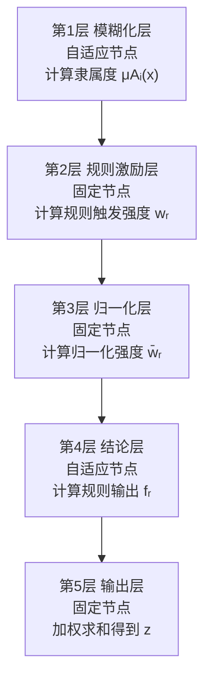

**神经模糊系统是一种将模糊逻辑的知识表达能力与神经网络的自学习能力融合在一起的混合智能算法**——其典型代表 ANFIS（Adaptive Network-based Fuzzy Inference System，自适应神经模糊推理系统）由 J.-S. R. Jang 提出，用神经网络的结构来实现 Takagi–Sugeno 型模糊推理系统，使隶属度函数参数与模糊规则能够从数据中自动学习获得，而无需完全依赖专家经验。
## 一、融合动机：两种范式为何要结合
模糊逻辑和神经网络各有先天短板：**模糊推理系统擅长表达"如果…则…"式的经验知识，但缺乏有效的学习机制**——隶属度函数形状、规则数量都得靠人工设定；**神经网络具备强大的自学习和并行计算能力，但其内部是一个"黑箱"，无法直观表达人类推理过程**。神经模糊系统正是把两者放进同一框架，用公式可概括为：
$$\text{Neuro-Fuzzy} = \text{Fuzzy Logic（知识表达 + 推理）} \oplus \text{Neural Network（学习 + 参数优化）}$$
具体分工如下：
| 组件 | 在神经模糊系统中承担的角色 |
|---|---|
| **模糊逻辑部分** | IF-THEN 规则库、隶属度函数、模糊推理机制，提供**可解释的知识表达** |
| **神经网络部分** | 多层前馈网络结构、反向传播等学习算法，提供**从数据中自动调整隶属度参数与规则结论**的能力 |
| **融合结果** | 一个既可解释、又可从样本数据中训练的透明模型 |
根据融合深度的不同，神经模糊系统可分为**合作型**（神经网络离线地学习模糊系统的参数，两者结构分离）、**并发型**（神经网络在线修正模糊系统的输出）和**融合型**（共享数据结构，将模糊推理直接映射为网络拓扑，ANFIS 即属此类）。
## 二、核心架构：以 ANFIS 五层网络为例
ANFIS 是最经典、应用最广的神经模糊实现。假设系统有输入 $x$、$y$，输出 $z$，采用一阶 Takagi–Sugeno 模型，含两条规则：
- 规则 1：IF $x$ is $A_1$ AND $y$ is $B_1$, THEN $f_1 = p_1 x + q_1 y + r_1$
- 规则 2：IF $x$ is $A_2$ AND $y$ is $B_2$, THEN $f_2 = p_2 x + q_2 y + r_2$
整个推理流程被展开为**五层前馈网络**：

**第 1 层（模糊化层）**：每个自适应节点将输入映射到某模糊集的隶属度。常用高斯函数：
$$\mu_{A_j}(x_i) = \exp\left(-\frac{(x_i - c_j)^2}{2\sigma_j^2}\right)$$
其中 $c_j$（中心）、$\sigma_j$（宽度）是可学习的**前提参数**，也可采用钟形、三角形、Sigmoid 等隶属函数。
**第 2 层（规则激励层）**：固定节点对各输入隶属度做 T-范数运算（通常取乘积），得到每条规则的触发强度：
$$w_r = \prod_{i=1}^{N} \mu_{A_{r,i}}(x_i)$$
**第 3 层（归一化层）**：固定节点将触发强度归一化：
$$\bar{w}_r = \frac{w_r}{\sum_{k=1}^{R} w_k}$$
**第 4 层（结论层）**：自适应节点计算每条规则的加权输出。对一阶 Sugeno 模型：
$$O_r = \bar{w}_r \cdot f_r = \bar{w}_r (p_r x + q_r y + r_r)$$
其中 $p_r, q_r, r_r$ 是可学习的**结论参数**；对零阶模型则 $f_r$ 为常数。
**第 5 层（输出层）**：固定节点对所有规则输出求和，得到最终结果：
$$z = \sum_{r} \bar{w}_r f_r$$
由于采用加权平均而非重心法去模糊化，ANFIS 省去了常规模糊系统清晰化的大量计算，数据处理被极大简化。
## 三、实现原理：混合学习算法
ANFIS 的关键在于**如何同时优化前提参数（隶属函数形状）与结论参数**。给定网络结构后，Jang 提出混合学习算法，每个训练周期分两个阶段交替进行：
**（1）前向传递——固定前提参数，用最小二乘估计（LSE）识别结论参数。** 由于第 4 层输出对结论参数 $p_r, q_r, r_r$ 是线性的，可将问题化为线性最小二乘：将所有训练样本代入后，构造方程组 $\mathbf{A}\boldsymbol{\theta} \approx \mathbf{y}$，其中 $\boldsymbol{\theta}$ 为全部结论参数拼接向量，求解使 $\|\mathbf{A}\boldsymbol{\theta}-\mathbf{y}\|^2$ 最小的最优解。这一步在解空间上是**全局最优**的，收敛速度快。
**（2）反向传递——固定结论参数，用梯度下降（反向传播）修正前提参数。** 误差信号从输出层反向传播到第 1 层，按链式法则更新高斯函数的中心 $c_j$ 与宽度 $\sigma_j$ 等前提参数，使总误差（如 MSE）最小。这一步负责调整输入空间的模糊划分，属于**局部搜索**。
两种方法的互补使训练既快又稳：LSE 快速定位线性最优解，梯度下降精调非线性划分。除标准混合方案外，实际还有四种参数更新策略可选——纯梯度下降；梯度下降 + 一次性 LSE；梯度下降 + LSE（标准混合）；序列（递推近似）LSE——需在计算复杂度与性能间权衡。在目标函数高度非凸的场景下，还可用 PSO、遗传算法等元启发式方法替代梯度下降，以跳出局部极小。
## 四、实现步骤与工具
构建一个实用 ANFIS 模型的完整流程如下：
1. **数据准备**：收集输入–输出样本对，划分训练集与验证集。
2. **结构初始化**：确定每个输入的隶属函数数量 $m$ 与类型（推荐每输入 2–4 个），规则数即为 $\prod_i m_i$；可用网格划分、模糊 C 均值聚类或专家知识初始化。
3. **训练**：执行混合学习循环直至误差收敛，同时用验证集监控过拟合。
4. **验证与部署**：在独立测试集上评估 RMSE / 准确率，必要时剪枝触发强度过低的规则。
工具层面，**MATLAB 的 Fuzzy Logic Designer（原 Neuro-Fuzzy Designer）提供完整的图形化训练、验证与测试环境**；Python 生态中可通过 `anfis` / `pyanfis` 等第三方库实现，也有基于 TensorFlow 的简洁实现 TensorANFIS，Kaggle 上有 Flight Price Prediction using ANFIS 等可直接运行的 Jupyter 示例。
## 五、代表模型与变体
除 ANFIS 外，融合型神经模糊系统家族还包括多个经典模型，如 **FALCON**（五层结构的模糊自适应学习控制网络）、**NEFCON**（面向强化学习控制）、**SONFIN**（自组织神经模糊网络，支持在线规则生成）、**EFuNN / dmEFuNN**（进化式模糊神经网络）以及基于进化算法的神经模糊设计等。
## 六、优缺点与适用场景
**主要优势：**
- **可解释性强**：内部是明确的模糊规则，可视化隶属函数区域，可按平均触发强度剪枝规则——相比纯神经网络明显更透明。
- **数据高效**：小样本、含噪声数据场景下表现稳健，因为专家规则可先验注入模型。
- **收敛快、精度有竞争力**：混合学习使其在大量任务上达到或超过常规 ANN 的精度（如高能物理建模中 $R \approx 0.99$、$\text{MSE} \sim 10^{-7}$）。
**主要局限：**
- **规则爆炸**：规则数随输入维数与隶属函数数量呈指数增长（$\prod_i m_i$），高维输入下架构迅速不可处理。
- **计算开销高**：训练与推理成本高于基础神经网络或经典模糊系统，对嵌入式实时部署构成挑战。
- **超参数敏感**：隶属函数类型与数量的选择对性能影响显著；训练/部署数据分布不匹配时性能会退化。
**适用场景**：非线性系统建模与辨识、时间序列预测、自适应控制（如四旋翼姿态控制、卫星姿态估计）、医学诊断分类（肝病、癫痫 EEG）、气象参数估计、风电功率后处理等中低维度、且对可解释性有要求的问题。对超高维特征（如图像、文本），更适合直接使用深度学习。
## 小结
神经模糊系统的核心思想可以浓缩为一句话：**用神经网络的学习机制去自动优化模糊系统的参数，用模糊规则的结构去保留神经网络所缺乏的可解释性**。ANFIS 通过五层网络将 Takagi–Sugeno 推理完整映射为可微分计算图，并以"LSE 定线性结论参数 + 反向传播调非线性前提参数"的混合算法实现了高效训练。当问题规模适中、数据有限且需要模型透明时，它至今仍是软计算工具箱中极具竞争力的选择。