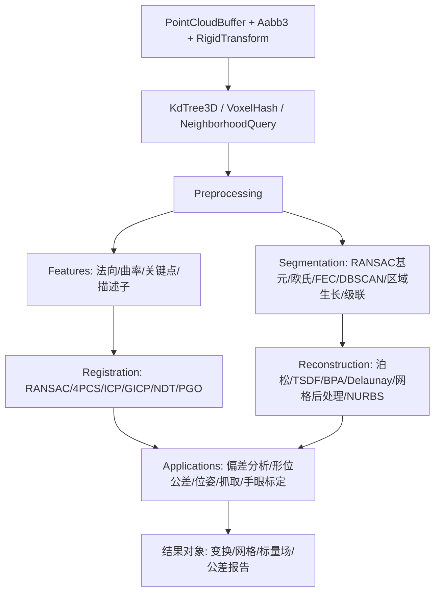

## 产品概述

在 Cloudy 项目中交付一套完整的工业三维点云算法库，按“预处理 → 特征 → 配准 → 分割 → 重建 → 下游应用”六阶段组织为可组合的算法模块，每个模块有明确输入输出与可选参数，工程师可按精度、实时性、数据规模自由选型。库只做数学算法，不承担文件读写与界面渲染；点云可直接来自外部三维文件读取模块的数据结构。

## 核心功能

- **数据与索引底座**：统一的点云容器（坐标、法向、强度、颜色、曲率、标签），包围盒、刚体变换与四元数、三维 KD 树与体素空间索引、邻域查询与可复用缓冲，供全部后续模块调用。
- **预处理**：体素网格降采样、随机/均匀/曲率自适应采样、统计滤波去离群、半径滤波去孤立点、移动最小二乘平滑、按 IMU 四元数插值或里程计位姿做运动畸变补偿、外参坐标变换与立方体/直通/条件裁剪。
- **特征**：邻域协方差法向估计与视点/最小生成树一致定向、曲率与主曲率、ISS/Harris-3D/SIFT-3D 关键点、PFH/FPFH、SHOT、ESF/VFH 描述子、描述子匹配与比值检验。
- **配准**：Kabsch/Horn 刚体变换估计、FPFH+RANSAC 粗配准、4PCS/Super4PCS 全局配准、ICP、点到面 ICP、GICP、NDT 精配准、位姿图全局优化、多站配准流水线与多视角拼接。
- **分割**：RANSAC 平面/球/圆柱/圆锥基元提取与顺序多模型分解、欧氏聚类、FEC 快速欧氏聚类、DBSCAN、法向与曲率区域生长、面向紧密堆叠的四级级联分割、基于几何特征的语义/实例标签分类。
- **重建**：法向一致定向、泊松重建、Marching Cubes 等值面、TSDF 多帧深度融合、滚球法 BPA、贪心三角化、Delaunay 2D/2.5D、网格数据结构与平滑/QEM 简化/补洞/法向重算、NURBS 曲面最小二乘拟合与平面/球/圆柱/圆锥参数化拟合。
- **下游应用**：扫描与参考模型配准后的偏差分析（最大/平均/标准差/RMS 与偏差色谱数据）、形位公差计算（平面度/直线度/圆度/圆柱度/平行度/垂直度/倾斜度/位置度/同轴度，含最小区域与最小二乘两套结果）、6-DoF 位姿估计与实时位姿跟踪、抓取区域形态学搜索与 antipodal 抓取候选、手眼标定。
- **可验证性**：配套合成数据自检程序，按阶段逐项校验并生成测试报告，覆盖降采样保形、去噪剔除率、法向角度误差、描述子旋转不变性、已知变换恢复精度、聚类与平面提取正确性、重建网格封闭性与体积误差、公差与位姿数值精度。

## 视觉与交互效果

无图形界面。算法以强类型 API 与结构化结果对象返回：点云子集、索引集合、刚体变换、变换矩阵序列、描述子矩阵、标签数组、三角网格、偏差标量场与统计摘要、公差报告、位姿与抓取位姿列表，均可直接交给外部渲染或检测流程消费。

## 一、技术栈

- 语言/运行时：VB.NET，`net10.0`（沿用 `Cloudy.vbproj` 现有配置，`RootNamespace=Microsoft.VisualBasic.MachineVision.Cloudy`）。
- 数学内核：复用 `Microsoft.VisualBasic.Core` 的 `Microsoft.VisualBasic.Math.SIMD`（`SimdEngine`/`SimdReduce`/`SimdDistance`/`SimdMatrix`/`SimdMath`/`SimdParallel`/`SIMDIntrinsics`/`SIMDEnvironment`），缺失算子按同样风格补入 `Microsoft.VisualBasic.Core\src\Math\SIMD\Engine\`。
- 互操作：`Microsoft.VisualBasic.Imaging.Drawing3D` 的 `Point3D`/`PointF3D`/`IPointCloud`（已通过 `imaging.NET5.vbproj` 引用），使 `Ply.PointCloud`（Landscape）等外部数据源可直接转入。
- 大矩阵与分解：`Microsoft.VisualBasic.Math`（`Algebra\Matrix.NET\NumericMatrix`、`Algebra\SVD.vb`、`EigenvalueDecomposition`）可用，但其分解入口多为 `Int16` 维度且接口面向 `GeneralMatrix`，对 3×3/6×6 与位姿图的小规模稠密求解反而更慢、耦合更强；因此 Cloudy 自带 `Linalg`（3×3 对称阵闭式特征分解、N×N Cholesky/高斯消元、Kabsch），仅在真正需要通用大矩阵时调用 Math 项目。
- 验证：新增 `Cloudy.Test` console 工程，使用 `Microsoft.VisualBasic.ApplicationServices.Debugging.DebugAudit`（`Check`/`AreEqual`/`Watch`/`Mark`/`SaveReport`）生成报告。

## 二、实现策略与关键决策

1. **SoA 数据布局**：`PointCloudBuffer` 以 `X()/Y()/Z()` 三条连续数组为主存储，可选 `Nx/Ny/Nz/Intensity/Color/Curvature/Labels/ClusterId`。理由：所有 SIMD 内核（`SimdReduce.DistanceSquared`、新增 `SimdVector3`）都要求连续数组；AoS 结构体数组会产生跨步访问，直接损失 2~4 倍吞吐。同时提供 `Item(i) As Point3D`、`From(IEnumerable(Of PointF3D))`、`ToPoint3D()` 适配层以保持易用性与外部互操作。
2. **空间索引双轨**：`KdTree3D` 用扁平节点数组 + 置换下标 + 迭代栈查询（构建 O(n log n)，kNN O(log n + k)），服务法向/描述子/ICP；`VoxelHash` 稀疏体素哈希服务体素滤波、欧氏聚类、FEC、TSDF。两者共享 `NeighborhoodQuery` 池化缓冲，避免逐点分配（十万点级每点一次分配会造成明显 GC 压力）。
3. **并行策略统一**：外层 `SimdParallel.ForRange` 分块（块内单线程 SIMD），禁止嵌套并行；每点独立写入自己的输出位置，避免伪共享与锁。归约允许 ULP 级差异，在文档中说明确定性边界。
4. **小规模线代自包含**：法向用 3×3 对称阵闭式特征值（解析解，避免迭代）；刚体配准用 Horn 四元数/Kabsch（闭式，无 SVD 依赖）；点到面 ICP、GICP、NDT 的 6×6 正规方程用带主元 Cholesky/高斯消元；位姿图用 `Double(,)` 稠密 Gauss-Newton（站点数通常 < 100，稠密求解更快也更简单）。
5. **确定性**：RANSAC、4PCS、ESF 采样、ISS 非极大抑制全部接受显式 `seed`，默认固定种子；并行归约不影响可复现性判断（断言使用容差而非逐位相等）。
6. **可伸缩与内存**：所有 O(n²) 路径必须经 KD 树/体素/分块兜底；`CloudyOptions` 暴露并行度、分块大小、内存预算、诊断开关；大点云走流式分块（体素聚合、TSDF 增量融合天然支持）。
7. **与深度学习的关系**：PointNet++/PointCNN/DGCNN/GraspNet 不实现推理，按用户要求提供**可运行的传统等价方案**——几何特征规则分类器 + 描述子最近质心分类器替代语义分割，位姿假设生成+验证+ICP 精化替代回归式位姿估计，投影占用网格腐蚀+悬空容差替代抓取网络；每个相关类型的 XML 文档必须标注与深度学习方法的能力差异与适用边界。
8. **复杂度关键点**：法向/FPFH 为 O(n·k)；RANSAC 为 O(iter·m)；ICP 为 O(iter·n·log n)（KD 树近邻）；欧氏聚类 O(n·k)，FEC 近似 O(n)；泊松用深度受限八叉树/均匀网格 + 多重网格迭代，避免大规模稀疏直接解；QEM 简化用二叉堆 O(m log m)；网格最近点距离用自建 BVH，O(log m)。

## 三、执行要点（防回归）

- 只新增文件，不改动 Core 现有 SIMD API 签名；新算子必须在 `SIMDEnvironment.IsEnabled=False` 时正确回退标量路径，并在长度小于向量宽度时走单通道分支（沿用 `SimdEngine.CanVectorize` 与“末块重叠”模式，就地运算禁止重叠末块）。
- `Cloudy` 内不得声明 `Namespace Math`（会与 `Microsoft.VisualBasic.Math` 冲突）；使用 `Imports Microsoft.VisualBasic.Math.SIMD` 与 `Imports std = System.Math`。
- 参数校验集中在入口（空点云、点数少于 k、邻域为空、退化共线/共面、奇异矩阵），抛 `ArgumentException`/`InvalidOperationException` 并给出可定位信息；热循环内不做重复长度校验。
- 不做日志刷屏：诊断信息通过 `CloudyOptions.DiagnosticSink`（可选回调）或返回结果对象中的 `Iterations/Residual` 字段暴露；异常消息不转储大数组内容。
- 精度容差先在合成几何上标定（球/平面/圆柱解析解），再用于真实数据；所有阈值参数给出物理量纲默认值（单位与点云一致）。

## 四、架构设计



调用关系：`Applications` 只依赖 `Registration`+`Reconstruction`+`Core` 的公开 API；`Reconstruction` 依赖 `Features`（法向）与 `Core`；`Segmentation` 依赖 `Features`（法向/曲率）；`Registration` 依赖 `Features`（描述子）与 `Core`；`Preprocessing` 仅依赖 `Core`。全部模块不反向依赖 `Applications`，保证可单独复用。

## 五、目录结构

```
MachineVision/Cloudy/
├── Cloudy.vbproj                      # 无需修改：SDK 风格自动编译目录下全部 .vb，现有 3 个 ProjectReference 已够用
├── NamespaceDoc.vb                    # [MODIFY] 补全六阶段流水线总览、模块依赖与选型建议（中文 XML 文档）
├── Core/
│   ├── PointCloudBuffer.vb            # [NEW] SoA 点云容器：Count/X/Y/Z、可选法向/强度/颜色/曲率/标签；New/From/Subset/Append/Transform/Bounds/ToPoint3D/Item(i)；显式拷贝语义与容量增长策略
│   ├── Vector3d.vb                    # [NEW] Double 三维向量值类型：加减乘、点积、叉积、范数、归一化、旋转、插值；内联热点方法
│   ├── Aabb3.vb                       # [NEW] 轴对齐包围盒：Expand/Union/Center/Size/Contains/Overlaps/RayIntersect/Diagonal，供 KD 树、裁剪、TSDF 使用
│   ├── Quaternion.vb                  # [NEW] 四元数：FromAxisAngle/FromRotationMatrix/ToRotationMatrix/Normalize/Slerp（运动畸变补偿核心）/Multiply/Conjugate
│   ├── RigidTransform.vb              # [NEW] 刚体变换 (R,t) 与 4x4 齐次矩阵互转：Identity/FromAxisAngle/FromQuaternion/FromMatrix/Compose/Inverse/Apply(点与点云)/ToMatrix4x4/校验正交性
│   ├── Linalg.vb                      # [NEW] 小规模线代：3x3 对称阵闭式特征分解（降序 λ 与特征向量）、3x3/6x6/NxN Cholesky 与带主元高斯消元、Kabsch/Horn 加权刚体变换、条件数与退化检测
│   ├── KdTree3D.vb                    # [NEW] 3D KD 树：扁平节点+置换下标+迭代栈；Build（按最大方差维中位数分割，可选并行）、Nearest、Knn(k)、RadiusSearch、HybridSearch；查询复用调用方缓冲
│   ├── VoxelHash.vb                   # [NEW] 稀疏体素哈希：体素键→点索引列表；支持索引半径邻域、体素聚合（均值/加权/最小）、按体素分块遍历
│   ├── NeighborhoodQuery.vb           # [NEW] 邻域查询门面：kNN/半径/混合；返回索引+平方距离+可选高斯权重；内部池化缓冲（线程本地）避免分配
│   └── CloudyOptions.vb               # [NEW] 全局选项：并行开关与阈值、分块大小、内存预算、随机种子、诊断回调；含 Validate 与 Clone
├── Preprocessing/
│   ├── VoxelGridFilter.vb             # [NEW] 体素降采样：按体素聚合质心，可选保留颜色/强度/法向并归一化；并行聚合；输出统计（体素占用率、压缩比）
│   ├── StatisticalOutlierRemoval.vb   # [NEW] SOR：kNN 平均距离 → μ+ασ 阈值剔除；返回掩码与距离统计；SIMD 归约均值/方差
│   ├── RadiusOutlierRemoval.vb        # [NEW] ROR：半径邻域计数 < minNeighbors 剔除；支持多半径投票与自适应半径（按局部密度）
│   ├── Sampling.vb                     # [NEW] 随机采样、体素均匀采样、曲率自适应采样（按曲率排序分层保留，低密度区保护）、最远点采样（FPS，供关键点/降采样）
│   ├── MlsSmoother.vb                 # [NEW] 移动最小二乘：邻域加权平面/二次曲面拟合，点投影与法向重估；支持上采样细分
│   ├── MotionUndistortion.vb          # [NEW] 运动畸变补偿：按点时间戳+IMU 姿态序列（四元数 Slerp）或里程计位姿插值，统一到帧起始时刻；含外参组合
│   └── CropFilters.vb                 # [NEW] Passthrough（轴向区间）、CropBox（包围盒内外）、ConditionalRemoval（任意谓词）、平面裁剪（保留正/负侧）
├── Features/
│   ├── NormalEstimation.vb            # [NEW] 法向与曲率：邻域协方差（SIMD 累加）→ 闭式 3x3 特征分解 → 最小特征向量为法向、λ0/(Σλ) 为表面变化度；支持 kNN/半径、权重、视点定向
│   ├── NormalOrientation.vb           # [NEW] 一致定向：视点法 + 最小生成树（以法向点积为权）传播 + 可选批量重定向（Poisson 前置）
│   ├── CurvatureEstimation.vb         # [NEW] 主曲率与高斯/平均曲率：形状算子（法向微分 / 二次曲面拟合），输出 κ1、κ2 与符号
│   ├── IssKeypoint.vb                 # [NEW] ISS：λ3/λ2、λ2/λ1 双阈值筛选 + 半径非极大抑制（并行+体素桶）
│   ├── Harris3DKeypoint.vb            # [NEW] Harris-3D：邻域梯度协方差 → 响应 R=det−k·tr²，非极大抑制与阈值
│   ├── Sift3DKeypoint.vb              # [NEW] SIFT-3D 简化：多尺度体素金字塔 + DoG + 曲率/尺度极值 + 亚体素插值 + 方向一致性筛选
│   ├── FpfhDescriptor.vb              # [NEW] PFH/SPFH/FPFH(33 bin)：Darboux 坐标系三角度特征、邻域加权求和、直方图归一化；SIMD 直方图累加
│   ├── ShotDescriptor.vb              # [NEW] SHOT(32 方位 x 8 仰角 x 11 径向 = 352 bin)：局部参考系 + 法向夹角/距离加权投票
│   ├── GlobalDescriptors.vb           # [NEW] ESF(640 bin，A3/D2/D1 与距离/面积/角度比例) 与 VFH(视点方向 128 + ESF 640)；确定性成对采样
│   ├── FeatureCloud.vb                # [NEW] 特征容器：关键点索引 + 描述子行矩阵 + 分值 + 尺度；序列化友好；支持按索引子集
│   └── FeatureMatching.vb             # [NEW] 描述子匹配：KD 树（描述子维度）+ Lowe ratio test + 双向一致性 + 可选几何一致性（对应点距离/法向夹角）过滤
├── Registration/
│   ├── TransformEstimation.vb         # [NEW] 对应点集刚体变换：Kabsch/Horn、加权、鲁棒版本（剔除最大残差）；残差与内点统计
│   ├── RansacRegistration.vb          # [NEW] 粗配准：FPFH 对应 → 随机 3 点假设 → 内点计数（阈值/法向一致）→ 最优变换 → 可选局部精化；早停与确定性 seed
│   ├── Pcs4Registration.vb            # [NEW] 4PCS/Super4PCS：共面四点仿射不变量匹配、近似全等集搜索、多假设验证与最优选择
│   ├── IcpRegistration.vb             # [NEW] ICP：点到点（Kabsch 闭式）与点到面（6x6 正规方程）；含最大对应距离、收敛阈值、最大迭代、内点比例/裁剪、结果诊断
│   ├── GeneralizedIcp.vb              # [NEW] GICP：每点局部协方差（平面正则化）→ plane-to-plane Mahalanobis 目标 → 6x6 迭代求解；失败回退点到面
│   ├── NdtRegistration.vb             # [NEW] NDT：体素正态分布（均值+协方差逆）、6-DoF Newton 迭代、得分与收敛判定；对初值鲁棒
│   ├── PoseGraphOptimizer.vb          # [NEW] 位姿图：节点初始位姿、边相对变换+信息矩阵；SE(3) Gauss-Newton（李代数增量）、鲁棒核、稠密 Cholesky；输出优化位姿与残差曲线
│   └── RegistrationPipeline.vb        # [NEW] 流水线：粗配准（RANSAC/4PCS）→ 精配准（ICP/GICP/NDT，可串联）→ 多站回环与位姿图优化 → 拼接输出统一点云与各站变换
├── Segmentation/
│   ├── RansacModels.vb                # [NEW] 基元模型：平面/球/圆柱/圆锥的最小采样、参数化、点到模型距离、法向一致性、参数精化（最小二乘）
│   ├── ModelFitting.vb                # [NEW] 通用 RANSAC 框架 + 顺序多模型提取（提取→移除→继续）、剩余点终止准则、模型合并与置信度
│   ├── EuclideanClustering.vb         # [NEW] 欧氏聚类：KD 树半径 BFS + 并查集，输出标签与簇统计（点数/包围盒/质心）
│   ├── FastEuclideanClustering.vb     # [NEW] FEC：体素标记传播（逐点而非逐簇），近似 O(n)，支持最小簇规模过滤与并行
│   ├── DbscanClustering.vb            # [NEW] DBSCAN：eps/minPts、核心点扩展、噪声标签；体素预筛加速
│   ├── RegionGrowing.vb               # [NEW] 区域生长：种子排序（曲率升序）、法向夹角+曲率+颜色阈值、邻接扩展；平滑曲面分割
│   ├── CascadeSegmentation.vb         # [NEW] 四级级联：欧氏聚类 → 局部凸连接面片 → 法向/颜色区域生长 → 平面精修；面向紧密堆叠零件的欠分割治理
│   └── SemanticClassification.vb      # [NEW] 语义/实例分类替代方案：λ1/λ2/λ3 线性度/平面度/散射度 + 法向 + 高度 + 曲率规则分类器，及描述子最近质心分类器；XML 文档标注与 PointNet++/PointCNN 差异
├── Reconstruction/
│   ├── MeshData.vb                    # [NEW] 网格容器：顶点 SoA + 三角形索引 + 可选法向/颜色/UV；包围盒、面积/体积、边表与邻接、欧拉示性数与边界环提取；点云互转
│   ├── MarchingCubes.vb               # [NEW] Marching Cubes：标量场 + 等值面 + 三角形输出 + 顶点去重（哈希）、法向插值；供泊松与 TSDF 共用
│   ├── PoissonReconstruction.vb       # [NEW] 泊松重建：深度受限八叉树/均匀网格 + 法向扩散向量场 + 散度 + 多重网格/高斯-赛德尔 Poisson 求解 + 等值面提取；带收敛诊断
│   ├── TsdfFusion.vb                  # [NEW] TSDF：深度图反投影 + 体素截断距离加权融合（增量、可滑动体积）+ Marching Cubes 提取；支持位姿序列与权重重置
│   ├── BallPivoting.vb                # [NEW] BPA 滚球法：半径序列、前沿管理、球心候选与空球检验、法向一致性；不要求法向
│   ├── Delaunay2D.vb                  # [NEW] Bowyer-Watson 2D Delaunay + 2.5D 三角化（沿投影平面）+ 约束边界支持；退化四点共圆处理
│   ├── GreedyTriangulation.vb          # [NEW] 贪心三角化：局部 kNN 平面投影 + 2D Delaunay + 距离/法向/边长裁剪 + 孔洞判定
│   ├── MeshProcessing.vb              # [NEW] 网格后处理：Laplacian/Taubin 平滑、QEM 边坍缩简化（二次误差+堆+合法性检查）、边界环检测与补洞（扇形/前进前沿）、法向重算、点云↔网格、网格最近点距离（BVH）
│   ├── NurbsSurface.vb                # [NEW] B 样条/NURBS：节点向量生成、基函数求值、最小二乘控制点求解（带状/稠密）、曲面求值与偏导、参数域重采样
│   └── PrimitiveFitting.vb            # [NEW] 基元最小二乘拟合：平面/球/圆柱/圆锥参数（轴向、半径、锥角、圆心/球心）与尺寸提取、残差与几何量（直径/圆度初值）
├── Applications/
│   ├── ModelComparison.vb             # [NEW] 参考模型比对：对齐（ICP 到网格/参考点云）→ 逐点符号距离（网格 BVH 最近点+法向符号）→ 最大/平均/标准差/RMS/超差比例 → 偏差标量场与 ARGB 色谱数据；STEP/IGES 由外部 CAD 承担的说明
│   ├── FormTolerance.vb               # [NEW] 形位公差：平面度/直线度/圆度/圆柱度/平行度/垂直度/倾斜度/位置度/同轴度；最小二乘拟合值与最小区域（迭代 Chebyshev/线性规划）双结果 + 判定
│   ├── PoseEstimation.vb              # [NEW] 6-DoF 位姿：特征粗配准 → 假设验证（内点率/残差/重叠度）→ ICP 精化 → 置信度；实时跟踪（匀速预测 + 局部 ICP）与丢失恢复
│   ├── GraspPlanning.vb               # [NEW] 抓取规划：俯视投影二维占用网格 → 夹爪足迹腐蚀 → 悬空容差/间隙检查 → 最大安全吸附区搜索；辅以法向 antipodal 候选与摩擦锥过滤；输出位姿+评分
│   └── HandEyeCalibration.vb          # [NEW] 手眼标定 AX=XB：Tsai-Lenz 两步法与 Park-Martin 闭式解、残差评估、异常位姿剔除、外参输出
└── Cloudy.Test/                        # [NEW] 独立 console 验证工程
    ├── Cloudy.Test.vbproj             # [NEW] net10.0 Exe，引用 Cloudy + Core
    ├── Program.vb                     # [NEW] 按阶段组织测试用例，DebugAudit.Check/AreEqual/Watch/Mark 记录，最后 SaveReport
    ├── SyntheticData.vb               # [NEW] 合成数据：平面/球/圆柱/环面/含噪多目标场景/已知变换点对/多视角深度帧与 IMU 序列
    └── report/                        # [NEW] 测试报告输出目录（运行期生成）
```

配套的 Core 侧新增算子（不改动既有 API，仅追加文件）：

```
Microsoft.VisualBasic.Core/src/Math/SIMD/Engine/
├── SimdVector3.vb      # [NEW] SoA 三维内核：Add3/Subtract3/Scale3/Dot3/DistanceSquared3/Cross3/Norm3/NormalizeInPlace3/Transform3(3x3+平移)/Bounds3/WeightedMean3/Covariance3/AxisMin/AxisMax
├── SimdIndexed.vb      # [NEW] 索引内核：Gather/Gather3/ScatterAdd/ReduceOverIndices（kNN 邻域取值与归约，避免逐点临时数组）
└── SimdHistogram.vb    # [NEW] 直方图内核：HistogramAdd（bin 累加，支持权重）、HistogramNormalize、HistogramExtrema；供 PFH/FPFH/SHOT/ESF/VFH 复用
```

## 六、关键类型约定

```
' SoA 点云容器（主存储，SIMD 友好）
Public Class PointCloudBuffer
    Public ReadOnly Property Count As Integer
    Public ReadOnly Property X As Double()
    Public ReadOnly Property Y As Double()
    Public ReadOnly Property Z As Double()
    Public Property Nx As Double()      ' 可选：法向
    Public Property Ny As Double()
    Public Property Nz As Double()
    Public Property Curvature As Double()
    Public Property Intensity As Double()
    Public Property Color As Integer()  ' ARGB
    Public Property Labels As Integer()

    Public Shared Function From(points As IEnumerable(Of PointF3D)) As PointCloudBuffer
    Public Function Subset(indices As Integer()) As PointCloudBuffer
    Public Function WithTransform(t As RigidTransform) As PointCloudBuffer
    Public Function Bounds() As Aabb3
End Class

' 配准统一返回结构
Public Class RegistrationResult
    Public Property Transform As RigidTransform
    Public Property Fitness As Double          ' 内点率 / 重叠度
    Public Property InlierRmse As Double
    Public Property Iterations As Integer
    Public Property Converged As Boolean
End Class
```

## 七、验证工程要点

`Cloudy.Test` 按六阶段顺序执行，每项用 `DebugAudit.Watch` 计时、`DebugAudit.Check/AreEqual` 断言、`DebugAudit.Mark` 标注阶段，末尾 `DebugAudit.SaveReport("report/cloudy-test-report.txt")` 与 `ToJson()` 双格式落盘。断言全部基于合成解析几何（已知真值），容差按物理单位显式给出，避免“看起来通过”。

## Agent Extensions

### SubAgent

- **code-explorer**
- 用途：在实现 Core 数据容器前，核实 `Microsoft.VisualBasic.Math` 的 `NumericMatrix`/`SVD`/`EigenvalueDecomposition` 实际签名与维度限制，以及 `Microsoft.VisualBasic.Imaging.Drawing3D.Point3D`/`PointF3D`/`IPointCloud` 的完整成员，确保互操作适配层与“大矩阵交给 Math 项目”的分工不落在虚构 API 上。
- 预期结果：输出一份可直接照抄的签名清单（类型名、命名空间、方法/属性、参数与返回类型、维度限制），并确认无需给 `Cloudy.vbproj` 追加 `Landscape.vbproj` 引用即可完成 PointF3D 适配。