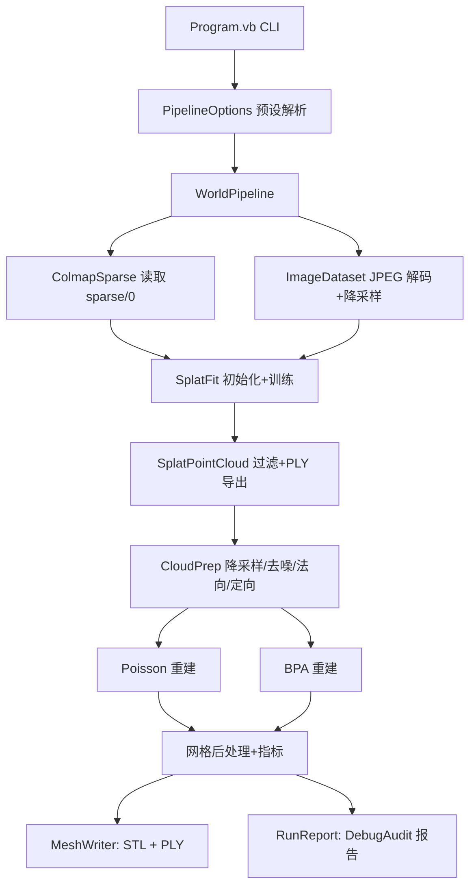

## 产品概述

在 WorldMaker 项目中新增一条面向真实生产数据的"照片 → 三维场景模型"流水线，输入为 Tanks&Temples `train`（火车头）场景的 301 张 980×545 JPEG 照片与配套 COLMAP 稀疏重建结果（相机内外参、稀疏三维点与颜色），输出为可直接用于后续渲染/测量/导入的**三维点云 PLY** 与**重建场景的三维模型文件（STL 主 + PLY 网格）**，并附带可核查的质量报告。

## 核心功能

- **数据接入**：自动发现并读取 `images\` 下的 JPEG 序列与 `sparse\0\` 下的 COLMAP 稀疏结果；相机位姿、内参、图像名与稀疏点颜色一一对应；缺图或缺失位姿时报错并给出可执行的修复提示。
- **训练集构建**：按命令行参数抽帧（默认 60 个视图、均匀抽稀、固定随机种子可复现）与降分辨率（默认宽 480），并同步缩放相机内参，保证投影关系不变。
- **3D 高斯溅射**：以 COLMAP 稀疏点及其颜色作为初始高斯（尺度按场景平均点距自适应），在 CPU 光栅化后端完成训练，实时输出迭代进度、高斯数量、损失与 PSNR，并落盘训练日志。
- **点云导出**：训练后导出两类 PLY——完整高斯参数 PLY（位置/颜色/尺度/旋转/不透明度），以及供重建使用的"表面点云"PLY（按不透明度与尺度过滤掉漂浮/超大高斯，可选带法向）。
- **点云重建**：对表面点云做体素降采样、统计去噪、法向估计与一致定向，然后分别用 Poisson（主，输出封闭平滑模型）与 BPA 滚球法（备选，保留扫描细节）重建，并给出两者对比指标。
- **网格后处理与导出**：去退化面、平滑、按预算简化、补洞、重算法向，导出 STL（主）与 PLY 网格；高斯点云、重建点云、网格、渲染对比图、训练日志、报告按运行标签归档。
- **可切换档位**：快速档（默认）/ 标准档 / 高精度档三套预设，所有预算参数（视图数、分辨率、迭代、致密化、重建分辨率）均可命令行覆盖，换档无需改代码。
- **质量报告**：分阶段耗时、训练 PSNR、高斯数、点云规模、两套网格的顶点/三角面数、封闭性、边界环数、表面积/体积、点云到网格的 RMS 与最大偏差、产物文件清单，统一写入文本与 JSON 报告。

## 视觉与产物效果

最终得到一座火车头的三维模型：Poisson 版本是封闭、平滑、可直接打印/仿真的实体外壳；BPA 版本更贴近原始扫描细节但可能存在孔洞。点云版本保留真实颜色，可直接在 PCL/MeshLab 等工具中打开查看；同时输出关键视角的训练渲染图与真实照片的对照，便于人工判断重建质量。

## 技术栈选择

- 语言/运行时：VB.NET，`net10.0`（与既有工程一致）
- 依赖（全部复用既有工程，除新增一个项目引用外不引入任何外部包）：
- `GaussianSplatting.vbproj`：`Camera/CameraIntrinsics/CameraExtrinsics`、`GaussianModel`、`SplatTrainer`、`TrainingOptions`、`SplatRenderer`、`PointCloudIO`
- `Core.vbproj`：`Microsoft.VisualBasic.Imaging.JpegImage`（`JpegReader`）、`BitmapBuffer`、`DebugAudit`、SIMD 内核
- `Cloudy.vbproj`：预处理/特征/重建/应用全套算法
- `Landscape.vbproj`（**需新增引用**）：`Microsoft.VisualBasic.Imaging.Landscape.Stl.{MeshBuilder, StlWriter}`
- `TensorFlow.vbproj`：`Tensor(H, W, 3)` 作为训练目标图像容器
- 已核实：`Landscape.vbproj` 为 `net10.0`、`AnyCPU|x64`，其依赖（Math/Core/html/imaging）WorldMaker 已全部间接引用，新增引用不会引入 Windows-only 或版本冲突。

## 实现方案

### 总体策略

WorldMaker 从空类库改造为**单一 console 可执行 + 可复用流程类**：`Program.vb` 解析参数 → `WorldPipeline` 顺序编排 5 个阶段（读取、训练、点云、重建、导出），每阶段以 `StageContext`（路径、参数、计时、DebugAudit 句柄）注入，阶段之间只通过不可变的数据模型（`ColmapScene`、`SplatRun`、`SurfaceCloud`、`ReconMesh`）传递，保证任一阶段可单独重跑、可替换。

### 关键决策与理由

1. **COLMAP 读取放在 WorldMaker 内**（`Data/ColmapSparse.vb`），不污染 GaussianSplatting 库职责。COLMAP 约定为 OpenCV（`P_cam = R·P_world + t`），与 `CameraExtrinsics` 完全一致，直接映射，无需坐标系翻转。`cameras.bin` 仅 64 字节即可判定为单 PINHOLE 相机（fx,fy,cx,cy），但仍按 model_id 通用解析以兼容后续数据集。
2. **高斯初始化不用随机点**：用 `points3D.bin` 的位置与 RGB 初始化（`GaussianModel.FromPointCloud`），初尺度取稀疏点最近邻距离中位数的 1.5 倍。真实数据下这能把"从噪声到可辨识形状"的迭代数从数千降到数百，是快速档能在 CPU 上出结果的前提。
3. **视图预算显式管理**：Tensor 是 `Double`，`980×545×3` 单视图 12.8 MB；301 视图约 3.9 GB 会直接 OOM。因此默认降采样到 480 宽（3.1 MB/视图）并抽 60 视图（约 188 MB），同时设总像素上限（默认 4 亿像素，约 3.2 GB），超限时自动减少视图数并告警。降采样用自写整数盒式滤波（逐行累加，cache 友好），并同步缩放内参：`fx·s, fy·s, cx·s−0.5(s−1), cy·s−0.5(s−1)`。
4. **训练步成本控制**：`ViewsPerStep` 默认取 `min(8, 视图数)`，每步只渲染部分视图并轮转，使单步成本恒定，避免"每步全量视图"导致快速档不可用；致密化区间按迭代数比例缩放。
5. **法向定向**：3DGS 点云是"无朝向的散点云"，Poisson 对法向翻转极敏感。策略为 `NormalEstimation.Estimate` → `NormalOrientation.OrientConsistent`（MST 传播）→ 用"法向与（点−场景质心）的点积为正的比例"做全局校验，比例 < 0.5 时整体翻转；Poisson 结果再用 `MeshData.Volume()` 符号做二次校验，为负时翻转法向重跑一次（最多 1 次）。
6. **两条重建路线都保留**：Poisson 出封闭网格（适合 CAD 比对/打印），BPA 出保细节网格（适合检测）。二者共用同一预处理点云与同一套导出/指标代码，只在 `ReconMesh` 里标记 `Algorithm`。
7. **网格 PLY 自写**（约 60 行）：Landscape 的 `PlyWriter` 只支持点云；STL 无顶点颜色。因此 STL 走 `MeshBuilder.AddTriangle` + `StlWriter.Write`，网格 PLY 在 WorldMaker 内写 ASCII（vertex + face + 可选 rgb），满足"保留颜色便于查看"的需求。
8. **确定性**：视图抽稀、初始化兜底、BPA 采样都用固定种子；报告记录实际使用的参数快照，便于复现同一结果。

### 性能与资源

- 训练：单步复杂度 ∝ 选中视图像素数 × 可见高斯数；快速档（480 宽 / 60 视图 / 800 迭代 / 每步 8 视图）在 CPU 单机上预期 10–40 分钟，代码在每 10 步打印耗时与 ETA。
- 预处理：体素降采样与 SOR 走 Cloudy 的 `SimdParallel.ForRange` + KD 树，`O(n log n)`；对 1e6 级点云秒级完成。
- Poisson：八叉树分辨率直接决定内存（`128³` 约百余 MB，`256³` 会破 GB），默认 `128`，并按 `MemoryBudgetMB` 自动降级并告警。
- BPA：半径取点云中位间距的 2.5 倍，`k=16` 邻域；对 1e6 点云用采样上限（默认 30 万）控制时间。
- 内存：训练张量、点云、网格三块峰值互斥（阶段间主动置空并 `GC.Collect`），避免同时驻留。

### 已知边界（写入 XML 文档并在报告中提示）

- CPU 训练画质低于 GPU 与官方实现；快速档更适合"打通链路 + 可看的三维模型"，高精度需切档并接受数小时耗时。
- 3DGS 重建的点云本质是各向异性高斯的中心，表面存在"绒毛"，必须靠不透明度/尺度过滤 + SOR 才能得到可用表面。
- STL 无颜色；T&T 场景含地面/背景，Poisson 会把它们一并建模，提供 `--remove-ground`（RANSAC 平面）与 `--crop-box` 可选后处理。

## 架构设计



## 目录结构

```
Data_science/MachineVision/WorldMaker/
├── WorldMaker.vbproj                       [MODIFY] 改为 Exe（OutputType/AssemblyName/AssemblyTitle/Platforms），新增 Landscape 项目引用，NoWarn 抑制噪音
├── Program.vb                              [NEW] 入口：解析参数、构造 PipelineOptions、调用 WorldPipeline.Run、按退出码返回；异常统一捕获并落盘
├── Cli/CommandLine.vb                      [NEW] 极简 --key value/--flag 解析器（大小写不敏感、支持默认值、未知参数告警）
├── Cli/PipelineOptions.vb                  [NEW] 预算参数 + fast/standard/high 三套预设 + 校验（视图数≤图像数、宽高比保持、内存上限换算）+ ToText 参数快照
├── Data/ColmapSparse.vb                    [NEW] COLMAP 二进制读取：cameras.bin/images.bin/points3D.bin 的 BinaryReader 解析（小端）、四元数→旋转矩阵、跳过 2D 观测但校验长度、返回 ColmapScene
├── Data/ColmapScene.vb                     [NEW] 场景模型：相机字典、按名排序的视图列表（ImageId/Name/Qvec/Tvec/CameraId）、稀疏点（XYZ/RGB/Error）；ToGaussianCameras() 转 GaussianSplatting.Camera；SparsePointsToArrays() 转 Double() 供初始化
├── Data/ImageDataset.vb                    [NEW] JPEG 解码（Microsoft.VisualBasic.Imaging.JpegImage → BitmapBuffer）→ 盒式降采样 → Tensor(H,W,3)；内参同步缩放；按预算自动裁剪视图数；保存抽样对照图（PNG）
├── Splatting/SplatFit.vb                   [NEW] 初始高斯构建（稀疏点+RGB，尺度=1.5×中位最近邻距离，含资源不足时随机兜底）、TrainingOptions 组装、SplatTrainer 运行、进度回调（控制台 + CSV + DebugAudit.Mark）、训练后评估 PSNR、导出关键视角渲染图
├── Splatting/SplatPointCloud.vb            [NEW] 高斯→表面点云：不透明度阈值（默认 0.1）、尺度阈值（≤3×中位）、可选按相机包围盒裁剪；写"表面点云 PLY"（x,y,z,rgb,opacity,scale）与"全参数 PLY"（调用 PointCloudIO.SaveGaussianPLY）；返回点数/包围盒统计
├── Cloudy/CloudPrep.vb                     [NEW] 读取表面 PLY → VoxelGridFilter.Downsample（体素=1.5×平均点距）→ StatisticalOutlierRemoval（k=20,1.0σ）→ NormalEstimation.Estimate（k=24）→ OrientConsistent + 质心一致性校验（必要时整体翻转）→ 可选 RANSAC 地面移除/裁剪；返回 PointCloudBuffer 与统计
├── Cloudy/MeshReconstruct.vb               [NEW] PoissonReconstruction.Reconstruct（分辨率/预算按档位，Volume<0 时翻转法向重跑一次）+ BallPivoting.Reconstruct（半径自适应、采样上限）；统一网格后处理：去退化面、TaubinSmooth 2 次、SimplifyQem 到预算、FillHoles、RecomputeNormals；输出 ReconMesh（Algorithm/网格/指标）
├── Cloudy/MeshMetrics.vb                   [NEW] 指标计算：顶点/三角面数、IsClosed、BoundaryLoops 数、表面积、体积、包围盒、点云→网格 RMS/最大偏差（MeshProcessing.PointToMeshDistance，抽样上限）
├── Io/MeshWriter.vb                        [NEW] MeshData → Stl.MeshBuilder.AddTriangle → StlWriter.Write；MeshData → ASCII 网格 PLY（vertex x y z + 可选 rgb + face）；按 run-tag 组织 mesh/ 目录
├── Io/CloudPly.vb                          [NEW] Cloudy PointCloudBuffer ↔ ASCII PLY（读写，含法向/颜色/强度）；供阶段间落地与复用
├── Pipeline/RunPaths.vb                    [NEW] output/<runTag>/{ply,mesh,render,logs,report} 目录创建与文件命名
├── Pipeline/WorldPipeline.vb               [NEW] 五阶段编排、阶段计时（DebugAudit.Watch）、失败即报告并返回非零、阶段产物落地与摘要打印
└── Reporting/RunReport.vb                  [NEW] 汇总所有指标 → DebugAudit.Capture/Mark/Check + SaveReport(txt) + ToJson(json) + 产物清单
```

## 关键代码结构

```
' 预算参数与预设（多个模块共享，决定所有下游阈值）
Public Class PipelineOptions
    Public Property ImagesDir As String
    Public Property SparseDir As String          ' 默认 <ImagesDir>\..\sparse\0
    Public Property OutputRoot As String         ' 默认 <worldmaker>\output
    Public Property Preset As String             ' fast | standard | high

    Public Property MaxViews As Integer          ' fast=60  standard=120  high=301
    Public Property TargetWidth As Integer       ' fast=480 standard=640  high=980(原图)
    Public Property Iterations As Integer        ' fast=800 standard=2000 high=5000
    Public Property ViewsPerStep As Integer      ' 默认 min(8, MaxViews)
    Public Property PixelBudget As Long          ' 默认 4e8 像素，超限自动减视图

    Public Property PoissonResolution As Integer ' fast=128 standard=160 high=192
    Public Property BpaMaxPoints As Integer      ' 默认 300000
    Public Property SimplifyTarget As Integer    ' 目标三角面数，0=不简化
    Public Property RemoveGround As Boolean
    Public Property Seed As Integer
End Class
```

```
' 阶段契约：便于单测/单跑/换实现
Public Interface IPipelineStage
    ReadOnly Property Name As String
    Function Run(context As StageContext) As StageResult
End Interface
```

## Agent Extensions

### SubAgent

- **code-explorer**
- Purpose: 在实现阶段快速核对 Landscape（Stl/MeshBuilder、PLY）、Core（JpegImage/BitmapBuffer/DebugAudit）与 Cloudy 各阶段的确切方法签名与命名空间，避免凭记忆写错 API。
- Expected outcome: 输出一份"可调用 API 清单"（类名、命名空间、方法签名、返回值结构），直接用于编码与编译纠错。