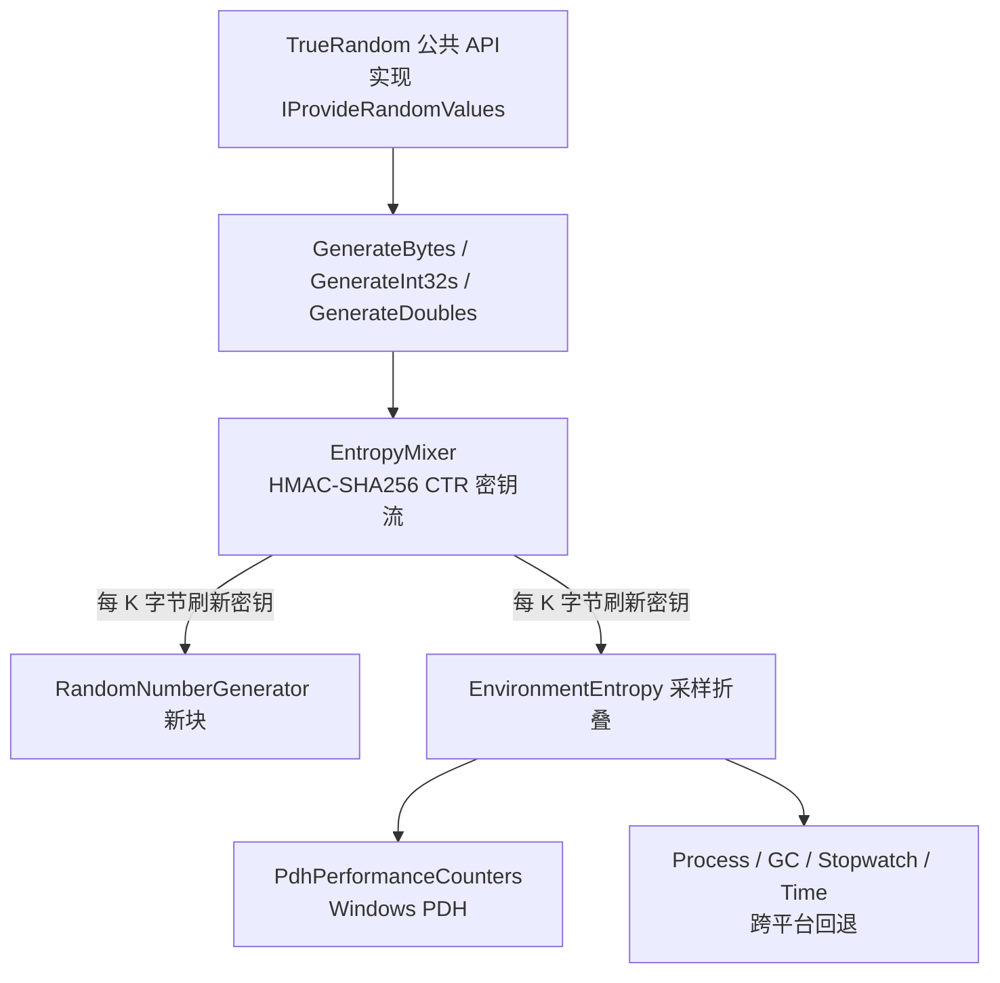

## 用户需求

在 `Randomizer\randomizer-netcore5.vbproj` 项目中新增一套基于操作系统环境噪声、性能计数器、时间等真实熵源的真随机数生成模块。现有生成器（Randomizer 表驱动 RAND、MersenneTwisterFast、FastRandom xorshift、crandn LCG）均为伪随机，已无法满足研究对不可预测性与高熵的需求。

## 产品概述

新增两个独立封装的真随机组件：①纯环境噪声熵收集器（慢、高熵，仅由采样噪声 + 哈希混合产出，不依赖加密随机数发生器）；②混合生成器（以 OS 熵池驱动的加密级 CSPRNG 做批量展开，周期性注入环境噪声刷新密钥，快、适合大规模）。对外以 `TrueRandom` 类实现 `IProvideRandomValues` 接口，提供 `GenerateBytes(n)` / `GenerateInt32s(n)` / `GenerateDoubles(n)` 批量生成指定数量的方法。

## 核心特性

- 采集操作系统环境噪声：高精度计时（Stopwatch/DateTime.UtcNow）、TickCount64、进程 CPU/内存/线程/句柄统计、GC 计数与内存、Guid、线程池积压等。
- Windows 上通过 PDH（P/Invoke pdh.dll）采集真实性能计数器（处理器时间、上下文切换、磁盘队列、内存可用字节等），非 Windows 自动回退到跨平台统计，保证编译与运行跨平台。
- 提供纯环境噪声熵收集器（GetSeed/GetBytes），用于密钥种子、一次性高熵场景。
- 提供混合生成器：实现 `IProvideRandomValues` 接口并支持批量生成，输出均匀分布、无模偏的整型与 [0,1) 双精度，且线程安全。

## 技术栈选择

- 语言/框架：VB.NET，TargetFramework `net10.0`（沿用现有 vbproj 配置，AnyCPU/x64）。
- 加密与哈希：`System.Security.Cryptography.SHA256` / `HMACSHA256` / `RandomNumberGenerator`（BCL，net10.0 自带，无需新增 NuGet）。
- 环境采样：`System.Diagnostics.Process`（跨平台）、`System.GC`、`System.Diagnostics.Stopwatch`、`System.Environment`、`System.Threading.ThreadPool`、`System.Runtime.InteropServices.RuntimeInformation`。
- Windows 专属：PDH `pdh.dll` P/Invoke（`PdhOpenQueryW` / `PdhAddEnglishCounterW` / `PdhCollectQueryData` / `PdhGetFormattedCounterValue` / `PdhCloseQuery`），调用处按 Windows 运行时门控。
- 复用：仅新增文件，沿用现有 `FastRandom\IProvideRandomValues.vb` 接口契约与项目 GPL3 头/Xml 注释风格；数学运算统一用 `Imports std = System.Math` 别名，避免与项目根命名空间 `Microsoft.VisualBasic.Math` 冲突。

## 实现方案

### 策略概述

- **纯环境噪声熵收集器 `EnvironmentEntropy`**：将多路噪声源采样后 `BitConverter` 拼接到字节流，经 `SHA256` 压缩为 32 字节熵块；通过"上一次输出 + 新采样"循环演化，累计产出任意长度字节（不调用任何 CSPRNG）。适合少量高熵种子。
- **混合生成器 `TrueRandom`**：采用 HMAC-SHA256 计数器（CTR）模式将 256-bit 密钥展开为密钥流，初始密钥 = `RandomNumberGenerator.GetBytes(32)` 与环境噪声折叠；每展开 K（默认 1024）字节，折叠一块新的 `RandomNumberGenerator` 输出 + 一次环境噪声采样刷新密钥（前向保密/抗回溯）。批量 `GenerateBytes/Int32s/Doubles` 由密钥流派生。
- **分布正确性**：`GenerateDoubles` 采用 53-bit 尾数法（参照 `MersenneTwisterFast.nextDouble` 的 `((hi<<27)+lo)/2^53` 方案）保证 [0,1)；`GenerateInt32s` 用 `RandomNumberGenerator.GetInt32` 或拒绝采样消除模偏；`Next(min,max)` 沿用接口语义防越界。
- **线程安全**：`TrueRandom` 对内部密钥流状态与计数器的访问加 `SyncLock`，`IsThreadSafe` 返回 True。

### 性能与可靠性

- 环境采样（尤其 PDH `CollectQueryData`）为毫秒级、较慢，仅用于初始化与周期性刷新，**绝不在逐字节路径**调用；批量产出主路径为 HMAC-SHA256 CTR（每 32 字节一次 HMAC），吞吐可接受。
- 噪声相关性：单次采样字节经 SHA256 压缩，连续采样间插入 `Stopwatch` 计时抖动，降低序列相关；PDH 计数器取不到时 `TryGetCounter` 安全降级，不抛异常污染采样。
- 避免技术债：混合展开复用 OS 加密级 CSPRNG 而非自造 PRNG；PDH 声明无条件存在但仅 Windows 调用，保证非 Windows 编译/运行通过。

## 实现要点

- PDH P/Invoke 结构 `PDH_FMT_COUNTERVALUE`、状态码 `PDH_STATUS` 检查、句柄用 `SafeHandle`/`Using` 释放，避免句柄泄漏。
- 在 `EnvironmentEntropy.Sample()` 内按 `RuntimeInformation.IsOSPlatform(OSPlatform.Windows)` 决定是否调用 PDH；非 Windows 仅用跨平台源。
- 数学函数统一 `System.Math`（别名 `std`），避免被项目命名空间遮蔽（参考 `MersenneTwisterFast.vb`）。
- 真随机数不可做"可复现"断言；自测只验证：长度正确、范围正确、多次调用结果不重复、多线程并发无异常。

## 架构设计



## 目录结构

```
Randomizer/
├── TrueRandom/                         # [NEW] 真随机模块目录
│   ├── PdhPerformanceCounters.vb       # [NEW] Windows PDH P/Invoke 封装：OpenQuery/AddEnglishCounter/CollectQueryData/GetFormattedCounterValue(Double)，TryGetCounter 安全降级；声明无条件存在，调用处按 Windows 门控。
│   ├── EnvironmentEntropy.vb           # [NEW] 纯环境噪声熵收集器：Sample() 多源采样→字节→SHA256 压缩；GetSeed()/GetBytes(n) 通过循环演化产出目标字节（不调用 CSPRNG），Windows 调用 PDH，非 Windows 回退。
│   ├── EntropyMixer.vb                 # [NEW] HMAC-SHA256 计数器模式密钥流展开（key=256bit，counter 递增）与密钥刷新折叠，供 TrueRandom 复用。
│   └── TrueRandom.vb                   # [NEW] 混合生成器类，实现 IProvideRandomValues（IsThreadSafe/NextFloat/NextFloats/Next(min,max)），并新增 GenerateBytes(n)/GenerateInt32s(n)/GenerateDoubles(n)；构造时 RNG+环境噪声初始化，SyncLock 保证线程安全。
├── README.md                           # [MODIFY] "可用的生成器"表新增 TrueRandom / EnvironmentEntropy 两行及使用示例。
├── randomizer-netcore5.vbproj          # [MODIFY] 可选：更新 Description/PackageTags 增加真随机与 entropy 关键词。
└── test/
    └── Program.vb                      # [MODIFY] 新增自测：长度/范围([0,1)、指定区间)/不可预测(多次不重复)/多线程并发无异常。
```

## 关键代码结构

`TrueRandom` 公共契约（实现 `IProvideRandomValues` 并扩展批量方法）：

```
Public Class TrueRandom : Implements IProvideRandomValues
    Public ReadOnly Property IsThreadSafe As Boolean Implements IProvideRandomValues.IsThreadSafe
    Public Function NextFloat() As Double Implements IProvideRandomValues.NextFloat
    Public Sub NextFloats(buffer As Double()) Implements IProvideRandomValues.NextFloats
    Public Function [Next](minValue As Integer, maxValue As Integer) As Integer Implements IProvideRandomValues.Next
    ' 新增批量真随机方法
    Public Function GenerateBytes(n As Integer) As Byte()
    Public Function GenerateInt32s(n As Integer) As Integer()
    Public Function GenerateDoubles(n As Integer) As Double()
End Class
```