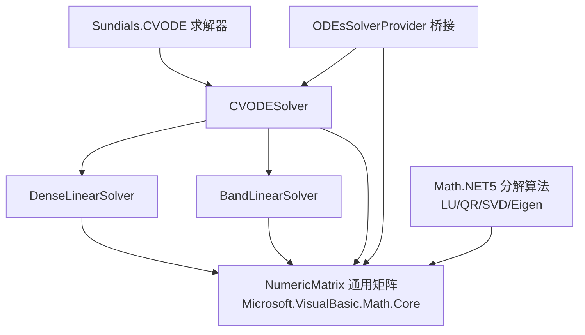

## 用户需求

对两个矩阵类型做能力比对与冗余合并：保留核心库中的通用矩阵类型，删除 CVODE 求解器项目内自带的私有矩阵类，让 ODE 求解器复用基础库中的矩阵实现；基础库中相对缺失的能力需要补齐。

## 产品概述

`sciBASIC#` 数学框架中同时存在两套稠密矩阵实现：一套是核心数学库中长期维护、被广泛复用的通用矩阵类型（jagged 行数组存储、带 SIMD 加速与多种分解算法）；另一套是 ODE 求解器项目内自带的简化稠密矩阵（矩形数组存储、仅覆盖求解器自用场景）。两者功能高度重叠，属于重复造轮子，且求解器版本长期缺少维护与性能优化。本次改造将二者合并为一套，消除重复代码。

## 核心功能

- **能力差异审查**：逐成员比对两套矩阵实现，形成「可直接替换 / 仅命名不同 / 确实缺失」三类清单，作为合并依据。
- **删除冗余实现**：移除求解器项目内的私有稠密矩阵类型文件，项目中不再存在同名重复类型。
- **求解器迁移**：ODE 求解器的 Jacobian 矩阵、线性方程组系数矩阵、LU 分解工作矩阵、带状矩阵装填、矩阵-向量乘法等全部改用基础库的通用矩阵类型；对外暴露的 Jacobian 回调参数类型同步更换。
- **补齐缺失能力**：在通用矩阵上新增「整体赋常量值、按维度的整块数据复制、对角线赋值、方阵判定、与矩形二维数组的双向互转」五类能力，使原私有矩阵的使用场景可 1:1 平移。
- **桥接语义明确**：与外部「矩形二维数组」回调对接处采用显式缓冲搬运（读入—回调写入—写回），不引入「看似共享、实则写入不生效」的隐式视图属性。
- **文档与示例同步**：项目说明文档、代码示例、变更说明中不再出现被删除的类型名称；示例程序的 Jacobian 写法与新类型一致。
- **行为等价保证**：重构前后同一 ODE 样例（含解析 Jacobian 的刚性方程）数值结果与求解步数保持一致，构建零告警。

## 边界与非目标

- 不修改基础库中已有成员的名称、签名与语义（只做新增，不做重命名或删除），避免影响其它引用该库的模块。
- 不为原私有矩阵的旧命名新增同义别名。
- 不重构求解器的数值算法、积分策略与事件求根逻辑。
- 其它子系统中同名但无关的私有矩阵类型不在本次范围内。

## 技术栈

- 语言/运行时：VB.NET（`Option Strict On`、`Option Infer On`、`LangVersion=latest`、`net10.0`）
- 项目形态：SDK 风格类库 `Sundials.CVODE.vbproj`（`GenerateDocumentationFile=true`，Public 成员须有 XML 文档）+ 控制台测试工程 `test/test.vbproj`
- 目标矩阵类型：`Microsoft.VisualBasic.Math.LinearAlgebra.Matrix.NumericMatrix`（程序集 `Microsoft.VisualBasic.Math.Core`，来自 `..\Math\Math.NET5.vbproj`）
- 依赖关系：`Sundials.CVODE.vbproj` 已引用 `Math.NET5.vbproj`、`Core.vbproj`、`odes-netcore5.vbproj`，**无需新增项目引用**；仅需在使用处 `Imports Microsoft.VisualBasic.Math.LinearAlgebra.Matrix`
- 无第三方依赖引入

## 实现方案

### 总体策略

采用「先补齐能力、再平移调用点、最后删除旧类」的三段式改造：

1. 在 `NumericMatrix.vb` 中**只新增**真正缺失的成员（不改动既有成员），使原私有矩阵的全部使用场景都能映射到通用矩阵上；
2. 逐文件把求解器内部对私有矩阵的引用替换为通用矩阵，命名沿用既有约定（`RowDimension`/`ColumnDimension`/`ArrayPack`/`AddEquals`/`MultiplyEquals`/`DotMultiply`/`Norm1`/`NormInf`/`NormF`/`Item(i, byRow)`）；
3. 删除旧类型文件，更新示例与文档，构建 + 运行回归比对。

### 关键决策与理由

- **新增能力最小化**：`NumericMatrix` 被大量模块引用，任何既有签名改动都会放大影响面。因此只新增 5 类能力，且全部为「无既有同名成员」的新名字，避免与基类 `Vector(Of T)` 的 `Array`/`Length`/`Copy` 冲突。
- **不提供 `Data As Double(,)` 属性**：通用矩阵内部是 jagged 行数组，矩形视图无法零拷贝共享；若提供属性，外部写入会静默丢失（Bug 极难定位）。改为显式的 `ToRectangular()` 读 + `CopyFrom(Double(,))` 写回，语义可见、开销可控。
- **LU 工作矩阵改用 jagged 视图**：`DenseLinearSolver` 原先通过 `Data As Double(,)` 做行列索引；改用 `ArrayPack(deepcopy:=False)` 取得内部引用后按 `data(i)(j)` 访问，**零额外分配**，且行主序循环下 jagged 访问省去一次乘法寻址，性能不劣于矩形数组。
- **Jacobian 桥接采用缓存缓冲**：外部回调签名固定为 `Action(Of Double, Double(), Double(,))`，桥接层在闭包中惰性分配一次 `(n, n)` 矩形缓冲，每次回调按「读入 → 回调写入 → 写回」搬运。搬运复杂度 O(n²)，与 Jacobian 求值本身的 O(n²) 同阶且远小于数值差分路径的 O(n³) 级 RHS 调用成本，可忽略。
- **只读辅助方法保持具体类型**：`BandLinearSolver.LoadFromDense`、`DenseLinearSolver.MatrixVectorMultiply` 仅读元素与维度，统一改用 `NumericMatrix` 参数即可，避免接口分派带来的额外开销。

### 成员映射表（旧 → 新）

| 私有稠密矩阵 | 通用矩阵（NumericMatrix） |
| --- | --- |
| `Rows` / `Columns` | `RowDimension` / `ColumnDimension` |
| `IsSquare` | **新增** `IsSquare` |
| `Item(row, col)` | `Item(i, j)`（无边界检查，求解器循环本身有界） |
| `Data As Double(,)` | **新增** `ToRectangular()`（读）/ `CopyFrom(Double(,))`（写回）；内部循环用 `ArrayPack()` |
| `AddInPlace` / `ScaleInPlace` | `AddEquals` / `MultiplyEquals` |
| `SetConstant(value)` | **新增** `SetConstant(value)` |
| `CopyFrom(DenseMatrix)` | **新增** `CopyFrom(GeneralMatrix)`（就地整块复制） |
| `SetDiagonal(value)` | **新增** `SetDiagonal(value)` |
| `SetColumn` / `GetColumn` / `SetRow` / `GetRow` | `Item(i, byRow:=False)` / `Item(i)` |
| `MultiplyVector(A, x)` | `DotMultiply(x)` |
| `FrobeniusNorm` / `Norm1` / `InfinityNorm` | `NormF` / `Norm1` / `NormInf` |
| `Identity` / `Zeros` / `Ones` / `Diagonal(Vector)` | `Identity` / `Zero` / `One` / `Diagonal(m, n, value)` |


### 性能与可靠性

- 数值热点 `ComputeNumericalJacobian`、`BuildAndFactorizeSystem`、LU 前代/回代均为 O(n²)/O(n³) 的三重循环，迁移后循环体不变，仅索引形式变化；jagged 逐行访问减少寻址计算，且 LU 数据整块复制通过逐行 `Array.Copy` 完成（与既有 `RowPackedCopy`、`Copy()` 的写法一致）。
- 新增方法均先做维度/空值校验并抛出与既有风格一致的 `ArgumentException`，防止静默越界。
- 整数溢出与内存：`CopyFrom(Double(,)))` 逐行块拷贝，不额外申请托管大对象，避免 GC 压力。

## 实施要点

- `NumericMatrix` 的成员注释统一使用中文 XML 文档（与文件现有风格一致），标注「就地修改」与「返回新实例」的区别，避免调用方误用产生别名共享问题。
- `CopyFrom(Double(,)))` 需校验矩形数组行列数与本矩阵一致，并按行块拷贝（`Buffer.BlockCopy`/`Array.Copy`），保持内部行数组**引用不变**（不 `ReDim`），以免破坏其它代码持有的行引用。
- `ToRectangular()` 内部按行块拷贝填充矩形数组，保持与既有 `ConvertJaggedToRectangularFlexible` 一致的异常处理（空矩阵返回空矩形数组）。
- 删除旧类后，`Sundials.CVODE.vbproj` 无需修改 `<Compile>` 项（SDK 风格自动包含），但需确认无 `EnableDefaultCompileItems=false` 等意外配置。
- `PackageReleaseNotes` 需追加一条「移除内部重复矩阵实现，改用核心库通用矩阵」的变更说明，避免包升级时无迹可循。
- 保留 `LinearSolverResult` 等既有返回码语义，不改动错误分支，控制改动半径。
- 迁移过程中若出现 `Option Strict On` 下的隐式类型推断差异，显式声明局变类型（如 `Dim data As Double()() = _luMatrix.ArrayPack()`）。

## 架构设计

改造后矩阵能力收敛到单一来源（核心数学库），求解器只承担数值算法职责：



## 目录结构

```
Math/
├── CVODE_Solver/
│   ├── DenseMatrix.vb                        # [DELETE] 私有稠密矩阵类型，能力已被通用矩阵覆盖
│   ├── Func.vb                               # [MODIFY] JacobianFunction 委托第 4 参数由私有矩阵改为 NumericMatrix；补 Imports
│   ├── CVODESolver.vb                        # [MODIFY] 字段 _J/_A 改 NumericMatrix；AllocateResources 改用 New NumericMatrix(n,n)；
│   │                                         #          ComputeNumericalJacobian / BuildAndFactorizeSystem 索引保持不变；
│   │                                         #          补 Imports Microsoft.VisualBasic.Math.LinearAlgebra.Matrix
│   ├── LinearSolver/
│   │   ├── DenseLinearSolver.vb              # [MODIFY] _luMatrix 改 NumericMatrix；Factorize 参数改 NumericMatrix 并用
│   │   │                                     #          CopyFrom + ArrayPack 做 LU；Solve 用 ArrayPack 取 jagged 视图；
│   │   │                                     #          Reset 用 SetConstant；MatrixVectorMultiply 参数改 NumericMatrix；
│   │   │                                     #          EstimateConditionNumber 用 Norm1 与 Item(i,i)
│   │   └── BandLinearSolver.vb               # [MODIFY] LoadFromDense 参数改 NumericMatrix，维度用 RowDimension/ColumnDimension
│   ├── Extensions/
│   │   └── ODEsSolverProvider.vb             # [MODIFY] Jacobian 桥接改为缓存 Double(,) 缓冲 + ToRectangular/CopyFrom 写回；
│   │                                         #          同步修正「零拷贝写入 Data」的注释描述
│   ├── PROJECT_SUMMARY.md                    # [MODIFY] 移除 DenseMatrix 章节与目录树条目，更新示例代码与桥接说明
│   ├── Sundials.CVODE.vbproj                 # [MODIFY] 更新 PackageReleaseNotes（记录矩阵实现去重），必要时递增 Version
│   └── test/
│       ├── CVODEExample.vb                   # [MODIFY] 示例 Jacobian 的 Lambda 参数类型改 NumericMatrix（补 Imports）
│       └── MatrixBridgeTest.vb               # [NEW] 通用矩阵新增能力的自检用例：ToRectangular/CopyFrom 往返、
│                                             #       就地复制不换行引用、SetDiagonal、SetConstant、IsSquare 判定
└── Math/
    └── Algebra/Matrix.NET/
        └── NumericMatrix.vb                  # [MODIFY] 仅新增成员（不改既有签名）：
                                              #   IsSquare、SetConstant、CopyFrom(GeneralMatrix)、
                                              #   CopyFrom(Double(,))、SetDiagonal、ToRectangular
```

## 关键接口

```
' NumericMatrix 新增成员（仅签名，不含实现）
''' <summary>是否为方阵（行数与列数相等）。</summary>
Public ReadOnly Property IsSquare As Boolean

''' <summary>将所有元素就地设置为指定值。</summary>
Public Sub SetConstant(value As Double)

''' <summary>按行块拷贝另一个矩阵的数据到当前矩阵（维度必须一致，就地修改）。</summary>
Public Sub CopyFrom(source As GeneralMatrix)

''' <summary>按行块拷贝矩形二维数组到当前矩阵（行列数必须一致，就地修改）。</summary>
Public Sub CopyFrom(source As Double(,))

''' <summary>设置主对角线元素（非方阵时取 min(m, n)）。</summary>
Public Sub SetDiagonal(value As Double)

''' <summary>导出为行主序矩形二维数组（新建实例，与内部行数组不共享引用）。</summary>
Public Function ToRectangular() As Double(,)
```

## Agent Extensions

### SubAgent

- **code-explorer**
- Purpose: 以 "very thorough" 级别全仓核查私有稠密矩阵类型的全部引用点（含解决方案文件、其它语言工程、示例与文档），确认删除后不会留下编译断点
- Expected outcome: 输出完整引用清单（文件 + 行号 + 引用性质），并对清单中每个文件标注「本次需修改 / 与本任务无关」

### Skill

- **lsp-code-analysis**
- Purpose: 对 `JacobianFunction` 委托与 `DenseMatrix` 类型做符号级「查找引用 / 调用层级」分析，验证签名变更的影响面并定位所有需要同步修改的调用点
- Expected outcome: 得到基于语义的引用集合（排除同名无关类型），重命名后可用同一手段复查无遗漏引用