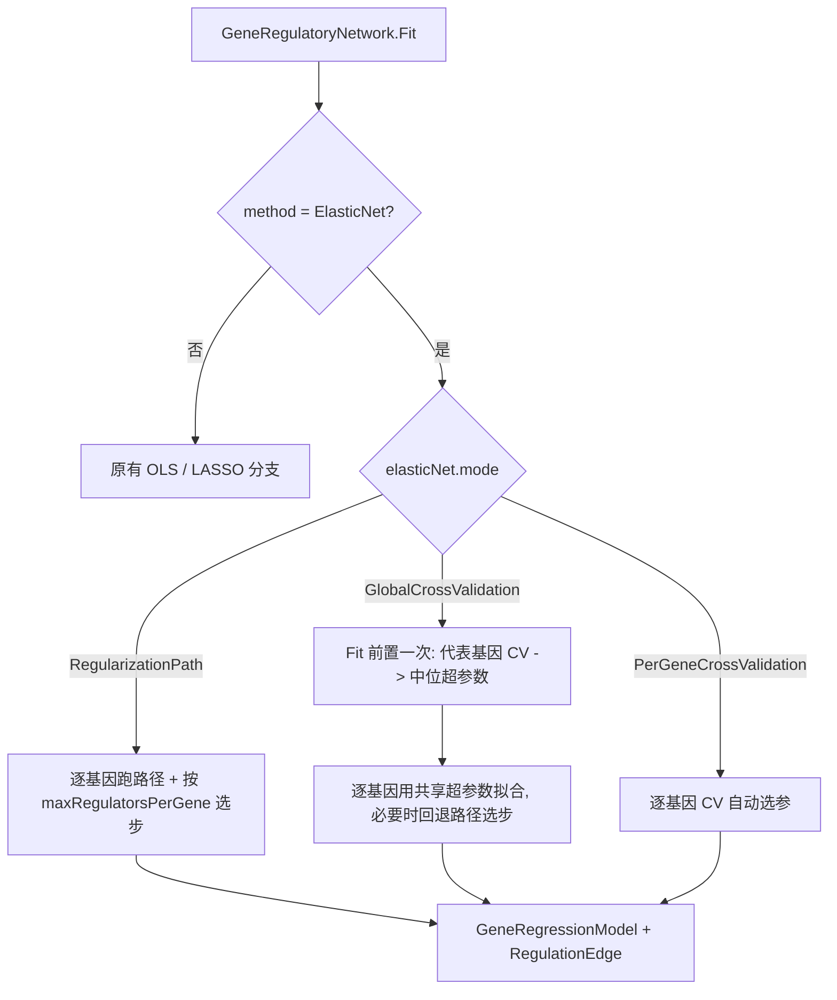

## 用户需求

在现有基因调控网络框架中接入 Elastic Net 作为第三种拟合方法，实现放在 `Network.Regulons\ElasticNet\` 目录；先产出开发规划（本轮为 plan 模式，不落地代码）。

## 已确认的方向

- **架构**：接入现有 GRN。给 `FittingMethod` 增加 `ElasticNet`，`ElasticNet\` 目录承载算法拟合器与超参数，复用现有候选筛选、模型、导出逻辑（允许小改 `GrnOptions.vb` / `GeneRegulatoryNetwork.vb`）。
- **超参数**：默认「正则化路径选步」，另提供「每基因交叉验证」与「全局 CV（代表基因取中位超参数复用）」两档开关。
- **验收**：p > n 场景、共线基因分组效应、与 OLS/LASSO 指标对比、路径一致性与导出。

## 功能内容

- 每个基因轮流作为目标基因，建立 `target = const + Σ β_i · regulator_i`，用 Elastic Net 求解（自带截距，系数已反标准化回原始表达量尺度）。
- 路径模式：固定 `l1_ratio` 跑 alpha 由大到小的正则化路径，在「非零系数数 ≤ 每基因上限」的步里取 R² 最大者；
- 每基因 CV 模式：对该基因跑 K 折 CV 自动选 `(alpha, l1_ratio)`；
- 全局 CV 模式：按方差选代表基因跑一次 CV，取中位超参数供全部基因复用（避免 G 倍开销）。
- 输出沿用现有网络对象：`Regulations()`、`CoefMatrix()`、`WriteEdges()`，并在边与模型中记录 `alpha` / `l1_ratio`。

## 边界与约束

- 不改变 OLS/LASSO 的既有行为与既有 45 条断言语义（导出表头新增两列时同步更新对应断言）。
- p > n 时放宽候选数量限制（Elastic Net 无 `n ≥ p` 要求），但保留显式预算上限以控内存与耗时。
- Elastic Net 不提供显著性检验，`pvalues` 统一为 1（与 LASSO 一致）。
- 不修改 `ElasticNet.vbproj` 工程本身；若验证中发现真实缺陷，先给证据再修。

## 技术栈

- 语言/目标框架：VB.NET，`net10.0`（沿用 `Network.Regulons.vbproj` 现状）。
- 算法库：新增引用 `..\..\..\..\runtime\sciBASIC#\Data_science\Mathematica\Math\ElasticNet\ElasticNet.vbproj`（程序集 `Microsoft.VisualBasic.Data.Bootstrapping.ElasticNet`，命名空间同名，含 `ElasticNetFitting` / `ElasticNetFit` / `ElasticNetPath` / `ElasticNetCVResult`）。
- 复用：`DataFittings`（`NumericTable`、`RegressionStatistics` 的 SST）、`HTS_matrix`（`Matrix` / `DataFrameRow`）。

## 关键事实（已核实）

1. `Network.Regulons.vbproj` **当前只声明了空目录**，没有 ElasticNet 的 `ProjectReference`：

```
225:227:Network.Regulons.vbproj   → <ItemGroup><Folder Include="ElasticNet\" /></ItemGroup>
```

必须补引用，否则无法编译。

2. `ElasticNetFitting.CheckMatrix` 无 `n ≥ p` 限制，坐标下降不需要 `X'X` 可逆 → **支持 p > n**；但 `Prepare` 每次会复制 `n × p` 设计矩阵，需要候选预算上限。
3. `BackTransform` 已把系数除以 `Scales`、截距置为 `YMean - Σ c·Means`，因此 `ElasticNetFit` / `ElasticNetPath` 的系数**已是原始量纲**，可直接与 OLS/LASSO 结果比较。
4. `ElasticNetPath` 提供 `Alphas`（降序）/`Intercepts`/`Coefficients(alphaIdx)`/`RSquared`/`NonZeroCounts`，与 LASSO 的 `LassoFit` 字段一一对应。
5. 现有 `GeneRegulatoryNetwork.BuildDesign(candidates, withIntercept, ByRef names, ByRef columns)` 在不加截距列时正好适配 Elastic Net；`FitGene` 的分支在 466-470 行，`CandidateBudget` 在 415-445 行，`Fit()` 的前置设置在 192-196 行，CSV 表头在 343 行。

## 实现方案

### 1. 命名空间决策（规避 VB 名称解析冲突）

`ElasticNet\` 目录**不新建同名命名空间**（否则文件内的 `Imports Microsoft.VisualBasic.Data.Bootstrapping.ElasticNet` 会与本地 `ElasticNet` 命名空间争用同一标识符）。所有新类型继续放在现有的 `Namespace LinearRegression` 下，目录仅作物理组织。这样 `Imports ...Bootstrapping.ElasticNet` 后可直接使用 `ElasticNetFitting` / `ElasticNetPath` 等类型名，无需 `Global.` 前缀（该前缀在本工程实测无效）。

### 2. 三档超参数策略



### 3. 候选预算按方法分支（p > n 的关键）

`CandidateBudget()` 现在无差别地夹到 `nS - 2`。改为：

- `ElasticNet` 且 `maxCandidates <= 0` → `k = min(poolSize - 1, elasticNet.maxCandidates)`（默认预算 1000）；
- `ElasticNet` 的硬上限用 `poolSize - 1`，不再用 `nS - 2`；
- OLS/LASSO 保持原逻辑与原有截断日志不变。

### 4. 路径选步规则（与现有 LASSO 对齐）

在 `NonZeroCounts > 0` 且 `≤ maxRegulatorsPerGene` 的步里取 `RSquared` 最大；找不到候选则退化为「非零数最少的一步」而不是最后一步（路径末端可能过于稠密）。

### 5. CV 模式仍遵守每基因上限

若 `cv.Fit.NonZeroCount > maxRegulatorsPerGene`，以 `BestL1Ratio` 再跑一次路径并选步。这样「每基因最多 k 个调控因子」在所有模式下都成立，既有断言语义不退化。

### 6. 导出口径

- `RegulationEdge` 增加 `alpha`、`l1Ratio`；`GeneRegressionModel` 增加 `alpha`、`l1Ratio`。
- `WriteEdges` 表头改为 `regulator,target,weight,abs_weight,intercept,r2,pvalue,alpha,l1_ratio,interaction`（同步更新 `test\Program.vb` 中 case 5 的表头逐字断言）。
- `CoefMatrix().tag` 从 `GRN.ElasticNet` 扩展为 `GRN.ElasticNet(l1_ratio=…)`；全局 CV 模式下追加 `cv` 标记。

## 性能与可靠性

- 单基因成本：路径模式 `O(numberOfAlphas × p × iterations)`；CV 模式约 `7 × cvAlphaSteps × folds` 倍。默认 50 alphas、`l1_ratio=0.7`、`maxIterations=10000`、`tolerance=1e-4`。
- 并行：沿用 `Parallel.For` 与 `maxDegreeOfParallelism`；`ElasticNetFitting` 为无状态 Module（仅在栈上分配），可安全并发调用。
- 内存：`Prepare` 每条路径复制 `n × p`，并行线程数会放大；`elasticNet.maxCandidates` 默认 1000 作为硬预算。
- `folds > 样本数` 会抛异常，需在选项校验里做 `folds = min(cvFolds, n)`，`n < 2` 时禁用 CV 并回退路径模式。
- 失败不中断：`FitGene` 已有 `Try/Catch`，ElasticNet 分支沿用 `Failed(name, message)` 语义。

## 目录结构

```
Network.Regulons/
├── ElasticNet/
│   ├── ElasticNetOptions.vb        [NEW] ElasticNetMode 枚举 + ElasticNetOptions（l1Ratio / numberOfAlphas / alphaRatio / tolerance / maxIterations / cvFolds / cvL1Ratios / cvAlphaSteps / globalCVReplicates / maxCandidates）+ Validate() + ToString()
│   └── ElasticNetRegressor.vb      [NEW] Friend ElasticNetFitResult（intercept/weights/r2/sse/sst/alpha/l1Ratio/nonZero/cvInfo）+ Friend ElasticNetRegressor：FitByPath / FitByCrossValidation / CrossValidateOnce / PickPathStep 的算法封装（输入为无截距列的 X 与 y）
├── Network.Regulons.vbproj         [MODIFY] 追加 ElasticNet.vbproj 的 ProjectReference（与 linear-netcore5 同一前缀，插入 216-223 行的 ItemGroup）
└── LinearRegression/
    ├── GrnOptions.vb               [MODIFY] FittingMethod 增加 ElasticNet = 2；新增 elasticNet As New ElasticNetOptions()；ToString() 输出 ElasticNet 摘要
    ├── GeneRegressionModel.vb      [MODIFY] 增加 alpha / l1Ratio 属性；ToString() 在 ElasticNet 下显示超参数
    ├── RegulationEdge.vb           [MODIFY] 增加 alpha / l1Ratio 属性
    └── GeneRegulatoryNetwork.vb    [MODIFY] Fit() 增加全局 CV 前置（192-196 行附近）；CandidateBudget 按方法分支（415-445）；FitGene 增加 ElasticNet 分支（466-470）；新增 FitElasticNet 与 ResolveElasticNetHyperparameters；Regulations() 填充 alpha/l1Ratio；WriteEdges 表头与行（343/346）；CoefMatrix tag（321）
test/
├── test.vbproj                     [MODIFY] 显式追加 ElasticNet.vbproj 引用（与现有显式列依赖的习惯一致）
├── SynthData.vb                    [MODIFY] 新增 BuildCollinearNetwork（两条完全共线的 TF + 一个靶基因）用于分组效应用例
└── Program.vb                      [MODIFY] 新增 case 8~11，并同步 case 5 的 CSV 表头断言
```

## 关键代码结构

```
Namespace LinearRegression

    ''' <summary>ElasticNet 超参数的确定方式</summary>
    Public Enum ElasticNetMode
        ''' <summary>固定 l1_ratio，跑正则化路径后按非零数上限与 R2 选步（默认，最快）</summary>
        RegularizationPath = 0
        ''' <summary>每个目标基因单独做 K 折交叉验证（最准，成本最高）</summary>
        PerGeneCrossValidation = 1
        ''' <summary>代表基因跑一次交叉验证，中位超参数供全部基因复用（折中）</summary>
        GlobalCrossValidation = 2
    End Enum

    Public Class ElasticNetOptions
        Public Property mode As ElasticNetMode = ElasticNetMode.RegularizationPath
        Public Property l1Ratio As Double = 0.7
        Public Property numberOfAlphas As Integer = 50
        Public Property alphaRatio As Double = 0.001
        Public Property tolerance As Double = 0.0001
        Public Property maxIterations As Integer = 10000
        Public Property cvFolds As Integer = 5
        Public Property cvL1Ratios As Double()
        Public Property cvAlphaSteps As Integer = 30
        Public Property globalCVReplicates As Integer = 20
        Public Property maxCandidates As Integer = 1000
        Public Sub Validate(nSamples As Integer)   ' l1Ratio∈[0,1]、步数>0、folds 夹到 nS
        Public Overrides Function ToString() As String
    End Class

    Friend Class ElasticNetFitResult
        Friend Intercept As Double
        Friend Weights As Double()
        Friend R2 As Double
        Friend SSE As Double
        Friend SST As Double
        Friend Alpha As Double
        Friend L1Ratio As Double
        Friend NonZero As Integer
        Friend Converged As Boolean
    End Class
End Namespace
```

## 验证方案

1. **构建**：`DataFittings`（不变）→ `ElasticNet` → `Network.Regulons` → `test`，改动的三个工程要求 0 错误；`Network.Regulons` 允许仅剩 `HTS_matrix` 的 2 个既有 CA2022 警告。
2. **回归**：demo 原 45 条断言全通过（仅 case 5 表头按新增列同步）。
3. **新增 case 8（p > n）**：60 基因 × 20 样本；断言 ElasticNet 下 `models.Max(regulators.Length) > nS - 2`，而 OLS 下不超过 `nS - 2`；并产出非空边集。
4. **新增 case 9（共线分组效应）**：`TF_A` 与 `TF_B` 列完全相同、`G_1 = 0.8·z + 噪声`；断言 ElasticNet（`l1_ratio=0.7`，收紧 tolerance）两系数同号且比值落在 0.7~1.4，而纯 L1 求解只保留其中一个。
5. **新增 case 10（横向对比）**：同一 `BuildNetwork(4,16,60,0.15,seed=7)`，打印 OLS / LASSO / ElasticNet 的边数、top-32 recall/precision/F1 与耗时；阈值按首次实测值下调 0.05 作为回归护栏（现有基线 OLS 0.875、LASSO 0.906）。
6. **新增 case 11（路径与导出）**：`NonZeroCounts` 与 `RSquared` 单调不减、`Alphas` 严格递减；路径末步系数与 `Fit(alpha=末步)` 在 `l1_ratio<1` 时一致（1e-6）；CSV 含 `alpha,l1_ratio` 列、`CoefMatrix().tag` 含 `ElasticNet`。

## 风险与对策

- **命名冲突**：不在 `ElasticNet\` 下新建同名命名空间（见上）。
- **私有方法可见性**：全局 CV 前置逻辑放在 `GeneRegulatoryNetwork` 内部（可访问私有 `BuildDesign` / `TopCorrelated`），算法封装在 `ElasticNetRegressor`（只吃 `X,y,names`），避免为复用而放宽访问级别。
- **纯 L1 的路径/单点不等价**：仅在 `l1Ratio < 1`（强凸）时断言逐位一致。
- **表头变更破坏既有断言**：与 case 5 同批修改，避免遗留失败。
- **VB 陷阱**：局部变量不得与属性同名仅大小写不同；`Count` 属性会遮蔽 LINQ 扩展（用 `.Where(...).Count()`）；`Path` 被同名参数遮蔽时用 `System.IO.Path`；`Call New X(...)` 非法需先赋值。

## Agent Extensions

### Skill

- **lsp-code-analysis**
- Purpose: 在给 `GeneRegressionModel` / `RegulationEdge` 增加 `alpha` / `l1Ratio` 字段前，用语义引用查询确认所有构造点与消费点，避免遗漏 `With { ... }` 初始化器。
- Expected outcome: 得到完整的引用清单（构造、读取、CSV 写出、断言），作为改动范围核对表。

### SubAgent

- **code-explorer**
- Purpose: 在编写 demo 前，跨 `test\Program.vb` 与 `test\SynthData.vb` 定位所有依赖边表表头、`RegulationEdge` 字段与阈值断言的代码位置。
- Expected outcome: 一份需要同步修改的断言/辅助函数清单，确保新增列与新增用例不会破坏既有 45 条断言。