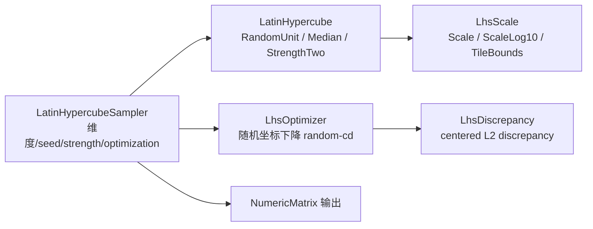

## 用户需求

在 `Math\Math.NET5.vbproj`（VB.NET，net10.0，根命名空间 `Microsoft.VisualBasic.Math`）的 `Math\Distributions\LHS\` 目录下，实现该目录 `readme.md` 描述的拉丁超立方采样（Latin Hypercube Sampling）方法。该目录目前仅有 readme.md，属全新实现。

## 功能内容

- **核心 LHS**：每维在 [0,1) 上均分 N 个等概率子区间，每格恰取一点（区间内随机抖动 `(π_j(i)+u)/N`），并对每维独立做随机置换，跨维随机配对，输出 N×d 样本；每列（轴）严格一格一点。
- **Median（中心化）LHS**：取区间中点 `(i+0.5)/N` 再随机置换，结果确定、均匀。
- **strength=2 LHS**：基于正交数组，使二维投影也近似均匀；要求 N = p²（p 为素数），非法 N 给出明确错误。
- **random-cd 优化**：通过随机坐标置换最小化 centered discrepancy，改善 2D/3D 投影空间填充度；优化后质量指标不得变差。
- **centered discrepancy 评估**：提供质量指标，越小越均匀，可对不同 seed 择优。
- **缩放**：`qmc.scale` 式线性缩放（逐维 lb/ub），以及论文的对数空间用法（log10 空间均匀采样后 `10^x`），并支持 `tile([-1,-3])` 这类循环边界模式。
- **固定 seed 可复现**：同 seed 结果逐位一致；报告采样方案与 seed。
- **门面 API**：SciPy 风格的采样器对象（维度 + seed + strength + optimization），`Random(n)` 返回 N×d 样本，可直接转 `NumericMatrix`。
- **自检**：在 `Math\test` 增加自检入口，覆盖分层性、复现性、strength=2 二维正交性、discrepancy 对拍、优化不劣化、缩放边界、异常分支与 10000×12 规模冒烟。

## 技术栈

- 语言/平台：VB.NET（net10.0），沿用工程现有 SDK 通配编译（`Compile Remove` 仅排除 LBFGSB\examples、packages、test\**），**新增 .vb 无需修改 vbproj**。
- 随机数：`System.Random`（局部实例 `New Random(seed)`）；不扩展 `RandomExtensions` 的 ThreadLocal 全局种子，以免污染全局流与破坏可复现性（ReadOnly 的 `seeds` 不可控）。
- 矩阵输出：复用 `Microsoft.VisualBasic.Math.LinearAlgebra.Matrix.NumericMatrix`（有 `Sub New(rows As IEnumerable(Of Double()))` 与 `Sub New(A As Double()(), Optional t As Boolean)`），样本按“行=样本、列=维度”直接构造；**不使用其 `*` 运算符**（逐元素乘法陷阱）。
- 无新增外部依赖。

## 实现方案

1. **核心生成（O(N·d) 时间/内存）**：先对每维生成 `0..N-1` 的 Fisher–Yates 随机置换 `π_j`，再逐行取 `x = (π_j(i) + u)/N`（Random LHS，`u∈[0,1)`）或 `x = (i + 0.5)/N`（Median LHS，仅在置换后的位置上取值，保证每格一点且结果可确定）。与 readme 的 Python 参考实现（`permuted(tile(arange(N)))+random()` 再除 N 转置）语义等价。
2. **strength=2（正交数组）**：校验 `N = p²` 且 p 为素数（整数平方根 + 试除），否则抛 `ArgumentException` 并给出“N 必须为素数平方”的明确信息。构造 p² 行的 OA：行索引 `(i,j) ∈ {0..p-1}²`，第 a 列取 `(a·i + j) mod p`（a = 0..p-1），另加一列 `(i + a·j)` 变体，最多 p+1 个互异列；每列各 p 个水平各出现 p 次，故把每个水平 ℓ 对应的 p 个槽位随机映射到 `{ℓp .. ℓp+p-1}` 即得 `0..N-1` 的置换，最后加抖动 `(value + u)/N`。二维投影在每个 p×p 粗格中恰有一点。d 大于 p+1 时循环复用列（仍保证一维完美分层，二维强度仅对互异列对成立），在 XML 注释中说明。
3. **centered L2 discrepancy（Hickernell）**：
CD² = (13/12)^d − (2/n)·Σ_i Π_k (1 + ½|x_ik−½| − ½|x_ik−½|²) + (1/n²)·Σ_{i,j} Π_k (1 + ½|x_ik−½| + ½|x_jk−½| − ½|x_ik−x_jk|)
全维精确实现为 O(n²·d)（用于质量报告，建议 n ≲ 5000）；同时提供按列投影重载（供优化器使用）。
4. **random-cd（随机坐标下降）**：对目标投影维度集合 S（默认前 2 维，等价 SciPy 的“提升 2D 投影”语义）预计算行核和 `R_i = Σ_j Π_{k∈S} g(x_ik,x_jk)`，初始化 O(n²·|S|)，总目标值 `Σ_i R_i` 与 term_b 同步维护；每次随机选取一列 k∈S 与两行 i1,i2 交换坐标，仅重算两行在 O(n·|S|) 内完成候选评分，仅当 CD 下降时接受；默认迭代 100 次。整体 O(n²·|S| + iters·n·|S|)，n=10000 时约 10⁸ 次乘法（亚秒到秒级），远优于每次全量 O(n²·d)。优化为启发式，不保证全局最优，但保证 CD 单调不增（自检可断言）。
5. **缩放**：`Scale(unit, lb, ub)` 逐维 `lb + u·(ub−lb)`；`ScaleLog10(unit, logLb, logUb)` 返回 `10^...`；`TileBounds(pattern, nDims)` 复现 `np.tile` 的循环填充（如 `{-1, -3}` 交替），并校验 lb 小于 ub、维度对齐。
6. **门面**：`LatinHypercubeSampler`（`New(nDims, Optional seed?)`，属性 `Strength`(1/2)、`Optimization`(None/RandomCD)、`CdIterations`、`ObjectiveDimensions`、`LastDiscrepancy`、`Dimensions`），`Random(n)` 用内部 `Random` 顺序推进（同一实例多次调用得到相互独立的新设计，并在注释中警告 readme 第 107 条“不要用同一批样本追加采样”），并提供 `RandomMatrix(n)` 返回 `NumericMatrix`。

## 实现要点

- **返回约定统一**：`Double()()` 外层为样本（N 行）、内层为维度（d 列），与 `NumericMatrix` 行语义一致；在 `NamespaceDoc` 中显式写明。
- **参数校验**：n ≥ 1、d ≥ 1，n 或 d 为 0/负数分别抛 `ArgumentOutOfRangeException`；strength=2 的非素数平方 N 抛 `ArgumentException`；lb ≥ ub 抛 `ArgumentException`。
- **可复现性**：所有公开入口同时提供 `Optional seed As Integer?` 与 `rng As Random` 重载；不读取全局 `Rnd`。
- **性能**：避免每次都分配 `0..N-1` 的临时数组堆积（复用单行缓冲 + 逐列置换）；`Double()()` 一次分配，不产生中间矩阵；不自造矩阵乘法。
- **文档**：工程开启 `GenerateDocumentationFile`，新增 Public 成员必须写 XML 注释（注释内不能出现连续双连字符）。
- **VB 语言陷阱**：局部变量不可与所在函数/属性同名（大小写不敏感，如函数 `Random` 内不要声明 `random`）；`Index/Step/Next/Call/Error/Failure` 等为关键字不可作标识符；Module 成员不能 `Shared`；`If(cond, arr, Nothing)` 需 `DirectCast`；为 `System.Math` 建立 `Imports std = System.Math` 别名（与既有文件风格一致），避免裸 `Math` 被命名空间遮蔽。
- **影响面控制**：仅新增 `Distributions\LHS\` 下的文件与 `Math\test\LhsSelfTest.vb`，并在 `ProgramMilp.Main` 追加一个 `Case "lhs"` 分支；不改动 `readme.md`、不改动既有 `Distributions` 类型、不改 `vbproj`。

## 架构设计

层次：纯函数核心（生成/度量/缩放）→ 有状态门面（采样器）→ 自检入口。核心模块无共享可变状态（除显式传入的 `Random`），可安全并行调用不同 seed 的采样器。



## 目录结构

```
Math/Math/Distributions/LHS/
├── NamespaceDoc.vb            # [NEW] 命名空间文档：Microsoft.VisualBasic.Math.Distributions.LHS，说明
│                              #       返回约定（行=样本/列=维度）、LHS 原理、seed 与“勿追加采样”注意事项
├── LatinHypercube.vb          # [NEW] 核心生成器（Public Module LatinHypercube）：
│                              #       RandomUnit(n,d,rng/seed)、Median(n,d,...)、StrengthTwo(n,d,...)、
│                              #       内部 Fisher-Yates 列置换、素数平方校验、IsPrime/IntegerSqrt 辅助
├── Discrepancy.vb             # [NEW] 度量（Public Module LhsDiscrepancy）：
│                              #       Centered(sample) 全维 O(n^2*d)、Centered(sample, dims) 投影重载、
│                              #       行核和/term_b 辅助（供优化器复用）
├── LhsOptimizer.vb            # [NEW] random-cd 随机坐标下降：增量维护 R_i 与总目标，仅接受下降；
│                              #       提供 Optimize(sample, rng, iterations, objectiveDimensions)
├── LhsScale.vb                # [NEW] 缩放工具（Public Module LhsScale）：Scale、ScaleLog10、TileBounds、
│                              #       边界校验与维度对齐检查
├── LatinHypercubeSampler.vb   # [NEW] 门面（Public Class LatinHypercubeSampler）：Dimensions/Strength/
│                              #       Optimization/RandomCD 迭代次数/LastDiscrepancy；Random(n) 与 RandomMatrix(n)
└── readme.md                  # 保留原样

Math/Math/test/
├── LhsSelfTest.vb             # [NEW] Public Module LhsSelfTest + RunAll() As Integer（PASS/FAIL 计数、退出码）
└── milp/ProgramMilp.vb        # [MODIFY] Select Case 中新增 Case "lhs" -> return LhsSelfTest.RunAll()
```

## 关键代码结构

```
' LatinHypercube.vb（签名级）
Public Module LatinHypercube
    Function RandomUnit(nSamples%, nDims%, rng As Random) As Double()()
    Function RandomUnit(nSamples%, nDims%, Optional seed As Integer? = Nothing) As Double()()
    Function Median(nSamples%, nDims%, rng As Random) As Double()()
    Function StrengthTwo(nSamples%, nDims%, rng As Random) As Double()()
End Module

' LatinHypercubeSampler.vb（属性契约）
Public Class LatinHypercubeSampler
    Sub New(nDims%, Optional seed As Integer? = Nothing)
    ReadOnly Property Dimensions As Integer
    Property Strength As Integer          ' 1 | 2
    Property Optimization As LhsOptimization  ' None | RandomCd
    Property CdIterations As Integer      ' 默认 100
    Property ObjectiveDimensions As Integer ' 默认 2
    ReadOnly Property LastDiscrepancy As Double
    Function Random(nSamples%) As Double()()
    Function RandomMatrix(nSamples%) As NumericMatrix
End Class
```