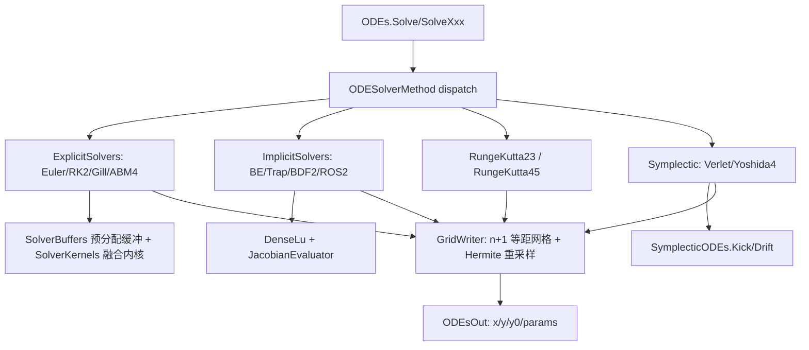

## 用户需求

在已完成算法修正与零分配内核重构的 `ODE/odes-netcore5.vbproj` 中，为**常微分方程组**路径（`ODEs` + `var` 状态变量）补充目前缺失的求解算法，使其从「只有 RK4 与 RK45」扩展为覆盖显式、隐式刚性、自适应与辛几何四大类的完整求解器集合。

## 产品概述

该工程提供两类能力：标量单方程求解（`ODE` + `df(x,y)` 委托）与方程组建模求解（继承 `ODEs`，用 `var` 字段声明状态量、`Double` 字段声明参数，输出 `ODEsOut` 的时间序列）。本轮只扩展方程组路径，但标量路径需要的共享基础设施（网格写入、显式阶段求值）保持复用不重复造。

## 核心功能

### 1. 显式固定步长系列（新增）

- **Euler**（1 阶，前向欧拉）
- **RK2 / Heun**（2 阶，改进欧拉）
- **Gill**（4 阶，4 阶段，舍入误差累积较小）
- **Adams-Bashforth-Moulton 4（ABM4）**：RK4 起步 3 步后进入 4 阶多步预测-校正，每步 2 次函数求值

### 2. 隐式刚性系列（新增）

- **后向 Euler（BDF1）**（1 阶，L-稳定，需 Newton 迭代）
- **梯形法 / Crank-Nicolson**（2 阶，A-稳定）
- **BDF2**（2 阶，刚性友好，首步用后向 Euler 起步）
- **Rosenbrock-ROS2**（2 阶段线性隐式，2 阶、L-稳定，每步一次 LU，无 Newton 迭代）

### 3. 自适应 RK23（新增）

Bogacki-Shampine 3(2)：4 阶段 + FSAL，每步 3 次新求值，比 RK45 更省函数求值，适合低频/粗略仿真；输出重采样到与 `Solve` 相同的 n+1 等距网格，并提供 `NumberOfSteps`/`NumberOfEvaluations` 诊断。

### 4. 辛几何算法（新增）

- **Störmer-Verlet**（2 阶，漂移-踢-漂移）
- **Yoshida 4 阶组合**（三次 Verlet 合成）
- 由于通用 ODE 没有天然的位置/动量分裂，提供显式契约 `SymplecticODEs`（`Kick`/`Drift` 两个用户重写），并明确其只适用于可分裂的哈密顿系统

### 5. 隐式方法的 Jacobian 策略

- 默认**自动中心差分**（零配置，步长 `δ = ε^(1/3)·max(1,|y_j|)`）
- 同时提供 `ODEs.Jacobian` 委托，可注入解析 Jacobian 以提升精度与性能
- 牛顿迭代采用修正 Newton（每步分解一次，必要时重算），失败时对当前步做内部二分细分（保持输出网格不变）

### 6. 统一调用入口

- `ODEs.Solve(n, a, b, method As ODESolverMethod, ...)` 统一分发
- `SolveEuler` / `SolveRK2` / `SolveGill` / `SolveABM4` / `SolveBackwardEuler` / `SolveTrapezoidal` / `SolveBDF2` / `SolveRosenbrockROS2` / `SolveRK23` / `SolveVerlet` / `SolveYoshida4` 便捷方法
- 所有入口返回与现有 `Solve` 完全同构的 `ODEsOut`（`x` 含 n+1 个点、`x(0)=a`、`x(n)=b`、`y` 为各状态变量列）

### 7. 验证交付

`_smoketest` 扩展：各方法的收敛阶（h 减半误差比）、刚性算例对照（显式发散 / 隐式稳定）、辛几何能量长期漂移、ABM4/BDF2 起步正确性、13 个 dispatch 枚举逐一断言、每种方法的耗时/分配/求值次数基准；`PASS: 0 failure(s)` 且退出码 0，Debug/Release 构建 0 警告 0 错误。

## 视觉与输出效果

无界面改动。`_smoketest` 控制台在原有分段输出后追加「显式求解器 / 隐式刚性求解器 / 自适应 RK23 / 辛几何 / 统一 dispatch / 方法基准」小节，逐项打印断言结果与基准表格，最后输出 `PASS: 0 failure(s)`。

## 技术栈

- 语言/框架：VB.NET，沿用 `odes-netcore5.vbproj`（net10.0，RootNamespace `Microsoft.VisualBasic.Math.Calculus`，AssemblyName `Microsoft.VisualBasic.Math.ODEsSolver`，`GenerateDocumentationFile=True` ⇒ 新增 Public 成员必须写 XML 注释）
- 依赖不新增：`Core.vbproj`（`Vector`/`ODESequence`/`Dictionary(Of T)`）、`Math.NET5.vbproj`
- 不引入 `Sundials.CVODE`（P/Invoke，需原生库）；新增求解器为**纯托管、无原生依赖**，README 中说明与 CVODE（变阶数 Adams/BDF）的分工

## 实现策略

### 1. 共享基础设施（先做，避免各求解器重复造轮子）

- **`GridWriter`（Friend）**：统一持有 `Points = ODESequence.CreatePoints(a,b,n)`（n+1 点）与 `Columns(size)(n)`；提供 `WriteInitial(y0)`、`Write(index,y)`、`WriteInterpolated(...)`、`WriteSpan(tPrev,yPrev,kPrev,tNew,yNew,kNew,h)`（用三次 Hermite 填充 `(tPrev,tNew]` 内的所有网格点，供 RK23/隐式步细分使用）。
- **扩展 `SolverBuffers`**（`Dynamics/SolverCore.vb`）：保留 `y/tmp/ynext/k(0..6)/vy/vtmp/vynext/vk` 不变（不改变 RK4/RK45 现有行为与分配量），新增**惰性**工作区 `EnsureHistory(count)` 返回环形导数历史、`EnsurePrevious()` 返回 `y_{n-1}`、`EnsureImplicit()` 返回 `J/lu/pivot/delta/rhs`（`Double(,)`、`Integer()`、`Double()`）。仅当隐式/多步/辛几何求解器构造时才分配。
- **`DenseLu`（Friend）**：原位部分主元 LU（`Factor(a As Double(,), pivot As Integer()) As Boolean`、`Solve(lu, pivot, rhs, x)`），预分配、0 分配；不依赖 `NumericMatrix`。
- **`JacobianEvaluator`（Friend）**：中心差商 `J(i,j) = (f_i(y+δ_j e_j) − f_i(y−δ_j e_j)) / (2δ_j)`，`δ_j = 6.055e-6·max(1,|y_j|)`；通过 `ODEs.Derivatives` 求值，复用预分配缓冲；若 `ODEs.Jacobian` 非空则直接调用它。
- **`ODESolverMethod`（Public Enum）**：`Euler, RK2, Gill, RK4, ABM4, BackwardEuler, Trapezoidal, BDF2, RosenbrockROS2, RK23, RK45, Verlet, Yoshida4`
- **`ODESolverOptions`（Public Class）**：`Atol/Rtol/InitialStep/MaxSteps`、`NewtonTolerance/MaxNewtonIterations`、`Jacobian`、`RefactorEachIteration`、`PositionIndices/MomentumIndices`。

### 2. 显式固定步长（`Dynamics/ExplicitSolvers.vb`）

所有类都：构造时 `New SolverBuffers(system.Size)`、`Solve(y0,n,a,b)` 返回自身、`Friend ReadOnly Property XValues/YValues`、结束时 `system.SyncState(y)`、每步设置 `system.CurrentStep`。

- `EulerSolver`：`y += h·f(t,y)`（1 次求值/步）
- `RungeKutta2`：`k1=f(t,y)`，`k2=f(t+h, y+h·k1)`，`y += h/2·(k1+k2)`（2 次/步）
- `GillSolver`（与标量 Gill 同系数）：`k2=f(t+h/2,y+h/2·k1)`；`k3=f(t+h/2, y+h[((√2−1)/2)k1+((2−√2)/2)k2])`；`k4=f(t+h, y+h[−(√2/2)k2+(1+√2/2)k3])`；`y += h/6·[k1+2(2−√2)k2+2(2+√2)k3+k4]`
- `AdamsBashforthMoulton4`：
- `n < 4` 时退化为 `RungeKutta4`
- 前 3 步用 RK4 起步并保存 `f_0..f_3`（环形缓冲）
- 预测 `y* = y + h/24(55f_n − 59f_{n−1} + 37f_{n−2} − 9f_{n−3})`
- 校正 `y' = y + h/24(9f(t+h,y*) + 19f_n − 5f_{n−1} + f_{n−2})`
- 校正后的导数作为新的 `f_{n+1}`（2 次求值/步）

### 3. 隐式刚性（`Dynamics/ImplicitSolvers.vb`）

共用抽象基类 `ImplicitSolverBase`（`Solve` 模板方法 + 牛顿迭代 + 步细分），子类仅提供「迭代矩阵与残差」：

| 方法 | 残差 G(y) | 迭代矩阵 W | 阶 |
| --- | --- | --- | --- |
| `BackwardEulerSolver` | `y − y_n − h·f(t+h,y)` | `I − hJ` | 1 |
| `TrapezoidalSolver` | `y − y_n − h/2·(f_n + f(t+h,y))` | `I − h/2·J` | 2 |
| `Bdf2Solver` | `1.5y − 2y_n + 0.5y_{n−1} − h·f(t+h,y)` | `1.5I − hJ` | 2 |
| `RosenbrockRos2Solver` | 见下（线性隐式，无 Newton） | `I − γhJ` | 2 |


- 牛顿：初值取显式 Euler 预测（`y_n + h f_n`）或上一步；`W Δ = −G`，`y ← y + Δ`；收敛判据 `‖Δ‖∞ ≤ NewtonTolerance·(1+‖y‖∞)` 且残差范数下降；`RefactorEachIteration=False` 时复用分解，残差停滞则重算 J/LU。
- 失败处理：当前步二分细分（最多 8 层，内部子步用同一方法），把最终状态写入该网格点；仍失败则抛 `InvalidOperationException`（提示刚性过强或减小步长），不静默返回 NaN。
- `Bdf2Solver` 首步用后向 Euler 起步，并保存 `y_{n−1}`。
- **`RosenbrockRos2Solver`（2 阶段、L-稳定、2 阶）**：
`γ = 1 + 1/√2`；`k1 = (I − γhJ)^{-1} h f_n`；`k2 = (I − γhJ)^{-1}[h f(y_n + a21 k1) + h J c21 k1]`；`y_{n+1} = y_n + b1 k1 + b2 k2`。
系数需满足三条可数值验证的条件：`b1+b2 = 1`（相容）、`b2·S = 1/2 − γ`（2 阶，`S = a21 + c21 + γ21`，`γ21` 为 Γ 的次对角元）、`R(∞) = 0`（L-稳定）。取 `b1=b2=1/2、a21=1、c21=0、γ21=1−2γ` 满足以上三式。
**验收门槛**：以标量问题 `y'=λy` 数值检查 `R(z)=y_1/y_0`，要求 `|R(z) − (1+z+z²/2)| < 1e-9`（z=−1e−3）、`|R(−1e8)| < 1e−6`；若不符必须调整系数直到通过（该断言写入 `_smoketest`）。

### 4. 自适应 RK23（`Dynamics/RungeKutta23.vb`）

Bogacki-Shampine 3(2)：`c = [0, 1/2, 3/4, 1]`；`a21 = 1/2`；`a32 = 3/4`；`a41 = 2/9, a42 = 1/3, a43 = 4/9`；`b3 = [2/9, 1/3, 4/9, 0]`；`b2 = [7/24, 1/4, 1/3, 1/8]`；FSAL（`k4 = f(t+h,y3)` 作为下一步 `k1`）。
误差 `err = RMS(|y3−y2| / (atol + rtol·max(|y|,|y3|)))`，步长因子 `0.9·err^(−1/3)` 限幅 `[0.2,5]`；与 `RungeKutta45` 一样用 `GridWriter.WriteSpan` 做 Hermite 重采样，并暴露 `NumberOfSteps`/`NumberOfEvaluations`。

### 5. 辛几何（`Dynamics/SymplecticODEs.vb` + `Dynamics/SymplecticSolvers.vb`）

- `Public MustInherit Class SymplecticODEs : Inherits ODEs`：
`Protected MustOverride Sub Kick(t, q() As Double, p() As Double, dp() As Double)`（`dp = F(q)`）
`Protected MustOverride Sub Drift(t, q() As Double, p() As Double, dq() As Double)`（`dq = G(p)`）
并**实现基类的 `func`**（按索引映射写 `dy`），使该模型同时可用于 RK4/RK45 与 dispatch。
索引映射：`Public Property PositionIndices/MomentumIndices As Integer()`，为 `Nothing` 时默认前半为 q、后半为 p（须为偶数维且等长，否则抛 `ArgumentException`）。
- `StormerVerletSolver`：`p += h/2·F(q)` → `q += h·G(p)` → `p += h/2·F(q)`
- `Yoshida4Solver`：`w1 = 1/(2 − 2^(1/3))`、`w0 = −2^(1/3)/(2 − 2^(1/3))`，按 `w1h, w0h, w1h` 三段组合 Verlet
- 对非 `SymplecticODEs` 模型调用 Verlet/Yoshida4 时抛 `InvalidOperationException`（明确提示）

### 6. `ODEs` 统一入口（`Dynamics/ODEs.vb`）

```
Public Property Jacobian As Action(Of Double, Double(), Double(,))

Public Function Solve(n As Integer, a As Double, b As Double, method As ODESolverMethod,
                      Optional incept As Boolean = False,
                      Optional options As ODESolverOptions = Nothing) As ODEsOut

Public Function SolveEuler(n As Integer, a As Double, b As Double, Optional incept As Boolean = False) As ODEsOut
' ... RK2 / Gill / ABM4 / BackwardEuler / Trapezoidal / BDF2 / RosenbrockROS2 / RK23 / Verlet / Yoshida4
```

`Solve(n,a,b,method,...)` 与现有 `Solve(n,a,b,Optional incept)` 通过第 4 参数类型（枚举 vs Boolean）区分，无二义性；内部 `Select Case` 构造求解器后统一走 `CreateOutput(Me, CreateY0Map(y0), solver.XValues, solver.YValues)`。

### 7. 架构与数据流



## 实施要点

- **不改变现有数值行为**：RK4/RK45 的缓冲结构与内核保持原样，`SolverBuffers` 的新增字段全部惰性分配；既有 78 条 `_smoketest` 断言必须继续通过。
- **性能**：新求解器同样走预分配缓冲 + 融合内核；显式方法的每步分配为 0，隐式方法只在构造时分配 `J/lu/pivot` 工作区（`O(N²)`，N 为状态变量数，生物动力学模型通常 N ≤ 50）。
- **数值稳健**：所有求解器在返回前检查 `NaN/Inf`，若出现则抛带时间点信息的异常，而不是把 NaN 写入结果列。
- **错误处理**：维度不匹配、`n < 1`、`b <= a`、Newton 不收敛、非辛模型调用辛求解器、奇数维辛分裂，都给出明确异常信息。
- **文档**：新增 Public 成员全部写 XML 注释（`GenerateDocumentationFile=True`，0 警告要求）；`README.md` 方法表补充「阶数 / 稳定性 / 是否自适应 / 每步函数求值 / 适用场景」，并说明隐式方法的 Jacobian 与辛几何的 `Kick/Drift` 契约。
- **VB 陷阱**：`Module` 成员不能 `Shared`；局部变量不得与类型/属性同名（`index/step/call/next/set/error/finished` 等）；`New T(6) {}` 是长度 7；`Partial Module` 上重复 XML 注释触发 BC42314；`If(cond, a, b)` 为短路三元。

## 目录结构

```
ODE/
├── Dynamics/
│   ├── SolverCore.vb                # [MODIFY] SolverBuffers 增加惰性工作区（历史/上一步/隐式 LU 与 J），Kernels 保持不变
│   ├── ODESolverMethod.vb           # [NEW] Public Enum ODESolverMethod + Public Class ODESolverOptions
│   ├── GridWriter.vb                # [NEW] Friend：n+1 网格、输出列、WriteInitial/Write/WriteSpan(Hermite)
│   ├── LinearAlgebra/DenseLu.vb     # [NEW] Friend：部分主元 LU 分解与回代（原位、预分配）
│   ├── Jacobian.vb                  # [NEW] Friend：中心差商 Jacobian（支持 ODEs.Jacobian 覆盖）
│   ├── ExplicitSolvers.vb           # [NEW] EulerSolver / RungeKutta2 / GillSolver / AdamsBashforthMoulton4
│   ├── ImplicitSolvers.vb           # [NEW] ImplicitSolverBase + BackwardEulerSolver / TrapezoidalSolver / Bdf2Solver / RosenbrockRos2Solver
│   ├── RungeKutta23.vb              # [NEW] Bogacki-Shampine 3(2) 自适应（FSAL、Hermite 重采样、步数/求值统计）
│   ├── SymplecticODEs.vb            # [NEW] MustInherit SymplecticODEs（Kick/Drift 契约 + func 适配 + q/p 索引）
│   ├── SymplecticSolvers.vb         # [NEW] StormerVerletSolver / Yoshida4Solver
│   └── ODEs.vb                      # [MODIFY] Jacobian 属性、Solve(method:=...)、11 个 SolveXxx 便捷方法
├── _smoketest/
│   ├── Program.vb                   # [MODIFY] Main 中注册新增用例
│   ├── SolverCases.vb               # [NEW] 收敛阶 / 刚性 / 能量 / 起步 / ROS2 稳定性函数 / dispatch 断言
│   └── Benchmark.vb                 # [MODIFY] 每方法耗时/分配/每步求值次数表格与断言
└── README.md                        # [MODIFY] 方法表（13 种）、隐式 Jacobian 与辛几何用法、自检命令
```

## 关键接口

```
' 统一分发与便捷入口
Public Function Solve(n As Integer, a As Double, b As Double, method As ODESolverMethod,
                      Optional incept As Boolean = False,
                      Optional options As ODESolverOptions = Nothing) As ODEsOut

' 可选解析 Jacobian（默认走中心差商）
Public Property Jacobian As Action(Of Double, Double(), Double(,))

' 辛几何契约
Public MustInherit Class SymplecticODEs : Inherits ODEs
    Protected MustOverride Sub Kick(t As Double, q As Double(), p As Double(), dp As Double())
    Protected MustOverride Sub Drift(t As Double, q As Double(), p As Double(), dq As Double())
End Class
```

## 验证方案

- **收敛阶**（`y'=-y`，n = 100/200/400 的误差比）：Euler ≈ 2、RK2 ≈ 4、Gill ≈ 16、ABM4 ≈ 16（n ≥ 4）；隐式组用 `y'=-5y`（n = 50/100/200）：后向 Euler ≈ 2、梯形 ≈ 4、BDF2 ≈ 4、ROS2 ≈ 4。
- **刚性对照**：`y' = -1e4(y − cos t) − sin t, y(0)=1`（解析解 `cos t`），[0,1]，n=200：RK4 显著发散（|y| 超出解析解 1e3 倍或 NaN），后向 Euler / 梯形 / BDF2 / ROS2 全部有限且误差分别 ≤ 2e-2 / 5e-4 / 5e-4 / 5e-4。
- **ROS2 稳定性函数**：标量 `y'=λy` 单步，`|R(z) − (1+z+z²/2)| < 1e-9`（z=−1e−3）、`|R(−1e8)| < 1e-6`。
- **辛几何**：[0,200] 简谐振子，n=40000：Verlet/Yoshida4 的能量漂移在 t∈[100,200] 区间不再增长（后/前半段漂移比 < 1.2）；Yoshida4 总漂移 < Verlet 的 1/100；均优于同 h 的 RK4。
- **起步正确性**：ABM4 与 n=1000 的 RK4 对拍 < 1e-8；BDF2 与梯形法对拍 < 1e-9，并验证 n=5 的小步数场景。
- **统一 dispatch**：13 个枚举逐一调用，断言 `x.Length=n+1`、`x(0)=a`、`x(n)=b`、列数=变量数、无 NaN；对普通模型调用 Verlet/Yoshida4 抛 `InvalidOperationException`。
- **基准**：logistic(1 var)/Lorenz(3 var)，n=24000，输出耗时、分配 MB、每步求值次数；断言所有新方法分配量 < legacy 实现的 1/4。
- **构建验收**：`odes-netcore5.vbproj` Debug/Release 均 0 警告 0 错误；`_smoketest` Release 运行 `PASS: 0 failure(s)`、退出码 0；下游 `ODESolver.Extensions`、`Bootstrapping`、`Visualization/test5` 编译通过。
- **引用影响面**：改动集中在新增文件与 `ODEs.vb` 的新增重载，使用语义分析核对 `Solve`/`CreateOutput`/`SyncState` 的调用方，确认无签名破坏。

## Agent Extensions

### SubAgent

- **code-explorer**
- Purpose: 实现前后核对 `SolverBuffers`/`SolverKernels`/`GridWriter` 的可用 API 与 `ODEs` 上现有成员（`Solve/SolveAdaptive/Derivatives/SyncState/CurrentStep/Size`），并盘点下游对 `ODEs`、`ODEsOut`、`RungeKutta4/45` 的调用点，确认新增重载不会产生二义性。
- Expected outcome: 一份「可安全调用的内部 API 清单 + 下游调用点清单」，作为重构无回归的依据。

### Skill

- **lsp-code-analysis**
- Purpose: 修改完成后用语义导航核对 `ODEs.Solve` 重载解析、`CreateOutput`、`SyncState`、`RungeKutta4.solverIteration` 的引用，确认没有遗漏调用方或重载冲突。
- Expected outcome: 引用清单与影响面报告，配合 `dotnet build` 0 警告 0 错误作为最终验收证据。