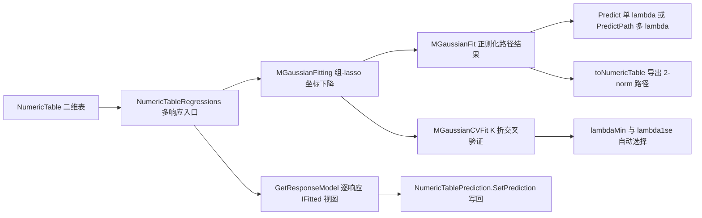

## 用户要求

基于 `DataFittings/MGaussian/readme.md` 的理论描述，在 `linear-netcore5.vbproj` 项目中实现「多响应高斯模型」（glmnet 的 `family="mgaussian"`）。范围确认为**路径 + 交叉验证**的完整档，交付形式为**全量交付**（算法库、结果模型、统一二维表入口、控制台测试报告、文档与包元数据更新）。绘图属于可视化，不在库实现范围内。

## 产品概述

新增一套面向「多个定量响应变量同时建模」的正则化线性回归能力：把 \(N \times K\) 响应矩阵与共享的特征矩阵联合拟合，通过组-lasso 惩罚让变量在全部响应上「同进同出」，产生一致的变量支持集；沿 λ 正则化路径给出每一步的系数矩阵与变量 2-norm 路径，并用 K 折交叉验证在 `mse` 或 `mae` 下自动选出 `lambda.min` 与 `lambda.1se`。对外以与现有回归工具一致的方式提供拟合、多 λ 预测、路径导出与结果查看。

## 核心功能

- **组-lasso 联合建模**：\(p \times K\) 系数矩阵，对变量系数向量施加 \(\ell_2\) 惩罚，变量级稀疏；支持 α 弹性网混合（α=1 组-lasso、α=0 岭型收缩）。
- **预处理与还原**：特征标准化、mgaussian 特有的 `standardize.response`、每响应独立且不惩罚的截距、可选逐样本权重；预测结果还原到原始量纲。
- **λ 正则化路径**：自动 λmax 与对数网格、warm start、每步 \((p+1)\times K\) 系数、变量 2-norm 路径、非零变量组数、训练 MSE、收敛状态与迭代数；允许自定义递减 λ 网格。
- **预测与导出**：单 λ 的 \(N \times K\) 预测、多 λ 的三维预测数组、路径导出为 `NumericTable`（含 λ、df、mse 等标签列）。
- **K 折交叉验证**：确定性分折、全响应合并的 `mse` / `mae`、`lambda.min` / `lambda.1se`、逐 λ 均值与标准误，并可用选中 λ 直接预测。
- **统一入口与测试报告**：缺省用二维表全部标签列作为多响应 Y（可指定列名子集）一键拟合或交叉验证；控制台自检覆盖稀疏同进同出、系数恢复、路径单调性、预测形状、CV 选 λ、异常输入与表入口联动，并生成审计报告。

## 技术栈选型

沿用现有工程，不引入新框架或第三方依赖：

- **语言与工程**：VB.NET，SDK-style `linear-netcore5.vbproj`，`net10.0`，RootNamespace `Microsoft.VisualBasic.Data.Bootstrapping`，新增子命名空间 `MGaussian`。SDK 默认 glob 自动编译 `MGaussian/*.vb`，无需改 Compile 项。
- **数值计算**：全部用 `Double()` / `Double()()` / `Double()()()` 手工数组运算，配合 `RectangularArray.Matrix(Of Double)(m, n)`（Core 工程，`Microsoft.VisualBasic.ComponentModel.Collection`）分配矩形缓冲区；`System.Math` 的 `Sqrt` / `Log` / `Exp`。**不使用 `NumericMatrix` 的 `*` 运算符**（既有注释确认它是逐元素乘法），也不需要 Cholesky 求逆，组-lasso 用坐标下降闭式更新即可。
- **复用既有契约与惯例**：`NumericTable`（`labels(sample)(label)` 行主序即天然 \(N \times K\) 响应矩阵，`labelNames` / `nlabels` / `GetLabel(idx)` / `SetLabel` / `Clone`）、`NumericTableRegressions` 私有 helper（`FeatureMatrix` / `FeatureNameList`），λ 路径与导出表惯例参照 `Ridge/RidgeFitting.vb`、`Ridge/RidgeFit.vb` 的 `toNumericTable()`，校验/中文 XML 文档/收敛标志风格参照上一轮的 `Poisson/PoissonFitting.vb`，坐标下降与 λ 网格常量参照 `LASSO/LassoFitGenerator.vb`。
- **测试**：`_smoketest` 控制台工程（已显式引用 Core.vbproj 与 linear 工程，无需改 vbproj），按用户规则使用 `Microsoft.VisualBasic.ApplicationServices.Debugging.DebugAudit`。

## 实现方案

**策略**：以块坐标下降（block coordinate descent）+ 组软阈值求解带组-lasso 惩罚的多响应最小二乘，沿递减 λ 网格 warm start 生成正则化路径；在全数据的统一 λ 网格上做 K 折交叉验证，按 glmnet 语义选 `lambda.min` / `lambda.1se`。

**关键决策与理由**：

- **求解器数学**：特征标准化使 \(\sum_i x_{ij}^2 = N\) 且各列中心化；响应中心化后截距等于各响应列均值且不参与惩罚。对每个变量 j，先移除其当前贡献得到残差矩阵 \(R_j\)，无惩罚解为 K 维向量 \(c_j = X_j^T R_j / N\)，更新为
\(\beta_j \leftarrow \frac{c_j}{1+\lambda(1-\alpha)} \max\left(0,\,1-\frac{\lambda\alpha}{\lVert c_j\rVert_2}\right)\)。
α=1 得到精确组稀疏，α=0 退化为岭型二次收缩（无精确零，需在文档写明）；该闭式更新避免矩阵分解，数值稳定且易于增量更新残差。
- **λ 路径**：\(\lambda_{max}=\max_j \lVert X_j^T Y/N\rVert_2/\alpha\)（α 趋近 0 时守卫为有限值），按 `lambda.min.ratio`（n ≥ p 取 1e-4，n < p 取 1e-2）在对数网格下降，默认 100 步；上一 λ 的系数作为下一步初值。允许传入自定义 `lambda()` 网格（严格递减、全为正）。每步保存 \((p+1)\times K\) 系数、p 维 `groupNorms`、非零变量组数 `df`、训练 MSE、迭代数与收敛标志。
- **不强行实现 `IFitted`**：其 `GetY(ParamArray x) As Double` 是单响应契约，多响应模型应提供自己的 `Predict` 与 `PredictPath`；如需写回二维表，提供 `GetResponseModel(k, lambdaIdx)` 逐响应视图（返回 `IFitted`），使 `NumericTablePrediction.SetPrediction` 仍可用，并在文档写明语义。
- **交叉验证**：确定性分折（固定种子置换），在全数据上生成一次统一 λ 网格，每折用训练子集拟合同一网格，在留出集上按全部响应合并计算 `mse` 或 `mae`；汇总每 λ 的均值与标准误，`lambda.min` 为均值最小处，`lambda.1se` 为满足 `mean ≤ mean(min) + se(min)` 的最大 λ。结果对象组合路径结果并加 `cvMean` / `cvSe` / `nfolds` / `measure` / `BestIndex` / `BestIndex1se`。
- **预处理一致性**：`standardize`（默认 True）保存 `featureMeans` / `featureScales`（常数列守卫 scale=1），`standardizeResponse`（默认 False）保存 `responseMeans` / `responseScales`，`weights` 在标准化、λmax、残差与损失中一致使用；系数对外一律还原为原始量纲，预测时把响应还原。

**性能与可靠性**：单轮坐标下降复杂度 \(O(n\cdot p\cdot K)\)，完整路径 \(O(L\cdot T\cdot n\cdot p\cdot K)\)（L 为 λ 步数、T 为内迭代轮数），CV 再乘 `nfolds`；瓶颈是残差矩阵遍历。缓解措施：预分配并复用残差/系数缓冲区、按 \(\Delta\beta_j\) 增量更新残差而不重算全模型、warm start 把 T 压到个位数、每折复用同一网格与缓冲区避免重建大矩阵、CV 折间不复制整份特征矩阵只按索引视图访问。空间复杂度 \(O(n\cdot K + L\cdot p\cdot K)\)。输入按 `RidgeFitting` / `PoissonFitting` 风格逐一校验（非空、行列数一致、全部有限、α ∈ [0,1]、nfolds ∈ [2,n]、L ≥ 2、tolerance > 0、λ 严格递减为正、名称长度匹配）；不收敛置 `Converged=False` 并暴露 `Iterations`，不静默返回。

**避免技术债**：路径网格、结果模型与导出表沿用 Ridge 已验证的 API 形态（`getCoefficients(idx)` / `toNumericTable()` / `lambdas` / `df`），模块结构与校验风格沿用 Poisson，不引入新的架构模式；新增代码仅限 `MGaussian/` 与一个测试文件。

## 实现注意事项

- **VB 大小写不敏感陷阱（上一轮实际踩过）**：局部变量 `X` 与参数 `x`、`A` 与循环变量 `a`、辅助函数 `Rates`/`Counts` 与同名局部变量都会触发 BC32000 / BC30734 / BC30616 / BC30311；命名须显式区分（如 `design`、`hessian`、`MakeRows`、`BuildResponse`）。
- **编译包含**：`MGaussian/*.vb` 由默认 glob 编译；测试代码只放在已被 `<Compile Remove="_smoketest\**" />` 排除的 `_smoketest` 目录，不改 Compile 项。
- **DebugAudit 用法**：断言一律用 `Test` / `Require` / `AreEqual` / `CheckThrows` / `Mark` / `Watch`（无 `Conditional`）；`Check` / `Snapshot` / `Capture` 带 `<Conditional("DEBUG")>`，Release 下被消除，不能用于断言。成功路径不写记录，报告只含 Mark / Watch / 失败事件；`Reset()` 清空全局状态后再 `MaxEvents=4096`，结束用 `SaveReport(path)` 生成 JSON 并以 `FailureCount` 设置 `Environment.ExitCode`（通过 `Run()` 返回值并入 `Program.vb` 的 `failures`）。
- **日志与进度**：算法内部不向 Console 写噪声；`Silent` 控制可选的进度输出，CV 的折循环也不逐折打印；异常信息须带维度与参数上下文且不含大块数据。
- **影响面控制**：不改动 Ridge / LASSO / Poisson / Logistic 既有算法，不改框架版本或配置节；`linear-netcore5.vbproj` 只改 `Description` / `PackageTags` / `PackageReleaseNotes`，`MGaussian/readme.md` 只在末尾追加使用章节并保留原有理论正文，`README.md` 只做增量补充。

## 架构设计

分层：数值求解器（组-lasso 坐标下降 + λ 路径）→ 路径结果模型（系数/预测/导出）→ 交叉验证层（复用求解器）→ 公共表入口（扩展方法）→ 测试与报告。数据流：



## 目录结构

汇总：在 `DataFittings/MGaussian/` 新建算法、结果模型与 CV 模块；在 `NumericTableRegressions.vb` 增加统一入口；复用 `_smoketest` 控制台工程新增 DebugAudit 自检；更新包元数据与文档。

```
DataFittings/
├── MGaussian/
│   ├── MGaussianFitting.vb       # [NEW] 核心求解器模块。实现 Fit(x,y,lambda,alpha,standardize,standardizeResponse,intercept,weights,numberOfLambdas,maxIterations,tolerance,featureNames,responseNames,Silent)；输入校验、中心化/标准化、lambdaMax 与对数网格、组软阈值块坐标下降、残差增量更新与 warm start、收敛判定、系数还原；返回 MGaussianFit。中文 XML 文档写明目标函数、alpha 语义、shared sparsity 与不做绘图。
│   ├── MGaussianFit.vb           # [NEW] 正则化路径结果模型。保存 lambdas、intercepts（每步 K 维）、coefficients（每步 p×K）、featureMeans/featureScales、responseMeans/responseScales、featureNames/responseNames、alpha、df、trainMse、groupNorms、converged、iterations；提供 getCoefficients(lambdaIdx) 返回 (p+1)×K、groupNorms(lambdaIdx)、Predict(newx, lambdaIdx) 返回 N×K、PredictPath(newx, lambdaIdx()) 返回三维数组、GetResponseModel(k, lambdaIdx) 返回 IFitted 逐响应视图、toNumericTable() 导出 2-norm 路径与 lambda/df/mse 标签列、ToString()。不实现 IFitted。
│   ├── MGaussianCVFit.vb         # [NEW] 交叉验证结果模型，组合 MGaussianFit（完整数据上的最终路径）并保存 nfolds、measure、cvMean、cvSe、lambdaMin、lambda1se、BestIndex、BestIndex1se、foldId；提供用选中 lambda 预测与 toNumericTable() 导出 CV 曲线。
│   ├── MGaussianCV.vb            # [NEW] K 折交叉验证模块。确定性分折、全数据统一 lambda 网格、逐折复用求解器拟合、留出集按全部响应合并计算 mse 或 mae、汇总均值/标准误、按 glmnet 语义选 lambdaMin 与 lambda1se；复用缓冲区与 warm start 控制 nfolds×L 的计算量；返回 MGaussianCVFit。
│   ├── MGaussianResponseModel.vb # [NEW] 逐响应 IFitted 视图：把某一响应、某一 lambda 的 (截距, 系数) 包装成轻量模型，实现 R2/Polynomial/ErrorTest/GetY，使既有 NumericTablePrediction 写回链路可用。
│   ├── NamespaceDoc.vb           # [NEW] MGaussian 命名空间级 XML 注释，说明多任务学习适用范围、组-lasso 与 IFitted 的单响应/多响应差异、不覆盖绘图与扩展模型。
│   └── readme.md                 # [MODIFY] 仅在末尾追加「本库实现与调用示例（VB.NET）」小节（表入口、CV、多 lambda 预测、2-norm 路径、standardize.response 解读），保留原有理论正文不变。
├── NumericTableRegressions.vb    # [MODIFY] 新增 Imports 别名 MGaussianNS；新增私有 helper ResponseMatrix(table, y, caller) 取全部或指定标签列构造 N×K 响应矩阵；新增 Region "multi-response regression" 含两个 Extension 方法 MGaussianRegression(...) 与 MGaussianCV(...)，复用 FeatureMatrix/FeatureNameList；模块级 XML 文档补一条多响应输入约定。
├── linear-netcore5.vbproj        # [MODIFY] 仅 Description / PackageTags / PackageReleaseNotes 追加 mgaussian 多响应组-lasso 与交叉验证说明；其余配置不动。
├── README.md                     # [MODIFY] 引言项目列表、核心能力表增加 ...Data.Bootstrapping.MGaussian 行，快速上手增加拟合与 CV 的 vbnet 示例，实现要点补充组-lasso 同进同出、standardize.response、三维预测与 lambda.min/1se 说明。
└── _smoketest/
    ├── MGaussianAudit.vb         # [NEW] DebugAudit 控制台自检模块（Public Module + Run() As Integer，不定义 Sub Main）。覆盖共享支持集稀疏、小 lambda 系数恢复、alpha=0 与 0.95、standardize.response 量纲、路径 df/MSE 单调性、warm start 迭代数、预测形状与路径导出、CV 选 lambda 与 mse/mae 切换、非法输入异常、表入口与逐响应写回联动；SaveReport 生成 mgaussian-test-report.json。
    └── Program.vb                # [MODIFY] 在 Main 中新增 Section("mgaussian audit") 与 failures += MGaussianAudit.Run()，保留既有冒烟测试与既有审计调用。
```

## 关键代码结构（接口级签名，不含实现）

求解器对外唯一入口，供路径、CV 与表入口共用：

```
Public Function Fit(x As Double()(),
                    y As Double()(),
                    Optional lambda As Double() = Nothing,
                    Optional alpha As Double = 1.0,
                    Optional numberOfLambdas As Integer = 100,
                    Optional standardize As Boolean = True,
                    Optional standardizeResponse As Boolean = False,
                    Optional intercept As Boolean = True,
                    Optional weights As Double() = Nothing,
                    Optional maxIterations As Integer = 1000,
                    Optional tolerance As Double = 0.000001,
                    Optional featureNames As String() = Nothing,
                    Optional responseNames As String() = Nothing,
                    Optional Silent As Boolean = False) As MGaussianFit
```

路径结果模型被表入口、CV 与预测写回共同依赖的公开契约：

```
Public Class MGaussianFit
    Public ReadOnly Property lambdas As Double()
    Public Function getCoefficients(lambdaIdx As Integer) As Double()()   ' (p+1) x K
    Public Function groupNorms(lambdaIdx As Integer) As Double()          ' p 维 2-norm
    Public Function Predict(newx As Double()(), Optional lambdaIdx As Integer = -1) As Double()()
    Public Function PredictPath(newx As Double()(), lambdaIdx As Integer()) As Double()()()
    Public Function GetResponseModel(k As Integer, lambdaIdx As Integer) As IFitted
    Public Function toNumericTable() As NumericTable
End Class
```

交叉验证入口与选中结果：

```
Public Function CrossValidate(x As Double()(), y As Double()(),
                              Optional nfolds As Integer = 10,
                              Optional measure As CVMeasure = CVMeasure.Mse,
                              Optional seed As Integer = 1,
                              ...与 Fit 相同的可选参数...) As MGaussianCVFit

Public Enum CVMeasure
    Mse
    Mae
End Enum
```

## Agent Extensions

### SubAgent

- **code-explorer**
- Purpose: 编码前一次性核实跨工程事实：`RectangularArray.Matrix(Of Double)`、`NumericTable.GetLabel(idx)` / `labels` 布局与 `SetLabel`、`RidgeFit.toNumericTable()` 的标签列写法、`DebugAudit` 的 `Test`/`AreEqual`/`CheckThrows`/`Watch`/`SaveReport` 精确签名，以及 `MGaussian` 命名空间/类型名是否与现有类型冲突。
- Expected outcome: 给出可引用的确切命名空间、API 清单与证据行号，确认数组手算方案无需新增依赖、测试工程引用链成立，避免 VB 大小写不敏感与 API 误用导致的编译期返工。